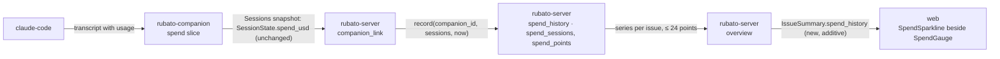

# Design: spend history per issue as a sparkline (#103)

Plan: [../103.md](../103.md) · ADR 0037 (*proposed*). Follow-up 1 of #81 (design note §9: "needs a
spend history in the overview or an endpoint; today `spend_usd` is a snapshot").

## Where it sits on the map



Seams touched: `web-server` (a new field on the overview, a schema change) and `companion-server`
(read for a new purpose; the wire does not change). `rubato-companion` is quiet.

## 1. Where spend comes from today

1. **Companion, after every hook.** The dispatch loop forwards the hook, then calls
   `spend::after_hook` (`crates/rubato-companion/src/runtime.rs:248-249`). That sums the session's
   whole transcript against the configured pricing off the async thread and stores the total on
   the registry entry (`crates/rubato-companion/src/spend/arm.rs:26-30`,
   `spend/apply.rs:6-9`). With no pricing configured it returns early and spend stays `None`
   (`spend/arm.rs:22-24`). The total is cumulative for the session: a transcript only grows.
2. **Companion → server.** `spend_usd` rides on each `SessionState` in a `Sessions` snapshot
   (`crates/rubato-companion/src/sessions/registry.rs:135`;
   `crates/rubato-protocol/src/session.rs:113-115`). A snapshot is sent on every hook, *before* the
   spend step runs (`hooks/arm.rs:63-75`), so a hook's snapshot carries the previous hook's spend;
   the reconcile loop sends again whenever the snapshot changed (`sessions/tasks.rs:90-96`), which
   carries the new value within one `team_poll_interval_secs`. Ended sessions are swept from the
   registry 300 s after they end (`sessions/tasks.rs:82`, `sessions/discovery.rs:180-183`) and so
   leave the snapshot.
3. **Server.** The companion socket's `Sessions` arm replaces that companion's one row in
   `session_snapshots` (`crates/rubato-server/src/companion_link/ws.rs:241-251`,
   `companion_link/store.rs:32-41`). Replays are recognised before any arm runs: `record_event`
   answers false for a seen `(companion_id, seq)` and the envelope is only acked
   (`ws.rs:175-179`).
4. **Overview.** `build_overview_inputs` reads every snapshot (`overview/inputs.rs:11`) and
   `build` sums the issue's live sessions' `spend_usd` (`overview/build.rs:250-257`) into
   `IssueSummary.spend_usd` (`build.rs:287`, `crates/rubato-protocol/src/progress.rs:183-185`).
5. **Web.** The issue panel draws `SpendGauge` in `.instruments` next to the stage rail
   (`web/src/features/issues/IssuePanel.tsx:79-82`); the gauge renders nothing without a cap
   (`web/src/features/issues/visuals.tsx:61-65`).

So the server has the right signal, at the right moment, and throws the previous value away.
History belongs where the snapshot lands: on the server, next to `companion_link`.

## 2. Storage: slice `spend_history` (ADR 0037)

A new server slice, `crates/rubato-server/src/spend_history/`, owns two tables (one migration,
additive, next free number when PR 1 lands):

```sql
-- The latest spend per session, with its issue. Owner: spend_history.
CREATE TABLE spend_sessions (
    companion_id TEXT NOT NULL,         -- the pairing the snapshot came on, not a claim in it
    session_id   TEXT NOT NULL,
    repo         TEXT NOT NULL,
    number       INTEGER NOT NULL,
    usd          REAL NOT NULL,
    at           TEXT NOT NULL,         -- when the snapshot carrying it was received
    PRIMARY KEY (companion_id, session_id)
);
CREATE INDEX spend_sessions_issue ON spend_sessions (repo, number);

-- Per issue and 15-minute bucket, the issue's total over every session it has had.
CREATE TABLE spend_points (
    repo   TEXT NOT NULL,
    number INTEGER NOT NULL,
    bucket TEXT NOT NULL,               -- received time floored to 15 minutes, RFC 3339
    usd    REAL NOT NULL,
    at     TEXT NOT NULL,               -- the receipt time of the last write into the bucket
    PRIMARY KEY (repo, number, bucket)
);
```

`spend_history::record(db, companion_id, sessions, now)` runs after `store_snapshot` in the
`Sessions` arm. For every session with a `session_id`, an `issue` and a finite, non-negative `spend_usd`:

1. Upsert `spend_sessions` with `ON CONFLICT(companion_id, session_id) DO UPDATE SET usd, at
   WHERE excluded.usd <> usd AND excluded.at >= at`. Zero rows affected means unchanged (or
   older): count `unchanged`, stop. The issue is not updated on conflict: a session keeps the
   issue it was first recorded under (plan A9).
2. Otherwise write the issue's point in one statement, so the total is read and written
   atomically:
   `INSERT INTO spend_points (repo, number, bucket, usd, at) SELECT ?, ?, ?, SUM(usd), ? FROM
   spend_sessions WHERE repo = ? AND number = ? ON CONFLICT(repo, number, bucket) DO UPDATE SET
   usd = excluded.usd, at = excluded.at WHERE excluded.at >= at`. Count `stored`.

A session that is not finite or negative is skipped and counted `rejected`. Sessions without an
issue (branch outside the convention) are not recorded: there is no issue to draw them on.

**Whose rows.** The key starts with the companion id of the pairing the envelope arrived on
(`pairing.companion_id`, `ws.rs:159`), not the `companion_id` inside `SessionState`, so one
companion cannot overwrite another companion's session row by sending its session id.

**Why two tables.** The issue's total must survive a session leaving the snapshot (§1.2), so the
latest value per session is kept, and each point is the sum over them. Bucketing bounds rows to
one per active 15 minutes per issue whatever the hook rate; the last write into a bucket wins, so
the newest point is always current.

**Concurrency.** Two companions may send snapshots for one issue at once (separate socket tasks,
pool of 8, `kernel/db.rs:16`). Each writer upserts its own session row before it writes the
point, and the point statement sums at execution time, so whichever point statement runs last
sees both sessions: both orders end at the right total. A replay never reaches `record`
(`ws.rs:175-179`); a reconnect that resends an older snapshot under a new sequence is stopped by
the `excluded.at >= at` guards. Test: two snapshots for one issue joined concurrently, 50 times,
end with the sum of both.

**Failure.** `record` returns a `Result`; the arm passes it to the existing `observe` helper
(`ws.rs:47-53`) as write `record_spend`, so a failure logs `companion bookkeeping write failed`
at `error` with companion id and seq, and the envelope is still acked. Spend history is never
worth dropping a snapshot for.

**Retention.** None in v0 (assumption A4 in the plan): one team, a handful of issues; at a heavy
day of 8 active hours that is 32 rows per issue.

## 3. The wire: `IssueSummary.spend_history` (ADR 0037)

In `crates/rubato-protocol/src/progress.rs`, next to `spend_usd`:

```rust
/// One point of an issue's spend over time: the total over every session it has had (ADR 0037).
pub struct SpendPoint { pub at: DateTime<Utc>, pub usd: f64 }

// IssueSummary
/// Spend over time, oldest first, at most 24 points. Not an input to progress.
#[serde(default, skip_serializing_if = "Vec::is_empty")]
pub spend_history: Vec<SpendPoint>,
```

Additive: an older payload without the field deserialises to empty, and an empty history is not
serialised, so the overview of an issue with no spend is byte-for-byte today's. `spend_usd`
keeps its meaning (plan Q2). `schema/protocol/issue_summary.schema.json` and
`overview.schema.json` regenerate; `web/src/protocol.ts` regenerates (`pnpm gen:types`, checked by
`.github/workflows/ci.yml:69`). `SpendPoint` is re-exported at the crate root like every type.

**Siblings.** #104, #105 and #106 are planned in parallel. #105 and #106 also add fields on the
overview (the stale threshold; the stage a blocked issue left from), and #104 adds an observed
traffic summary. Each change is an additive field with `serde(default)`, so they merge in any
order; the only conflict is textual in the generated schema and `protocol.ts`, solved by
regenerating after a rebase. No field is renamed or retyped.

## 4. Reading: `spend_history::series`

`overview/inputs.rs` gains `spend: spend_history::series(&app.db).await?`, one query:
`SELECT repo, number, bucket, usd FROM spend_points ORDER BY repo, number, bucket`. It groups by
issue and downsamples each series to at most 24 points with a pure function,
`downsample(points, 24)`: a series of 24 or fewer is returned as is; a longer one keeps the first
and the last point and, between them, the last point of each of 22 equal time spans that has one.
A non-decreasing input stays non-decreasing. `build` copies the series onto the issue's summary;
nothing else reads it. `overview` names `spend_history` at its root only; `spend_history` names
no slice; `companion_link` names `spend_history::record`. The slice graph stays acyclic.

## 5. The web: `SpendSparkline`

`web/src/features/issues/visuals.tsx` gains `SpendSparkline({ points })`, drawn in `.instruments`
right of `SpendGauge`:

- Fewer than two points: renders nothing (the issue's criterion: one sample shows none).
- Otherwise an inline SVG, 96 × 32, a polyline scaled to the series' own min and max (a flat
  series draws a flat line at mid-height), a dot on the last point, and the last value as text
  beneath in the mono face: `$8.40 all sessions`. It is drawn whether or not the plan has a cap,
  so an issue with no cap still shows its history.
- `role="img"` with `aria-label="spend over time, $1.20 to $8.40 across 6 points"`.
- Static: no animation or transition, so the motion switch and reduced-motion e2e need nothing.
- Stroke in the `--accent` role base, which `styles.test.ts` already checks at 3:1 on `--panel` in
  both schemes (`NON_TEXT`, `web/src/styles.test.ts:84`); the value text in `--muted` on
  `--panel`, a pair the contrast test already covers.

The line's last point can be higher than the gauge's value once a session has ended (§1.2: the
gauge sums live sessions, the line every session). The text under the line says "all sessions" so
the two numbers do not read as a contradiction. Changing the gauge to the cumulative figure is
plan Q2 (c).

## 6. Telemetry

- Metric `rubato.spend.points` (counter), by `rubato.outcome`: `stored`, `unchanged`, `rejected`,
  `failed`. New in `crates/rubato-protocol/src/otel.rs` `metric`. Info-level not applicable
  (a metric); the failure log is `error`.
- Log `companion bookkeeping write failed` with `write=record_spend` (existing line, new write
  name).
- Dashboard panel "Spend history writes" (`sum by (rubato_outcome)
  (increase(rubato_spend_points_total[1h]))`) next to "Cost per issue" in the "Cost is a signal"
  row of `observability/dashboards/rubato-overview.json`, with "Sessions by state" `working`
  overlaid so a flat `stored` line while sessions work is visible.
- No alert: none of the never-silent list changes. A flat history is visible on the panel and on
  the sparkline itself.

## 7. What must hold

- The gauge, its tones and its label (`web/src/features/issues/visuals.test.tsx:56-72`).
- `spend_usd` as the sum over live sessions (`overview/build.rs:673`, test
  `working_session_with_plan_is_building_and_spend_sums`).
- The replay rule (ADR 0012): `record` runs after the replay check, never on a replayed envelope.
- Progress is derived: `derive_progress` and its tests do not see spend history.
- The slice layout: `spend_history` added to `crates/rubato-server/src/slices.rs` `SLICES` and to
  the AGENTS.md server block with its two tables; the protocol block's `progress` line names
  `SpendPoint`.
- The issue panel at 900 px (`.instruments` already wraps, `web/src/styles.css:465`) and the
  `issue-panel` screenshots.

## 8. Failure

| Fails | Seen as | Signal |
| --- | --- | --- |
| Companion has no pricing configured | no history, no gauge value | `stored` stays 0 while `working` > 0 on the panel |
| A write fails (disk full, migration missing) | history stops; envelope still acked | `rubato.spend.points{failed}`; log `companion bookkeeping write failed` `write=record_spend` |
| A buggy companion sends NaN or negative spend | that sample is skipped | `rubato.spend.points{rejected}` |
| A reconnect resends an old snapshot | nothing changes | `unchanged` rises; the guards hold |
| The web is older than the server | no sparkline, nothing else changes | additive field; `protocol.ts` diff in CI |
