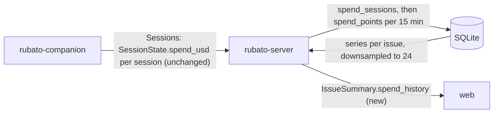

# Spend history per issue as a sparkline

Issue: #103 · Design: [103-spend-sparkline/design.md](103-spend-sparkline/design.md) · ADR 0037
(*proposed*) · Map: seam `web-server`.

Track: **full**, because `IssueSummary` in `crates/rubato-protocol` gains a field, which changes
`schema/protocol/*.json`.

Issue #103, follow-up 1 of #81 (design note §9): "Show each issue's spend over time as a sparkline
beside the spend gauge." The overview carries only today's `spend_usd`, a sum over the sessions
the companions report right now; the server keeps no earlier value (design §1). This change has
the server remember spend per issue as it arrives on the companion socket, carries a short
history per issue in the overview, and draws it next to the gauge from #81.

## What the change does

- **The server remembers spend.** Each `Sessions` snapshot a companion sends updates the latest
  spend of every session tied to an issue, and the issue's total over every session it has had is
  kept per 15-minute bucket (new slice `spend_history`, design §2). A replayed or older snapshot
  never lowers a stored value.
- **The overview carries it.** Each issue's summary has `spend_history`: up to 24 points
  (`at`, `usd`), oldest first, over the issue's recorded life; absent when there is none. Additive:
  `spend_usd` and every other field are unchanged (design §3).
- **The issue panel draws it.** A sparkline beside the spend gauge, with its last value labelled
  "all sessions"; it shows with or without a cap, and not at all with fewer than two points
  (design §5).

## How we'll know it works

- [ ] **Rising line** (issue criterion): an integration test sends three `Sessions` snapshots over the companion websocket for one issue at three receipt times 20 minutes apart (injected clock), spend 1.0, 2.5, 4.0; `GET /api/overview` returns `spend_history` with three points, rising, ending at 4.0. Must fail: with the point written per session instead of summed, a second session on the issue makes the test's two-session variant end at the wrong total.
- [ ] **One sample shows none** (issue criterion): a Vitest renders `SpendSparkline` with 0 and 1 points (nothing in the DOM) and with 3 rising points (a polyline whose last y is above its first, the label `spend over time, $1.00 to $4.00 across 3 points`, and the text `$4.00 all sessions`); it renders with `cap` absent.
- [ ] **Store rules** (server unit tests on an in-memory database, `spend_history`): the same snapshot twice stores one row and counts `unchanged`; two sessions on one issue sum; a session that leaves the snapshot keeps its share of the total; an older snapshot after a newer one changes nothing; NaN and negative spend are skipped and counted `rejected`; a snapshot on companion B naming companion A's session id writes B's own row and leaves A's untouched; a session without an issue is not recorded; two snapshots for one issue written concurrently (`tokio::join!`, 50 rounds) end at the sum of both.
- [ ] **Downsampling** (unit test): 100 points become 24 with the first and last kept, a non-decreasing series stays non-decreasing, 24 or fewer come back unchanged.
- [ ] **Replays** (integration): an envelope replayed with a seen sequence adds no row and no count.
- [ ] **A failed write is logged, not fatal** (integration): with `spend_points` dropped in the test database, a `Sessions` snapshot is still acked and stored in `session_snapshots`, and `companion bookkeeping write failed` with `write=record_spend` is captured at `error`; `rubato.spend.points{rubato.outcome=failed}` is 1.
- [ ] **Additive wire** (protocol unit test): an `IssueSummary` JSON without `spend_history` deserialises with an empty history, and an empty history is not serialised.
- [ ] **In the panel**: `issue-panel.test.tsx` finds the sparkline inside `.instruments` after the gauge for an issue with history; the `issue-panel` screenshots (`web/e2e/shots.spec.ts`) show it, dark and light, at 1600 and 900 wide.

## What it must not break

- **The spend gauge and its tones** (calm, near, over), its label and its absence without a cap: `web/src/features/issues/visuals.test.tsx:56-72`, unchanged.
- **The `web-server` overview contract, additive only**: no field renamed, retyped or removed; `spend_usd` still the sum over live sessions (`overview/build.rs:673`, `working_session_with_plan_is_building_and_spend_sums`); the additive-wire test above; `protocol.ts` regenerated and diffed in CI (`.github/workflows/ci.yml:69`). **Sibling plans** #104, #105 and #106 are written in parallel; #105 and #106 also add fields on the overview (and #104 an observed-traffic summary), so each is an additive field with `serde(default)` and they merge in any order; after a rebase the generated schema and `protocol.ts` are regenerated, never hand-merged.
- **Replay and acks on the companion socket** (ADR 0012): `record` runs only after the replay check (`companion_link/ws.rs:175-179`) and its failure never withholds the ack (failed-write test above; existing `a_failed_bookkeeping_write_is_logged_with_companion_and_seq`).
- **Progress is derived, never stored**: spend history is not an input to `derive_progress`; its tests in `crates/rubato-protocol/src/progress.rs` and `overview/build.rs` run unchanged.
- **The slice layout**: `crates/rubato-server/src/slices.rs` and the AGENTS.md server block gain `spend_history` with its two tables; the slice test checks they match.
- **Contrast and motion**: the sparkline is static and uses tokens the contrast test already checks (`--accent` as a non-text base, `--muted` on `--panel`); `styles.test.ts` and the reduced-motion e2e run unchanged; the 900 px e2e still passes with the panel open.

## How we'll debug it at 3 am

See the O-rows. New: counter `rubato.spend.points` by `rubato.outcome` (`stored`, `unchanged`,
`rejected`, `failed`) in `otel.rs`; dashboard panel "Spend history writes" in the "Cost is a
signal" row, with working sessions overlaid; the existing log `companion bookkeeping write failed`
gains the write name `record_spend`. No new finding and no alert (design §6, §8).

## Affected parts

| Node | Status | What changes | Seams |
| --- | --- | --- | --- |
| rubato-protocol | affected | `SpendPoint`; `IssueSummary.spend_history`; metric name `rubato.spend.points`; schema regenerated | web-server |
| rubato-server | affected | slice `spend_history` (tables `spend_sessions`, `spend_points`, `record`, `series`, `downsample`); `companion_link` records after each snapshot; `overview` fills the field; dashboard panel | web-server, companion-server |
| web | affected | `SpendSparkline` beside `SpendGauge` in the issue panel; `protocol.ts` regenerated | web-server |
| rubato-companion | quiet | sends `SessionState.spend_usd` as today; no change | companion-server |

## Data models

| Model | Kind | Part | Change | Crosses | Note |
| --- | --- | --- | --- | --- | --- |
| `SpendPoint`, `IssueSummary.spend_history` | type | rubato-protocol | new | web-server | at most 24 points per issue, oldest first; omitted when empty |
| `issue_summary.schema.json`, `overview.schema.json` | schema | rubato-protocol | changed | web-server | additive; regenerated |
| `spend_sessions` | table | rubato-server | new | | owned by `spend_history`; key (companion id of the pairing, session id); latest spend, with its issue |
| `spend_points` | table | rubato-server | new | | owned by `spend_history`; key (repo, number, 15-minute bucket); the issue's total |
| `rubato.spend.points` | event | rubato-server | new | | counter by `rubato.outcome` |

## Data flow

## Tasks

- [ ] **PR 0** `issue/103-spend-sparkline`: this plan, the design note, ADR 0037 (*proposed*), pinned; `plan.ts check` clean; design review posted as `Review:` on #103; a person's `Approved:` and the ADR's acceptance before PR 1 merges.
- [ ] **PR 1** `issue/103-spend-history-server`: failing first: the additive-wire protocol test (no `spend_history` field yet); the `spend_history` store tests (unchanged, sum, swept session, older snapshot, rejected, no issue, concurrent 50 rounds) and the downsampling test against an empty slice; the integration tests for the rising line and its two-session must-fail variant, the replay and the failed write (all fail: no field, no table). Then `SpendPoint` and `IssueSummary.spend_history` in `progress.rs`, `rubato.spend.points` in `otel.rs`, the migration (next free number), slice `spend_history` (`record`, `series`, `downsample`), the call in the `Sessions` arm through `observe("record_spend", …)`, `overview/inputs.rs` and `build.rs`; `slices.rs` and the AGENTS.md server and protocol blocks; regenerated `schema/protocol/` and `web/src/protocol.ts`; the dashboard panel "Spend history writes".
- [ ] **PR 2** `issue/103-spend-sparkline-web`: failing first: the `SpendSparkline` Vitest (0, 1, 3 points; label; no cap) and the `issue-panel.test.tsx` placement case. Then `SpendSparkline` in `features/issues/visuals.tsx`, its place in `.instruments`, its CSS on existing tokens; the seeded e2e data gets a spend history for the `issue-panel` shots; before and after screenshots in the PR description.

## Assumed, not yet approved

| # | Decision | Chosen | Alternatives | Scope |
| --- | --- | --- | --- | --- |
| Q1 | How does the history reach the web? | (a) **recommended**: a field on the overview, `IssueSummary.spend_history`, at most 24 points per issue; ADR 0037 as drafted | (b) a new endpoint `GET /api/issues/{owner}/{repo}/{n}/spend`, read when the issue panel opens; (c) both: a short series in the overview and the full one on the endpoint | seam (web-server): (a) answered by Mattias Jonsson, 2026-11-13 |
| Q2 | What does a point on the line mean? | (a) **recommended**: the issue's total over every session it has had, ended ones included; `spend_usd` unchanged, so after a session ends the line can end above the gauge, and the line's label says "all sessions" | (b) the same as `spend_usd`, the sum over live sessions at that time, so the line drops when a session is swept; (c) the cumulative total, and `spend_usd` changes to it too, so gauge and line agree (changes an existing field's meaning: not additive) | seam (web-server): (a) answered by Mattias Jonsson, 2026-11-13 |
| A3 | Bucket width and number of points | 15-minute buckets stored; at most 24 points sent, first and last kept | 5-minute buckets; 48 points | node (rubato-server) |
| A4 | Retention | none in v0; rows grow per active 15 minutes per issue (32 on a heavy day) | prune points of Done issues after 90 days, keeping each session's latest row | node (rubato-server) |
| A5 | Which slice owns the tables | a new slice `spend_history`, called by `companion_link` and read by `overview` | keep them in `companion_link` next to `session_snapshots` | node (rubato-server) |
| A6 | Sessions without an issue | not recorded | record them under their repo | node (rubato-server) |
| A7 | Migration number | the next free number when PR 1 lands (#82 and the sibling plans also add migrations) | reserve one now | node (rubato-server) |
| A8 | Sparkline scale | the series' own min to max; flat series at mid-height; drawn with or without a cap | scale from 0 to the cap | node (web) |
| A9 | A session whose issue changes (a discovered session whose branch moves; a launched one keeps its launch issue) | its spend stays with the issue it was first recorded under | move its row to the new issue | node (rubato-server) |

## O-rows

| Seam | Breaks like | Signal | Panel | Owner |
| --- | --- | --- | --- | --- |
| web-server | the overview stops carrying history, or carries a shape the web cannot read; sparklines vanish or go flat | `rubato.spend.points{rubato.outcome}` (`stored` falls to 0 while sessions work); generated `protocol.ts` diffed in CI; the additive-wire protocol test | Spend history writes (new, "Cost is a signal" row) | rubato-server |
| companion-server | companions stop sending `spend_usd` (pricing not configured, a companion change) or send garbage, so history stops or is skipped | `rubato.spend.points{rubato.outcome=stored}` flat while `rubato.sessions.by_state{rubato.session.state=working}` > 0; `rubato.spend.points{rubato.outcome=rejected}`; log `companion bookkeeping write failed` with `write=record_spend`, `rubato.companion_id` and seq | Spend history writes; Sessions by state | rubato-server |

## Flows

| From | To | Seam | Kind | Carries |
| --- | --- | --- | --- | --- |
| rubato-server | web | web-server | data | IssueSummary.spend_history: up to 24 points of the issue's spend over time |

## ADRs proposed

| ADR | File | Blob |
| --- | --- | --- |
| 0037 | docs/decisions/0037-spend-history-per-issue-in-the-overview.md | db2bd6b07faadf787b650ea6949038a5336c89ad |

## Review map

1. `spend_history::record` (design §2): the two upserts and their `at` guards, the single-statement sum, and that it runs only after the replay check and never withholds the ack.
2. The wire change in `crates/rubato-protocol/src/progress.rs`: `spend_history` is `serde(default)` and skipped when empty, `spend_usd` untouched, and the regenerated schema shows only an added property.
3. Plan Q2 against design §5: the gauge sums live sessions and the line every session; check the label makes the difference readable.
