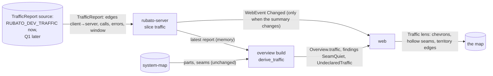

# Observed traffic on seams, drawn on the map

Issue: #104 · Design: [104-observed-traffic/design.md](104-observed-traffic/design.md) · Map:
`rubato-protocol`, `rubato-server`, `web` over seam `web-server`.

Track: **full**, because new wire types and two findings change `schema/protocol/*.json`
(`overview`, `finding`, and a new `traffic_report`), and the real source of traffic needs an
external part and a seam the map does not have yet.

Issue #104 asks that the server summarise observed calls per seam and send the summary in the
overview, and that the map's conduits carry particles that mean traffic, with the
map-versus-territory findings (a declared seam with no traffic, traffic with no seam) drawn on
them. Follow-up 2 of #81. One premise does not hold: the server does not receive production
telemetry today (Claude Code, the companion and the server export OTLP to the team's backend and
nothing comes back), and AGENTS.md forbids depending on that stack. So this plan builds
everything that does not depend on the source, against one input shape (`TrafficReport`) that a
development file fills today, and leaves the source as question Q1 with the options designed in
design §6.

## What the change does

- **The overview carries observed traffic per seam.** From the latest `TrafficReport`, the server
  derives, for every declared seam that had calls in the report's window, the calls each way and
  the errors; the edges between two map parts that no seam joins; how many services map to no
  part; and the state of the source (`not_configured`, `fresh`, `stale`, `failing`) with the time
  of the last good report (design §2–§3, ADR 0039).
- **Map versus territory becomes two findings.** `SeamQuiet`: a declared seam with no calls in the
  window while both its parts show traffic elsewhere. `UndeclaredTraffic`: calls between two parts
  no seam joins. Both appear in the Findings panel and on the map; nothing acts on them.
- **Unknown is never quiet.** A missing, failing or stale report makes the state `unknown` on the
  map: no chevrons, no quiet seams, no undeclared edges, and a legend that says why.
- **A Traffic lens.** Beside Structure, Data flow and Control flow. In it, observed calls travel
  on each seam as **chevrons** pointing the way the calls go (one to three per direction by calls
  per minute, fixed speed), the chip shows the rate and error share, a quiet seam is drawn hollow
  with "no calls in <window>", and undeclared traffic is a static dotted amber territory edge
  between the two parts with its chevrons and an "observed, not on the map" label (design §5).
- **Dots, rings and chevrons never share a lens.** Declared particles stay in Data and Control;
  chevrons appear only in Traffic. The particle cap of 120 counts chevrons; reduced motion leaves
  one still chevron per direction and the rate as text.
- **The server watches its own source.** Each fetch is a span; the report's age, quiet seams,
  undeclared edges and unmapped services are gauges; an alert fires when a configured source's
  report is older than 10 minutes; a dashboard row "Map versus territory" shows them.

## How we'll know it works

- [ ] **Derivation** (Rust unit tests on `derive_traffic`, over fixtures in
  `crates/rubato-protocol/fixtures/traffic/`): forward and reverse calls land on the right seam;
  two seams joining one pair both get the calls; a self-call is ignored; an edge with no seam is
  undeclared and a finding; a seam whose two parts are observed with no calls is `SeamQuiet`; a
  seam to an unobserved part is not; an unknown service counts in `unmapped_services` and makes
  no finding. The test prints how many fixtures and edges it checked. Must fail: a fixture with a
  stale `observed_at` that expects `SeamQuiet` is rejected (stale yields no findings).
- [ ] **Unknown, not quiet**: unit tests for each non-fresh state (`not_configured`, `stale` at
  3 × fetch interval + 1 s, `failing`) return no seams, no undeclared edges and no findings, and
  keep the last good `observed_at`; at exactly 3 × fetch interval the report is still fresh.
- [ ] **Wire**: the protocol schema snapshot test fails until `overview.schema.json`,
  `finding.schema.json` and the new `traffic_report.schema.json` are regenerated; `web/src/protocol.ts`
  regenerates with `ObservedTraffic` and the two variants; an overview JSON without `traffic`
  deserialises to `not_configured` (old-server fixture).
- [ ] **Server slice**: an integration test with `RUBATO_DEV_TRAFFIC` pointing at a fixture
  serves `/api/overview` with `traffic.state = fresh` and the expected findings; rewriting the
  file with the same counts does not notify `/ws/web`, changing a count does; a report with 2 001
  edges, a window of 30 s or a 300-byte name is rejected with its reason and the previous report
  kept; deleting the file turns the state `failing`, and an old mtime turns it `stale`; the
  metrics reader sees `rubato.traffic.fetches` once per outcome (`ok`, `rejected`, `failed`) and
  `rubato.traffic.report_age`, `seams_quiet`, `undeclared_edges` and `unmapped_services` with the
  fixture's values.
- [ ] **Alert**: `TrafficReportStale` has a test under `observability/alerts/tests/` that fires it
  on a report age series above 600 s and stays silent when the gauge is absent (not configured);
  `observability/check.ts` passes and its count grows by one rule and three panels.
- [ ] **Chevrons, by shape** (Vitest): in the Traffic lens a seam with calls renders `.traffic`
  chevrons with `offset-rotate: auto` forward and `auto 180deg` reverse, counts 1/2/3 at 0.5, 1
  and 60 calls per minute; no `.particle` dot or ring is rendered in that lens; no `.traffic` is
  rendered in Data, Control, plan or scenario.
- [ ] **Findings on conduits** (Vitest): a `SeamQuiet` seam renders `.quiet` with no chevrons and
  the chip text "no calls in 1 h" and the amber `quiet` style, not `collision`; the chip's ⚠ appears in every lens with a screen-reader
  sentence per finding kind; an `UndeclaredTraffic` renders `territory-<from>-<to>` with a static
  dotted stroke, no `moving` class, chevrons, and no button; `findingText` covers both variants.
- [ ] **Unknown in the web** (Vitest): for `not_configured`, `stale` and `failing` the lens draws
  no `.traffic`, `.quiet` or territory edge and the legend shows the state's sentence.
- [ ] **Cap** (Vitest): `particleBudget` with counts keeps its existing results at count 2, and
  30 traffic seams at 6 chevrons (180) are cut to 120 with near seams first.
- [ ] **Reduced motion** (e2e, `web/e2e/motion.spec.ts`): the Traffic lens with a stubbed fresh
  overview has empty `document.getAnimations()` under `data-motion="reduced"` and one still
  chevron per direction; under `full` the chevrons animate. The motion Vitest over `styles.css`
  counts the chevron rule; a fixture rule outside the switch fails.
- [ ] **Performance** (e2e, `web/e2e/perf.spec.ts`): the 40/60 fixture with traffic on every seam
  in the Traffic lens records no long animation frame over 50 ms and prints the chevron count (120).
- [ ] **Screenshots**: `shots.spec.ts` gains `map-traffic` (fresh, with a quiet seam and a
  territory edge) and `map-traffic-unknown`, dark and light, at both widths; reviewed by a person
  in PR 2.

## What it must not break

- **Declared-flow particles**: dots in Data, rings in Control, the scenario pulse and its trail,
  the still marker at 30 %. Guarded by `web/src/features/map/particles.test.tsx` and the legend and
  scenario e2e in `web/e2e/map.spec.ts`, unchanged.
- **The particle cap of 120**: `particleBudget`'s existing tests pass unchanged with count 2; the
  new cap test and the perf e2e cover chevrons.
- **The one motion switch** `:root[data-motion="full"]`: the motion Vitest over `styles.css` and
  the reduced-motion e2e in `web/e2e/motion.spec.ts`.
- **`moving` means proposed**: territory edges and quiet seams never carry `moving`; the
  proposed-stays-distinct Vitest gains the territory edge.
- **Progress is derived from its own signals only**: `derive_progress` does not read traffic; the
  existing progress tests in `crates/rubato-protocol/src/progress.rs` pass unchanged, and a new
  test builds the same overview with and without a report and compares every `IssueSummary`.
- **Older overviews and sibling fields**: `Overview.traffic` and the two variants are additive
  (`#[serde(default)]`); the old-server fixture test; the sibling plans #103, #105, #106 add their
  own fields and only conflict textually.
- **The slice layout**: the server's slice test with the new `traffic` slice and its AGENTS.md
  row; `web/src/features/features.test.ts` with no new web feature.

## How we'll debug it at 3 am

See the O-row for `web-server`. New signals: span `rubato.traffic.fetch`; counter
`rubato.traffic.fetches{rubato.outcome}`; gauges `rubato.traffic.report_age`,
`rubato.traffic.seams_quiet`, `rubato.traffic.undeclared_edges`,
`rubato.traffic.unmapped_services`; logs `traffic report rejected` (with the reason),
`traffic source failing` and `traffic source recovered`; alert `TrafficReportStale`; findings
`SeamQuiet` and `UndeclaredTraffic`. The first question is the trust check: is the report fresh
(`rubato.traffic.report_age`)? If it is not, the map says *unknown* and nothing else is to be
believed. If it is and nothing lights, `rubato.traffic.unmapped_services` says the names do not
match the parts.

## Affected parts

| Node | Status | What changes | Seams |
| --- | --- | --- | --- |
| rubato-protocol | affected | module `traffic`: `TrafficReport`, `ObservedTraffic`, `SeamTraffic`, `UndeclaredEdge`, `TrafficState`, `derive_traffic`, limits; `Finding::SeamQuiet`, `Finding::UndeclaredTraffic`; `Overview.traffic`; `otel.rs` names; schema files | web-server |
| rubato-server | affected | slice `traffic` (source port, `RUBATO_DEV_TRAFFIC` file source, fetch task, latest report in memory, notify on change, telemetry); overview build calls `derive_traffic`; gauges; alert and dashboard row | web-server |
| web | affected | Traffic lens; chevron particles; quiet seams and territory edges; legend and unknown states; `particleBudget` with counts; chip and inspector rows; `findingText` | web-server |
| system-map | quiet | read as today for parts and seams; no schema change unless Q2 is answered (b) | |

## Data models

| Model | Kind | Part | Change | Crosses | Note |
| --- | --- | --- | --- | --- | --- |
| `TrafficReport`, `TrafficEdge` | type | rubato-protocol | new | | the one input every source fills; `schema/protocol/traffic_report.schema.json`; crosses the source's seam once Q1 names one |
| `ObservedTraffic`, `SeamTraffic`, `UndeclaredEdge`, `TrafficState` | type | rubato-protocol | new | web-server | `Overview.traffic`, default `not_configured` |
| `Overview.traffic` | type | rubato-protocol | changed | web-server | additive, `#[serde(default)]` |
| `Finding::SeamQuiet`, `Finding::UndeclaredTraffic` | type | rubato-protocol | new | web-server | map versus territory |
| `rubato.traffic.*` names | file | rubato-protocol | changed | | `src/otel.rs`: span `fetch`, counter `fetches`, gauges `report_age`, `seams_quiet`, `undeclared_edges`, `unmapped_services` |
| latest report | type | rubato-server | new | | in memory, slice `traffic`; no table, no migration |
| `RUBATO_DEV_TRAFFIC`, `RUBATO_TRAFFIC_FETCH_SECS` | file | rubato-server | new | | config; development source and fetch interval (15–300 s, default 60) |
| `TrafficReportStale` and the "Map versus territory" row | file | rubato-server | new | | `observability/alerts/rubato.rules.yml`, `observability/dashboards/rubato-overview.json` |

## Data flow

## Tasks

- [ ] **PR 0** `issue/104-observed-traffic`: this plan, the design note, ADR 0039 (proposed).
  Design review.
- [ ] **PR 1** `issue/104-traffic-server`: failing first: the `derive_traffic` unit tests over
  `crates/rubato-protocol/fixtures/traffic/` (with the stale must-fail fixture), the unknown-state
  tests, the schema snapshot test (fails until regenerated), the old-server overview fixture, the
  progress-unchanged test, the server integration test on `RUBATO_DEV_TRAFFIC` (fresh, same
  counts no notify, limits rejected, missing file failing, old mtime stale), and the
  `TrafficReportStale` alert test. Then module `traffic` in `rubato-protocol` with the two
  findings, `Overview.traffic` and the `otel.rs` names; slice `traffic` in `rubato-server` with the
  dev-file source and its task in `tasks.rs`; the overview build and gauges; the alert rule and the
  dashboard row; the AGENTS.md server block and the protocol block gain `traffic`; regenerate
  `schema/protocol/` and `web/src/protocol.ts`; `docs/QUICKSTART.md` documents the dev file.
- [ ] **PR 2** `issue/104-traffic-lens`: failing first: the chevron, findings-on-conduits,
  unknown-in-the-web and cap Vitest; the motion Vitest fixture for the chevron rule; the Traffic
  lens in the reduced-motion e2e and the perf e2e (fixture `web/e2e/fixtures/big-map.ts` gains
  traffic on every seam); `map-traffic` and `map-traffic-unknown` in `shots.spec.ts`. Then the
  lens in `flows.ts` and `MapView.tsx`, the chevron in `particles.tsx` with `particleBudget`
  counts, `.traffic`, `.quiet` and `.territory` in `styles.css` under the switch, the territory
  edge, chip rate and per-kind screen-reader text in `SeamChip.tsx`, the inspector rows, the legend
  and unknown sentences, and `findingText` for both variants. Before and after screenshots in the
  PR description.
- [ ] **PR 3** (only when Q1 is answered (a), (b) or (c)): this plan is edited first with the
  chosen source's tasks, ADR 0040 and its O-row, and approved again; the new part and seam are
  added by a person through a map draft before it merges.

## Assumed, not yet approved

| # | Decision | Chosen | Alternatives | Scope |
| --- | --- | --- | --- | --- |
| Q1 | Where observed traffic comes from. The map has no part for a telemetry backend and the server receives no production telemetry; each option adds an external part and a seam a person adds to the map (design §6) | **(d)**, answered by Mattias Jonsson, 2026-11-13 | (a) the server queries a Prometheus-compatible HTTP API (`/api/v1/query`) for the OTel Collector `servicegraph` connector's `traces_service_graph_request_total` and `…_failed_total`, new part `telemetry-backend`, seam `server-telemetry`; (b) services push summaries: `POST /api/traffic` with a `TrafficReport` and a bearer token from config, new part `traffic-pusher`, seam `traffic-pusher-server`; (c) the server counts only its own seams (companion envelopes, GitHub calls, web requests), no new part, works only on a map that contains Rubato; (d) defer: ship PR 1–2 with the development file only, production shows `not_configured`, the source gets its own issue | seam |
| Q2 | How a service in a report maps to a map part | **(a)**, answered by Mattias Jonsson, 2026-11-13 | (a) the part whose id equals the service's OTel `service.name`; no map change; services that match nothing are counted as unmapped; (b) an optional `service` field on a node in `schema/system-map.schema.json` (seam `server-system-map`, ADR 0040 or later), so ids and service names may differ; (c) a mapping in server config, `RUBATO_TRAFFIC_SERVICES=service=part,…`, outside the map | seam |
| A3 | Where traffic is drawn | a separate Traffic lens; declared particles and chevrons never share a lens | chevrons beside dots in the Data lens, sharing the cap | node (web) |
| A4 | The traffic particle's shape | a filled chevron pointing the way the calls go, green role | a diamond; a short streak (too close to dashes) | node (web) |
| A5 | What volume looks like | 1, 2 or 3 chevrons per direction for under 1, under 60 and 60+ calls per minute, fixed 64 px/s; exact rate as text | speed by rate; thickness by rate | node (web) |
| A6 | When a report is stale | older than 3 × the fetch interval (default 60 s, so 180 s) | a fixed 10 min; the report's own window | node (rubato-server) |
| A7 | Where the latest report is kept | in memory in slice `traffic`; a restart is *unknown* until the next fetch | a SQLite table with history (ADR 0039 alternatives) | node (rubato-server) |
| A8 | Two seams joining the same pair of parts | both get the edge's calls | the first in map order; neither, with a finding | node (rubato-server) |
| A9 | Report limits | 2 000 edges (cut, `truncated`), names up to 200 bytes, window 60 s to 24 h; a report outside them is rejected whole | larger limits; reject only the bad edges | node (rubato-server) |
| A10 | Errors on the map | text only (chip and inspector), no colour or shape change on the chevrons | red chevrons above an error share | node (web) |

## O-rows

| Seam | Breaks like | Signal | Panel | Owner |
| --- | --- | --- | --- | --- |
| web-server | the Traffic lens is empty, shows quiet seams from a dead source, or the web cannot read the new fields | gauge `rubato.traffic.report_age` (alert `TrafficReportStale` above 600 s with a source configured); counter `rubato.traffic.fetches{rubato.outcome}` and span `rubato.traffic.fetch`; gauges `rubato.traffic.seams_quiet`, `rubato.traffic.undeclared_edges`, `rubato.traffic.unmapped_services`; logs `traffic report rejected` (reason) and `traffic source failing`; generated `protocol.ts` diffed in CI | Map versus territory (new row: report age; quiet seams and undeclared edges; fetches by outcome) | rubato-server |

## Flows

| From | To | Seam | Kind | Carries |
| --- | --- | --- | --- | --- |
| rubato-server | web | web-server | data | Overview.traffic: observed calls per seam each way, undeclared edges, source state; findings SeamQuiet and UndeclaredTraffic |
| rubato-server | web | web-server | control | WebEvent Changed when the traffic summary changes |

## ADRs proposed

| ADR | File | Blob |
| --- | --- | --- |
| 0039 | docs/decisions/0039-observed-traffic-per-seam-in-the-overview.md | 1f285516a6beffbc67618b12011d358817db283f |

## Review map

1. `derive_traffic`'s freshness rule (design §3, step 1): the only thing standing between a dead
   source and a map full of false "quiet" findings.
2. Q1 and design §6: which source, and what it adds to the map and to the server's attack surface.
3. The chevron and the territory edge against the #81 vocabulary (design §5.2, §5.4): shape
   tells traffic from dots, rings and marching dashes, and the cap still holds.
