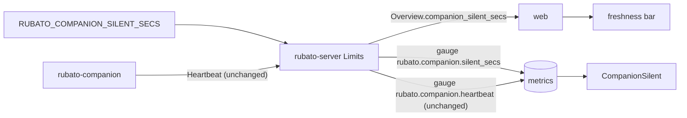

# Companion stale threshold N in the overview

Issue: #105 · Design: [105-stale-threshold/design.md](105-stale-threshold/design.md) · Map: seam `web-server`.

Track: **full**, because `Overview` in `crates/rubato-protocol` gains a field, which changes
`schema/protocol/overview.schema.json`. Otherwise the change is small.

Issue #105 asks to "put the companion stale threshold N in the overview, so the freshness bar
matches the alert" (follow-up 3 of #81, design §9). Today N is three separate values: the server's
`Limits::companion_silent_secs` (`crates/rubato-protocol/src/limits.rs:28`, overridden by
`RUBATO_COMPANION_SILENT_SECS` at `crates/rubato-server/src/kernel/config.rs:148`), the literal
`> 600` in `CompanionSilent` (`observability/alerts/rubato.rules.yml:8`), and the web's
`COMPANION_STALE_MS` (`web/src/features/companions/Lanes.tsx:13`). They can drift, and they already
do: nothing reads the server's N except the `Welcome` envelope
(`crates/rubato-server/src/companion_link/ws.rs:224`). So the issue's criterion ("fires the
alert" at N = 5) needs the alert to follow the server's N too. This plan makes the server's N the
only one: the overview carries it to the web, and a gauge carries it to the alert (design §1–2).

## What the change does

- **The overview carries N.** `Overview.companion_silent_secs` is the server's configured
  threshold in seconds (from `RUBATO_COMPANION_SILENT_SECS`, default 600 = 10 minutes). The field
  is additive and has a default, so a reader of an older overview gets 600.
- **The freshness bar uses it.** A companion lane's bar drains from `last_seen` to empty over N
  from the overview, in place of the hard-coded 10 minutes. The 600 s constant is kept only as a
  fallback.
- **The alert uses it.** The server exports N as the gauge `rubato.companion.silent_secs`, and
  `CompanionSilent` fires when a heartbeat is older than that gauge. When the gauge is missing it
  falls back to 600. The summary states how long the companion has been silent instead of "over
  10 minutes", and the `Companions` panel draws N as a line.
- **N has a floor.** A value below 60 s is raised to 60 with a startup warning, so a typo cannot
  page for every companion or empty every bar.

## How we'll know it works

- [ ] **Overview carries N**: a server integration test reads `GET /api/overview` on a harness with
  `limits.companion_silent_secs = 300` and gets `companion_silent_secs: 300`, and on a default
  harness gets 600. Must fail: a handler that writes `Limits::default()` fails the 300 case.
- [ ] **Schema is additive**: the `rubato-protocol` schema snapshot test passes after
  `UPDATE_SCHEMAS=1`, `overview.schema.json` does not list `companion_silent_secs` under
  `required`, and a unit test deserialises an overview JSON without the field to 600. CI's
  `protocol.ts` diff is clean after `gen:types`.
- [ ] **Bar matches N** (issue criterion, web half): a `lanes.test.tsx` case renders a disconnected
  companion last seen 6 minutes ago with `companion_silent_secs: 300` and finds
  `fresh-<id>` with `data-share="0.00"` and the `stale` class. With the field absent, the same
  companion is `fading` at `0.40`. Must fail: today's `Lanes.tsx` shows `0.40` in the 300 case.
- [ ] **Alert matches N** (issue criterion, alert half): `observability/alerts/tests/rubato.test.yml`
  gains a case where `rubato_companion_silent_secs` is 300 and a heartbeat stops at 0. It expects
  `CompanionSilent` at 6m and nothing at 4m. The existing cases keep a 600 series (quiet at 5m,
  firing at 15m), and a new case without the series fires at 11m and not at 9m (the fallback).
  `pnpm observability:rules` runs promtool.
- [ ] **The fallback cannot be dropped by accident**: `observability/rules.test.ts` gains a mutant
  that removes `or vector(600)`, and promtool must fail on the no-series case at 11m.
- [ ] **Gauge is recorded**: a test in `crates/rubato-server/src/kernel/telemetry.rs`, using the
  in-memory exporter already there (`:170-189`), records the value as a poll tick does and
  reads `rubato.companion.silent_secs = 300` back after two collections. The name is in `otel.rs`'s list, whose test fails on
  a name missing from it.
- [ ] **Panel and rule refer to the gauge**: `observability/check.ts` checks that the
  `CompanionSilent` expression and the `Companions` panel both query `rubato_companion_silent_secs`,
  and prints the count it checked. `check.test.ts` has a fixture rule with the literal `> 600` back,
  which must fail.
- [ ] **Floor**: a `config.rs` unit test shows 30 → 60 with one warning naming 30, and 300 → 300
  with none.
- [ ] **On the stack** (observation after deploy): `publish.ts --verify-live` reports
  `rubato_companion_silent_secs` stored, and the `Companions` panel shows the N line.

## What it must not break

- **`CompanionSilent` at the default**: it still fires at 15m and stays quiet at 5m with N = 600.
  Guarded by the existing promtool cases, kept, with the expected summary updated to the new
  wording.
- **The `web-server` overview contract**: additive only. No field is renamed or removed, and
  older clients ignore the new one. Guarded by the schema snapshot test and the
  deserialise-without-field test. Sibling plans #103, #104 and #106 add their own fields beside
  this one (design §4).
- **"Never silent" list complete**: `observability/check.ts` `REQUIRED` still names
  `CompanionSilent`. Guarded by `check.test.ts`.
- **Connected companions show a full bar**: unchanged at `Lanes.tsx:118`. Guarded by the existing
  `lanes.test.tsx` cases.
- **`freshness()` contract**: 1 just now, 0 at the threshold or never seen. Guarded by
  `freshness.test.ts`, which now uses the fallback constant.
- **The `Welcome` envelope**: still carries `limits` unchanged. Guarded by
  `crates/rubato-protocol/fixtures/server_welcome.json`, round-tripped by
  `crates/rubato-protocol/tests/fixtures.rs`.

## How we'll debug it at 3 am

See the O-rows. A bar that disagrees with the alert can be checked in two places: the
`Companions` panel shows the N the alert is using, and `GET /api/overview` shows
`companion_silent_secs`. If the two differ, the panel's N line is missing (the gauge is not
exported) and the alert is on its 600 fallback. A config value that was raised to 60 is logged
once at startup as a `warn!` from `config.warnings`, naming the value given. No new finding.

## Affected parts

| Node | Status | What changes | Seams |
| --- | --- | --- | --- |
| rubato-protocol | affected | `Overview.companion_silent_secs` with a serde default; metric name `rubato.companion.silent_secs` in `otel.rs`; schema snapshot | web-server |
| rubato-server | affected | fills the field from `config.limits`; records the threshold gauge each poll tick; config floor of 60 s; alert rule, its promtool cases, the `Companions` panel and `check.ts` | web-server, companion-server |
| web | affected | `Lanes` reads N from the overview; `COMPANION_STALE_MS` becomes the fallback `DEFAULT_COMPANION_SILENT_SECS`; regenerated `protocol.ts` | web-server |
| rubato-companion | quiet | heartbeats as before; ignores `limits.companion_silent_secs` in `Welcome` as before | companion-server |

## Data models

| Model | Kind | Part | Change | Crosses | Note |
| --- | --- | --- | --- | --- | --- |
| `Overview.companion_silent_secs` | type | rubato-protocol | changed | web-server | u64 seconds, serde default 600, not required in the schema (Q1) |
| `schema/protocol/overview.schema.json` | schema | rubato-protocol | changed | web-server | regenerated; `protocol.ts` follows |
| `rubato.companion.silent_secs` | event | rubato-server | new | | gauge from config, recorded on every poll tick (Q2) |
| `observability/alerts/rubato.rules.yml` `CompanionSilent` | file | rubato-server | changed | companion-server | threshold from the gauge, fallback 600 |

## Data flow

## Tasks

One PR, `issue/105-stale-threshold`, after approval and the answers to Q1 and Q2.

- [x] **1. Protocol.** Failing first: a `progress.rs` unit test deserialises an `Overview` without
  `companion_silent_secs` and expects 600, and the schema snapshot test fails until regenerated.
  Then add the field with `#[serde(default = …)]` returning `Limits::default().companion_silent_secs`,
  add `metric::COMPANION_SILENT_SECS` to `otel.rs` and its list, and run
  `UPDATE_SCHEMAS=1 cargo test -p rubato-protocol`.
- [x] **2. Server overview.** Failing first: the integration test with
  `limits.companion_silent_secs = 300` (and 600 on the default harness). Then fill the field in
  `overview/handler.rs:61`.
- [x] **3. Server gauge and floor.** Failing first: the in-memory exporter test for the gauge, and
  the `config.rs` floor test. Then add `companion_silent_secs: Gauge<u64>` to the metrics in
  `kernel/telemetry.rs`, record it next to `poll_ticks` on every poll tick (`tasks.rs:395`), so it is exported
  whatever the temporality, and add the floor
  next to `clamp_poll_secs`.
- [x] **4. Alert and panel.** Failing first: the new promtool cases (300 at 6m; no series at 11m)
  against today's rule, the `rules.test.ts` mutant, and the `check.ts` fixture with the literal.
  Then the new rule expression and summary, the `Companions` panel's second target
  `max(rubato_companion_silent_secs)` with legend `N`, and the `check.ts` assertion.
- [ ] **5. Web.** Failing first: the `lanes.test.tsx` 300 / absent cases. Then `pnpm -C web gen:types`,
  `Lane` gets a `staleMs` prop from `Lanes`, `COMPANION_STALE_MS` becomes
  `DEFAULT_COMPANION_SILENT_SECS = 600`, and `freshness.test.ts` uses it.
- [ ] **6. Docs.** `docs/QUICKSTART.md:99`: `RUBATO_COMPANION_SILENT_SECS` now also sets the alert
  and the bar, with a floor of 60. The `#81` design §9 item 3 is marked done by this issue.

## Assumed, not yet approved

| # | Decision | Chosen | Alternatives | Scope |
| --- | --- | --- | --- | --- |
| Q1 | How the overview carries N. Which option? | (a) `companion_silent_secs: u64`, top-level on `Overview`, in seconds like `Limits` and the env var, serde default 600 | (b) `companion_silent_mins: u64`, in minutes as the issue words it, so it no longer matches `Limits` and the env var; (c) `limits: Limits`, the whole struct, which would also let the web drop `SESSION_STALE_SECS` (`Lanes.tsx:10`) but puts poll intervals on the wire | seam (web-server): (a) answered by Mattias Jonsson, 2026-11-13 |
| Q2 | How the alert's N stays the server's N. Which option? | (a) the server exports the gauge `rubato.companion.silent_secs`, and `CompanionSilent` compares against it with `or vector(600)` as the fallback (design §2.3) | (b) keep the literal `> 600`; `check.ts` fails when it differs from `Limits::default()`, and QUICKSTART says to edit the rule when overriding the env var. The issue's "fires the alert at N = 5" then needs a manual rule edit; (c) `publish.ts` writes N into the rule from an env var at publish time, which is a second place to set N and leaves promtool testing a template | seam (companion-server): (a) answered by Mattias Jonsson, 2026-11-13 |
| A3 | Connected companions | keep the full bar while the websocket is open; a hung but connected companion is the alert's job (design §3) | drain by `last_seen` even when connected | node (web) |
| A4 | Floor for N | 60 s, with a warning, following `clamp_poll_secs` | no floor; reject the config at startup | node (rubato-server) |
| A5 | Alert summary | `has not reported for {{ $value \| humanizeDuration }}` | keep "over 10 minutes" and accept that it is wrong when N is not the default | node (rubato-server) |
| A6 | `SESSION_STALE_SECS` drift | out of scope unless Q1 (c) is chosen | fix it here regardless | node (web) |

## O-rows

| Seam | Breaks like | Signal | Panel | Owner |
| --- | --- | --- | --- | --- |
| web-server | the bar drains over a different N than the server has, or the overview fails to decode after a sibling's field lands | `GET /api/overview` `companion_silent_secs` against the `Companions` panel's `N` line; CI's `protocol.ts` diff and the schema snapshot test; `rubato.web.rejected` unchanged | Companions | rubato-server |
| companion-server | `CompanionSilent` fires late, early or never because its threshold is not the configured N | gauge `rubato.companion.silent_secs` (`rubato_companion_silent_secs`) missing or different from config, which puts the rule on its 600 fallback; gauge `rubato.companion.heartbeat` by `rubato.companion_id`, `rubato.user`; startup `warn!` from `config.warnings` when N was raised to 60 | Companions | rubato-server |

## Flows

| From | To | Seam | Kind | Carries |
| --- | --- | --- | --- | --- |
| rubato-server | web | web-server | data | Overview.companion_silent_secs: the companion stale threshold N in seconds |

## ADRs proposed

None.

## Review map

1. The `CompanionSilent` expression and its promtool cases (task 4). `on() group_left()` with
   `or vector(600)` must fire at the configured N and at 600 when the gauge is missing. This is
   the one place where a mistake makes a page silent.
2. `Overview.companion_silent_secs` in `progress.rs` and `overview.schema.json`: a serde default,
   not required, and no other field touched, so it merges beside #103, #104 and #106.
3. `Lanes.tsx`: the bar's threshold comes from the overview and the 600 fallback is used only
   when the field is absent.
