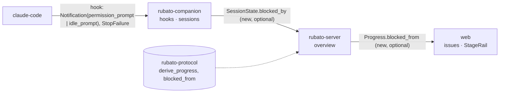

# Design: show which stage a blocked issue left from (#106)

Plan: [../106.md](../106.md) · ADR 0043 (*proposed*) · Follow-up 4 of #81 (design note §9).
Seam questions Q1 and Q2 are open; this note is written with the recommended options and says
what changes if a person picks another.

## Where it sits on the map

Three deployables and the contract crate; two seams, both additive: `companion-server`
(`SessionState`) and `web-server` (`Progress`). No table, no migration.

## 1. How *Blocked* is decided today

`derive_progress` (`crates/rubato-protocol/src/progress.rs:76`) takes `ProgressInputs`
(`progress.rs:48`) and returns the state and a reason. Precedence is Done > InReview > Blocked >
session states > Started > Planned (`progress.rs:74`). *Blocked* has exactly two causes:

1. **A live cap hit**, `inputs.cap_hit` (`progress.rs:85-87`, reason `cap hit`). The server sets
   the bool from `cap_hit_blocks` (`crates/rubato-server/src/overview/build.rs:70-76`): a
   **spend** hit always blocks (the companion is killing a session that was running); an
   **attempts** hit blocks only when every session of the issue is ended (`build.rs:73`), i.e. it
   is a refused Start. Which hits are live comes from `launches` and `cap_hits`
   (`crates/rubato-server/src/launch/store.rs:107`). The kind is lost at `build.rs:164`.
2. **A trusted blocked live session** (`progress.rs:93-104`, reason `session <id> blocked`): the
   first non-ended session with `status == Blocked` and a trusted source. The companion sets
   `Blocked` from three hooks (`crates/rubato-protocol/src/hook.rs:35`, `:39`):
   `Notification` with `permission_prompt` (waiting for a permission, mid-turn), `Notification`
   with `idle_prompt` (Claude Code has waited for input for a while, after a `Stop`), and
   `StopFailure` (the turn failed, mid-turn). tmux-ide can also report `blocked`
   (`crates/rubato-companion/src/sessions/discovery.rs:23`), with no hook behind it.

Below *Blocked*, the session branch of the same function names the stations: a working session
gives Designing or Building by `has_plan` (`progress.rs:107-117`); idle sessions give Started or
Designed (`progress.rs:126-133`); no live session gives Designed, Started or Planned
(`progress.rs:136-144`).

The server builds `Progress` at `build.rs:263-273`; the web draws it at
`web/src/features/issues/IssuePanel.tsx:80` with `StageRail` (`web/src/features/issues/visuals.tsx:44-58`),
which today renders a notch at a fixed place (`web/src/styles.css:476`, left at 1.5/7, beside
Started; plan 81 A8).

## 2. Can the station be derived? Yes, with one more signal

The signals that make an issue *Blocked* are still present for as long as it is *Blocked*: the
live cap hit row and the blocked session in the companion's snapshot. When they go, the issue is
no longer blocked and nothing about "before" is needed. So the station can be computed at
derivation time from the same inputs, with nothing remembered:

- A **spend** hit stops a session that was running: it left from the working station.
- An **attempts** hit is a Start that was refused: nothing ran, so the station is what the other
  signals say without the cap.
- A session blocked **mid-turn** (`permission_prompt`, `StopFailure`) would be working but for the
  wait: the working station.
- A session blocked **while waiting** (`idle_prompt`) had already stopped: the idle station.

Two gaps in today's inputs:

- `ProgressInputs.cap_hit` is a bool; the kind is dropped at `build.rs:164`. Fix: carry
  `Option<CapKind>` (Rust-only struct, no schema change).
- `SessionState.status == Blocked` does not say which hook blocked it, so `idle_prompt` and
  `permission_prompt` look the same. This matters: in this team's workflow the commonest wait is
  an agent idle after writing its plan, waiting for `Approved:`. With a plan file present,
  treating it as mid-turn would put the notch at Building, one station late. Fix (recommended,
  Q1 a): the companion, which applies the hook (`crates/rubato-companion/src/hooks/apply.rs:9`),
  keeps the cause next to the status and sends it as `SessionState.blocked_by`. This is the
  current cause of the current status, not history and not progress; it is cleared by the next
  hook that implies a status.

Nothing is stored by hand; no table is added. The "Derived, not stored" checklist row holds.

## 3. The rule

`pub fn blocked_from(inputs: &ProgressInputs<'_>) -> Option<ProgressState>` in
`crates/rubato-protocol/src/progress.rs`. It calls `derive_progress` and returns `None` unless the
state is `Blocked`, so the two can never disagree. Then, in the same order `derive_progress`
checks:

| Cause (as `derive_progress` sees it) | `blocked_from` with a plan file | without |
| --- | --- | --- |
| cap hit, kind `spend` | `building` | `designing` |
| cap hit, kind `attempts` (all sessions ended) | `designed` | `started` if launched, else none |
| blocked session, `blocked_by` = `permission_prompt` or `stop_failure` | `building` | `designing` |
| blocked session, `blocked_by` = `idle_prompt` | `designed` | `started` |
| blocked session, `blocked_by` absent (old companion, tmux-ide) | `building` | `designing` |

"The blocked session" is the same one `derive_progress` names in its reason (the first trusted
blocked live session), so the reason line and the notch talk about the same session. `None` means
off the rail, drawn as today. Values are only ever `started`, `designing`, `designed` or
`building`: *In review* and *Done* outrank *Blocked*, and *Planned* means nothing ran, which the
issue asks to keep off the rail.

`has_plan` is read now, not at the moment the issue blocked. If the plan file lands while the
issue is blocked, the notch moves from Designing to Building; that is the truer station now
(A3 in the plan).

If a person picks **Q1 b** (no `blocked_by`), rows 3–5 collapse to "working station" and the
companion is untouched. If a person picks **Q2 b**, the spend row becomes "as without the cap"
(the killed session is ended by then, so `designed`/`started`).

## 4. The wire

- `rubato-protocol::session`: `pub enum BlockCause { PermissionPrompt, IdlePrompt, StopFailure }`
  (snake_case), `SessionState.blocked_by: Option<BlockCause>`, skipped when `None`.
  `HookEventKind::implied_block_cause(notification_type)` next to `implied_status`
  (`hook.rs:27`), so the mapping lives once.
- `rubato-protocol::progress`: `Progress.blocked_from: Option<ProgressState>`, skipped when
  `None`; `ProgressInputs.cap_hit: Option<CapKind>` (was `bool`; Rust-only).
- `schema/protocol/session_state.schema.json`, `progress.schema.json`, and the schemas that embed
  them (`issue_summary`, `overview`, `companion_envelope`) change additively,
  rewritten with `UPDATE_SCHEMAS=1` (`crates/rubato-protocol/tests/schema_snapshot.rs` fails
  until they are); `web/src/protocol.ts` is regenerated with `pnpm gen:types`.

Compatibility: an old companion sends no `blocked_by` (fallback row 5); an old server ignores the
field (serde does not deny unknown fields on `SessionState`). An old web ignores `blocked_from`.
Siblings #103–#105 add other `Overview` fields in parallel; nothing here renames or removes one.

## 5. Companion

`Entry` in the registry gains `blocked_by: Option<BlockCause>`. In `apply_hook`
(`hooks/apply.rs:9-26` and the new-session branch at `:28`): when `implied_status()` is `Some(s)`,
set `status = s` and `blocked_by = ev.implied_block_cause()` (which is `None` for every non-block
status, so any working, idle or ended hook clears it). A `Notification` with no or another type
implies nothing and leaves both. Discovery from tmux-ide that sets `Blocked` leaves `blocked_by`
`None`. The `rubato.hook.forward` span and the `rubato.hook.forwarded` counter carry
`rubato.session.blocked_by` when the hook blocks (three values, absent otherwise).

## 6. Server

`build.rs:164` passes `cap_hit_blocks(...).then_some(kind)` as `cap_hit`; `build.rs:263-273` sets
`blocked_from: blocked_from(&inputs)` with the same `ProgressInputs` value (build it once, use it
twice). `overview/gauges.rs` records a new gauge `rubato.issues.blocked_from` by
`rubato.issue.blocked_from` for all five values (`started`, `designing`, `designed`, `building`,
`off_rail`) on every refresh, zeros included, so a station that empties drops to 0 instead of
keeping its last value. The dashboard gets a panel "Blocked, by station left from" in the
Progress row.

## 7. Web

`StageRail` takes the `Progress` (or `state` plus `blockedFrom`). When `state` is `blocked` and
`blockedFrom` is a rail station at index *k*:

- stations before *k* are `past` (filled), station *k* gets `left` (red dot, its label visible in
  `--bad-ink`), later stations are empty;
- the notch sits over station *k*: `style={{"--at": k}}` and
  `left: calc(100% / 7 * (var(--at) + 0.5))`; without `blockedFrom` the rule keeps today's 1.5;
- `aria-label`: `Progress: Blocked, left from Building, station 5 of 7`; without it,
  `Progress: Blocked` as today.

`ProgressRing` and `TeamTrack` do not change (the issue: "the nine states and the progress ring").
The new small-text rule `.stage-rail .station.left .label` joins the contrast pairs in
`web/src/styles.test.ts` (`--bad-ink` on `--panel`, both schemes).

## 8. What must hold

- `derive_progress` returns what it returns today for every input: its signature changes only in
  the `cap_hit` type, and every existing test in `progress.rs:395+` keeps its expected state.
- All nine states stay reachable (`every_state_is_reachable`); the ring Vitest over nine states
  passes unchanged.
- No table, no migration, no write: `blocked_from` exists only in the built overview.
- `rubato.issues.by_state` keeps its labels; the existing "Issues by state" panel is unchanged.
- Old companions and old webs keep working (additive, optional fields).

## 9. Failure

| What goes wrong | Who sees it | Signal |
| --- | --- | --- |
| A notch at the wrong station | a person on the issue panel | `rubato.issues.blocked_from` against the "Issues by state" blocked count; the overview JSON's `progress.blocked_from` next to `reason` |
| Every blocked session reads mid-turn | a person; the panel shows no `designed`/`started` from sessions | `rubato.hook.forwarded{rubato.session.blocked_by="idle_prompt"}` is 0 while idle prompts happen: the companion is not setting it |
| Schema drift between Rust and TS | CI | `schema_snapshot.rs`, `gen:types` diff |
