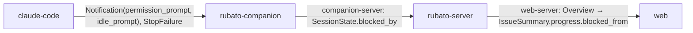

# Show which stage a blocked issue left from

Issue: #106 · Design: [106-blocked-from/design.md](106-blocked-from/design.md) · Map: seam `web-server`, and `companion-server` if Q1 is answered (a).

Track: **full**, because `Progress` in `crates/rubato-protocol` changes and with it
`schema/protocol/*.json`; with Q1 (a) also `SessionState`, three deployables and two seams.

Issue #106, follow-up 4 of #81 (design note §9): `Progress` gives the state, not the previous
one, so the stage rail draws *Blocked* as a notch off the rail. The issue asks that progress
carry the state before *Blocked*, derived and not stored by hand, and that the rail put the
notch at that station. The design note shows it can be derived at derivation time: the signals
that make an issue *Blocked* (a live cap hit, a blocked session) are still there while it is
blocked, and they name the station, once the derivation keeps the cap's kind and the companion
says which hook blocked a session (Q1).

## What the change does

- **Progress says where a blocked issue left from.** `Progress.blocked_from` is set when the
  state is *Blocked*: `building` or `designing` (by plan file) for a spend cap or a session
  blocked mid-turn; `designed` or `started` for a session waiting for input or a refused Start;
  absent when nothing ran (design §3). It is computed by a pure function from the same inputs as
  the state, on every overview build, and written nowhere.
- **The companion says why a session is blocked.** `SessionState.blocked_by` is
  `permission_prompt`, `idle_prompt` or `stop_failure`, set from the hook that blocked the
  session and cleared by the next status-changing hook (Q1 a; design §5).
- **The stage rail puts the notch at that station.** The stations before it are filled, the
  station itself is red with its label shown, and the rail's label reads "left from Building";
  without `blocked_from` the notch stays off the rail as today (design §7).
- **Operators can see blocked issues by station** on a new dashboard panel "Blocked, by station
  left from".

## How we'll know it works

- [x] **Rule, every row** (`progress.rs` unit test `blocked_from_follows_the_cause`): a table of
  inputs → expected value covering the five rows of design §3 with and without a plan file, and
  `None` for every non-blocked state. Must fail: a fixture of a session blocked by `idle_prompt`
  with a plan expects `designed`; the "every blocked session is mid-turn" shortcut returns
  `building` and fails it.
- [ ] **Issue criterion, blocked while Building**: `overview/build.rs` test
  `blocked_while_building_says_building`: a plan row, a trusted session blocked with
  `blocked_by = permission_prompt` → `progress.state == blocked`, `blocked_from == building`.
- [ ] **Issue criterion, blocked before any session**: same file, `blocked_before_any_session_is_off_the_rail`:
  a pinned issue, not launched, a live attempts cap hit, no sessions → `blocked`, `blocked_from`
  absent, and the serialized `Progress` has no `blocked_from` key.
- [x] **Never disagrees with the state**: a property-style test in `progress.rs` over every
  combination of the boolean inputs, both cap kinds and each session status and cause: whenever
  `blocked_from` is `Some`, `derive_progress` is `Blocked`, and the value is one of the four rail
  stations.
- [x] **Companion sets and clears the cause**: `hooks.feature` gains a `blocked_by` column
  (`notification-permission.json` → `permission_prompt`, `notification-idle.json` →
  `idle_prompt`, others empty) and a scenario "a working hook after a permission prompt clears
  the cause" (`notification-permission.json` then `pre-tool-use.json` → `working`, no
  `blocked_by`). `hook.rs` unit test: `StopFailure` → `stop_failure`; `Notification` with another
  type → no status and no cause. The suite prints its scenario count as today.
- [ ] **Rail at the station** (`web/src/features/issues/visuals.test.tsx`): blocked with
  `blockedFrom="building"` → stations `past ×4, left, "", ""`, the notch's `--at` is 4, the
  label reads "Progress: Blocked, left from Building, station 5 of 7"; blocked without it → no
  `past`, no `left`, the notch has no `--at`, label "Progress: Blocked". Must fail: the existing
  test "puts blocked as a notch, not a station" is rewritten so it fails on today's component
  (which ignores `blockedFrom`).
- [ ] **Contrast**: `web/src/styles.test.ts` finds the new `.stage-rail .station.left .label`
  rule and checks `--bad-ink` on `--panel` in both schemes; its printed pair count goes up by 2.
- [ ] **Dashboard**: `observability/check.ts` requires the panel "Blocked, by station left from"
  querying `rubato_issues_blocked_from`; `check.test.ts` gains a fixture dashboard without it
  that fails. The check prints its count as today.

## What it must not break

- **Progress stays derived** (AGENTS.md): no migration, no table, no write; `blocked_from` lives
  only in the built overview. Guarded by review (no file under `crates/rubato-server/migrations`
  in the diff) and the "Derived, not stored" checklist row.
- **The nine states**: `derive_progress` returns exactly what it returns today for every input;
  all existing tests in `crates/rubato-protocol/src/progress.rs` (from `:395`) and
  `every_state_is_reachable` pass with only the `cap_hit` field's type changed.
- **The progress ring and the team track**: unchanged; the ring Vitest over all nine states in
  `visuals.test.tsx` passes untouched.
- **Old companions and old browsers**: both new fields are optional and skipped when absent; a
  `build.rs` test with a blocked session and no `blocked_by` gives `building`/`designing`
  (fallback row). The schema snapshot test (`crates/rubato-protocol/tests/schema_snapshot.rs`)
  shows only additions.
- **The "Issues by state" panel and `rubato.issues.by_state`**: labels unchanged;
  `observability/check.ts` keeps passing on the existing panels.
- **Siblings #103–#105** add other `Overview` fields: nothing here renames or removes a field.

## How we'll debug it at 3 am

See the O-rows. New: the gauge `rubato.issues.blocked_from` by `rubato.issue.blocked_from`
(`started`, `designing`, `designed`, `building`, `off_rail`, zeros recorded), whose sum must
equal the blocked bar of "Issues by state"; and `rubato.session.blocked_by` on the companion's
`rubato.hook.forward` span and `rubato.hook.forwarded` counter. Both on the new panel. The
overview JSON shows `progress.blocked_from` next to `progress.reason`, which already names the
cause (`cap hit` or `session <id> blocked`). No new log line: the derivation is pure.

## Affected parts

| Node | Status | What changes | Seams |
| --- | --- | --- | --- |
| rubato-protocol | affected | `Progress.blocked_from`, `blocked_from()`, `ProgressInputs.cap_hit: Option<CapKind>`; `BlockCause`, `SessionState.blocked_by`, `HookEventKind::implied_block_cause`; otel names; schema snapshots | web-server, companion-server |
| rubato-server | affected | overview build passes the cap kind and sets `blocked_from`; gauge `rubato.issues.blocked_from`; dashboard panel and check | web-server, companion-server |
| rubato-companion | affected | registry keeps `blocked_by` with the status; hook span and counter carry it; `hooks.feature` | companion-server |
| web | affected | `StageRail` draws the notch at `blocked_from`; `IssuePanel` passes it; styles and contrast pair; regenerated `protocol.ts` | web-server |
| claude-code | quiet | the hooks it already sends (`Notification` types, `StopFailure`) are read for their cause | |

## Data models

| Model | Kind | Part | Change | Crosses | Note |
| --- | --- | --- | --- | --- | --- |
| `Progress.blocked_from` | type | rubato-protocol | changed | web-server | optional `ProgressState`, only with `state = blocked`; one of four rail stations |
| `SessionState.blocked_by`, `BlockCause` | type | rubato-protocol | changed | companion-server | optional; `permission_prompt`, `idle_prompt`, `stop_failure` (Q1 a) |
| `ProgressInputs.cap_hit` | type | rubato-protocol | changed | | `bool` → `Option<CapKind>`; Rust-only, not in any schema |
| `progress`, `session_state`, `issue_summary`, `overview`, `companion_envelope` schemas | schema | rubato-protocol | changed | web-server | additive; `schema/protocol/*.schema.json` |
| `web/src/protocol.ts` | file | web | changed | web-server | generated by `gen:types` |

## Data flow

## Tasks

- [ ] **PR 0** `issue/106-blocked-from`: this plan, the design note, ADR 0043 (proposed). Design
  review.
- [x] **PR 1** `issue/106-protocol`: failing first: `blocked_from_follows_the_cause` and the
  never-disagrees test in `progress.rs`, the `implied_block_cause` test in `hook.rs`. Then
  `BlockCause`, `SessionState.blocked_by`, `implied_block_cause`, `ProgressInputs.cap_hit:
  Option<CapKind>`, `blocked_from()`, `Progress.blocked_from`; otel `attr::SESSION_BLOCKED_BY`,
  `attr::ISSUE_BLOCKED_FROM`, `metric::ISSUES_BLOCKED_FROM`; `UPDATE_SCHEMAS=1`; `gen:types`.
  Server compiles with `cap_hit` passed as the kind and `blocked_from: None` (no behaviour yet).
- [x] **PR 2** `issue/106-companion`: failing first: the `blocked_by` column and the clearing
  scenario in `hooks.feature` (fail on PR 1's companion, which never sets it). Then `Entry.blocked_by`
  in `apply_hook` and the registry snapshot; the attribute on `rubato.hook.forward` and
  `rubato.hook.forwarded`. Dropped if Q1 is answered (b).
- [ ] **PR 3** `issue/106-server`: failing first: `blocked_while_building_says_building`,
  `blocked_before_any_session_is_off_the_rail`, the no-`blocked_by` fallback test, and the
  dashboard check fixture. Then `build.rs` sets `blocked_from` from the same `ProgressInputs`;
  `gauges.rs` records `rubato.issues.blocked_from` for all five values; the dashboard panel; the
  `check.ts` entry.
- [ ] **PR 4** `issue/106-rail`: failing first: the rewritten stage-rail tests and the contrast
  pair. Then `StageRail` with `blockedFrom`, the `left` station, `--at` on the notch,
  `IssuePanel.tsx:80` passing `progress.blocked_from`; the `issue-panel` shots rerun by hand for
  the PR description.

## Assumed, not yet approved

| # | Decision | Chosen | Alternatives | Scope |
| --- | --- | --- | --- | --- |
| Q1 | How does the derivation tell a session blocked mid-turn (`permission_prompt`, `StopFailure`: working station) from one blocked while waiting (`idle_prompt` after `Stop`: idle station)? The snapshot only says `blocked`. | (a) the companion sends `SessionState.blocked_by` from the hook that blocked it; additive on `companion-server`; absent means mid-turn (recommended) | (b) no new signal: every blocked session counts as mid-turn, so an agent idle after its plan, waiting for approval, shows Building; companion untouched; (c) the server reads the blocking hook from `companion_events`, a first reader of an unpruned log, with nothing for tmux-ide-sourced blocks | seam (companion-server): (a) answered by Mattias Jonsson, 2026-11-13 |
| Q2 | Which station does a cap hit leave from? | (a) spend: the working station (Building with a plan, Designing without), since the companion stops a running session; attempts (a refused Start): Designed with a plan, Started if launched, else off the rail (recommended) | (b) both kinds: what the other signals say without the cap (spend then reads Designed or Started, because the killed session has ended); (c) both kinds: the working station | seam (web-server): (a) answered by Mattias Jonsson, 2026-11-13 |
| A3 | `has_plan` at derivation time, not at the moment of blocking | read now: a plan file pushed while blocked moves the notch from Designing to Building | keep the station from the first time Blocked was seen (needs storing; rejected by AGENTS.md) | node (rubato-protocol) |
| A4 | Which blocked session decides when several are blocked | the one `derive_progress` names in its reason (first trusted blocked live session), so reason and notch agree | the newest by `last_seen` | node (rubato-protocol) |
| A5 | Ring and team track | unchanged; only the stage rail uses `blocked_from` | a ring arc up to the station with a red gap | node (web) |
| A6 | The gauge's off-rail value | `off_rail`, recorded at 0 like the others, so five series always exist | omit the series | node (rubato-server) |

## O-rows

| Seam | Breaks like | Signal | Panel | Owner |
| --- | --- | --- | --- | --- |
| web-server | the notch sits at the wrong station, or blocked issues all show off the rail | gauge `rubato.issues.blocked_from{rubato.issue.blocked_from}` whose sum must match `rubato.issues.by_state{rubato.issue.state="blocked"}`; `off_rail` equal to the blocked count means the field is not being set; generated `protocol.ts` diffed in CI | Blocked, by station left from (new, Progress row) | rubato-server |
| companion-server | every blocked session reads mid-turn (an agent waiting for approval shows Building) | counter `rubato.hook.forwarded{rubato.hook_event="Notification", rubato.session.blocked_by}`: no `idle_prompt` series while `rubato.issues.blocked_from{building}` rises; span `rubato.hook.forward` with `rubato.session.blocked_by` and `rubato.session_id` | Blocked, by station left from (new, second query) | rubato-server |

## Flows

| From | To | Seam | Kind | Carries |
| --- | --- | --- | --- | --- |
| rubato-server | web | web-server | data | Overview: `progress.blocked_from` on blocked issues |
| rubato-companion | rubato-server | companion-server | data | SessionState snapshots with `blocked_by` on blocked sessions |

## ADRs proposed

| ADR | File | Blob |
| --- | --- | --- |
| 0043 | docs/decisions/0043-blocked-progress-carries-the-station-it-left.md | 00d83bf037485d06a63b138045ed6f4616261295 |

## Review map

1. `blocked_from()` in `crates/rubato-protocol/src/progress.rs` against design §3: it must call
   `derive_progress` and agree with it, use the same blocked session as the reason, and return
   only the four rail stations.
2. `apply_hook` in `crates/rubato-companion/src/hooks/apply.rs` (Q1 a): every status-implying hook
   must set or clear `blocked_by`; a typeless `Notification` must leave both alone.
3. `StageRail` and its CSS: the notch position comes from `--at`, and the fallback without
   `blocked_from` is exactly today's rail.
