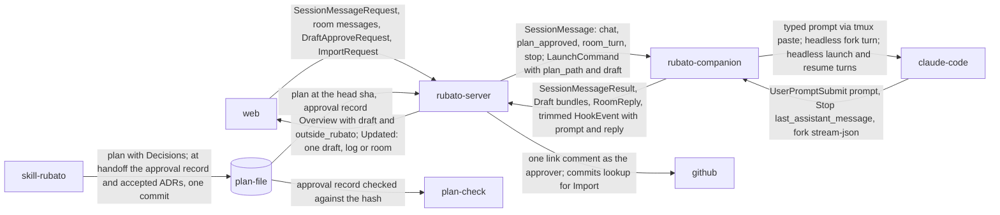

# Plan in Rubato: chat with your agent, drafts in Rubato, hand off to Git at approval

Issue: #122, with #138 and #139 planned in the same unit · Design:
[122-plan-in-rubato/design.md](122-plan-in-rubato/design.md) · ADRs 0050–0059 (*proposed*) ·
Stacked PRs on `issue/122-*` branches; PR 0 is this plan.

History:
- Revised after the first design review: three blockers, eight should-fix and the nits, all taken.
- Extended on 2026-11-14 with agent-only clients (#138, PR 13, ADR 0059). #139 was already settled
  by Q5 and ADR 0058.

Issue #122 (Mattias Jonsson, 2026-11-14) asks that a plan stop living in Git while it is being
shaped. Today every revision is edit, commit, push, wait for the poll, new sha and a new
`Approved:` comment, and the person cannot talk to the planning agent from the plan in Rubato,
which is the main pain. The change:

- drafts live in Rubato, mirrored from the agent's worktree;
- the person talks to their own session from the plan, and the team talks in the plan's room,
  where an owner can call their agent in;
- review, decisions and approval happen in Rubato;
- at approval the agent commits the plan once, with an approval record in its front matter, and
  the issue gets one comment linking that commit.

Mattias answered the open choices on 2026-11-14; they are rows Q1–Q12 under *Assumed* and the
table at the top of the design. A spike against real Claude Code and tmux settled the delivery
mechanics (design §Spike). This plan itself goes through the old flow.

## What the change does

- **Talk to your own agent from the plan.**
  - A message typed on a plan in Rubato reaches the session you launched for it, and is typed into
    the session when it next waits for input, never in the middle of a turn.
  - Its reply shows on the plan.
  - Only your own sessions accept your messages. A message whose delivery cannot be confirmed shows
    as *delivery unknown* and is never typed twice.
- **The team sees the conversation.** The prompts and final replies of a launched session form its
  session log, visible to everyone on the team. Tool input and output never leave the machine; that
  includes what is stored today, which is purged.
- **Drafts without commits.** While the agent writes the plan, its design note and the ADRs it
  proposes, every settled version appears in Rubato as a revision, with what changed since you last
  looked. Nothing is committed or pushed. Progress reads *Designing* while the draft is revised and
  *Designed* when one is settled.
- **Parked drafts come back.** When the session ends the draft stays in Rubato. Starting a session
  on the issue again resumes the draft's branch and writes the draft into the new worktree.
- **Review, decisions and approval in Rubato.**
  - The agent's `Review:` reply is the review.
  - Decisions are a table in the plan.
  - A team member approves a settled draft that fits the map, with a summary pre-filled from the
    agent's `Summary:` reply.
  - No GitHub comment is needed before approval.
- **One commit at approval.**
  - The approval goes to the session ahead of anything else. The agent runs `plan.ts handoff`, which
    makes exactly one commit on the issue branch: the approval record in the front matter, the
    plan's ADRs accepted (in the map repo), and an `Approved-by:` trailer.
  - Rubato then posts one comment on the issue, as the approver: a permalink to the plan at that
    commit and the approved summary. Each re-approval posts one more.
- **CI checks the approval.** plan-check fails a pull request whose plan changed after it was
  approved.
- **The plan's room.**
  - The team talks about the plan in its room. The owner calls their own agent in, or accepts a
    teammate's request. While planning, the working session answers when addressed; while building,
    a read-only fork does.
  - Who is in, who called them in and since when is always shown. Agents leave when dismissed or
    after 30 minutes unaddressed, and agent-to-agent turns stop after 3 in a row.
  - Rubato posts a notice when another plan touches the same seam.
- **Plans from outside Rubato.** A plan found on an `issue/` branch with no draft behind it shows as
  *outside Rubato*. *Import* makes it a draft the importer owns, directly when it already fits, or
  through a rewrite session on the importer's own companion.
- **The cutover.** `Approved:` comments keep counting until a cutover time set at deploy. Until
  then, sessions plan as today, with commit, push and comments, and see their drafts mirrored. After
  the cutover, launched sessions plan in Rubato and approval happens only there.
- **Launched sessions survive a companion restart.** The companion keeps its hook port, token and
  launches, so an upgrade does not cut chat, mirroring or the handoff for live sessions.
- **Agent-only clients (#138).**
  - A companion in headless mode runs Claude Code with no terminal and no tmux. Its owner pairs it,
    launches on it, chats with it, calls it into a room and stops it, as with any companion.
  - It shows as *headless*, with its owner.
  - Caps apply, and it never approves.
  - A client is defined by its contract, not by how it pairs, so an agent running elsewhere with an
    owner's token can be added later (ADR 0059).
- **Stop your own session.** The owner can stop a running session from Rubato, interactive or
  headless. Nobody else can.

## How we'll know it works

- [ ] A message sent from a plan in Rubato reaches my own launched session and the reply shows on the plan. Checked in e2e (`e2e/run.ts` with the stand-in extended to read typed input and fire `Stop`) and once live on the deployed server.
- [ ] Delivery waits for idle and happens once:
  - Gherkin `session-messages.feature`: a message is pasted exactly, newlines kept, only after a `Stop`. A second message waits for the next `Stop` even though the snapshot still reads idle; this scenario fails on purpose without `input_sent_at`.
  - Messages for another user (`not_paired_user`) or for a session not launched from Rubato (`not_launched_here`) are refused.
  - A duplicate id is refused.
- [ ] A message enqueued while the companion is offline or asleep stays queued and is delivered after its next Hello. Every `sent` row is pushed again at Hello with the same id: the companion types it if it never got it, answers `delivered` without typing if it had, and `failed { interrupted }` if it stopped while pasting, which gives `delivery_unknown` (server and Gherkin tests).
- [ ] After a companion restart, a session it launched earlier still posts hooks to the same port, and chat still reaches it. A taken port reports `hooks_lost` and the web says "relaunch to chat" (Gherkin `restart.feature`).
- [ ] The server never sends anything twice:
  - a `sent` row becomes `delivery_unknown` 60 s after its last push while its companion stayed live, on the injected clock, and is never pushed again;
  - a late result still applies;
  - a dispatch race sends one row (server tests);
  - `plan_approved` goes ahead of queued chat (server test).
- [ ] Messages and log entries reach only the companion that can take them. A companion without `session_input` gets no message, and a server without `session_messages` gets no result (server and Gherkin tests). The old `fixtures/companion_hello.json` still decodes (fixtures test).
- [ ] Hook payloads carry only the allowlist, and nothing stores them:
  - Gherkin: `PostToolUse` reaches the test server without `tool_input`, `tool_response` or an unknown `secret_x` field; with the trim removed, the scenario fails;
  - the server stores a hook from an old companion without its payload (unit test);
  - migration 0014 leaves no `payload` in hook rows and loses no row (migration test, with counts);
  - the server's start runs VACUUM after it, so the purged text is not in the database file (test; fails without the VACUUM);
  - the session log takes text only from companions that announce `hook_allowlist`, and only for launched sessions (server test).
- [ ] The session log fills from the hooks:
  - `UserPromptSubmit` and `Stop` fixtures make one prompt and one reply, joined by `prompt_id`;
  - a `Stop` without text writes nothing and counts `dropped`;
  - a `Review:` reply is tied to the newest settled revision;
  - a prompt ending with a delivered message carries its `message_id`, with `mixed` set after half-typed text.

  All four are server tests.
- [ ] Decisions recorded in the plan's `## Decisions` table are parsed into `Plan.decisions` by both parsers (shared fixture), and each new row shows as an entry in the plan's thread (Vitest).
- [ ] Before the cutover a launch says `planning: git` and the session plans as today; after it, a launch to a companion with the capabilities says `rubato`, `launch.sh` exports `RUBATO_PLANNING`, and the prompt is the Rubato variant (server and Gherkin tests).
- [ ] A plan can be drafted, reviewed and approved with no commit, push or GitHub comment before approval (e2e: the stand-in's origin has no new commit until the handoff; the GitHub stand-in has no comment).
- [ ] Draft mirroring and progress:
  - two `Stop`s with no change send one bundle, and an oversize bundle is refused and counted (Gherkin `drafts.feature`);
  - revisions are stored only when the bundle hash changes (server test);
  - progress-table rows show Designing while a draft is revised, Designed when it is settled, and Building with a plan on the branch, each with `blocked_from` (protocol tests);
  - two settled drafts on one seam raise `SeamCollision` (server test).
- [ ] A parked draft comes back:
  - a launch of the owner reuses the draft's branch, and two drafts with no branch give 409 (server tests);
  - the companion restores into a worktree it just created and leaves a reused, differing one untouched, reporting `restore_skipped` (Gherkin `restore.feature`, must-fail on the reused worktree);
  - once live: park, relaunch, the files are back.
- [ ] Approval refusals: one handler test per reason (`not_latest`, `not_settled`, `bundle_incomplete`, `adrs_unpinned`, `plan_does_not_fit`, `cutover_unset`). The approval stores the bundle hash. Self-approval is recorded as `self`, and a second press returns the first approval.
- [ ] The cutover:
  - a comment approval before the cutover counts and one after it does not (fixture pair);
  - a comment posted after a current Rubato approval does not hide it, in the overview or in `BranchPrefs`, and raises `CommentApprovalIgnored`;
  - *Accept plan* refuses with `approve_in_rubato` after the cutover;
  - with no cutover, the golden overview is byte-identical.
- [ ] Approving produces exactly one commit on the issue branch, carrying the approval record, the decisions and the accepted ADRs:
  - skill tests on a temporary repo with an origin cover `plan.ts handoff` writing the keys, accepting the pinned ADRs at their blobs, making one commit with both trailers and pushing;
  - `plan_changed`, `bundle_changed` (a design note edited after approval), `adr_changed` and `push_failed` each exit with nothing extra written;
  - the handoff posts its line to the companion's `/handoff`, which forwards a `HandoffReport` the server records;
  - a rerun after `push_failed` pushes the same commit.
- [ ] After that commit the issue gets exactly one link comment, and a re-approval adds one more:
  - two ticks post one comment (FakeGitHub call log), also when the branch head moves between them;
  - an unknown outcome is never re-posted and is found by its `Rubato-Approval:` line;
  - a mismatch gives `ApprovalRecordMismatch` and no comment;
  - no token gives `LinkWaitingForApprover`.

  These are server tests, plus e2e against the GitHub stand-in.
- [ ] `plan-check` fails a PR whose plan changed after its approval:
  - `approval-stale.md` and `approval-partial.md` fail, and `approval-current.md` passes;
  - the line reports `approval`;
  - the shared hash fixtures `with-keys.md` and `crlf.md` give the same hash in Rust and TypeScript, and a legacy plan's hash is unchanged.
- [ ] The room:
  - Playwright with two users and two stand-in companions: a teammate's request shows pending until the owner accepts; an addressed turn reaches only that agent with the room since it joined; the turn limit stops the 4th agent-triggered turn; dismissal and the 30-minute timeout stop delivery;
  - a seam notice is posted once per pair (server test);
  - once live with a second GitHub account.
- [ ] A building-time fork turn answers in the room without changing the live session's transcript, and its cost counts on the issue (Gherkin `fork.feature` with a stand-in that records `--fork-session`; the design's spike for the real CLI).
- [ ] Import:
  - a fitting plan on a branch becomes a draft owned by the importer, with `original_author` from the commits call;
  - a non-fitting one starts a rewrite launch on the importer's companion;
  - an unpinned issue with a fitting plan may launch (server tests).
- [ ] Agent-only clients. Gherkin `headless.feature` runs with tmux absent from PATH and a stand-in `claude` that records its argv and writes stream-json. A flag decides whether the stand-in also posts hooks, and every scenario runs both ways.
  - A headless launch reaches *Designing* with `StateSource::Headless` and no `tmux` location.
  - A chat message is one `-p --resume` turn, and its reply (from `result`) shows. A message sent while a turn runs waits, and goes out when the turn ends with no hook at all, through the idle snapshot. Must-fail fixture: with the snapshot trigger removed from dispatch, the waiting message is never sent.
  - Spend is checked during a turn and at its end without hooks, and a cap hit kills the group and shows *Blocked*.
  - The total and quiet bounds (on the injected clock) kill a turn with `failed { timeout }` and `failed { quiet }`.
  - **Restart mid-turn:** the companion restarts while a turn runs. The old group is killed and reported `companion_restarted` before any new turn starts. Must-fail: with the start check removed, two stand-in turns run at once.
  - Revoke: `Error { code: "auth" }` and a 401 at reconnect stop every turn, and the companion exits.
- [ ] Stop, revoke and approval (server tests):
  - `POST /api/sessions/{id}/stop` from anyone but the owner gets 403 `not_your_session`, and gets 409 `companion_offline` for a companion that is not live;
  - `stop` is pushed while a chat row of the launch is `sent`, and that row then fails `stopped`;
  - the session reports *Ended* after a stop;
  - after a revoke, the socket closes and the companion's next envelope is not applied (fails on today's `ws.rs:92` loop);
  - the approve route called with a companion's bearer token gets 401;
  - `Hello.client` is stored on `pairings.client` (migration 0022) and shown while offline, and an old Hello reads `interactive`;
  - `stop` and `source: headless` are never sent to a peer that did not announce `session_stop` or `headless` (fixtures).
- [ ] A live run against real Claude Code (launch, two resume turns, stop, a cap hit at a tiny cap) is recorded in PR 13, including whether hooks fired.
- [ ] Each of the five new alert rules fires in promtool, stays quiet on its quiet case, and is caught by its mutant; `observability/check.ts` lists them in `REQUIRED`.
- [ ] Revising a plan during planning takes fewer steps than the Git-first flow: the live run is recorded in the PR 12 description, counting the steps per revision before and after.

## What it must not break

- **`actions/plan-check` on every existing plan.** Legacy plans hash as before and keep their comment approvals. Guarded by the existing fixtures, the dogfood test over `docs/plans/*.md` and the new `with-keys` fixture.
- **Discovery of plans on `issue/` branches in every map repo (ADR 0032).** The existing discovery and branch-choice tests, plus one for the Rubato-approval branch preference.
- **ADR 0004.** A user reaches only their own sessions; nothing listens on a developer machine but the loopback hook port. Guarded by owner checks on both sides (server 403, companion `not_paired_user`) and the existing launch-refusal Gherkin.
- **No pane scraping (AGENTS.md, ADR 0003).** The companion writes to a pane and never reads one. A test scans the companion source for `capture-pane`; replies come from hooks.
- **Progress is derived.** No table stores a draft or plan state. The review checklist row and the progress tests guard this.
- **The single-map, pre-cutover overview** stays byte-identical in the golden test (`tests/workspaces_golden.rs`).
- **Today's comment approval flow until the cutover.** `approve` handler tests and `plan.ts wait`/`adrs.ts accept` skill tests run unchanged.
- **Launch.** Existing Gherkin `worktree.feature`, `launch-refusal.feature` and `launch-timeout.feature`. `fixtures/server_launch.json` still round-trips, with the new fields absent.
- **Hooks.** `hooks.feature` keeps every event's status, and `blocked_by` is unchanged.
- **Scenario playback.** The map loads with the new flows and scenario, and no existing step becomes ambiguous (server map test, plan-check map check).
- **Slice tests and the AGENTS.md slice blocks** in each deployable, and `features.test.ts` in the web.
- **The ADR 0033 merge gate**, when #82 builds it: it uses the merged approval list (ADR 0054 annotation).
- **The Approvals panel and `rubato_plans_approval_stale`** (`observability/check.ts:32`): the gauge is computed from the merged list, counted approvals only; the existing gauge test runs on both sources.
- **No pane reads.** The `capture-pane` scan has a must-fail fixture: the same scan over a fixture file containing `capture-pane` reports a hit.
- **Live sessions across a companion restart** (`restart.feature`).
- **Interactive companions behave as before.** The default `mode` is `interactive`. Every existing Gherkin suite runs unchanged in that mode, and `fixtures/companion_hello.json` without `client` still decodes.

## How we'll debug it at 3 am

See the O-rows. New, all registered in `otel.rs`:

- **Spans:** `rubato.session_message.dispatch`, `rubato.session_input.deliver`, `rubato.plan.draft`, `rubato.plan.link_comment`, `rubato.room.fork_turn`.
- **Metrics:** `rubato.session_messages{rubato.outcome}`, `rubato.session_messages.oldest_idle_queued_seconds`, `rubato.session_log.dropped`, `rubato.drafts.refused`, `rubato.companions.by_capability`, `rubato.plans.handoff_overdue`, `rubato.plans.link_comment_missing`, `rubato.plans.approval_record_mismatch`, `rubato.plans.comment_after_cutover`, `rubato.hook.payload_trimmed`, `rubato.session_input.failed`, `rubato.headless.turns`, `rubato.headless.killed`.
- **Skill line:** `rubato.plan.handoff`.
- **Findings:** `DraftOwnerConflict`, `ApprovalRecordMismatch`, `LinkCommentWaiting`, `LinkWaitingForApprover`, `AdrsNotAccepted`, `CommentApprovalIgnored`.
- **Alerts:** `SessionMessageStuck`, `ApprovalNoHandoff`, `HandoffNoLinkComment`, `ApprovalRecordMismatch`, `HeadlessTurnsKilled` (PR 13).
- **Log lines**, at info: `session message dispatched` (id, launch, kind), `session message outcome`, `draft revision stored` (issue, branch, rev), `link comment posted`, `handoff reported` (approval, outcome), `cutover` at start (the configured time, or `unset`), `vacuum after hook payload purge` (free pages before and after), `headless turn started`, `headless turn ended` (exit, duration, cost). At warn: `link comment unknown`, `hook port changed`, `session message delivery unknown`, `headless turn killed` (reason).

## Affected parts

| Node | Status | What changes | Seams |
| --- | --- | --- | --- |
| rubato-protocol | affected | `SessionMessage` and its result, capabilities in Hello and Welcome, `DraftBundle`, `RoomReply`, `HookEvent.message_id`/`mixed`, `LaunchCommand.plan_path`/`draft`, `LaunchRequest.branch`, limits, `Plan.decisions`/`approval`, `bundle_paths`, the progress split, `ApprovalRecord.source`, `IssueSummary.draft`/`outside_rubato`, `WebEvent::Updated`, findings, otel names; `Hello.client`, `StateSource::Headless`, `SessionMessageKind::stop` | companion-server, web-server, server-plan-file |
| rubato-companion | affected | hook allowlist and launch header; slices `session_input` (idle check, tmux paste, fork turns) and `plan_mirror` (bundle at settle points, restore at launch); `last_hook`, `input_sent_at`; `kernel/tmux.rs` paste, `kernel/claude.rs`, `proc` with stdin; `pair` notice; headless mode (config `mode`, `HeadlessInput`, launch and resume turns in a process group, one turn per session across restarts, no tmux-ide gate, spend checked without hooks), `stop`, revoke stops headless turns | companion-server, companion-claude-code |
| rubato-server | affected | slices `session_messages`, `session_log`, `plan_drafts`, `rooms`; `approve` gains Rubato approval, `rubato_approvals`, `plan_links` and the link reconcile; merged approval list and cutover; plan read at the head sha; launch on the draft branch; migrations 0014–0022; four alerts and a dashboard row; `Hello.client` kept per companion; the owner-only stop route (never queued); the idle snapshot as a dispatch trigger; a revoked socket closed; migration 0022 | companion-server, server-github, server-plan-file, web-server |
| web | affected | features `chat` and `room`; `plans` grows the draft view, revision diff, approval with summary and Import; `Updated` events; "upgrade the companion"; the *headless* badge and Stop on your own sessions | web-server |
| skill-rubato | affected | `plan.ts handoff`; approval hash without the record; `bundle_paths`; `## Decisions` in `init`; SKILL.md Rubato mode (no commit, no comments; `Review:` and `Summary:` replies; handoff on `plan_approved`); `prompt.md`; hooks.json launch header; after the cutover `wait` and `accept --comment` retire | skill-plan-file, skill-github |
| plan-check | affected | approval rule (`approval_stale`, `approval_partial`), `## Decisions` parsed, the hash without the record | plan-check-plan-file |
| plan-file | affected | front matter may carry `approved_by`, `approved_at`, `approved_sha`; optional `## Decisions` section | skill-plan-file, server-plan-file, plan-check-plan-file |
| github | affected | one link comment per approved commit, as the approver; one commits call per Import; no `Approved:` or `Review:` comments after the cutover | server-github, skill-github |
| claude-code | affected | receives typed prompts through its pane; runs headless forked turns in plan mode; in a headless companion, every turn is `claude -p` (launch, then `--resume`) | companion-claude-code |
| system-map | affected | flows extended on seven seams, one new control flow on companion-server, scenario `plan-in-rubato`; no new ids, no schema change | |

## Data models

| Model | Kind | Part | Change | Crosses | Note |
| --- | --- | --- | --- | --- | --- |
| `SessionMessage`, `SessionMessageKind`, `ServerMessage::SessionMessage` | type | rubato-protocol | new | companion-server | chat, plan_approved, room_turn |
| `SessionMessageResult`, `SessionMessageOutcome` | type | rubato-protocol | new | companion-server | delivered (mixed), not_idle, refused, failed |
| `Capability`, `Hello.capabilities`, `Welcome.capabilities` | type | rubato-protocol | changed | companion-server | serde default empty |
| `HookEvent.message_id`, `HookEvent.mixed`, trimmed `payload` | type | rubato-protocol | changed | companion-server | allowlist |
| `DraftBundle`, `CompanionMessage::Draft` | type | rubato-protocol | new | companion-server | files, missing, bundle_hash, refused |
| `RoomReply` | type | rubato-protocol | new | companion-server | a fork turn's answer and cost |
| `LaunchCommand.plan_path`, `LaunchCommand.planning`, `LaunchCommand.draft`, `LaunchResult::Started.draft_restored` | type | rubato-protocol | changed | companion-server | additive; `planning` defaults to `git` |
| `HandoffReport` | type | rubato-protocol | new | companion-server | the handoff's outcome, from `/handoff` |
| `Hello.client`, `StateSource::Headless`, capabilities `headless` and `session_stop` | type | rubato-protocol | changed | companion-server | `interactive` by serde default; headless liveness from the child process; new values sent only to a peer that announced them |
| `pairings.client` | table | rubato-server | changed | | migration 0022, owned by `pairing`, default `interactive` |
| `launches.json` turn (pgid, start time) | file | rubato-companion | changed | | one turn per session across restarts |
| `SessionMessageKind::stop` | type | rubato-protocol | new | companion-server | owner only; never queued; past the in-flight rule; skips only the idle check |
| `SessionStopRequest` (`POST /api/sessions/{id}/stop`) | type | rubato-protocol | new | web-server | 403 `not_your_session` for anyone but the owner |
| companion config `mode`, `headless_turn_max_secs`, `headless_quiet_max_secs` | file | rubato-companion | new | | `interactive` (default) or `headless`; the turn bounds (A19) |
| `SessionState.hooks_lost` | type | rubato-protocol | changed | companion-server | a launch whose hook port changed |
| `Limits` (message, log, draft, room context sizes) | type | rubato-protocol | changed | companion-server | defaults in the design |
| `ProgressInputs.written_plan`, `ProgressInputs.plan_on_branch` | type | rubato-protocol | changed | web-server | replaces `has_plan` |
| `ApprovalRecord.source`, `approval_id`, optional `comment_id` | type | rubato-protocol | changed | web-server | one merged list, counted approvals only |
| `IssueSummary.draft`, `IssueSummary.outside_rubato`, `DraftSummary` | type | rubato-protocol | new | web-server | absent when the issue has no draft or plan outside Rubato |
| `Finding::DraftOwnerConflict`, `ApprovalRecordMismatch`, `LinkCommentWaiting`, `LinkWaitingForApprover`, `AdrsNotAccepted`, `CommentApprovalIgnored` | type | rubato-protocol | new | web-server | |
| `WebEvent::Updated` | type | rubato-protocol | new | web-server | names one draft, log or room |
| `SessionMessageRequest`, `DraftApproveRequest`, `ImportRequest`, `LaunchRequest.branch`, room requests | type | rubato-protocol | new | web-server | routes in the design |
| `Plan.decisions`, `Plan.approval`, `bundle_paths`, `bundle_hash` | type | rubato-protocol | changed | server-plan-file | shared fixtures with the TypeScript twins |
| `approved_by`, `approved_at`, `approved_sha` front matter keys | file | plan-file | new | skill-plan-file | left out of the approval hash |
| `## Decisions` section | file | plan-file | new | skill-plan-file | `# \| Decision \| Chosen \| Why \| Decided by` |
| `rubato.*` names in the design's D10 | event | rubato-protocol | new | | in `otel.rs` and `all_names()` |
| `session_messages` | table | rubato-server | new | | owned by `session_messages` |
| `session_log_entries` | table | rubato-server | new | | owned by `session_log` |
| `plan_drafts`, `plan_draft_revisions` | table | rubato-server | new | | owned by `plan_drafts` |
| `rubato_approvals`, `plan_links` | table | rubato-server | new | | owned by `approve`; the approval keeps `bundle_hash` and the handoff report; `plan_links` keyed by approval |
| `room_messages`, `room_agents`, `room_requests` | table | rubato-server | new | | owned by `rooms` |
| `companion_events.payload` | table | rubato-server | changed | | hook rows without payload, new kinds as `{}`; purged and vacuumed (0014) |
| `RUBATO_COMMENT_APPROVALS_UNTIL` | file | rubato-server | new | | server config, the cutover |
| `deliveries.json` | file | rubato-companion | new | | last 1000 message ids, `typing` or `delivered` |
| `launches.json`, kept hook endpoint | file | rubato-companion | new | | launches and port and token survive a restart |
| `hooks.json` `X-Rubato-Launch` header | file | skill-rubato | changed | | double-quoted, so it expands; the launch survives `/clear` |
| `rubato.plan.handoff` line | event | skill-rubato | new | skill-plan-file | outcome, approval, commit, adrs |
| link comment with `Rubato-Approval:` line | file | github | new | server-github | as the approver |

## Data flow

## Tasks

- [ ] **PR 0** `issue/122-plan-in-rubato`. This plan, the design note, ADRs 0050–0058 (*proposed*), the map's flows and scenario `plan-in-rubato`. `plan.ts check` clean; design review; `Review:` on #122. Mattias's `Approved:` and the ADRs' acceptance come before PR 1 merges.
- [ ] **PR 1** `issue/122-hook-trim`.
  - Tests first: Gherkin `PostToolUse` arrives without `tool_input`, `tool_response` or `secret_x` (new fixture `post-tool-use-extra.json`; fails with the trim removed); a server unit test stores an old companion's hook without its payload; a migration test counts hook rows with `payload` before and after 0014; a test that the server's start vacuums (fails without the VACUUM); an `otel.rs` test, parsed from the source, that every declared name is in `all_names()` (it fails today on 7 names).
  - Then the allowlist in the companion before the outbox, the server's stored form, migration 0014 and the VACUUM after it, the `pair` notice, `rubato.hook.payload_trimmed`, and `all_names()` completed.
  - Deploy record: a database copy before the deploy, destroyed within 7 days once the deploy is checked.
- [ ] **PR 2** `issue/122-plan-form`.
  - Fixtures first: `approval-hash/with-keys.md` and `crlf.md`, with the count raised in `hash.rs` and `skill.test.ts`; `decisions.md` and `.json`; `bundle/` cases; plan-check must-fail `approval-stale.md` and `approval-partial.md`, plus `approval-current.md`.
  - Then the hash without the record in Rust and TypeScript, `Plan.decisions` and `Plan.approval` in both parsers and `plan.schema.json`, `bundle_paths` in protocol and the skill, the plan-check approval rule and its `approval` field, and `plan.ts init` writing `## Decisions`.
- [ ] **PR 3** `issue/122-session-messages`.
  - Tests first: protocol fixtures for `SessionMessage`, the result and capabilities (the old Hello still decodes); server tests for dispatch (one in flight per launch, priority, race, queued while the companion is away and sent after Hello, pushed again at Hello with the same id, sweep only while live, late result, no capability, owner-only 403); Gherkin `session-messages.feature` with the `idle` stand-in extended to log stdin (exact paste, wait for `Stop`, `input_sent_at` must-fail, refusals, a repeated push answered from `deliveries.json`, `typing` answered `interrupted`) and the launch header after a new session id; Gherkin `restart.feature` (same port and token after a restart; a taken port gives `hooks_lost`).
  - Then the protocol types, capabilities on both sides, slice `session_messages` with migration 0015 (keyed by launch) and the sweep ticker, companion slice `session_input` with `kernel/tmux.rs` paste, `proc` stdin and `deliveries.json`, `launches.json` and the kept hook endpoint, `X-Rubato-Launch` in hooks.json (double-quoted), and web feature `chat` (compose on your own session; *waiting for the turn to end*, *delivered*, *delivery unknown*; "send again"; "relaunch to chat").
  - The dashboard row "Planning in Rubato" with the message panels; later PRs add theirs.
  - AGENTS.md blocks for all three deployables.
- [ ] **PR 4** `issue/122-session-log`.
  - Tests first: server tests from recorded `UserPromptSubmit` and `Stop` fixtures (one pair per `prompt_id`; dropped without text; `message_id` and `mixed`; `Review:` tied to a revision; `Summary:` kept; no entry from a companion without `hook_allowlist` or a session without a launch); web Vitest for the log view.
  - Then slice `session_log` with migration 0016, `GET /api/sessions/{id}/log`, `WebEvent::Updated`, the companion keeping `prompt` and `last_assistant_message` for launched sessions and tagging `message_id`, and the log view in `chat`.
- [ ] **PR 5** `issue/122-drafts`.
  - Tests first: Gherkin `drafts.feature` (bundle at `Stop`, unchanged bundle sent once, oversize refused, missing listed); server tests (revision on a hash change only, owner conflict, `GET` of revisions); protocol progress-table rows for the split and `blocked_from`; `SeamCollision` on two settled drafts; Vitest for the diff and last-seen.
  - Then `LaunchCommand.plan_path`, companion slice `plan_mirror`, slice `plan_drafts` with migration 0017, the progress split, `SeamCollision` over drafts, the draft view in `plans`, and the golden re-recorded only for the new optional field if it appears.
- [ ] **PR 6** `issue/122-approve`.
  - Tests first: one handler test per refusal, `adrs_unpinned` included; `self`; idempotent second press; the bundle hash stored; the cutover fixture pair; *Accept plan* refuses after the cutover; merged `approval_state` over counted approvals only, with a later comment not hiding a Rubato approval and raising `CommentApprovalIgnored`; `BranchPrefs` from the list built in `tasks.rs` prefers the Rubato approval branch; the `rubato_plans_approval_stale` gauge over both sources; `plan_approved` enqueued at priority 0 and bound at the next launch; the golden unchanged with no cutover.
  - Then `rubato_approvals` (migration 0018), the approve route, the merged list, the cutover config and its `cutover` log line, the approval view with the summary pre-filled, and `rubato.plans.comment_after_cutover`.
- [ ] **PR 7** `issue/122-handoff`.
  - Tests first:
    - skill tests for `plan.ts handoff` on a temporary map-repo checkout with an origin: keys, ADRs at their blobs, one commit with both trailers, push; `plan_changed`, `bundle_changed`, `adr_changed`, `push_failed` and a rerun; a non-map repo leaves ADRs and prints them; the report posted to a stub `/handoff`;
    - companion tests of the rendered prompt, `skill_outdated`, the `/handoff` route and `HandoffReport`;
    - server tests for `LaunchCommand.planning` (git before the cutover, rubato after, only with the capabilities) and the link reconcile (one comment over two ticks, also with the head moving; unknown outcome found by its line and never re-posted; mismatch; no token; `handoff_overdue` counting only approvals still current);
    - promtool tests and mutants for the four rules; `check.ts` `REQUIRED`.
  - Then `LaunchCommand.planning`, `RUBATO_PLANNING`, `RUBATO_HOOK_URL` and `RUBATO_HOOK_TOKEN` in `launch.sh`, SKILL.md Rubato mode (used only when `RUBATO_PLANNING=rubato`; `plan.ts adrs-pin` before the `Summary:` reply) and both variants of `prompt.md`, `plan.ts handoff` and the factored ADR rewrite, the companion rendering `plan_approved` and the `/handoff` route, the plan read at the head sha, `plan_links` keyed by approval (migration 0019), the findings, the gauges, the rules and their panels (with the `gridPos` overlap check).
- [ ] **PR 8** `issue/122-parked`.
  - Tests first: server launch tests (the owner reuses the draft branch; 409 `pass_branch`; `LaunchCommand.draft` only with `draft_restore`; caps from the newest draft revision; a resumed draft counts as an attempt); Gherkin `restore.feature` (fresh worktree written; reused and differing left alone with `restore_skipped`; a path escaping the worktree refused).
  - Then the launch changes, `LaunchRequest.branch`, the companion restore and `draft_restored`.
- [ ] **PR 9** `issue/122-import`.
  - Tests first: server tests (outside Rubato derived; a fitting import makes an owned draft with `original_author` from the FakeGitHub commits call; a non-fitting one starts a rewrite launch; an unpinned issue with a fitting plan may launch).
  - Then slice `import` (no table; it names `plan_drafts`, `launch` and `plans`), the import route, the commits call in the GitHub port, the launch rule, Import in the web, and the AGENTS.md server block.
- [ ] **PR 10** `issue/122-room`.
  - Tests first: server tests (messages are team-visible; a seam notice once per pair); Vitest for the room view.
  - Then slice `rooms` with migration 0020 (messages), feature `room`, the notices, and `Updated` for rooms.
- [ ] **PR 11** `issue/122-call-in`.
  - Tests first: server tests (owner call-in; a request pending until accepted; an addressed turn with the room since the agent joined, framed as quoted discussion with each author; the turn limit at 3; dismissal; the 30-minute timeout; planning vs building routing); Gherkin `fork.feature` (a stand-in records `--resume --fork-session --permission-mode plan` without Rubato hooks, the reply returns, the cost counts, a cap hit stops it); Playwright with two users and two stand-in companions.
  - Then `room_agents` and `room_requests` (migration 0021), `room_turn` delivery, `kernel/claude.rs` and fork turns in `session_input`, `RoomReply`, and the call-in dialog with the cost estimate.
- [ ] **PR 13** `issue/122-headless` (#138, after PR 11, before PR 12).
  - Tests first:
    - Gherkin `headless.feature` as listed under *How we'll know it works*, every scenario with and without hooks, including "restart mid-turn" and its must-fail.
    - Protocol fixtures: an old Hello without `client` decodes as `interactive`; capability gating for `headless` and `session_stop`.
    - Server tests: stop is owner only (403) and never queued (409); stop goes past an in-flight row; a turn-end snapshot triggers dispatch (must-fail without it); a revoked socket closes; the approve route with a companion token gets 401; `client` is shown offline.
    - Promtool, a quiet case and a mutant for `HeadlessTurnsKilled`.
    - Vitest for the badge and Stop.
  - Then:
    - `kernel/config.rs` (`mode`, `headless_turn_max_secs`, `headless_quiet_max_secs`);
    - the launcher's headless branch (`gitx` worktree, no tmux-ide gate, no discovery);
    - `kernel/claude.rs` launch and resume turns in a process group with a `Drop` guard;
    - `sessions::Entry.turn` and the pgid in `launches.json`, with the start check through `kernel/ps.rs`;
    - `HeadlessInput` and `stop` in `session_input`, with `stop` also in the tmux adapter;
    - the spend check at turn end and every 60 s;
    - `Revoked` in `server_link` and `stop_all()` from `runtime.rs`;
    - the protocol types and capabilities;
    - the stop route and the snapshot trigger in `session_messages`;
    - the socket close on `None` in `companion_link/ws.rs`;
    - migration 0022 `pairings.client`;
    - the badge in `companions` and Stop in `chat`;
    - the rule and the "Headless turns" panel;
    - the AGENTS.md companion and web blocks.
  - Last, the live run, recorded in the PR description.
- [ ] **PR 12** `issue/122-cutover`.
  - AGENTS.md: the Chat non-goal goes; "How we work" says review and approval happen in Rubato; the front matter rule names the approval record; the never-silent list gains the four rules (and `HeadlessTurnsKilled` from PR 13); "Decisions are records" says acceptance comes with approval in Rubato and the handoff commit (no longer an `Approved:` comment, ADR 0035); "Decisions already made" says the approved plan travels as a file and drafts live in Rubato.
  - Also: README; QUICKSTART (what leaves the machine, the cutover, upgrading companions and skills first); SKILL.md without the comment path; `plan.ts wait` and `adrs.ts accept --comment` refuse with `approval_in_rubato`; the skill README capability table.
  - AGENTS.md for ADR 0059:
    - "Decisions already made": "tmux is required; tmux-ide is the runner" reads "for interactive companions", and "A user starts sessions only in their own tmux" reads "only through their own companion";
    - the v0 "Does" line on starting a session ("in the developer's own tmux, through tmux-ide") names the headless mode;
    - the Architecture table's companion row says it runs `tmux` in interactive mode only;
    - the progress model's "pane cwd → worktree" says that headless sessions start from the launch's worktree;
    - the never-silent list gains `HeadlessTurnsKilled`;
    - "Does not: Run agents itself" stays.
  - Close #91, #138 and #139 with links.
  - Deploy record with the cutover time, and the live run (steps per revision before and after; a second GitHub account in the room).

## Assumed, not yet approved

| # | Decision | Chosen | Alternatives | Scope |
| --- | --- | --- | --- | --- |
| Q1 | Scope | all six slices of the issue and Import, in one plan; chosen by Mattias Jonsson 2026-11-14; extended the same day with #138 (PR 13) and #139 as one unit | core first, call-in later; slices 1–4 only | seam (companion-server): settled |
| Q2 | Comment approvals after the change | count only when posted before `RUBATO_COMMENT_APPROVALS_UNTIL`; chosen by Mattias Jonsson 2026-11-14; ADR 0054 proposed | keep counting; stop at once | seam (server-github): settled, ADR to accept |
| Q3 | Sessions with chat and mirroring | launched from Rubato only; chosen by Mattias Jonsson 2026-11-14; ADR 0051 proposed | any hooked session | seam (companion-server): settled, ADR to accept |
| Q4 | Review and decisions | decisions as a parsed `## Decisions` table; the review as the agent's `Review:` reply; chosen by Mattias Jonsson 2026-11-14; ADR 0056 proposed | both from replies; both as bundle files | seam (server-plan-file): settled, ADR to accept |
| Q5 | Owner of an imported plan (#139) | the importer, original author and branch recorded; chosen by Mattias Jonsson 2026-11-14; ADR 0058 proposed | the author must consent; defer to #139 | seam (web-server): settled, ADR to accept |
| Q6 | Agents in rooms they were not called into (issue Q7) | never; Rubato posts a system notice on a shared seam; chosen by Mattias Jonsson 2026-11-14; ADR 0057 proposed | an agent notice that never reads; no notices | seam (web-server): settled, ADR to accept |
| Q7 | Testing the team part (issue Q8) | Playwright with two users and two stand-in companions, plus one live run with a second GitHub account; chosen by Mattias Jonsson 2026-11-14 | a real second person; agent posts | node (web): settled |
| Q8 | Discussion summary | the agent's `Summary:` reply, edited in the approval view, stored with the approval, posted only in the link comment; chosen by Mattias Jonsson 2026-11-14; ADR 0055 proposed | a plan section | seam (server-github): settled, ADR to accept |
| Q9 | Delivery adapter | tmux paste through `kernel/tmux.rs`; tmux-ide `send` rewrites newlines and long messages (design §Spike); chosen by Mattias Jonsson 2026-11-14; ADR 0051 amends 0003 | tmux-ide send capped at 150 characters; wait for an upstream fix | seam (companion-claude-code): settled, ADR to accept |
| Q10 | Session log source | hook payloads (`prompt`, `last_assistant_message`); chosen by Mattias Jonsson 2026-11-14; ADR 0052 proposed | a transcript reader | seam (companion-server): settled, ADR to accept |
| Q11 | Hook payloads already stored | purged in migration 0014, after a database copy; chosen by Mattias Jonsson 2026-11-14; ADR 0052 proposed | keep them | seam (companion-server): settled, ADR to accept |
| Q12 | ADRs proposed from connected repos | stay *proposed*, finding `AdrsNotAccepted`; chosen by Mattias Jonsson 2026-11-14; ADR 0055 proposed | Rubato opens a map-repo PR; a second handoff in the map repo | seam (skill-plan-file): settled, ADR to accept |
| A1 | Link comment when the approver has no token | wait, finding `LinkWaitingForApprover`, retry each full lane; ADR 0055 proposed | the App posts it naming the approver; the App after N hours | seam (server-github): blocks until ADR 0055 is accepted |
| A2 | Mirroring cadence | at settle points only (`Stop`, `idle_prompt`, `SessionEnd`); nothing mid-turn; ADR 0053 proposed | every save, debounced | seam (companion-server): blocks until ADR 0053 is accepted |
| A3 | Where the record travels to the agent | as arguments in the typed prompt, not as a file outside the worktree; ADR 0055 proposed | a JSON file in the launch dir | seam (companion-claude-code): blocks until ADR 0055 is accepted |
| A4 | Before the cutover | Rubato approval refused (`cutover_unset`), launches say `planning: git` and sessions plan as today, so PRs 6–7 merge dark; ADR 0054 proposed | allowed beside comments | seam (companion-server): blocks until ADR 0054 is accepted |
| A5 | Progress with a draft | Designing while working on a draft, Designed when settled, Building only with the plan on the branch; ADR 0053 proposed | a settled draft counts as a plan everywhere | seam (web-server): blocks until ADR 0053 is accepted |
| A6 | "Since you last looked" | the browser's localStorage, per device | a per-login table | node (web) |
| A7 | A second user's session on a draft's branch | not stored; finding `DraftOwnerConflict`; taking over is Import | last writer wins | node (rubato-server) |
| A8 | Delivery timeout | `delivery_unknown` after 60 s, sweep every 10 s | 30 s; 120 s | node (rubato-server) |
| A9 | Limits | message 8000 characters, log entry 16000, draft 1 MiB, room context 16000 | larger; none | node (rubato-protocol) |
| A10 | Room agent handle and limits | `@<owner>-agent`; turn limit 3; dismissal after 30 minutes unaddressed | per-session handles; other numbers | node (rubato-server) |
| A11 | Session log retention | kept without pruning; a database backup is enough (issue) | prune after N days | node (rubato-server) |
| A12 | Fork turns | no Rubato hooks; cost counts on the issue and the owner's cap; first-turn estimate shown at call-in | hooks on, as a second session | node (rubato-companion) |
| A13 | Handoff idempotence | a rerun with equal keys goes on to commit or push; `adr_changed` and `bundle_changed` refuse the whole handoff | accept the unchanged ADRs only | node (skill-rubato) |
| A14 | Resuming a parked draft | counts as an attempt; caps come from the newest draft revision | does not count | node (rubato-server) |
| A15 | A room turn while planning | typed into the working session under its launch permission mode, framed as quoted discussion with each author; ADR 0057 proposed | only through a plan-mode fork | seam (companion-claude-code): blocks until ADR 0057 is accepted |
| A16 | Delivery after a reconnect | `sent` rows pushed again at Hello with the same id; the companion's `deliveries.json` decides; ADR 0051 proposed | never pushed again | seam (companion-server): blocks until ADR 0051 is accepted |
| A17 | A companion restart | keeps the hook port, token and launches; a taken port reports `hooks_lost` | relaunch every session | node (rubato-companion) |
| Q13 | Agent-only clients (#138) | a headless companion first; a token client with the agent running elsewhere is not ruled out, because the client contract does not depend on how it pairs; chosen by Mattias Jonsson 2026-11-14 ("start by 1 but dont rule out 2"); ADR 0059 proposed | a token client first; record the rules only | seam (companion-server): settled, ADR to accept |
| A18 | Modes per companion | one mode per companion, from config | both modes in one companion, per launch | node (rubato-companion) |
| A19 | Headless turn bounds | config: `headless_turn_max_secs` 4 h total and `headless_quiet_max_secs` 15 min with no stream event; past either the group is killed (`timeout`, `quiet`) and `HeadlessTurnsKilled` fires | one wall-clock bound; the spend cap only | node (rubato-companion) |
| A20 | Signals for a headless turn | the child process is the authority: its exit and the idle snapshot end the turn and trigger dispatch, the `result` is the reply, stream events move `last_seen`; hooks are cross-checked only; ADR 0059 proposed | rely on hooks under `-p` | seam (companion-server): blocks until ADR 0059 is accepted |
| A21 | Who may stop a session, and when | its owner only, interactive or headless; 403 `not_your_session` otherwise; never queued, 409 `companion_offline`; past the in-flight rule; the session ends; ADR 0059 proposed | the owner or whoever called it into a room; queue until Hello | seam (web-server): blocks until ADR 0059 is accepted |
| A22 | Spend checks without hooks | the transcript sum at each turn end and every 60 s while a turn runs | at turn end only | node (rubato-companion) |
| A23 | Where `Hello.client` lives | `pairings.client`, migration 0022, owned by `pairing`, so an offline companion keeps its badge | in memory on the connection | node (rubato-server) |
| A24 | Old peers | `headless` and `session_stop` capabilities gate the new values; a headless companion refuses to start against a server without `session_stop` | send and let old peers drop | seam (companion-server): blocks until ADR 0059 is accepted |

## O-rows

| Seam | Breaks like | Signal | Panel | Owner |
| --- | --- | --- | --- | --- |
| companion-server | messages stuck, typed twice or lost; drafts or results dropped by an old peer; a capability missing on one side | span `rubato.session_message.dispatch` (id, session, kind, outcome); `rubato.session_messages{rubato.outcome}` with `delivery_unknown`; gauge `rubato.session_messages.oldest_idle_queued_seconds` and alert `SessionMessageStuck`; `rubato.drafts.refused{rubato.reason}`; gauge `rubato.companions.by_capability`; `rubato.events.dropped{rubato.reason=schema}`; a headless companion's `stop` or revoke never landing, or a turn end that never triggers dispatch: `rubato.session_messages{rubato.session_message.kind=stop, rubato.outcome}` and `rubato.headless.killed{rubato.reason=stop\|revoke}`, with `rubato.client` on the Hello span | Planning in Rubato (created in PR 3; "Headless turns" from PR 13); Events dropped (exists) | rubato-server |
| companion-claude-code | the paste fails, lands mid-turn, or mixes with typed text; replies stop arriving; a fork turn fails or overspends | span `rubato.session_input.deliver` (adapter, outcome, mixed, duration); `rubato.session_input.failed{rubato.reason}`; `rubato.hook.payload_trimmed`; `rubato.session_log.dropped{rubato.reason=no_text}`; span `rubato.room.fork_turn` (exit, cost) and `CapHit`; a headless turn that hangs, dies or answers without a `Stop`: span `rubato.session_input.deliver` with `rubato.adapter=headless`, `rubato.headless.turns{rubato.outcome=ok\|failed\|no_result}`, `rubato.headless.killed{rubato.reason=cap\|timeout\|quiet\|companion_restarted}` and alert `HeadlessTurnsKilled`, log `headless turn killed` | Planning in Rubato (incl. "Headless turns"); Hooks/min vs working sessions (exists) | rubato-companion |
| server-github | the link comment is missing, doubled, or posted for a mismatched record; Import's commits call fails | span `rubato.plan.link_comment` (approval, outcome); gauge `rubato.plans.link_comment_missing` and alert `HandoffNoLinkComment`; findings `LinkCommentWaiting`, `LinkWaitingForApprover`; `rubato.github.calls{rubato.github.endpoint}` | Planning in Rubato; GitHub calls by endpoint (exists) | rubato-server |
| server-plan-file | an approval never reaches a commit; the committed record differs from Rubato's; the plan is read at a sha other than the one linked | gauges `rubato.plans.handoff_overdue` and `rubato.plans.approval_record_mismatch`; alerts `ApprovalNoHandoff` and `ApprovalRecordMismatch`; finding `ApprovalRecordMismatch`; log `draft revision stored` | Planning in Rubato; Plans, reviews and approvals (exists) | plan-file |
| web-server | someone else's session is reached or stopped; an approval is refused without a reason; a view never refreshes | `rubato.web.rejected{rubato.reason=not_your_session\|not_latest\|not_settled\|bundle_incomplete\|plan_does_not_fit\|cutover_unset\|approve_in_rubato}`; `rubato.route` on route spans; `rubato.events.dropped{web_lagged}`; generated `protocol.ts` diffed in CI | Web writes rejected (exists) | rubato-server |
| skill-plan-file | the handoff refuses or the push fails, so nothing reaches the branch; ADRs left proposed | the `rubato.plan.handoff` line (outcome, approval, commit, adrs_accepted, adrs_left), posted to the companion's `/handoff` and recorded on the approval as a `HandoffReport`; log `handoff reported`; finding `AdrsNotAccepted`; #142 would make it a span | Planning in Rubato | plan-file |
| skill-github | a Rubato session still posts `Review:` or `Approved:` after the cutover | `rubato.plans.comment_after_cutover`; finding `CommentApprovalIgnored` on the issue | Plans, reviews and approvals (exists) | skill-rubato |
| plan-check-plan-file | a plan edited after approval passes CI, or a legacy plan fails | the `rubato.plan.check` line with `approval: current\|stale\|partial\|none`; the summary line's failure count | Plan check log lines (exists) | plan-check |

## Flows

| From | To | Seam | Kind | Carries |
| --- | --- | --- | --- | --- |
| rubato-server | rubato-companion | companion-server | control | SessionMessage for a session the paired user launched: chat, plan_approved, room_turn, stop |
| rubato-server | rubato-companion | companion-server | control | LaunchCommand with plan_path and a parked draft; Welcome with server capabilities |
| rubato-companion | rubato-server | companion-server | data | SessionMessageResult, plan draft bundles at settle points, RoomReply, trimmed HookEvent with prompt and reply, capabilities |
| rubato-companion | claude-code | companion-claude-code | control | a typed prompt through the session's tmux pane; a headless forked turn in plan mode; in a headless companion, a `claude -p` launch or resume turn, killed on stop, cap or timeout |
| claude-code | rubato-companion | companion-claude-code | data | UserPromptSubmit prompt and Stop last_assistant_message by prompt_id; a fork's stream-json result and cost |
| rubato-server | github | server-github | control | as the approver, one link comment per approved plan commit |
| github | rubato-server | server-github | data | the plan file's last commit author, for Import |
| plan-file | rubato-server | server-plan-file | data | plan at the head sha with Decisions and the approval record |
| skill-rubato | plan-file | skill-plan-file | data | plan with Decisions; at handoff the approval record and accepted ADRs, in one commit |
| plan-file | plan-check | plan-check-plan-file | data | the approval record checked against the plan's hash |
| web | rubato-server | web-server | data | chat and room messages; a draft approval with its summary; Import |
| web | rubato-server | web-server | control | the owner stops their own session |
| rubato-server | web | web-server | data | drafts with revisions, session logs and rooms; outside Rubato; Updated for one resource |

## ADRs proposed

| ADR | File | Blob |
| --- | --- | --- |
| 0050 | docs/decisions/0050-conversation-with-your-own-agent.md | a6480de5bea299e329d6459ea4a578cce3c3058e |
| 0051 | docs/decisions/0051-session-messages.md | 6a01053c9816db75e2f081d2b1116fdafadab7b0 |
| 0052 | docs/decisions/0052-what-leaves-the-machine.md | 55a50754142ca6b9657ae3705c6d73ae0ea9be01 |
| 0053 | docs/decisions/0053-drafts-live-in-rubato.md | dd750680876de8ffc5ccb196a940d53ceab84c8a |
| 0054 | docs/decisions/0054-approval-in-rubato.md | 4e03a3c56ff39d2be25a5484f74ad11b5de68468 |
| 0055 | docs/decisions/0055-handoff-commit-and-link-comment.md | 1a74bd4d1d6b61d8f11e03ed5ed3319bb713ef0f |
| 0056 | docs/decisions/0056-decisions-and-review-in-the-plan-and-log.md | f47cb92a007914e4f63bcf31ff370b9a006d13ab |
| 0057 | docs/decisions/0057-the-plans-room.md | 690cf7e1780dc7ca4727b10d3b1853fb725ff8fa |
| 0058 | docs/decisions/0058-plans-from-outside-rubato.md | 021b3c11a5e64e5ab56b80b25fc33a6e593e2c80 |
| 0059 | docs/decisions/0059-agent-only-clients.md | 31d062b7b3af6f4c4203ac05dda4eeb7182d37f4 |

## Review map

1. **Session messages** (PR 3: `session_messages` dispatch and sweep; companion `session_input`):
   - nothing `sent` is ever pushed again;
   - only a hook proves idle, and `input_sent_at` blocks a second paste;
   - owner-only, checked on both sides;
   - `plan_approved` goes first.
2. **The approval source and its hash** (PRs 2 and 6: `hash.rs`, `plan-sha.ts`, the merged list in `overview/build.rs`, `BranchPrefs`, the cutover):
   - a legacy plan hashes byte for byte as before;
   - a Rubato approval counts only while its record matches the plan read at the head sha;
   - with no cutover nothing changes.
3. **Handoff and the link comment** (PR 7: `plan.ts handoff`, `approve`'s link reconcile, `plan_links`):
   - one commit and one comment per approval;
   - never re-posted on an unknown outcome;
   - nothing posted on a mismatch.
