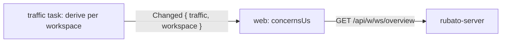

# Tell browsers about traffic changes in every workspace

The traffic task records each workspace's traffic gauges, but it compares the derived summary
and calls `notify("traffic")` from `default`'s map only (`crates/rubato-server/src/traffic/fetch.rs`).
A change that shows only in another workspace's view (a seam of its map gets quiet or busy, an
undeclared edge between its parts) waits for the next poll's refetch. This change remembers the
last summary per workspace and tells each workspace whose summary changed, with the
workspace-scoped `Changed` event that ADR 0049 already defines.

## What the change does

- A traffic report that changes a workspace's derived traffic (its seams, undeclared edges,
  ghosts, dismissals, unmapped services) tells that workspace's browsers:
  `Changed { reason: "traffic", workspace: <id> }`, once per report that changed it.
- A report that changes nothing in a workspace sends that workspace nothing; one that changes
  only `shop` does not make `default`'s browsers refetch.
- With one workspace the browsers are told as before (one event per change); the event now names
  `default`, which the web treats as its own (`concernsUs`, `web/src/shared/workspace.ts:80`).
  This is what ADR 0049 says a change of one map is: scoped to its workspace, so other
  workspaces' browsers stop refetching when only `default`'s traffic changed.

## How we'll know it works

- [ ] `overview::traffic_tests::a_change_in_one_workspace_tells_only_its_browsers`: two
      workspaces (Rubato's map as `default`, a `shop` map whose parts declare namespaceless
      services). The first report sends exactly `(traffic, default)` and `(traffic, shop)`
      (`drain` returns reason and workspace); a second report that changes only the
      calls on `shop`'s `storefront-checkout` seam sends exactly
      `Changed { traffic, workspace: shop }`; the same report again sends nothing. It prints
      how many events it checked.
- [ ] The same test fails on purpose against today's code: the second report sends no event,
      because `default`'s summary did not change (run before the fix, recorded in the PR).
- [ ] `the_dev_file_feeds_the_overview_and_the_instruments` still sees one `traffic` event per
      change with one workspace, and it now names `default`: `(traffic, Some("default"))`.
- [ ] `web/src/shared/workspace.test.ts`: on a page that has not learned its workspace
      (`forgetWorkspace()`), `concernsUs` is true for `workspace: "default"` and false for
      `workspace: "shop"`.

## What it must not break

- One workspace: one `traffic` event per changed summary and none for an unchanged one
  (`the_dev_file_feeds_the_overview_and_the_instruments`).
- Dismissals notify their own workspace (`traffic::dismiss_tests`).
- The traffic gauges per workspace: unchanged code, guarded by the same test.
- The web refetches on a `Changed` that names its workspace or none (`concernsUs`, web tests),
  including a page that has not learned its workspace yet (the new assertion above).
- A dismissal still notifies its workspace from the handler (`dismiss.rs`); the next tick then
  tells it once more, because `dismissed` is part of the compared summary. That was so for
  `default` already, and it stays harmless.

## How we'll debug it at 3 am

See the O-rows. The fan-out already logs `web fan-out` with `reason` and `rubato.workspace` for
every `notify_ws`; a workspace whose browsers never refresh on traffic shows no such line with
`reason=traffic` for it.

## Affected parts

| Node | Status | What changes | Seams |
| --- | --- | --- | --- |
| rubato-server | affected | the traffic task keeps the last told summary per workspace and calls `notify_ws("traffic", ws)` for each workspace whose summary changed | web-server |
| web | quiet | already refetches on a `Changed` naming its workspace | web-server |

## Data models

None.

## Data flow

## Tasks

1. Failing test first: `a_change_in_one_workspace_tells_only_its_browsers` in
   `crates/rubato-server/src/overview/traffic_tests.rs`, with a second workspace `shop` whose
   parts declare namespaceless services, so a change in `shop`'s edges leaves `default`'s
   summary as it was (its ends are unmapped there, counted by name only). Run it against today's
   code and see it fail on the second report.
2. `traffic/fetch.rs`: `told` becomes a map from workspace id to the last summary; after the
   gauges, each workspace whose summary differs is told with `notify_ws("traffic", ws)`;
   workspaces no longer loaded are dropped from `told` (defensive: no code path removes a
   loaded map today, so there is no test for it). `drain` returns `(reason, workspace)`.
   Update the doc comments.
3. `web/src/shared/workspace.test.ts`: the `concernsUs` assertion for a page that has not
   learned its workspace.
4. Run the server suite, the web tests, clippy and fmt.

## Assumed, not yet approved

| # | Decision | Chosen | Alternatives | Scope |
| --- | --- | --- | --- | --- |
| A1 | Which event `default` gets | `notify_ws("traffic", "default")`, like every other workspace, as ADR 0049 decides for a change of one map | keep the unscoped `notify` for `default` | node (settled by ADR 0049) |

## Decisions

| # | Decision | Chosen | Why | Decided by |
| --- | --- | --- | --- | --- |
| 1 | Approve plan for build | yes | approved by Mattias in the Claude Code session ("approve all"), 2026-11-16 | Mattias (m0x6A) |

## O-rows

| Seam | Breaks like | Signal | Panel | Owner |
| --- | --- | --- | --- | --- |
| web-server | a workspace's map shows old traffic until the next poll | Loki: log line `web fan-out` with `reason=traffic` and `rubato.workspace=shop`; no such line while `rubato.traffic.undeclared_edges` or `rubato.traffic.seams_quiet` with `rubato.workspace=shop` changes is this failure. Report age and fetches stay green here, so they only rule out the source | Traffic report age and Traffic fetches, to rule out the source | rubato-server |

## Flows

| From | To | Seam | Kind | Carries |
| --- | --- | --- | --- | --- |
| rubato-server | web | web-server | control | WebEvent Changed with reason traffic, per workspace whose derived traffic changed |

## ADRs proposed

None.

## Review map

1. `crates/rubato-server/src/traffic/fetch.rs` `record`: the per-workspace comparison.
2. `crates/rubato-server/src/overview/traffic_tests.rs`: the two-workspace test and its fixture.
