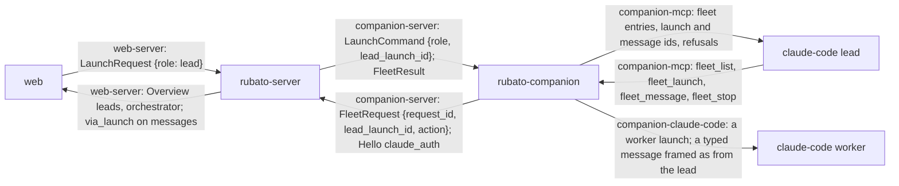

# A lead agent for your own fleet, behind a flag; headless hosts and API keys

Issue: #134 · Design: [134-orchestrator/design.md](134-orchestrator/design.md) · ADRs:
[0072](../decisions/0072-a-lead-agent-directs-only-its-owners-sessions.md) (supersedes parts of
0050 and 0071) and [0076](../decisions/0076-headless-companion-as-a-daemon-or-container-with-an-api-key.md),
both proposed · Map: flows changed on `companion-server`, `companion-mcp`, `web-server`; the
`claude-code` node's description.

Track: **full**. It changes the non-goals (ADR 0050), the protocol schema
(`schema/protocol/*.json`), flows on three seams in `docs/design/rubato-map.yml`, and adds a
dependency (a container image with Claude Code in it).

Today one person directs each agent. #134 asks for an "AI team lead" that directs a fleet of
agents in the person's place. It also asks that Claude can run through its API, and that an agent
can run as a daemon or in a container. This plan makes a **lead** a launch like any other. Over
the agent MCP (ADR 0071), a lead can list, launch, message and stop the sessions it launched for
its own owner, and nobody else's. It is built behind an orchestrator flag that is off by default
on both server and companion, and it is not deployed. Separately, and not behind the flag, the
plan documents how to host a headless companion (systemd, launchd, a container). Claude Code may
then use an API key, and the companion says which kind of auth it uses, never the key.

## What the change does

- **A person can start a lead agent** on an issue, through their own companion, when both the
  server (`RUBATO_ORCHESTRATOR=1`) and the companion (`orchestrator: true`) have the flag on. The
  web offers *Start as lead* only then (design §2, §7).
- **A lead can list its owner's own sessions** in the workspace, with state, progress and the
  last reply's first line (`fleet_list`).
- **A lead can start workers** on issues, as its owner, through the server's ordinary launch path
  and only on the owner's own connected companions. There are at most 4 live workers per lead, a
  lead cannot start a lead, and it cannot take an issue another person has launched or has a draft
  on (`fleet_launch`).
- **A lead can message and stop the workers it launched.** Messages go through the
  session-message queue, typed with a first line naming the lead; stops go through the existing
  stop path (`fleet_message`, `fleet_stop`).
- **The lead hears about its workers.** When a worker ends, blocks or goes idle after working, the
  lead gets a short fleet notice as a message, at most one per minute (design §2).
- **A lead can never touch another person's agent**, or one of its owner's sessions it did not
  launch. It cannot approve, review, decide, pin, merge, call into a room or edit the map. A
  refusal for another person's agent, or a forged lead identity, is counted and pages
  (`FleetCrossOwner`) (design §3).
- **Inside one OS user, isolation is limited, and the plan says so.** A lead secret in the lead's
  own `mcp.json` stops a worker that only knows the lead's launch id. A worker that reads the
  lead's files as the same OS user can still act as the lead, within the owner's own sessions and
  caps. ADR 0072 accepts this. The isolation available is a separate companion for the lead.
- **The team sees the fleet.** *lead* on the lead's session, *via lead* on its workers and on
  each message it sent.
- **With the flag off, nothing changes.** No `fleet` capability, no tools, a lead launch refused
  `orchestrator_off`, the overview's `orchestrator: false`.
- **Hosts are documented.** `docs/design/companion-hosts.md` says what each way of running a
  companion assumes: interactive with tmux and a logged-in `claude`, headless as a systemd or
  launchd service, or headless in a container from `Dockerfile.companion` (ADR 0076).
- **Claude through an API**: Claude Code authenticated by `ANTHROPIC_API_KEY`, Bedrock or Vertex.
  The companion announces `claude_auth:<kind>`, and the lane shows *API key*, *Bedrock* or
  *Vertex* (design §6).

## How we'll know it works

- [ ] An orchestration agent coordinates a fleet: a Gherkin scenario launches a lead with a
  stand-in `claude` that calls `fleet_launch`. The server sends a worker `LaunchCommand` with
  `lead_launch_id`. Then `fleet_message` queues a chat that the worker receives, framed "From
  …'s lead agent", and `fleet_stop` ends the worker.
- [ ] Own agents only (server, `fleet/tests.rs`, design §3, the alice and bob fixture):
  - a message or stop to bob's launch is refused `other_owner`, `session_messages` is unchanged,
    bob's companion gets nothing, and the counter carries `rubato.target_owner=bob`;
  - one to alice's own hand-started launch is refused `not_led`;
  - `fleet_launch` with bob's `companion_id` is refused by `launch::start`, and on an issue bob
    launched it is refused `someone_elses_issue`;
  - `fleet_list` never contains bob's launches;
  - a request on bob's socket naming the lead is refused `identity`, and one from a worker naming
    itself is refused `not_a_lead`.

  Each test prints its count. A must-fail `authorize` without the target check fails the first.
- [ ] Forged lead (companion `agent_mcp`): a call with a worker's own launch header gets no fleet
  tools in `tools/list`. A fleet call naming the lead's launch id without the lead secret, or with
  the wrong one, is refused `identity` and counted `rubato.reason="lead_secret"`.
- [ ] Notices: a worker going idle after working queues one `rubato` chat to its lead. Three
  changes within 60 s make one notice. With the flag off, none.
- [ ] Flag off by default: a `kernel/config.rs` test for each side. With the server flag off,
  every action is refused `orchestrator_off`, and a lead `LaunchRequest` from the web gets 409
  with `rubato.web.rejected{rubato.reason="orchestrator_off"}`. With the companion flag off, a
  `LaunchCommand {role: lead}` gets no fleet tools in `tools/list`.
- [ ] Replay safety: the same `request_id` from the same lead twice launches once. The same id with
  another action is refused `request_id_reused`. A row left `in_progress` past 60 s answers
  `unknown`. A recorded sequence replayed by the companion gets the stored `FleetResult`, not a
  bare ack. With the link down the tool answers `link_down`, and the outbox never holds a
  `FleetRequest`.
- [ ] Half-on flag: a lead launch to a companion that did not announce `fleet` is refused
  `companion_cannot_lead`, and the web offers *Start as lead* only on lanes with `can_lead`.
- [ ] No approval path: the ADR 0071 every-fixture test includes one `FleetRequest` fixture per
  action, with the approval tables unchanged. The ADR 0071 tool guard covers the four new tools,
  and its must-fail fixture still fails.
- [ ] The docs state the assumptions: `docs/design/companion-hosts.md` exists, README links it,
  and AGENTS.md's v0 scope names ADR 0072 and 0076.
- [ ] API auth: a `kernel/claude_auth.rs` test sets each of `ANTHROPIC_API_KEY`,
  `CLAUDE_CODE_USE_BEDROCK` and `CLAUDE_CODE_USE_VERTEX` to a marker value. It gets the kind, and
  the marker appears in no capability, span attribute or log line. A web lane test shows *API
  key* for `claude_auth:api_key`.
- [ ] Container, run by hand and listed in the PR (CI does not build the image):
  - `docker build -f Dockerfile.companion .` succeeds;
  - `docker run --rm <image> rubato-companion --version` prints the version;
  - with an interactive config it exits non-zero with "headless only in a container";
  - `pair` and `run` against a local dev server show the companion's lane as headless with its
    `claude_auth`.
- [ ] `FleetCrossOwner` fires in its promtool test, and `pnpm observability:check` counts it.

## What it must not break

- **No steering of another developer's agent** (AGENTS.md, ADR 0050). Guarded by the boundary
  tests above and the `FleetCrossOwner` alert.
- **Only the paired owner starts sessions, and nothing is inbound** (ADR 0004). `fleet_launch`
  calls `launch::start` as the owner. Guard: the existing `launch` tests for another user's
  companion (`launch/handler.rs:80-112`), plus the fleet test above.
- **An agent never approves** (ADR 0054). Guard: the every-fixture test and the tool guard.
- **Deployed behaviour.** The deployed server has no `RUBATO_ORCHESTRATOR`. Guard: the golden
  `overview.json` re-recorded with the flag off shows `orchestrator: false` and no `leads`. The
  existing launch, session-message and stop tests pass untouched.
- **At-most-once delivery** (ADR 0051): lead messages and notices use the same queue and states.
  Guard: `session_messages/tests.rs` unchanged and passing, plus `enqueue_via` tests for the empty
  and too-long checks with the first line counted.
- **A teammate's attempt budget** (`launch_count` counts every user's launches of an issue,
  `launch/store.rs:131`): a lead cannot launch on an issue another person launched in the last 30
  days or has a draft on. Guard: the `someone_elses_issue` test.
- **Room forks stay without MCP** (ADR 0057, 0071). Guard: the `kernel/claude.rs` fork-args test.
- **What leaves the machine** (ADR 0052, 0071): `FleetRequest` is stored with an empty payload in
  `companion_events`, and the message text reaches the server once, as a chat body. The API key
  never leaves. Guard: a `companion_link` test for the empty payload, and the `claude_auth` test.
- **Existing companions and servers.** Everything is gated by the `fleet` capability, and the new
  fields are serde-default. Guard: the protocol schema snapshot and the fixture replay in both
  suites.
- **The map and existing plans.** Every plan in `docs/plans/` still checks. Guard: `pnpm
  plan-check`.
- **Publishing workflows untouched.** `.github/workflows/` has no diff.

## How we'll debug it at 3 am

See the O-rows. New signals:
- span `rubato.fleet.request` and counter `rubato.fleet.requests{rubato.fleet.action,
  rubato.outcome, rubato.reason}` on the server;
- alert `FleetCrossOwner`, which pages on any `other_owner` or `identity` refusal (`not_led` is
  counted only);
- counter `rubato.fleet.notices{rubato.outcome}`;
- panel "Fleet requests by action and outcome";
- `rubato.claude.auth` on the companion's Hello and `rubato.launch` spans;
- `rubato.mcp.calls{rubato.mcp.tool=~"fleet_.*"}` with `rubato.outcome="pending"` (no result within
  15 s) and `rubato.reason="lead_secret"` or `"link_down"`.

New log lines:
- server: `warn!(rubato.launch_id, rubato.target_launch_id, rubato.target_owner, rubato.reason, "fleet request refused")`;
- companion: `warn!(rubato.launch_id, "lead launch without orchestrator")`, for a lead command
  refused because the companion's flag is off.

## Affected parts

| Node | Status | What changes | Seams |
| --- | --- | --- | --- |
| rubato-protocol | affected | `LaunchRole`, `role` and `lead_launch_id` on `LaunchRequest` and `LaunchCommand`, `FleetRequest`, `FleetAction`, `FleetResult`, `FleetEntry`, capability `fleet`, the `claude_auth:` prefix, `SessionMessageView.via_launch`, `Overview.leads` and `orchestrator`, otel names, fixtures | companion-server, web-server |
| rubato-server | affected | new slice `fleet` (claim, authorize, list, launch, message, stop, notices; table `fleet_requests`); `launch` takes a role, stores `role` and `lead_launch_id` columns, and refuses a lead with the flag off or to a companion without `fleet`; `session_messages` gains `enqueue_via` and `stop_as`; `companion_link` dispatches `FleetRequest`, answers its replay with the stored result, and hands `Sessions` to `fleet` for notices; overview `leads` and `can_lead`; `RUBATO_ORCHESTRATOR`, `RUBATO_FLEET_MAX`; migration `0028_fleet.sql` | companion-server, web-server |
| rubato-companion | affected | `agent_mcp` lists the four fleet tools for a lead launch with the flag on and the lead secret; the lead secret in the lead's `mcp.json` and `leads.json`; `server_link` sends `FleetRequest` only while the link is up, never through the outbox, and routes `FleetResult`; `LaunchRecord` gains `role` and `lead_launch_id`; `kernel/claude_auth.rs`; `orchestrator` config; the container refuses interactive mode | companion-mcp, companion-server, companion-claude-code |
| claude-code | affected | a lead session calls the fleet tools; may be authenticated by an API key | companion-mcp, companion-claude-code |
| web | affected | *Start as lead* when `orchestrator`; *lead* and *via lead* chips; *via lead agent* on chat messages; *API key* on the lane | web-server |
| skill-rubato | affected | `prompt-lead.md`, the lead's launch prompt, embedded in the server | |

## Data models

| Model | Kind | Part | Change | Crosses | Note |
| --- | --- | --- | --- | --- | --- |
| `LaunchRole`, `LaunchRequest.role` | type | rubato-protocol | new | web-server | `worker` default, `lead` behind the flag |
| `LaunchCommand.role`, `LaunchCommand.lead_launch_id` | type | rubato-protocol | changed | companion-server | serde default |
| `CompanionMessage::FleetRequest`, `FleetAction` | type | rubato-protocol | new | companion-server | `{request_id, lead_launch_id, action}`; never in the outbox |
| `ServerMessage::FleetResult`, `FleetEntry` | type | rubato-protocol | new | companion-server | outcome (`ok`, `refused`, `in_progress`, `unknown`), reason, fleet, launch or message id |
| `RefusalReason::OrchestratorOff` | type | rubato-protocol | new | companion-server | a lead command to a companion with its flag off |
| capability `fleet`, prefix `claude_auth:` | type | rubato-protocol | new | companion-server | Hello and Welcome |
| `SessionMessageView.via_launch` | type | rubato-protocol | changed | web-server | the lead that sent it |
| `Overview.leads`, `Overview.orchestrator`, `CompanionView.can_lead` | type | rubato-protocol | changed | web-server | empty and false while the flag is off |
| `companion_envelope`, `server_envelope`, `overview` schemas | schema | rubato-protocol | changed | companion-server | additive |
| `fleet_requests` | table | rubato-server | new | | migration `0028_fleet.sql` (or the next free number), slice `fleet`; key (companion, lead, request id) with the action hash, claimed before acting; pruned after 30 days |
| `session_messages.via_launch` | table | rubato-server | changed | | nullable column, same migration |
| `launches.role`, `launches.lead_launch_id` | table | rubato-server | changed | | nullable columns, same migration; indexes `launches_by_lead` and `launches_by_user` |
| `rubato.fleet.notices` | event | rubato-server | new | companion-server | counter; a notice is a `rubato` chat to the lead |
| `rubato.fleet.request`, `rubato.fleet.requests` | event | rubato-server | new | companion-server | span and counter |
| `FleetCrossOwner` | file | rubato-server | new | | alert rule and its promtool test |
| fleet MCP tools | type | rubato-companion | new | companion-mcp | `fleet_list`, `fleet_launch`, `fleet_message`, `fleet_stop` |
| `LaunchRecord.role`, `lead_launch_id` | file | rubato-companion | changed | | `launches.json`, serde default |
| lead secret | file | rubato-companion | new | companion-mcp | header `X-Rubato-Lead` in the lead's `mcp.json` (0600) and the state dir's `leads.json` (0600); in no environment variable |
| `companion.orchestrator` | file | rubato-companion | new | | `local.yml`, default false |
| `Dockerfile.companion` | file | rubato-companion | new | companion-claude-code | headless image, not built by CI |
| `docs/design/companion-hosts.md` | file | rubato-companion | new | | hosts and their assumptions |
| `prompt-lead.md` | file | skill-rubato | new | | the lead's launch prompt |

## Data flow

## Tasks

0. **Wait for the agent MCP.** These must merge first (ADR 0071):
   - #220–#225: `/mcp`, the `agent_mcp` slice, `mcp.json`, the launch flags and `server_link`;
   - #226: the every-fixture approval guard;
   - #227: its migration;
   - #228: it changes the same files.

   The MCP panel comes with them. This build starts on main after they merge (A1).
1. **Protocol** (failing first: round-trip tests for `FleetRequest`, `FleetResult` and
   `LaunchCommand {role: lead}`, none of which compile yet). Add the types, the capability, the
   otel names, one fixture per action, and `schema.rs`. Run `UPDATE_SCHEMAS=1` on the schema
   snapshot and regenerate `web/src/protocol.ts`.
2. **Map** (failing first: the tests that pin the real map, with the new flows in
   `rubato-map.yml`). Edit the flows on `companion-server`, `companion-mcp` and `web-server` and
   the `claude-code` description. Re-record goldens with `UPDATE_GOLDEN=1`.
3. **Server `fleet` slice** (failing first: the boundary tests of design §3, the replay tests and
   the notice tests). Add the migration (`fleet_requests`, the `launches` columns and indexes,
   `via_launch`), the claim, `authorize`, list, launch, message, stop and notices. Also add
   `session_messages::enqueue_via` (with the text checks) and `stop_as`, the `companion_link` arms
   (dispatch, replay, `Sessions`), the empty payload, the counters and span, and the AGENTS.md
   server block.
4. **Server `launch` and flag** (failing first: a lead `LaunchRequest` with the flag off is 409
   `orchestrator_off`, one to a companion without `fleet` is 409 `companion_cannot_lead`, and a
   config test pins the default off). Add `RUBATO_ORCHESTRATOR`, `RUBATO_FLEET_MAX`, the `fleet`
   Welcome capability, `prompt-lead.md`, and `leads`, `orchestrator` and `can_lead` in the
   overview. Re-record the golden overview.
5. **Companion** (failing first: `tools/list` for a lead launch with the flag on and the secret
   lists the four tools; with the flag off, for a worker, or without the secret, it does not; the
   outbox never holds a `FleetRequest`). Add the `orchestrator` config, the `LaunchRecord` fields,
   the lead secret in `mcp.json` and `leads.json`, the tool handlers, `FleetRequest` out (link up
   only) and `FleetResult` routing with the 15 s wait, the `pending` and `link_down` answers, the
   lead-command refusal, and the tool-guard fixture. Then the Gherkin scenario of "How we'll
   know".
6. **Claude auth** (failing first: the `claude_auth` marker test). Add `kernel/claude_auth.rs`, the
   Hello capability, and the span attributes.
7. **Web** (failing first: lane tests for *lead*, *via lead* and *API key*, a chat test for *via
   lead agent*, and the Start menu with and without `orchestrator`).
8. **Hosts** (failing first: a companion test that `run` with `RUBATO_IN_CONTAINER=1` and an
   interactive config exits with its message). Add `Dockerfile.companion`,
   `docs/design/companion-hosts.md` with the systemd unit and the launchd plist, the README link,
   and AGENTS.md's scope lines. Build and run the image by hand.
9. **Observability** (failing first: the promtool test for `FleetCrossOwner` with no rule). Add the
   rule, the panel, and the never-silent line in AGENTS.md. Run `pnpm observability:check` and
   `:test`.
10. All checks: fmt, clippy, cargo test per crate, the Gherkin suites, `pnpm typecheck`, `pnpm
    test`, plan-check, observability, and `pnpm e2e`. Then the PR.

## Assumed, not yet approved

| # | Decision | Chosen | Alternatives | Scope |
| --- | --- | --- | --- | --- |
| A1 | Build order against the agent MCP | build on main after #220–#225 merge; if they have not merged when this plan is approved, wait | fold a minimal `/mcp` into this build (overlaps the builder of #220) | node (rubato-companion) |
| A2 | Fleet size | 4 live workers per lead, `RUBATO_FLEET_MAX` | unbounded; 2 | node (rubato-server) |
| A3 | Result wait in the companion | 15 s, then `pending` with the request id | block until the result; 60 s | node (rubato-companion) |
| A4 | Notice coalescing | at most one notice per lead per 60 s, listing every change since the last | one per change; none | node (rubato-server) |
| A8 | `someone_elses_issue` window | another user's launch of the issue in the last 30 days, or a draft they own | any launch ever; live launches only | node (rubato-server) |
| A9 | A claim left `in_progress` | answered `unknown` after 60 s, never acted on again | retry it | node (rubato-server) |
| A5 | `fleet_list` bound | live or launched in the last 24 h, at most 50, the last reply's first line at most 200 characters | the whole history | node (rubato-server) |
| A6 | `fleet_requests` retention | 30 days, pruned on insert | forever | node (rubato-server) |
| A7 | Claude Code version in the image | an `ARG`, default 2.1.317 (2026-11-02); bumped by hand | latest at build | node (rubato-companion) |

## Decisions

| # | Decision | Chosen | Why | Decided by |
| --- | --- | --- | --- | --- |
| 1 | Who a lead may direct | only the sessions it launched for its own owner; `fleet_list` reads all of the owner's launches in the workspace | the narrowest scope that gives the issue a fleet; an owner's hand-started sessions do not change under them; it can widen with a new ADR | agent (delegated by Mattias, 2026-11-15) |
| 2 | Where the boundary is checked | on the server, in one `fleet::authorize`, from the pairing and the stored launch, never from tool arguments | the server holds who owns which launch; the companion only knows its own | agent (delegated by Mattias, 2026-11-15) |
| 3 | Channel | four tools on ADR 0071's agent MCP, one `FleetRequest` and `FleetResult` pair on the companion websocket | builds on the existing identity and transport; no new route or credential | agent (delegated by Mattias, 2026-11-15) |
| 4 | Is a lead a new kind of client? | no; a launch with `role: lead` on an issue, with that issue's caps | reuses caps, branch, log and visibility | agent (delegated by Mattias, 2026-11-15) |
| 5 | Revisit existing issues for the one-human assumption? | no; a lead is one person's delegate, and approval and merge stay human | every rule about people stays true | agent (delegated by Mattias, 2026-11-15) |
| 6 | "The API version of Claude" | Claude Code authenticated by an API key, Bedrock or Vertex; no Messages API agent loop | ADR 0003 holds; hooks, log, forks and plans keep working | agent (delegated by Mattias, 2026-11-15) |
| 7 | Daemon or container | a headless companion as a systemd or launchd service, or in a plain container from `Dockerfile.companion`; no Docker-in-Docker, no Docker socket; CI does not build or publish it | the socket is root on the host; publishing would change a workflow | agent (delegated by Mattias, 2026-11-15) |
| 8 | Flag scope | the orchestrator flag gates only the lead; hosts, docs and `claude_auth` are not behind it | they change no non-goal; `claude_auth` is a label | agent (delegated by Mattias, 2026-11-15) |
| 9 | How auth kind is reported | a `claude_auth:<kind>` capability string in Hello, from which variables are set, never their values | the `skill:` prefix is the precedent; no schema field for a label | agent (delegated by Mattias, 2026-11-15) |
| 10 | Two ADRs | 0072 for the lead (a non-goal change), 0076 for hosts and API keys (a dependency) | they are separate decisions that a person may accept separately | agent (delegated by Mattias, 2026-11-15) |
| 11 | How a worker can tell its lead from its person | the server writes a first line naming the lead into the message body; the companion types it as any chat; the worker's launch prompt says it was started by a lead | the worker and the team can tell who is speaking | agent (delegated by Mattias, 2026-11-15) |
| 12 | Isolation inside one OS user | accept, on the record in ADR 0072, that any of the owner's sessions on the lead's companion could act as the lead; add a lead secret in the lead's own `mcp.json` that raises the bar; real isolation is a separate companion for the lead | the harm stays within the owner's own sessions and caps; per-worker OS users or sandboxes are a large build (review blocker 1) | agent (delegated by Mattias, 2026-11-15) |
| 13 | Replay | claim (companion, lead, request id, action hash) before acting; a repeat answers the stored result; `FleetRequest` never in the outbox, `link_down` while disconnected; a replayed sequence gets its stored result; no client-side expiry | no double launch, and no clock skew (review blocker 3) | agent (delegated by Mattias, 2026-11-15) |
| 14 | Refusal reasons | `other_owner` (pages), `not_led` (counted only), `identity` (pages), `not_a_lead`, `someone_elses_issue`, `fleet_full`, `request_id_reused`, `orchestrator_off`, `companion_cannot_lead` | a page should mean the line between people was tested (review should-fix 4) | agent (delegated by Mattias, 2026-11-15) |
| 15 | What wakes a lead | the server queues coalesced fleet notices to the lead when a worker ends, blocks or goes idle after working | without them, a lead's next turn needs its person (review should-fix 7) | agent (delegated by Mattias, 2026-11-15) |
| 16 | Superseded in part | 0004, 0050, 0051, 0062 and 0071, with the new sentence for each; AGENTS.md lines on orchestration qualified by the flag | each of them says only the person may start, message or stop their sessions (review blocker 2) | agent (delegated by Mattias, 2026-11-15) |

## O-rows

| Seam | Breaks like | Signal | Panel | Owner |
| --- | --- | --- | --- | --- |
| companion-server | a lead's request refused for the wrong reason, a cross-owner attempt, a replayed request acting twice, results or notices not reaching the companion | span `rubato.fleet.request` with `rubato.launch_id`, `rubato.target_launch_id`, `rubato.target_owner`, `rubato.fleet.action`, `rubato.outcome`, `rubato.reason`; counters `rubato.fleet.requests` and `rubato.fleet.notices`; alert `FleetCrossOwner` on `rubato.reason=other_owner\|identity`; `rubato.events.dropped{rubato.reason="schema"}` for a malformed request; `rubato.claude.auth` on the Hello span | Fleet requests by action and outcome (new, Trust check row) | rubato-server |
| companion-mcp | fleet tools missing for a lead, listed for a worker, or answering `pending` because results do not come back | `rubato.mcp.calls{rubato.mcp.tool=~"fleet_.*", rubato.outcome}` with `pending` and `refused`; span `rubato.mcp.call` with `rubato.launch_id`; `warn!(rubato.launch_id, "lead launch without orchestrator")` | MCP calls by tool and outcome | rubato-companion |
| companion-claude-code | a worker started by a lead fails to launch, a lead's message or a notice is not typed, or an API-key host fails every turn (bad or expired key) | span `rubato.launch` with error status and `rubato.claude.auth`; `rubato.session_input.deliver` for the lead's messages; `rubato.headless.turns{rubato.outcome="failed"}` with the `result` error | Headless turns | rubato-companion |
| web-server | *Start as lead* shown while the flag is off, or a lead launch accepted while off | `rubato.web.rejected{rubato.reason="orchestrator_off"}` rising; the overview's `orchestrator` field in the golden test | Web writes rejected | rubato-server |

## Flows

| From | To | Seam | Kind | Carries |
| --- | --- | --- | --- | --- |
| web | rubato-server | web-server | control | LaunchRequest with role lead, only while the orchestrator flag is on |
| rubato-server | web | web-server | data | Overview leads and orchestrator; via_launch on session messages; claude_auth on the companion lane |
| claude-code | rubato-companion | companion-mcp | control | a lead's fleet_launch, fleet_message and fleet_stop calls |
| claude-code | rubato-companion | companion-mcp | data | a lead's fleet_list call |
| rubato-companion | claude-code | companion-mcp | data | fleet entries, launch and message ids, refusals with a reason, pending with a request id |
| rubato-companion | rubato-server | companion-server | control | FleetRequest from a lead launch: list, launch, message or stop the owner's own sessions it started |
| rubato-server | rubato-companion | companion-server | data | FleetResult; LaunchCommand with role and lead_launch_id |
| rubato-server | rubato-companion | companion-server | control | a fleet notice to the lead, as a session message, when a worker ends, blocks or goes idle |
| rubato-companion | rubato-server | companion-server | data | Hello capability claude_auth with the kind only |
| rubato-companion | claude-code | companion-claude-code | control | a worker launch started by a lead; a lead's message typed with a first line naming the lead |

## ADRs proposed

| ADR | File | Blob |
| --- | --- | --- |
| 0072 | docs/decisions/0072-a-lead-agent-directs-only-its-owners-sessions.md | 129a1689904d7dd31448f0cc89dd7220a00ec70f |
| 0076 | docs/decisions/0076-headless-companion-as-a-daemon-or-container-with-an-api-key.md | a742bd40ee8e629b8b93d7d6cc3ef5c2ad30c1cc |

## Review map

1. Design §3 and `crates/rubato-server/src/fleet/authorize.rs`: the one function that keeps a
   lead to its own owner's sessions, and the tests that try to break it.
2. ADR 0072's Supersedes: what changes in ADR 0050 and 0071, and what stands.
3. Design §7: both flags default off; the golden overview with the flag off.
