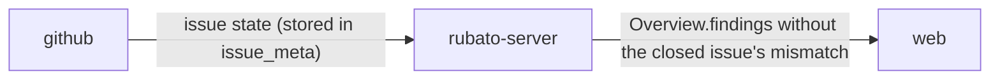

# A closed issue keeps raising MapVersionMismatch forever

The overview deployed at `sha-cebcbe2` shows *m0x6A/rubato#47 was launched with map 064fba6;
the server holds cebcbe2*. #47 was closed on 2026-11-11, and its work merged through #48's
branches. Progress reaches *Done* only from a merged pull request of the issue's own branch, so
the finding's guard (`state != Done`) never lets it go. The issue's GitHub state is already
stored (`issue_meta.github_state`), so the fix needs no extra GitHub call.

## What the change does

- `MapVersionMismatch` is raised only while the issue is open on GitHub. A closed issue whose
  work merged elsewhere stops raising it.

## How we'll know it works

- [ ] A launch at an older map version, on an issue whose `github_state` is `closed` and with no merged pull request, raises no `MapVersionMismatch`; the same launch on an open issue, or one whose state is not yet known, still raises it (`overview/build.rs` unit test).
- [ ] The golden test (`tests/workspaces_golden.rs`) still shows the mismatch for its open issue, unchanged.

## What it must not break

- The progress model: Done still comes only from a merged pull request (`derive_progress` tests unchanged); this changes the finding, not the state.
- An issue whose state is not yet read (no `issue_meta` row) still raises the finding: unknown is not closed (the unit test's third case).
- The golden overview of a single-map server (`tests/workspaces_golden.rs`).

## How we'll debug it at 3 am

See the O-row. The finding is shown on the map and in the panel; nothing new is logged.

## Affected parts

| Node | Status | What changes | Seams |
| --- | --- | --- | --- |
| rubato-server | affected | the `MapVersionMismatch` guard also skips an issue closed on GitHub | web-server |

## Data models

None.

## Data flow

## Tasks

- [ ] Failing unit test first in `overview/build.rs`: one launch at an older map version on three issues (closed, open, state unknown); only the open and unknown ones raise the finding. It fails on purpose before the guard changes.
- [ ] Guard: skip when `inputs.meta` says the issue's `github_state` is `closed`.
- [ ] Run the server suite, including the golden test.

## Assumed, not yet approved

| # | Decision | Chosen | Alternatives | Scope |
| --- | --- | --- | --- | --- |
| A1 | Which closed issues stop raising it | every closed issue, merged or not: a closed issue has no session to mislead | only closed with a merged pull request somewhere | node |

## O-rows

| Seam | Breaks like | Signal | Panel | Owner |
| --- | --- | --- | --- | --- |
| web-server | a real mismatch on an open issue is hidden, or a closed one still shows | the `map_version_mismatch` finding in `Overview.findings`, per issue; covered by the unit test and the golden test in CI | Interactive map | rubato-server |

## Flows

| From | To | Seam | Kind | Carries |
| --- | --- | --- | --- | --- |
| rubato-server | web | web-server | data | Overview.findings without a closed issue's map version mismatch |

## ADRs proposed

None.

## Review map

1. The guard in `crates/rubato-server/src/overview/build.rs` (the `launch_map_versions` loop): closed means `github_state == "closed"`; an unknown state still raises the finding.
