# Overlay the observed system on the map and merge what it shows

Issue: #140, with #107 and #142 in the same unit · Design:
[140-observed-system/design.md](140-observed-system/design.md) · Map: `skill-rubato`,
`plan-check`, `rubato-companion`, `rubato-protocol`, `rubato-server`, `web`, `system-map`.

Track: **full**. New wire types change `schema/protocol/*.json`, a part gains `service` in
`schema/system-map.schema.json`, a new external source is read, and the seams `web-server`,
`server-system-map` and `companion-claude-code` change.

#140 asks for the system as telemetry sees it, drawn over the declared map, so that a person can
take what differs into the shared map draft and merge it. It needs two other things first, so
the three issues are planned as one unit, approved once and landed as three pull requests:

- **#142**: skills emit telemetry;
- **#107**: production gets a real source of observed traffic.

Two premises do not hold:

- **The session's commands do not inherit `OTEL_*`.** #142 says every command a launched session
  runs inherits `OTEL_RESOURCE_ATTRIBUTES`. Claude Code documents that it "doesn't pass `OTEL_*`
  environment variables to the subprocesses it spawns, including the Bash tool"
  (code.claude.com/docs/en/monitoring-usage). The companion therefore also exports the same
  values as `RUBATO_OTEL_*`, and the script reads the standard names first (design §2.2).
- **Traffic is not matched by namespace and name today.** #140 asks for identity by
  `service.namespace` + `service.name`. Today a service matches the part whose id equals its
  `service.name` (`crates/rubato-protocol/src/traffic.rs:212`). This plan replaces that rule, so
  ADR 0059 supersedes the identity sentence of ADR 0039.

## What the change does

- **Skills emit spans (#142).** `skills/rubato/scripts/otel-emit.ts` has no dependencies.
  - It sends one OTLP/JSON POST per process to the standard OTLP endpoint.
  - Every rubato skill command gets a span, and its calls to GitHub, the map file and the plan
    file are client spans with `peer.service`.
  - A shell-only skill wraps a command with `otel-emit.ts span --name <n> --peer 
 -- <cmd>`.
  - With no endpoint, or an endpoint that does not answer, the scripts behave exactly as today.
- **plan-check emits the same span (#142 Q2)** when the workflow sets an endpoint. Its log line is
  unchanged.
- **The companion hands the session its telemetry settings (#142).**
  - It merges `OTEL_RESOURCE_ATTRIBUTES` instead of overwriting it.
  - It mirrors the endpoint, protocol, headers and resource attributes as `RUBATO_OTEL_*`, which
    Claude Code passes to Bash.
  - When Claude Code's tracing is on, the script parents its span on `TRACEPARENT`.
- **Production traffic comes from the service graph (#107, ADR 0040).** A new adapter behind the
  `Source` port asks a Prometheus-compatible query API for the OTel servicegraph connector's
  request and failure totals over the window, and fills `TrafficReport`. PromQL, metric and label
  names and credentials stay inside the adapter. Unconfigured, nothing changes.
- **A part says which service it is (ADR 0059).** A map part may carry
  `service: {namespace?, name}`, exactly as its service emits it.
  - A part without `service` is never matched. There is no match on the id, and no match on the
    name alone.
  - A part with no `namespace` matches only ends that emit none, such as servicegraph virtual
    nodes from `peer.service`.
- **Ghost parts.** A service in a fresh report that emits a namespace and matches no part is drawn as a dashed ghost
  part, with its namespace, name and calls, in a band right of the declared map. Declared parts
  never move.
- **Observed-only edges.** Calls to or from a ghost are drawn as territory edges, like #104's
  undeclared edges between two parts.
- **Declared but not observed.** As `SeamQuiet` today, a seam is quiet when both its parts
  declare `service`, both are observed, and the seam carries no calls. A part without telemetry is
  never quiet.
- **Take into the draft.** The Traffic lens's inspector offers one action per discrepancy, opening
  the map draft with the operation prefilled and the person as its author:
  - a ghost becomes *add part*, with id, kind and `service` prefilled;
  - an observed-only edge becomes *add seam*, with from, to and id prefilled;
  - a quiet seam becomes *remove seam*.

  The person edits, proposes and merges as with any draft (ADR 0018). Once the PR is merged and
  the map reloaded, the discrepancy is declared.
- **Dismiss (ADR 0060).**
  - A person can dismiss a discrepancy for the workspace. It is hidden from the overlay and the
    findings, and listed under "Dismissed (n)" in the legend with who dismissed it and an Undo.
  - Dismissals live on the server, never in the map file.
  - They are never an input to progress, pins, plans or approvals.
- **Unknown stays unknown.** A stale, failing or unconfigured source draws no ghosts, no edges and
  no actions, and says why.

## How we'll know it works

- [ ] **otel-emit, by test** (`skills/rubato/test/otel-emit.test.ts`, against a `node:http` fake
  collector):
  - the OTLP/JSON body carries the span, `service.name`, the namespace from
    `OTEL_RESOURCE_ATTRIBUTES`, and the `rubato.*` attributes;
  - with no endpoint, nothing is sent and nothing is printed;
  - with a collector that never answers, the call returns within 1 s;
  - a valid `TRACEPARENT` becomes the parent;
  - `RUBATO_OTEL_*` is read only when `OTEL_*` is unset;
  - under `grpc`, nothing is sent;
  - the CLI passes stdout, stderr and the exit code through unchanged.
- [ ] **Names** (`skills/rubato/test/otel-names.test.ts`): every span and attribute name the
  scripts pass is in `crates/rubato-protocol/src/otel.rs` or the OTel semconv list, and it prints how many names it
  checked. Must fail:
  `test/fixtures/otel-bad-name.ts` emits `rubato.skill.bogus`.
- [ ] **Skill commands**: `plan.ts check` under the fake collector sends one `rubato.skill.command`
  span and a `rubato.skill.call` client span with `peer.service=plan-file`, and its stdout is
  byte-identical with and without an endpoint.
- [ ] **plan-check** (`actions/plan-check/test/otel.test.ts`): one span when
  `OTEL_EXPORTER_OTLP_ENDPOINT` is set; output byte-identical without it.
- [ ] **Companion launch script** (`crates/rubato-companion/src/launch/script.rs` tests):
  - the `RUBATO_OTEL_*` mirrors are exported;
  - `OTEL_RESOURCE_ATTRIBUTES` keeps an inherited `service.namespace`;
  - no header value is written into the script as a literal.
- [ ] **Prometheus adapter** (`crates/rubato-server/src/traffic/tests.rs`, axum fake on
  `127.0.0.1:0` serving `crates/rubato-server/tests/fixtures/prometheus/*`):
  - the query text, the namespace labels and the auth header are as configured;
  - each case gives the expected report or state: ok, empty namespace label, failures above
    requests (capped), HTTP 500 (failing), slow (times out, failing), garbage (rejected),
    2 001 series (cut, `truncated`);
  - must fail: `matrix.json` is rejected as `parse`;
  - the test prints how many fixtures it served.
- [ ] **Config**: setting both `RUBATO_DEV_TRAFFIC` and `RUBATO_TRAFFIC_PROMETHEUS_URL` is a
  startup error; headers never appear in a log line (the test captures the log).
- [ ] **Derivation** (fixtures in `crates/rubato-protocol/fixtures/traffic/`):
  - a ghost and its ghost edge;
  - the same `service.name` in two namespaces gives two ghosts;
  - a namespaceless end matches `{name: github}`, and a namespaced end does not;
  - a part without `service` is never matched or quiet;
  - a quiet seam requires `service` on both parts;
  - a dismissed key is hidden and listed;
  - an end with neither a namespace nor a namespaceless part is counted only;
  - must fail: `must-fail/name-only.json` expects a match on name alone and is rejected.
- [ ] **Map identity**: `SystemMap::validate` refuses two parts with the same service; the draft's
  `apply` refuses it as `duplicate_service`; YAML round trip keeps `service`. Must fail:
  `actions/plan-check/test/fixtures/duplicate-service-map.yml`.
- [ ] **Dismissals** (server slice tests):
  - `POST /api/w/{ws}/traffic/dismissals` records the author from the session;
  - `DELETE …/{id}` undoes;
  - a second dismissal of the same key is idempotent;
  - the 501st is refused;
  - another workspace does not see it;
  - each change notifies `/ws/web`.
- [ ] **Overlay** (Vitest):
  - the ghost band leaves every declared position identical;
  - for `not_configured`, `stale` and `failing` there are no ghosts, no ghost edges and no actions;
  - a ghost and a draft-added part take no issue drops;
  - "Take into draft" prefills the add-part form with `service`, and nothing is posted until the
    person submits;
  - the add-seam action is disabled until the ghost's add-part op is in the draft.
- [ ] **Loop** (`web/e2e/map.spec.ts` with a stubbed fresh overview and draft): take a ghost and
  its edge into the draft, then reload with a map that has them; the ghost disappears and the
  seam shows declared.
- [ ] **Screenshots**: `map-traffic-ghosts` in `shots.spec.ts`, dark and light, both widths,
  reviewed by a person in PR 3.
- [ ] **Alerts and dashboard**: `observability/check.ts` passes with the new panels; the
  `TrafficReportStale` test still fires and stays silent when unconfigured.

## What it must not break

- **Skill stdout**, which Claude Code reads: byte-identical tests above; `skill.test.ts` and
  `approval.test.ts` unchanged.
- **No new npm dependencies, no Python**: `skills/rubato/package.json` and
  `actions/plan-check/package.json` dependency lists unchanged (checked in review).
- **ADR 0018**: one shared draft, a person as author of every op, ids never renamed, refusal of a
  proposal that no longer applies. Existing `map_draft` tests unchanged; ghosts never post an op
  on their own (Vitest above).
- **ADR 0039**: one report shape. Unknown is never quiet: the existing
  `every_non_fresh_state_is_unknown_never_quiet` test, extended with ghosts. Traffic is never an
  input to progress, pins, plans or approvals: `traffic_does_not_change_any_issue_summary`
  (`crates/rubato-server/src/overview/build.rs:795`), extended with dismissals.
- **#104's encodings**: chevrons only in Traffic, dots and rings in Data and Control, reduced motion
  stops all of it. `traffic.test.tsx`, `particles.test.tsx`, `web/e2e/motion.spec.ts`; the
  particle cap of 120 counts ghost-edge chevrons.
- **Shared layout (ADR 0016)**: ghosts never reach `PUT /api/layout`; existing layout tests
  unchanged.
- **Pins, `Map:` lines, plans and new issues** check the merged map only
  (`crates/rubato-server/src/pins/map_lines.rs:17`, `crates/rubato-protocol/src/plan.rs:214`),
  so a ghost can't be named until merged. Existing tests unchanged.
- **Dev traffic files without namespaces** stay valid (the new fields are additive). Their ends
  match only parts that declare a namespaceless `service`; QUICKSTART says so.
- **Names from outside the team stay text**: service names come from whoever emits telemetry.
  They are capped at 200 bytes, rendered as text, and never become an id without the person
  submitting the draft form, where `valid_id` checks them (`crates/rubato-server/src/map_draft/apply.rs:6`).
  A dismissal key is built from the same capped fields.
- **Slice layout**: the server slice test with `traffic` owning `traffic_dismissals`, and the
  AGENTS.md block in step.

## How we'll debug it at 3 am

See the O-rows. The trust check comes first, as in #104: `rubato.traffic.report_age` and
`rubato.traffic.fetches{rubato.outcome}`, now labelled with `rubato.traffic.source`. If the
report is fresh and nothing lights, go through these in order:

1. `rubato.traffic.unmapped_services`, which now counts only ends with no identity to match.
2. `rubato.traffic.ghost_parts`: services that emit but are not on the map.
3. A missing `service` on the part in the map.

New logs:

- `traffic report rejected` gains the Prometheus reasons;
- `traffic dismissal added` and `traffic dismissal removed`, with the author and key;
- `map draft refused` with `duplicate_service`.

For skills, a session with `rubato.issue` but no `rubato.skill.command` spans on the "Skills
emitting" panel means the env mirror did not reach the session.

## Affected parts

| Node | Status | What changes | Seams |
| --- | --- | --- | --- |
| skill-rubato | affected | `scripts/otel-emit.ts` (new): library and CLI; spans around every command; client spans with `peer.service`; README for other skills | skill-github, skill-plan-file, skill-system-map |
| plan-check | affected | `src/cli.ts` sends a `rubato.skill.command` span through `otel-emit.ts` when an endpoint is set | plan-check-plan-file |
| rubato-companion | affected | `launch/script.rs`: merged `OTEL_RESOURCE_ATTRIBUTES`, `RUBATO_OTEL_*` mirrors | companion-claude-code |
| rubato-protocol | affected | `TrafficEdge` namespaces; `MapNode.service`; ghosts, ghost edges, dismissals in `ObservedTraffic`; `Finding::ObservedOnlyPart`; `derive_traffic` matching; `otel.rs` names; schema files | web-server, server-system-map |
| rubato-server | affected | slice `traffic`: Prometheus adapter, source selection, dismissals table and routes; `map_draft` YAML keys and `duplicate_service`; overview build passes dismissals | web-server, server-system-map |
| web | affected | Traffic lens: ghost band, ghost cards, edges to ghosts, inspector actions, dismissed legend; DraftPanel prefill and `service` inputs; `findingText` | web-server |
| system-map | affected | `schema/system-map.schema.json` gains `service`; `docs/design/rubato-map.yml` declares it on Rubato's own parts | server-system-map, skill-system-map |
| claude-code | quiet | read as documented: strips `OTEL_*` from Bash, sets `TRACEPARENT` when its tracing is on | companion-claude-code |
| github | quiet | target of `peer.service=github` client spans; nothing changes in what is called | skill-github |
| plan-file | quiet | target of `peer.service=plan-file` client spans; format unchanged | skill-plan-file, plan-check-plan-file |

## Data models

| Model | Kind | Part | Change | Crosses | Note |
| --- | --- | --- | --- | --- | --- |
| `TrafficEdge.client_namespace`, `server_namespace` | type | rubato-protocol | changed | web-server | additive, `Option<String>`, ≤ 200 bytes; `traffic_report.schema.json` |
| `ServiceId`, `MapNode.service` | type | rubato-protocol | new | server-system-map | `{namespace?, name}`; unique per map |
| `service` on a part | schema | system-map | changed | server-system-map | `schema/system-map.schema.json`, `additionalProperties: false` |
| `GhostPart`, `GhostEdge`, `TrafficEnd`, `TrafficDismissal`, `DiscrepancyKey` | type | rubato-protocol | new | web-server | in `ObservedTraffic`; empty unless `fresh` (dismissals always listed) |
| `ObservedTraffic.unmapped_services` | type | rubato-protocol | changed | web-server | now counts only unidentified ends; ghosts are listed instead |
| `Finding::ObservedOnlyPart` | type | rubato-protocol | new | web-server | a ghost, `{service, calls}` |
| `DismissRequest`; `TRAFFIC_DISMISSALS` route | type | rubato-protocol | new | web-server | `POST`, `DELETE /api/w/{ws}/traffic/dismissals[/{id}]` |
| `traffic_dismissals` | table | rubato-server | new | | migration `0014_traffic_dismissals.sql`; slice `traffic`; ≤ 500 per workspace |
| `RUBATO_TRAFFIC_PROMETHEUS_*`, `RUBATO_TRAFFIC_WINDOW_SECS` | file | rubato-server | new | | config, design §3.3 |
| `rubato.skill.*`, `rubato.traffic.source`, `ghost_parts`, `dismissals` | file | rubato-protocol | changed | | `src/otel.rs` |
| `RUBATO_OTEL_*` mirrors | file | rubato-companion | new | companion-claude-code | in the launch script, design §2.2 |
| OTLP/JSON span | event | skill-rubato | new | skill-github | to the team's collector; `peer.service` names the other side |

## Data flow

```mermaid
flowchart LR
  comp[rubato-companion] -- "launch: OTEL_* and RUBATO_OTEL_* mirror" --> cc[claude-code]
  cc -- "Bash env: RUBATO_OTEL_*, TRACEPARENT" --> skill[skill-rubato scripts]
  skill -- "OTLP/JSON spans, peer.service github / plan-file / system-map" --> col[(team's collector,<br/>servicegraph connector)]
  pc[plan-check] -- "OTLP/JSON span" --> col
  col -- "traces_service_graph_* (Prometheus query API)" --> src[rubato-server<br/>traffic: Prometheus adapter]
  src -- "TrafficReport with namespaces" --> build[derive_traffic]
  map[(system-map: parts with service)] -- "SystemMap" --> build
  dis[(traffic_dismissals)] -- "dismissed keys" --> build
  build -- "Overview.traffic: ghosts, ghost edges, dismissed; findings" --> web
  web -- "DismissRequest; map draft ops prefilled from a ghost or edge" --> server[rubato-server]
  server -- "map draft proposed as a PR" --> map
```

## Tasks

1. **PR 0, `issue/140-observed-system`**: this plan, the design note, ADRs 0040, 0059, 0060 and
   0061 (proposed). Design review, `Review:` comment, approval.
2. **PR 1, `issue/142-skill-telemetry`** (closes #142):
   1. Failing tests first:
      - `otel-emit.test.ts` and `otel-names.test.ts` with the `otel-bad-name.ts` must-fail
        fixture;
      - the companion `script.rs` mirror, merge and no-literal tests;
      - plan-check `otel.test.ts`.
   2. Then:
      - `otel-emit.ts`;
      - the wrapping in `plan.ts`, `map.ts`, `adrs.ts`, `hooks.ts` and `lib/approval.ts`;
      - the `otel.rs` names;
      - `launch/script.rs`;
      - `cli.ts`;
      - the AGENTS.md "What each part emits" rows for skills and plan-check;
      - the README section;
      - the "Skills emitting" dashboard panel.
3. **PR 2, `issue/107-prometheus-source`** (closes #107):
   1. Failing tests first:
      - the adapter tests over `tests/fixtures/prometheus/` with the `matrix.json` must-fail;
      - the both-sources config test;
      - the headers-not-logged test;
      - the schema snapshot (fails until `TrafficEdge` gains namespaces).
   2. Then:
      - `traffic/prometheus.rs`;
      - the source selection in `source.rs`, `kernel/config.rs` and `kernel/state.rs`;
      - the `TrafficEdge` fields;
      - `rubato.traffic.source`;
      - regenerate `schema/protocol/` and `web/src/protocol.ts`;
      - the QUICKSTART connector setup and env table.
   3. A person adds the source part and seam through a map draft (A1) before it merges.
4. **PR 3, `issue/140-observed-system`** (closes #140):
   1. Failing tests first:
      - the derivation fixtures with the `name-only.json` must-fail;
      - map validate, YAML and `apply` tests with the duplicate-service must-fail;
      - the dismissal slice tests;
      - the overlay Vitest;
      - the loop e2e;
      - `map-traffic-ghosts`.
   2. Then:
      - `MapNode.service`, the new `ObservedTraffic` fields, `Finding::ObservedOnlyPart` and
        `derive_traffic`;
      - `schema/system-map.schema.json`;
      - migration `0014`, `traffic/dismiss.rs` and the routes in `app.rs`;
      - `map_draft/yaml.rs` and `apply.rs`;
      - the overview build;
      - web: the ghost band in `graph.ts`, ghost cards and edges in `traffic.tsx`, the inspector
        actions, the DraftPanel prefill and `service` inputs, `findingText`, and no drop on
        ghosts;
      - the gauges and dashboard panels;
      - the AGENTS.md traffic slice row, protocol block and "Map versus territory" sentence;
      - `service` on Rubato's own parts in `docs/design/rubato-map.yml`, through the shared
        draft once deployed.

## Assumed, not yet approved

| # | Decision | Chosen | Alternatives | Scope |
| --- | --- | --- | --- | --- |
| Q1 | Unit shape | one plan on #140, three PRs (#142, #107, #140), answered by Mattias Jonsson, 2026-11-14 | one PR; three plans | seam |
| Q2 | How a part says which service it is (#140 Q2) | `service: {namespace?, name}` on a part, no default, ADR 0059, answered by Mattias Jonsson, 2026-11-14 | the id is `<namespace>/<name>` | seam |
| Q3 | Ends with no namespace (servicegraph virtual nodes) | exact match with the namespace optional: `{name: github}` matches only namespaceless ends, answered by Mattias Jonsson, 2026-11-14 | never matched | seam |
| Q4 | Where the overlay lives (#140 Q1) | the Traffic lens, extended, answered by Mattias Jonsson, 2026-11-14 | a toggle over every lens; a Territory lens | seam |
| Q5 | Where ghosts sit (#140 Q3) | a band right of the declared map, never in the shared layout, answered by Mattias Jonsson, 2026-11-14 | ELK near callers; draggable in view state | node (web) |
| Q6 | What dismissing means (#140 Q4) | a per-workspace list on the server, ADR 0060, answered by Mattias Jonsson, 2026-11-14 | not kept; an ignore list in the map | seam |
| Q7 | How the skill reads OTel settings inside a session (#142 Q1) | standard `OTEL_*` first, then the companion's `RUBATO_OTEL_*` mirror; `TRACEPARENT` as parent, ADR 0061, answered by Mattias Jonsson, 2026-11-14 | `local.yml` + `TRACEPARENT` only; standard env only | seam |
| Q8 | plan-check and hook spans (#142 Q2, Q3) | plan-check uses the script; hook-derived spans are a later issue, answered by Mattias Jonsson, 2026-11-14 | a separate issue for plan-check; hook spans now | seam |
| A1 | The source on the map | a new external part `service-graph` and seam `server-service-graph` (rubato-server → service-graph, owner rubato-server), added by a person through the map draft before PR 2 merges | name them otherwise; leave the source off the map | seam |
| A2 | An OTLP collector on the map | not added; skills' spans to the collector are telemetry, not a seam of the system | an external part `otel-collector` with seams from skill-rubato and plan-check | seam |
| A3 | Dismissed items in the view | hidden from the overlay and findings, listed in the legend with author and Undo | muted in place | node (web) |
| A4 | Overlay limits | at most 50 ghosts and 200 ghost edges, largest by calls, with `ghosts_truncated` | no limit; 100 / 500 | node (rubato-protocol) |
| A5 | Send timeout | 800 ms, one POST per process, at `beforeExit` | 2 s; no wait (fire and forget loses the span) | node (skill-rubato) |
| A6 | `traces_service_graph_connection_info` | not queried; request and failure totals only | query it for topology when present | node (rubato-server) |
| A7 | Suggested id for a ghost taken into the draft | `slug(name)`, prefixed with the namespace when taken; the person edits it | `<namespace>-<name>` always | node (web) |
| A8 | Undo of a dismissal | deletes the row; the log line keeps the record | a soft delete with history | node (rubato-server) |
| A9 | gRPC endpoints | `otel-emit.ts` sends OTLP/JSON over HTTP only and skips at once under `grpc` | a gRPC client (needs a dependency) | node (skill-rubato) |
| A10 | Headers in the mirror | expanded at run time from the tmux environment, never written into the launch script | written as a literal (secret on disk) | node (rubato-companion) |

## O-rows

| Seam | Breaks like | Signal | Panel | Owner |
| --- | --- | --- | --- | --- |
| companion-claude-code | the session's skill scripts get no OTel settings, so skills go dark on the map | span `rubato.launch` with `rubato.issue`; no `rubato.skill.command` spans with that `rubato.issue` within the session | Skills emitting (new: skill command spans per issue and per `rubato.skill.name`) | rubato-companion |
| skill-github | `gh` calls from the skill fail or hang | span `rubato.skill.call` with `peer.service=github`, its status and duration | Skills emitting | skill-rubato |
| skill-plan-file | the plan is written or read wrong | span `rubato.skill.call` with `peer.service=plan-file`, its status; the existing `rubato.plan.check` line | Skills emitting | plan-file |
| skill-system-map | the map can't be read or names unknown ids | span `rubato.skill.call` with `peer.service=system-map`, `rubato.map.version`; the existing `rubato.map.select` line | Skills emitting | skill-rubato |
| plan-check-plan-file | plan-check fails or stops reporting | span `rubato.skill.command` with `rubato.skill.name=plan-check` and `rubato.exit_code`; the existing `rubato.plan.check` log line | Skills emitting | plan-file |
| web-server | the overlay shows ghosts from a dead source, hides a real discrepancy, or the web can't read the new fields | gauges `rubato.traffic.report_age` (alert `TrafficReportStale`), `rubato.traffic.ghost_parts`, `rubato.traffic.dismissals`, `rubato.traffic.unmapped_services`; counter `rubato.traffic.fetches{rubato.outcome, rubato.traffic.source}`; logs `traffic dismissal added` / `removed`; generated `protocol.ts` diffed in CI | Map versus territory | rubato-server |
| server-system-map | a proposal with a duplicate `service` is refused, or `service` is dropped from the rendered YAML | log `map draft refused` with `duplicate_service`; counter `rubato.map_draft.refused{rubato.reason}`; the YAML round-trip test in CI | Map drafts | rubato-server |

## Flows

| From | To | Seam | Kind | Carries |
| --- | --- | --- | --- | --- |
| rubato-companion | claude-code | companion-claude-code | control | merged OTEL_RESOURCE_ATTRIBUTES and the RUBATO_OTEL_* mirror of endpoint, protocol, headers and resource attributes |
| skill-rubato | github | skill-github | data | client spans name GitHub as peer.service (the calls are unchanged) |
| skill-rubato | plan-file | skill-plan-file | data | client spans name the plan file as peer.service (the file is unchanged) |
| system-map | skill-rubato | skill-system-map | data | parts may carry service {namespace, name} |
| plan-check | plan-file | plan-check-plan-file | control | a rubato.skill.command span for each run when an endpoint is set |
| system-map | rubato-server | server-system-map | data | parts with service {namespace, name}, unique per map |
| rubato-server | system-map | server-system-map | control | draft ops that add or update a part's service, proposed as a pull request |
| rubato-server | web | web-server | data | Overview.traffic: ghosts, ghost edges, dismissals; finding ObservedOnlyPart |
| web | rubato-server | web-server | control | dismiss or undo a discrepancy as yourself; draft ops prefilled from a ghost, edge or quiet seam |

## ADRs proposed

| ADR | File | Blob |
| --- | --- | --- |
| 0040 | docs/decisions/0040-traffic-from-the-service-graph-over-the-prometheus-api.md | 67c9691f9e7577f9357ef81c776d9fff2fade8e7 |
| 0059 | docs/decisions/0059-a-part-names-the-service-it-is.md | 0ac724c2c96397e9a4a50aef4f6cffbc9270e376 |
| 0060 | docs/decisions/0060-traffic-dismissals-per-workspace.md | e464075638cac45fd758748ee0a24a5485327f2e |
| 0061 | docs/decisions/0061-skills-emit-spans-through-otel-emit.md | c571ff92f98f1bc941690ed365bbaef9e8c8843e |

## Review map

1. `derive_traffic`'s matching and the ghost rule (design §4): exact identity, namespace
   optional only as emitted, unknown never quiet, dismissals never touching progress.
2. The `RUBATO_OTEL_*` mirror and the merged resource attributes (design §2.2): the one place a
   Rubato-named setting stands in for standard OTel env, and where a header could leak.
3. "Take into draft" (design §6): nothing reaches the draft without a click, and the edge action
   waits for its ghost's part.
