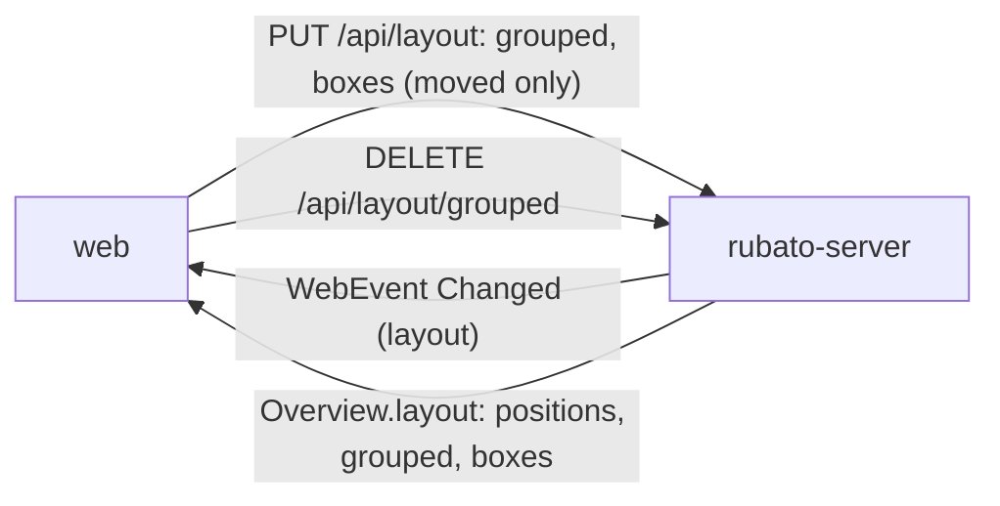

# By repo: a readable grouping whose parts and boxes can be moved

Issue: #144 · Design: [144-by-repo-layout/design.md](144-by-repo-layout/design.md) (with the UX
review) · ADR 0068 (*proposed*, adds to ADR 0016). Full track: `MapLayout` in rubato-protocol
gains fields, so `schema/protocol/map_layout.schema.json` and the `web-server` seam change.

The **By repo** grouping (#89) is too crowded to read and cannot be arranged: every seam inside a
repo puts its chip and flow labels into one narrow column, chips cover part cards, labels are cut
off, and drag is off while the grouping is on. This makes the grouping a second shared
arrangement next to the flat one, with parts movable inside their repo's box and boxes movable
as a whole, folds the seams inside one repo into one bundle per pair of parts, and lets every
flow label be read in full.

## What the change does

- **The grouping is a shared arrangement.** Where the team puts a part inside its repo's box, and
  where it puts each box, is stored on the server next to the flat layout and seen by everyone,
  after a reload too. A part or box nobody has placed is placed by ELK. The flat positions are
  never written by the grouping, and the grouping never reads them.
- **Parts move inside their box.** A part can be dragged (or moved with the arrow keys) inside
  its repo's box. The box grows or shrinks to fit its parts. A part dragged past the box's left
  or top edge stays at the edge; a part dropped on another repo's box goes back to where the drag
  began. Moving code between repos is a map draft (ADR 0018), not a drag.
- **Boxes move as a whole.** Dragging a box's frame moves the box and its parts together; a box
  dropped on another box goes back.
- **Seams inside one repo fold into bundles.** The seams between two parts of the same repo are
  drawn as one line with a small badge ("1 seam", "2 seams"); the badge keeps the warning of any
  seam in it (collision, finding, quiet, in the draft). The bundle opens into its seams' arrows,
  chips and flow labels while the pointer is on it, after a click (or Enter) on its badge, which
  from the keyboard puts focus on its first chip, while an issue is dragged over it, and whenever
  one of its seams is lit (a selected part or seam, the
  plan lens, the scenario step). While an issue row is dragged over it, it stays open until the
  drop or the end of the drag. A closed bundle draws no flow particles and no Traffic chevrons;
  open, it draws them as the flat map does. Seams that cross repos, and seams to parts with no
  repo, are always drawn in full.
- **Every flow label can be read in full.** A flow label shows its whole text while it is hovered
  or focused (on the flat map and in the grouping); the inspector lists every flow of a seam in
  full, as today.
- **Auto-arrange follows the view.** On the flat map it clears the flat layout, as today; in
  **By repo** it clears only the grouped arrangement, says how many positions it removed, and
  offers Undo.
- **More room.** ELK lays out a box's parts with the box's own options, so the root's spacing
  never reached them and they sat 20 px apart. The box now has its own spacing: 60 between parts,
  140 between columns. The gap between a box and the parts outside it grows from 200 to 260, room
  for a whole flow label of a seam that leaves the repo.
- **Labels sit where they can be read.** In the grouping, each seam's labels (its chip and flow
  labels, or a bundle's badge) take the first point along their curve, from the middle outwards,
  that touches no part card and no label placed before them. The flat map keeps every label at
  its middle.
- **Names are whole.** A part's kind moves under its name when both don't fit on one line, on
  the flat map too.

## How we'll know it works

- [ ] e2e `map.spec.ts` "By repo on the team's map: no chip, label or badge overlaps another or a part card, and every part's name is readable": with `docs/design/rubato-map.yml` and nothing stored, in the Structure, Data flow and Control flow lenses, every `.seam-label` box is disjoint from every other and from every part card, and each part's name is visible and not clipped (`scrollWidth <= clientWidth`).
- [ ] e2e "a part dragged inside its box stays there for everyone and after a reload": drag `web` within the box with the mouse; the second browser follows over the websocket; after a reload and By repo on again it is at the same place relative to its box; it stays inside the box; the box's bounds in the second browser equal the first's (the box refits on a refresh).
- [ ] e2e "a part dragged out of its box comes back inside": a drag past the left edge stops at the edge; in workspace `shop` (fixture gains a second repo, `acme/ledger`), a part dropped onto the other repo's box goes back to the start, and a box dropped onto the other box goes back too.
- [ ] e2e "a box moves with its parts": drag the `m0x6A/rubato` box frame; every part in it moves by the same offset, the externals do not; after a reload the same.
- [ ] e2e "By repo off brings back the flat map exactly": canvas positions of every part before By repo, and after moving parts and a box in the grouping and turning By repo off, are equal.
- [ ] e2e "a bundle opens on hover and on a selected part": the `skill-system-map` chip is hidden and its bundle badge shows; hovering the badge shows the chip; selecting `skill-rubato` shows it; a flow label hovered in the Data flow lens shows its whole `carries` text, unclipped.
- [ ] e2e "Auto-arrange in By repo clears only the grouping": the flat position saved before stays; the grouped one is gone; Undo brings it back.
- [ ] Vitest `grouped.test.ts`: placement (stored over ELK; held over stored), box fit (grows and shrinks; never narrower than its name), clamp to the left/top padding, a drop on another box snaps back (part and box), `groupedToSave` writes only moved parts and boxes, as `grouped` and `boxes`.
- [ ] Vitest `labels.test.ts`: the curve is React Flow's (equal to `getBezierPath`'s label point at 0.5); a label with room stays at the middle; a label whose middle lies on a card moves off it (must fail without placement); two crossing curves keep their labels apart; a stack of flow labels moves as one.
- [ ] Vitest `bundles.test.ts`: seams inside one repo are bundled per unordered pair, crossing seams and seams to externals are not; a bundle opens when lit, hovered or pinned open; its badge carries the strongest warning of its seams.
- [ ] Rust integration test: `PUT` with `positions` and `grouped` in one body counts once per arrangement; `PUT` with `grouped` and `boxes` is stored and served; an unknown part id, a repo no part names, and a position off the canvas are refused whole (`422`, `rubato.web.rejected` with `unknown_id`/`bad_position`); `DELETE /api/layout` leaves the grouping, `DELETE /api/layout/grouped` leaves the flat layout and returns what it removed, only for the map's current parts and repos (so its Undo is never refused); rows for ids the map no longer has are not served and are deleted on the next write.
- [ ] Rust `app.rs` telemetry test: `rubato.layout.writes` carries `rubato.layout.arrangement`.
- [ ] Migration test: 0024 on a database with flat positions keeps them unchanged.

## What it must not break

- ADR 0016, the flat map's shared layout: the e2e "a dragged part is in the same place in a second browser and after reload" runs unchanged; the Rust `layout_put_is_in_overview_and_notifies` runs with only `..Default::default()` added; the new e2e asserts flat positions are unchanged by any grouped move.
- Layout stays presentation: `overview::build` tests `layout_is_served_for_known_parts_and_changes_no_progress` and `queue_layout_and_draft_do_not_change_progress` extended with grouped positions.
- Pin, drop and "New issue here…" on parts and seams inside a box: new e2e in By repo drags a backlog issue onto a part inside the box and onto a seam inside a bundle (it opens under the drag), and opens "New issue here…" from a part in the box; the existing "drag a not-pinned issue onto a part and onto a seam" is unchanged.
- Edit mode turns grouping off: e2e turns By repo on, enters Edit map, sees no box and the By repo button disabled, leaves, sees the boxes again.
- Reduced motion and the lenses inside boxes: an opened bundle draws its arrows through the same `SeamEdge` with the lens's arrows, particles and still marker. New e2e in `motion.spec.ts`: By repo on, a part selected so its bundles open, Data flow lens: moving particles on an opened seam inside the box; with reduced motion, only still markers. New e2e: By repo on, Traffic lens on the routed traffic fixture: chevrons on a crossing seam and on an opened bundle's seam. `motion.spec.ts` and the lens e2e otherwise unchanged.
- The `shop` fixture's second repo: `workspaces.spec.ts` iterates the fixture's nodes and still passes.
- Workspaces (ADR 0047): `workspaces_scope.rs` extended: a grouped write in `shop` is not in `default`.
- Old web bundles: `grouped` and `boxes` are optional with serde defaults, so a body without them is a flat write as before.

## How we'll debug it at 3 am

See the O-row. New: the attribute `rubato.layout.arrangement` (`flat` or `grouped`) on
`rubato.layout.writes` (one count per arrangement a write touches, so a body with both counts both) and on the `layout written` / `layout cleared` info lines, registered in
`crates/rubato-protocol/src/otel.rs`; the "Layout writes" panel splits by it.

## Affected parts

| Node | Status | What changes | Seams |
| --- | --- | --- | --- |
| web | affected | grouped placement (`grouped.ts`), bundles (`bundles.ts`), MapView drag in the grouping, bundle edge and badge, full flow labels, Auto-arrange by view | web-server |
| rubato-server | affected | `layout` slice: table `map_layout_grouped` (migration 0024), `PUT` validates and stores `grouped` and `boxes`, `DELETE /api/layout/grouped`; the overview filters the grouping to the map's parts and repos | web-server |
| rubato-protocol | affected | `MapLayout.grouped`, `MapLayout.boxes` (serde default), route `LAYOUT_GROUPED`, attribute `rubato.layout.arrangement` | |

## Data models

| Model | Kind | Part | Change | Crosses | Note |
| --- | --- | --- | --- | --- | --- |
| `MapLayout` | type | rubato-protocol | changed | | adds `grouped` (part id → position relative to its repo's box, or to the canvas for a part with no repo) and `boxes` (`owner/name` → box top-left); both optional |
| `PUT /api/layout` body, overview `layout` | type | rubato-server | changed | web-server | carry the two new maps |
| `DELETE /api/layout/grouped` | type | rubato-server | new | web-server | clears the grouping; answers with what it removed (`MapLayout`) |
| `map_layout_grouped` | table | rubato-server | new | | `(workspace_id, kind 'part'/'box', id)`, `x`, `y`, `updated_by`, `updated_at`; owner `layout`; migration 0024, additive |
| `rubato.layout.arrangement` | event | rubato-protocol | new | | attribute on `rubato.layout.writes` and the layout log lines |

## Data flow

## Tasks

- [ ] **PR** `issue/144-by-repo-layout`: this plan, the design note with the UX review, ADR 0068 (*proposed*); `plan.ts check`; review; `Review:` on #144.
- [ ] Protocol: unit test first (`{"positions":{}}` reads as an empty grouping; fails to compile), then `grouped`, `boxes`, `LAYOUT_GROUPED`, the otel attribute; `UPDATE_SCHEMAS=1` schema snapshot; `pnpm gen:types`.
- [ ] Server: migration test first (fails: table missing), then `0024_map_layout_grouped.sql`; integration test first (fails: a grouped write is not in the overview), then `store` and `handlers` for `grouped`/`boxes`, `clear_grouped`, the route in `app.rs`, the overview filter, the metric attribute; `workspaces_scope.rs` case; golden re-recorded.
- [ ] Web: `grouped.test.ts` first, then `grouped.ts`; `bundles.test.ts` first, then `bundles.ts`; `labels.test.ts` first, then `labels.ts`; then MapView (drag in the grouping, box nodes draggable by a `dragHandle` on the frame with the body `pointer-events: none`, bundle edge type, hover/focus/pin-open, Auto-arrange by view), `api.ts` `clearGrouped`, App's notice; flow label CSS.
- [ ] e2e: `shop-map.yml` gains repo `acme/ledger` (part `ledger`, seam `checkout-ledger`); the By repo tests above, each failing on main first (drag is off, chips overlap, no bundle).
- [ ] `nodes.test.ts` first (fails: a box keeps its first size), then `mergeNodes` takes `style`, `width`, `height`, `draggable` and `dragHandle` from what is wanted.
- [ ] AGENTS.md slice blocks (`layout` owns `map_layout, map_layout_grouped`; the web `map` row names `DELETE /api/layout/grouped`); dashboard panel splits by arrangement.
- [ ] After approval: ADR 0068 accepted.

## Assumed, not yet approved

| # | Decision | Chosen | Alternatives | Scope |
| --- | --- | --- | --- | --- |
| A1 | Where a part with no repo sits in the grouping | its own grouped position, on the canvas, stored in `grouped` like a boxed part | always ELK's; its flat position | node (web) |
| A2 | How long a hovered bundle stays open after the pointer leaves | 400 ms, so the pointer can travel from the badge to a chip; a click on the canvas closes bundles opened by a click | close at once; stay until a click elsewhere | node (web) |
| A3 | Whether **By repo** is remembered across reloads | not in this change (it starts off, as today) | per browser in `localStorage` | node (web) |
| A4 | Phone width | no change beyond the bundles; the grouping fits at a small zoom and is read by zooming in, like the flat map | a list of repos below a breakpoint | node (web) |

## Decisions

| # | Decision | Chosen | Why | Decided by |
| --- | --- | --- | --- | --- |
| 1 | Where grouped positions are kept (issue Q1) | (a) shared layout on the server, a second arrangement next to the flat one: part positions relative to their repo's box, plus each box's position, as additive `MapLayout` fields with serde defaults, additive migration 0024 and ADR 0068 adding to 0016. Flat positions are never overwritten by grouped ones. | (b) derived from the flat layout cannot keep a drag inside a box without writing the flat positions, which the issue forbids, so it loses what users asked for; (c) is not shared | Mattias Jonsson (answer relayed by the team lead session, 2026-11-15) |
| 2 | Whether dragging a part out of its box means anything (issue Q2) | No. The part stays inside (left/top edge) or snaps back (dropped on another box); the box grows right and down to make room. Moving code between repos is a map draft (ADR 0018). | the box is the repo in `system-map.yml` | Mattias Jonsson (answer relayed by the team lead session, 2026-11-15) |
| 3 | Seams inside one repo (issue Q3) | Collapsed into one bundle per pair of parts, opened on hover or select; seams that cross repos always drawn; full flow labels readable on hover and in the inspector | what someone opening By repo needs first is what crosses repo boundaries; what is inside one repo can fold away (UX review) | Mattias Jonsson (answer relayed by the team lead session, 2026-11-15) |

## O-rows

| Seam | Breaks like | Signal | Panel | Owner |
| --- | --- | --- | --- | --- |
| web-server | grouped moves are refused or lost (people see different By repo arrangements, or a drag springs back), or a grouped write clobbers the flat map | `rubato.layout.writes` by `rubato.layout.arrangement` stops moving while people drag; `rubato.web.rejected` with route `/api/layout` and `rubato.reason` (`unknown_id`, `bad_position`); the `layout written` / `layout cleared` lines with `rubato.user` and `rubato.layout.arrangement`; a `flat` count that moves while only the grouping is used is the clobber | Layout writes; Web writes rejected | rubato-server |

## Flows

| From | To | Seam | Kind | Carries |
| --- | --- | --- | --- | --- |
| web | rubato-server | web-server | data | MapLayout with the By repo arrangement: moved parts relative to their repo's box, and moved boxes |
| web | rubato-server | web-server | control | clear the By repo arrangement for the team (`DELETE /api/layout/grouped`) |
| rubato-server | web | web-server | data | Overview layout with the By repo arrangement: grouped part positions and box positions |

## ADRs proposed

| ADR | File | Blob |
| --- | --- | --- |
| 0068 | docs/decisions/0068-by-repo-arrangement-shared.md | 634622b31dff609f0eab650668bec5ae824c9f2e |

## Review map

1. `web/src/features/map/MapView.tsx` `onNodesChange` in the grouping: the clamp and snap-back, and that a grouped change never reaches `positions` (the flat layout).
2. `crates/rubato-server/src/layout/handlers.rs` `put_layout`: validation of `grouped` ids and `boxes` repos against the map and the draft, all or none.
3. `web/src/features/map/bundles.ts`: which seams fold, and that a warning never folds away.
