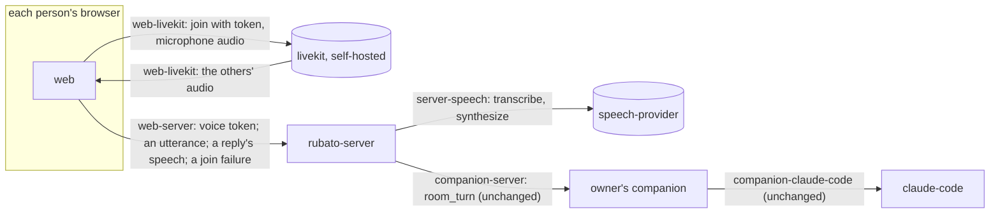

# 146: a voice channel on a plan's room, with speech through an adapter

Plan: [../146.md](../146.md) · ADR: [0073](../../decisions/0073-voice-in-a-plans-room-through-livekit-and-a-speech-adapter.md)
(proposed; lifts AGENTS.md's "Audio" non-goal in part, and extends ADR 0066's CSP in part) ·
Issue: m0x6A/rubato#146 · Map: new external nodes `livekit` and `speech-provider`; new seams
`web-livekit` and `server-speech`; flows changed on `web-server`.

#146 asks for a voice meeting in Rubato that a person can call their agent into, the way #122
calls one into a plan's room. Mattias decided on 2026-11-15 that it gets a superseding ADR and is
built behind a flag that is **off by default**, up to a merged PR, and not deployed. This note
designs the smallest real vertical slice:
- the room has a voice channel, and Rubato mints a token for it;
- speech becomes room messages and replies become speech, through an adapter;
- a fake adapter serves the tests;
- the deployed server never starts LiveKit.

It also lists what Mattias would need to set up to turn it on (§9).

## 1. Where it sits



- **People to people** goes browser to LiveKit, directly. Rubato never sees that audio.
- **People to agent** goes browser to Rubato as one utterance at a time, which is transcribed and
  then becomes room text.
- **Agent to people** goes Rubato to the browsers as one spoken clip per reply to a spoken
  question.
- The companion and Claude Code see only text, as for any room turn (ADR 0057).

## 2. Voice channel and token

`POST /api/room/voice/token` with `{repo, number, branch}` returns `VoiceToken {url, token, room,
identity, expires_at}`.
- It is for anyone who may log in, as reading a room is (ADR 0022, ADR 0057). The room must exist,
  meaning a plan or a draft is on that branch. `rooms::has_plan` (`rooms/handlers.rs:36`) is
  `pub(super)` today and is re-exported from `rooms`.
- The token is a LiveKit access token: a JWT, HS256, signed with `RUBATO_LIVEKIT_API_SECRET`. Its
  claims:
  - `iss`: the API key; `sub`: `<login>#<8 random hex>`, so two tabs of one person do not evict
    each other as duplicate identities; `name`: the login;
  - `nbf`: now; `exp`: now + 600;
  - `video`: `{ room, roomJoin: true, canSubscribe: true, canPublish: true, canPublishData: false,
    canPublishSources: ["microphone"] }`.
- It is built with the server's existing `hmac` and `sha2` crates. base64url (no padding) is
  hand-written in the slice, about 20 lines with table tests, because `base64` is not a direct
  dependency. So no new Rust dependency is needed.
- **What `exp` bounds.** Only the join. LiveKit refreshes the tokens of connected participants, so
  a person who is in stays in. Rubato never talks to LiveKit and cannot remove anyone. A login
  revoked under ADR 0022 can stay in a call it is already in; rotating LiveKit's keys ends every
  call. The ADR says so.
- The room name is `rubato-` followed by the first 32 hex digits of `sha256("<repo>#<n>@<branch>")`.
  The name is stable, safe in a URL, and does not spell the branch out to LiveKit.
- A test decodes the token with the same secret and checks every claim. A must-fail test signs
  with the wrong secret and fails verification.
- Rubato never starts or connects to LiveKit. A source test reads every file under `src/voice/`
  and `kernel/speech.rs`, and fails if one names `std::process`, `tokio::process` or `Command`. It
  prints how many files it read, and a must-fail fixture file proves it bites.

**CSP (ADR 0066).** `content_security_policy` (`kernel/http.rs:163`) takes an optional voice
origin. With voice on, it appends the origin of `RUBATO_LIVEKIT_URL` to `connect-src`, in both its
`wss:` and `https:` forms (the client calls `https://…/rtc/validate` when a join fails). With voice
off the policy is byte-equal to today's. The CSP test (`app.rs:1194`) gets a voice-on case and a
voice-off case. Clips are played from their same-origin URL, never a `blob:` URL, so `media-src`
falling back to `'self'` is enough.

**Join failures are reported.** Rubato never sees LiveKit, so the browser reports a failed join:

`POST /api/room/voice/join-failed` with `{repo, number, branch, reason}`.
- `reason` is one of `signal` (WebSocket refused), `ice` (no media path: UDP blocked, no TURN),
  `permission` (microphone denied), `insecure` (not a secure context) or `other`.
- The body is at most 1 KiB; any other reason is stored as `other`.
- The route counts `rubato.voice.join_failed{rubato.reason}` and logs it with the user and the
  room. It stores nothing.
- At most one report per browser per room per minute.

**Web.** The room section (`web/src/features/room/RoomSection.tsx`) gains a `VoicePanel`, shown
only when `Me.voice` is present and enabled:
- *Join voice* fetches a token, loads `livekit-client` with a dynamic import, connects and
  publishes the microphone. It catches each failure kind above and reports it;
- the panel shows who is in the voice channel (LiveKit participants) next to the room's agents,
  with their owners and who called them in, as today (`Presence.tsx`);
- *Leave* disconnects.

`livekit-client` is pinned at an exact version (2.23.0, 2026-10-16), loaded only on *Join voice*,
and mocked in Vitest.

## 3. Speech into the room

Push-to-talk: hold *Talk* to speak to the room, or *Ask <handle>* to ask an agent in the room. One
press records one utterance with `MediaRecorder`, at most 60 s. The format is the first one
`MediaRecorder.isTypeSupported` accepts: `audio/webm;codecs=opus`, `audio/ogg;codecs=opus`, then
`audio/mp4` for Safari. The browser gives each utterance an id (a UUID). On release:

`POST /api/room/voice/utterance?repo=&number=&branch=&id=<uuid>&to=<handle>?`, with the audio as
the body, at most 2 MiB.

1. **Cheap checks first, before any transcription.** Each refusal is counted under the voice
   route's own name.
   - Voice off: 404 `voice_off`.
   - No speech adapter configured: 409 `no_speech`.
   - No plan or draft on the branch: 404 `no_plan`.
   - `to` that is not an agent present in the room: 422 `unknown_agent`.
   - Body over 2 MiB: 413 `too_long`. The route sets `DefaultBodyLimit` to 2 MiB + 1 byte and the
     handler checks the length itself, so axum's own 413 never answers first.
   - An `id` already posted in that room: 200 with the stored message, and nothing else happens.
2. **Bounded transcription.** A semaphore of 2 permits covers STT and TTS together; no permit
   within 2 s gives 503 `busy`. Then `Speech::transcribe(bytes, mime, language)` runs, with a
   deadline of 30 s and a response cap of 4 MiB. The language comes from
   `RUBATO_SPEECH_LANGUAGE`, or the provider detects it. The bytes are dropped when the call
   returns, whatever happened.
3. An empty transcript: 422 `empty`, and nothing is posted.
4. With `to`, the text becomes `@<handle> <transcript>`, so the existing addressing
   (`turns::person_turns`, `rooms/turns.rs:341`) makes the turn.
5. `rooms::post_as(app, user, key, text, PostSource::Voice { id })` is the body of today's `post`
   handler (`rooms/handlers.rs:76`), split out. The web route calls it with `PostSource::Typed`.
   The message takes the utterance id as its `RoomMessage.id` and carries `spoken: true`.
   `store::insert` is already `INSERT OR IGNORE` and returns whether it inserted
   (`rooms/store.rs:53`). `post_as` dispatches turns only when it did; today's handler ignores
   that bool (`handlers.rs:126`). So a repeated press makes one message and one turn.
6. A turn made by a spoken message adds one line to the turn text: *"Asked aloud: start your reply
   with an answer of one or two sentences that can be spoken; details after."* This is in
   `rooms::dispatch_turn` (`rooms/turns.rs:82`). Everything else about the turn is as ADR 0057
   says: who it goes to, session or fork, caps, and the turn limit.
7. Log: `info!(rubato.room, rubato.user, message_id, turn_id, stt_ms, "spoken message posted")`.
   The `turn_id` joins it to `room turn queued` (`turns.rs:126-134`, which logs `turn_id`) and to
   the reply, which carries the same `turn_id`.

## 4. Replies as speech

An agent's room reply is posted by `rooms::turns::post_reply` (`rooms/turns.rs:171`) with its
`turn_id`, and the browsers are told through `WebResource::Room`, as today. **Only replies to
spoken questions are spoken.** A browser joined to the voice channel plays an agent message newer
than its join whose `turn_id` is the `turn_id` of a `spoken` message in the room:

`GET /api/room/voice/speech/{message_id}` returns the audio, with the provider's content type.

1. The message must be an agent's, in a room, answering a turn whose trigger is `spoken`, with
   voice and speech on. Otherwise the route answers 404 (`not_spoken`, `voice_off`) or 409
   (`no_speech`). Replies to typed turns therefore never reach the provider.
2. The spoken cut, `voice::spoken_cut(text)`:
   - drops fenced code blocks and tables;
   - keeps whole sentences up to 400 characters;
   - if nothing is left, it is *"I've posted the details in the room."*

   It is a pure function with table tests.
3. The cache is keyed by message id: at most 32 clips, each kept 10 minutes, in memory. It is held
   in the kernel's `Slots` (`kernel/state.rs:110`), so the kernel does not name the slice. On a
   miss, `Speech::synthesize(cut)` runs under the same semaphore, deadline and 4 MiB cap.
   Concurrent misses for one id wait on one synthesis (a per-id `OnceCell`), so N listeners cause
   one provider call.
4. The browser plays the clip from that URL with an `<audio>` element, never a `blob:` URL. The
   full reply stays in the room thread, and the panel marks the message *spoken*.

Order and overlap: the browser queues clips and plays them one at a time. *Talk* pressed while a
clip plays stops that clip (the issue's question 6, the simple half).

## 5. The adapter

```rust
// crates/rubato-server/src/kernel/speech.rs
#[async_trait]
pub trait Speech: Send + Sync {
    fn name(&self) -> &'static str;                 // "openai_compatible" | "fake"
    fn hosts(&self) -> Vec<String>;                 // shown in the consent text
    async fn transcribe(&self, audio: Bytes, mime: &str, language: Option<&str>) -> Result<String, SpeechError>;
    async fn synthesize(&self, text: &str) -> Result<SpeechClip, SpeechError>; // bytes + mime
}
```

| Adapter | Transcribe | Synthesize | Config |
| --- | --- | --- | --- |
| `openai_compatible` | `POST {RUBATO_STT_URL}/audio/transcriptions`, multipart `file`, `model`, `language?`, `response_format=json` → `.text` | `POST {RUBATO_TTS_URL}/audio/speech`, JSON `{model, input, voice, response_format: "mp3"}` → bytes | `RUBATO_STT_URL`, `RUBATO_TTS_URL` (bases, e.g. `http://speaches:8000/v1` for both), `RUBATO_STT_API_KEY`, `RUBATO_TTS_API_KEY` (optional bearers), `RUBATO_STT_MODEL`, `RUBATO_TTS_MODEL`, `RUBATO_TTS_VOICE` |
| `fake` | the body read as UTF-8, trimmed | the text's bytes, `text/plain` | none |

- The adapter sits in `kernel/`, beside the GitHub port (`kernel/github/`), because it is an
  adapter to someone else's tool. It names no slice.
- `reqwest` is already a dependency; this adds its `multipart` feature.
- Response bodies are read with a 4 MiB cap: past it, the call is `BadBody`.
- `SpeechError` is `Timeout`, `Status(u16)`, `Transport` or `BadBody`. Each becomes `rubato.outcome`
  on the span and a 502 to the browser.
- The API keys and the LiveKit secret are held in a redacting newtype like `WebhookSecret`
  (`kernel/config.rs:20-23`), since `Config` derives `Debug` (`config.rs:217`). A test formats the
  config and finds no secret in the output.

Why one OpenAI-compatible adapter: the local servers people run on a CPU box speak this shape, and
so do the hosted APIs.
- Speaches bundles faster-whisper and Kokoro behind one URL.
- faster-whisper-server serves STT, and Kokoro-FastAPI serves TTS, each on its own URL.
- whisper.cpp's server serves STT with `--inference-path /v1/audio/transcriptions`, and with
  `--convert` (it needs ffmpeg) to accept webm/opus.

The choice of local or hosted (the issue's question 1) becomes two URLs, not code. A provider that
does not fit is a new adapter behind the same port.

The fake adapter is selectable with `RUBATO_SPEECH=fake` and is used by every server test and by
the dev server. A config test pins that `fake` is refused unless `RUBATO_DEV_USER` is set. ADR
0064 keeps that setting to loopback, so a deployed server cannot echo uploads back as
"transcripts".

## 6. Flag and config

| Setting | Default | Meaning |
| --- | --- | --- |
| `RUBATO_VOICE` | unset (off) | every `/api/room/voice/*` route answers 404 `voice_off`; `Me.voice` absent; CSP unchanged; no panel |
| `RUBATO_LIVEKIT_URL`, `RUBATO_LIVEKIT_API_KEY`, `RUBATO_LIVEKIT_API_SECRET` | unset | all three or none; with voice on and none, the token route answers 409 `no_livekit` |
| `RUBATO_SPEECH` | unset | `openai_compatible` or `fake`; unset means voice for people only, and the utterance and speech routes answer 409 `no_speech` |
| `RUBATO_STT_URL`, `RUBATO_TTS_URL`, `RUBATO_STT_API_KEY`, `RUBATO_TTS_API_KEY`, `RUBATO_STT_MODEL`, `RUBATO_TTS_MODEL`, `RUBATO_TTS_VOICE`, `RUBATO_SPEECH_LANGUAGE` | unset | the `openai_compatible` settings; both URLs and both models are required when it is chosen |

- `Me` gains `voice: { enabled, speech: bool, speech_hosts: [string] }`. It is skipped while
  voice is off, so the golden `me.json` and every response without voice are unchanged.
- The server refuses to start when `RUBATO_VOICE=1` names a half-configured LiveKit or speech
  provider, with a message naming the missing variable. This follows ADR 0064's rule of failing
  loudly.
- The deployed compose file is not changed.

## 7. Wire and storage

| Model | Where | Shape |
| --- | --- | --- |
| `VoiceTokenRequest` / `VoiceToken` | web ↔ server | `{repo, number, branch}` / `{url, token, room, identity, expires_at}` |
| utterance | web → server | raw audio body; room key, `id` and `to` in the query; answers `RoomMessage` |
| `VoiceJoinFailed` | web → server | `{repo, number, branch, reason}` |
| speech | server → web | audio bytes for one agent reply to a spoken turn |
| `RoomMessage.spoken` | server → web | `bool`, default false, skipped when false |
| `Me.voice` | server → web | `VoiceAvailability {enabled, speech, speech_hosts}`, skipped while off |
| `room_messages.spoken` | server, slice `rooms` | `INTEGER NOT NULL DEFAULT 0`, migration `00NN_room_messages_spoken.sql`: the next free number at build (main ends at 0026, 0027 is #189's, and #134 also wants one) |
| clip cache | server, slice `voice`, memory in `Slots` | at most 32 entries, 10 minutes each |

New slice `voice` (server). It owns no table. It names `rooms` (`has_plan`, `post_as`, reading
one message, the trigger of a turn, the agents present) and `auth`, and nothing names it but the
composition root. The web feature is `room` (extended); there is no new feature folder, since the
voice panel is part of the room. In the AGENTS.md protocol block, `room` gets its own line, which
it does not have today.

## 8. Observability

| Signal | Where | Attributes |
| --- | --- | --- |
| span `rubato.voice.token` | server | `rubato.room`, `rubato.user`, `rubato.outcome` |
| span `rubato.voice.stt`, `rubato.voice.tts` | server, around each adapter call | `rubato.voice.provider`, `rubato.room`, `rubato.outcome`, `rubato.voice.bytes`, duration |
| counter `rubato.voice.speech` | server | `rubato.voice.op` (`stt`, `tts`), `rubato.outcome` (`ok`, `timeout`, `status`, `transport`, `bad_body`, `empty`, `busy`), `rubato.voice.provider` |
| histogram `rubato.voice.duration` | server | `rubato.voice.op`; seconds; the STT and TTS parts of the issue's latency split |
| counter `rubato.voice.tokens` | server | `rubato.outcome` |
| counter `rubato.voice.join_failed` | server, from the browser's report | `rubato.reason` |
| `rubato.web.rejected{rubato.route, rubato.reason}` | server (exists) | routes `/api/room/voice/*`; reasons `voice_off`, `no_speech`, `no_livekit`, `no_plan`, `too_long`, `empty`, `unknown_agent`, `busy`, `not_spoken` |
| alert `SpeechProviderFailing` | `observability/alerts/rubato.rules.yml` | see below; with promtool cases for failures with some `ok`, failures with no `ok` series at all, and only `ok` |
| panel "Voice" | `rubato-overview.json` | speech calls by op and outcome, their duration, tokens and join failures |

`SpeechProviderFailing` is
`sum(increase(rubato_voice_speech_total{rubato_outcome!~"ok|empty|busy"}[10m])) > 0 unless
sum(increase(rubato_voice_speech_total{rubato_outcome="ok"}[10m])) > 0`. It fires with no `ok`
series at all, for example after a restart.

The rest of the issue's latency split (queue wait, agent turn) is already measured. The queue wait
comes from `session_messages`. The turn comes from `rubato.room.fork_turn` and the session log.
The split is joined on `turn_id` (§3, step 7).

AGENTS.md's "never silent" list gains: *a speech provider failing every call for 10 minutes while
people use voice* (`SpeechProviderFailing`).

## 9. What it takes to turn it on

This is for Mattias, in the order he would do it.

1. **HTTPS for Rubato's web.** Browsers allow the microphone only in a secure context (HTTPS, or
   `localhost`). The deployed `http://192.168.50.49:8081` cannot use voice as it is. Put Rubato
   behind TLS (Traefik with a certificate for a name) and set `RUBATO_PUBLIC_URL` to that
   `https://` URL, or use it from `localhost` for a test.
2. **A LiveKit server.** Use the `livekit/livekit-server` image at a pinned version, beside Rubato
   rather than inside its container. Its `livekit.yaml` has `keys: { <API_KEY>: <API_SECRET> }`.
   - In Docker, use host networking, or set `rtc.node_ip` or `rtc.use_external_ip: true`. On a
     bridge network LiveKit advertises the container's IP, and media never connects.
   - Ports:
     - 7880/tcp, signalling over WebSocket, behind TLS as `wss://…`, because the page is HTTPS;
     - 7881/tcp, ICE over TCP;
     - 50000–60000/udp, or `rtc.udp_port: 7882` for a single UDP port.

   On the home server, LAN only, that is enough. Through the VPS cluster behind Traefik, UDP needs
   its own entrypoint, or a TURN server:
   - LiveKit's built-in TURN on 3478/udp needs no certificate;
   - TURN over TLS needs a domain and a certificate. On 443 it collides with Traefik unless
     Traefik passes TLS through by SNI.
3. **Keys for Rubato.** The same pair as LiveKit, as `RUBATO_LIVEKIT_API_KEY` and
   `RUBATO_LIVEKIT_API_SECRET` (a secret of at least 32 characters), plus `RUBATO_LIVEKIT_URL`
   (`wss://livekit.<domain>`). Rubato adds that origin to its CSP itself.
4. **A speech provider with an OpenAI-compatible API.** Choose one:
   - *local, on the home server's CPU*: Speaches (faster-whisper for STT, Kokoro for TTS, one
     container). Set `RUBATO_STT_URL` and `RUBATO_TTS_URL` to `http://speaches:8000/v1`,
     `RUBATO_STT_MODEL=Systran/faster-whisper-small`,
     `RUBATO_TTS_MODEL=speaches-ai/Kokoro-82M-v1.0-ONNX` and a voice. Audio stays on the
     machine. It must be measured: `small` is about real time on a few CPU cores, and Swedish
     wants `medium` or larger. Kokoro has no Swedish voice, so Swedish replies would be read in an
     English voice;
   - *hosted*: an OpenAI-compatible API with keys in `RUBATO_STT_API_KEY` and
     `RUBATO_TTS_API_KEY`, for example `gpt-4o-mini-transcribe` and `gpt-4o-mini-tts`. It is fast
     and handles Swedish, but the audio and text leave for that provider, which may keep them
     under its own terms. The consent text names its host and says so;
   - *mixed*: for example hosted STT for Swedish with a local Kokoro for TTS, since the URLs are
     separate.
5. **Turn it on**: `RUBATO_VOICE=1` and `RUBATO_SPEECH=openai_compatible` on the server.
6. **Decide on consent.** Is the per-browser banner that names the provider enough (the issue's
   question 4)? It covers both speech and spoken replies, plus the "speech via <host>" badge
   while joined.

Nothing has to be installed on a developer's machine. Companions are unchanged.

## 10. The issue's open questions

| # | Question | This slice | Decisions row |
| --- | --- | --- | --- |
| 1 | Where STT and TTS run | wherever the two OpenAI-compatible URLs point; Mattias picks (§9.4) | 3 |
| 2 | Hosting | a LiveKit beside Rubato, never started by Rubato; LAN first (§9.2) | 2 |
| 3 | How the agent is addressed | an *Ask <handle>* button; spoken names later | 5 |
| 4 | Consent | a per-browser banner naming the provider's hosts, plus the participant list and a badge; Mattias decides if enough | 7 |
| 5 | Speaker attribution | one browser per person; a shared mic is out of scope | 8 |
| 6 | Interruptions | *Talk* stops the clip playing in that browser; the reply in the thread is unchanged | 9 |
| 7 | Testing with a team of one | the fake adapter in server tests; two browser tabs by hand once LiveKit runs (the identity suffix lets one login join twice) | 10 |

## 11. What we'd lose, what to watch

- **An open meeting.** Push-to-talk means the agent hears only what is sent to it, which keeps
  ADR 0057's "nothing before it was called in" trivially true. Always-listening transcription is
  the bridge-participant slice, which needs its own ADR.
- **Ending a call.** Rubato cannot remove someone from a LiveKit room. Revoking a login ends their
  access to Rubato, not a call already in progress.
- **Latency.** A spoken answer waits for the whole turn, because the reply comes at the turn's
  end. The panel shows *thinking* from the post until the reply arrives.
- **Cost.** Each spoken question is a room turn on the owner's cap, plus one STT and one TTS call
  at the provider, which Rubato does not price.
