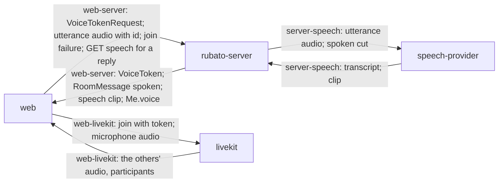

# A voice channel on a plan's room, with speech through an adapter, behind a flag

Issue: #146 · Design: [146-voice-meetings/design.md](146-voice-meetings/design.md) · ADR:
[0073](../decisions/0073-voice-in-a-plans-room-through-livekit-and-a-speech-adapter.md) (proposed;
lifts AGENTS.md's "Audio" non-goal in part, extends ADR 0066's CSP in part) · Map: new external
nodes `livekit` and `speech-provider`, new seams `web-livekit` and `server-speech`, flows changed
on `web-server`.

Track: **full**. It adds two dependencies (a self-hosted LiveKit and a speech provider, plus
`livekit-client` in the web), two seams and two nodes in `docs/design/rubato-map.yml`, changes the
protocol schema, and changes a non-goal.

#146 asks for a voice meeting inside Rubato that a person can call their agent into, the way #122
calls one into a plan's room. This plan builds the smallest real slice, behind a flag that is off
by default and is not deployed:
- a plan's room gets a voice channel on the team's own LiveKit, and Rubato mints the join token;
- a push-to-talk utterance becomes a room message through a speech adapter;
- an agent's reply to a spoken question becomes a short spoken clip through the same adapter;
- a fake adapter drives the tests;
- Rubato never starts or connects to LiveKit.

Everything ADR 0057 says about rooms holds: who calls an agent in, when it answers, when it
leaves.

## What the change does

- **A plan's room has a voice channel**, when `RUBATO_VOICE=1` and LiveKit is configured. *Join
  voice* fetches a ten-minute join token from Rubato and connects the browser to the team's
  LiveKit. Its origin is then allowed in the page's CSP. People in the room hear each other, and
  the panel shows who is in the voice channel next to the room's agents and whose they are
  (design §2).
- **A failed join is reported** by the browser with its kind (signal, ice, permission, insecure),
  since Rubato never sees LiveKit.
- **Speaking posts in the room.** Hold *Talk* to speak to the room, or *Ask <handle>* to ask an
  agent that is in it. The utterance is transcribed by the configured speech provider and posted
  as the speaker, marked *spoken*. Asking an agent makes a room turn exactly as a typed
  `@handle` does. A repeated press posts once (design §3).
- **Agents answer spoken questions aloud.** A reply to a turn asked aloud is spoken in every
  browser in the voice channel: its first sentences, at most 400 characters, code removed. The
  full reply stays in the thread. Replies to typed turns are never sent to the provider
  (design §4).
- **Speech goes through one adapter.** An OpenAI-compatible HTTP API, local or hosted, is chosen
  by configuration, with separate STT and TTS URLs. Calls are bounded to 2 at a time, 30 s each,
  and 4 MiB per response. A fake adapter serves tests and the dev server, and is refused on a
  server without `RUBATO_DEV_USER` (design §5).
- **Rubato stores no audio.** An utterance lives in memory for its transcription. A spoken reply
  lives in a bounded in-memory cache (32 clips, 10 minutes). The transcript is room text.
- **Consent is shown** before a browser's first utterance. It names the provider's hosts and
  covers both speech and spoken replies. A badge stays while the browser is joined.
- **With the flag off, nothing changes.** Every voice route answers 404 `voice_off`, `Me.voice` is
  absent, the CSP is byte-equal to today's, and no panel is shown.

## How we'll know it works

- [ ] The room has a voice channel and Rubato mints a token: a `voice` test decodes the token with
  the secret and checks `iss`, `sub` (`<login>#<suffix>`), `name`, `nbf`, `exp` = now + 600, and
  the `video` grant (room name, join, subscribe, publish, microphone only, no data). A must-fail
  test with the wrong secret fails verification. A token for a branch with no plan or draft gets
  404. The hand-written base64url has table tests.
- [ ] CSP: with voice on, `connect-src` carries the LiveKit origin as `wss:` and `https:`; with
  voice off, the header is byte-equal to today's (the `app.rs:1194` test, both cases).
- [ ] Join failures: `POST /api/room/voice/join-failed` counts
  `rubato.voice.join_failed{rubato.reason}`, maps an unknown reason to `other`, refuses a body
  over 1 KiB, and stores nothing. A web test reports `permission` when `getUserMedia` rejects.
- [ ] Speech becomes room messages through the adapter: with the fake adapter, an utterance body
  `why this seam?` and `to=m0x6a-agent` posts `@m0x6a-agent why this seam?` as the speaker with
  `spoken: true` and the utterance id as its id. It queues a `room_turn` for the owner's launch
  whose text has the "Asked aloud" line. The same id again returns the message and queues no
  second turn. Without `to`, no turn is queued.
- [ ] Checks before transcription: `no_plan`, `unknown_agent`, `too_long` (2 MiB + 1, counted as
  `too_long`, not axum's 413) and `voice_off` each leave the counting fake's transcribe count at 0.
- [ ] Bounded calls: with a fake that blocks, a third concurrent call gets 503 `busy`. A provider
  body over 4 MiB is `BadBody`.
- [ ] Replies become speech, only for spoken turns: after a `RoomReply` to a spoken turn,
  `GET /api/room/voice/speech/{id}` returns the fake's clip of the spoken cut, and two concurrent
  requests make one `synthesize` call. A reply to a typed turn gets 404 `not_spoken` with no
  provider call, and so does a person's message.
- [ ] The spoken cut: table tests for code fences, tables, the 400-character sentence boundary, and
  the "details in the room" fallback.
- [ ] The OpenAI-compatible adapter: against a local stub server, transcription sends multipart
  `file`, `model` and `language` to the STT URL and reads `.text`. Synthesis sends `{model, input,
  voice, response_format}` to the TTS URL and returns the bytes. Timeout, 500 and a bad body each
  map to their `SpeechError`.
- [ ] Not addressed, no answer: a spoken message to the room with an agent present queues no
  turn. A turn for a teammate's agent still needs that agent to be in the room, which happens only
  when its owner calls it in or accepts a request (the ADR 0057 tests, unchanged).
- [ ] No audio stored: after an utterance and a spoken reply, no table has a new row or column
  holding audio. No file is written under the data or temp dirs; a test lists both before and
  after. The clip cache evicts at 33 entries, and after 10 minutes on the test clock.
- [ ] The flag: config tests pin `RUBATO_VOICE` off by default. With it off, each voice route
  answers 404 `voice_off` and counts
  `rubato.web.rejected{rubato.route="/api/room/voice/…", rubato.reason="voice_off"}`. A
  half-configured LiveKit or speech provider refuses to start with the missing variable named.
  `fake` without `RUBATO_DEV_USER` is refused. The config's `Debug` output contains no secret.
- [ ] Rubato never starts LiveKit: a source test fails if a file under
  `crates/rubato-server/src/voice/`, or `kernel/speech.rs`, names `std::process`,
  `tokio::process` or `Command`. It prints how many files it read, and a must-fail fixture file
  proves it bites.
- [ ] Web: `VoicePanel` tests with `livekit-client` mocked:
  - no panel while `Me.voice` is absent;
  - *Join voice* connects with the minted token;
  - the consent banner blocks the first *Talk* until confirmed;
  - *Ask <handle>* sends `to` and an id;
  - a reply to a spoken turn is fetched by URL and played once, and a reply to a typed turn is not;
  - *Talk* stops a playing clip;
  - the recording format is picked with `isTypeSupported`.
- [ ] `SpeechProviderFailing` fires in its promtool tests: failures with some `ok`, and failures
  with no `ok` series at all. It does not fire with only `ok`. `pnpm observability:check` counts
  it.

## What it must not break

- **Owner-only control of an agent** (ADR 0004, 0057): a spoken question reaches only an agent its
  owner called in. Guard: the `rooms/tests.rs` call-in and turn tests pass unchanged, and the
  voice turn test uses the same path.
- **The room's turn limit and the owner's cap** (ADR 0057): spoken turns are room turns. Guard:
  the existing turn-limit test, plus one spoken variant.
- **Typed posts** (`POST /api/room/messages`): the post handler's body moves into
  `rooms::post_as`, which now skips dispatch when the insert was a repeat. Guard: every existing
  rooms test passes untouched, and typed messages have `spoken` false and serialise as before.
- **The CSP and same-origin writes** (ADR 0066): unchanged with voice off; with voice on, only the
  LiveKit origin is added to `connect-src`. Guard: the CSP test, both cases, and the existing
  same-origin write tests, which cover the new POST routes.
- **What reaches GitHub**: nothing from a meeting. Guard: the slice test that `voice` names no
  GitHub port.
- **No inbound access, nothing on developer machines**: companions are untouched. Guard: the
  companion suites pass unchanged, and the PR's diff has no file under `crates/rubato-companion/`.
- **Deployed behaviour**: the deployed server has no `RUBATO_VOICE`. Guard: the golden `me.json`
  and overview are unchanged with voice off (`Me.voice` skipped). The deploy compose has no diff.
- **The web when voice is off**: `livekit-client` is never imported. Guard: a test that the room
  section renders while the module mock throws on import.
- **The map**: the new nodes and seams validate, and every plan in `docs/plans/` still checks.
  Guard: `pnpm plan-check`, and the tests that pin the real map, re-recorded in this commit.

## How we'll debug it at 3 am

See the O-rows. New signals:
- spans `rubato.voice.token`, `rubato.voice.stt` and `rubato.voice.tts`;
- counters `rubato.voice.speech{rubato.voice.op, rubato.outcome, rubato.voice.provider}`,
  `rubato.voice.tokens{rubato.outcome}` and `rubato.voice.join_failed{rubato.reason}`;
- histogram `rubato.voice.duration{rubato.voice.op}`;
- alert `SpeechProviderFailing` (every call failing for 10 minutes, including when none ever
  succeeded);
- panel "Voice".

New log line: `info!(rubato.room, rubato.user, message_id, turn_id, stt_ms, "spoken message posted")`.
Its `turn_id` joins it to the `room turn queued` line and to the reply.

## Affected parts

| Node | Status | What changes | Seams |
| --- | --- | --- | --- |
| rubato-protocol | affected | `VoiceTokenRequest`, `VoiceToken`, `VoiceJoinFailed`, `VoiceAvailability` on `Me`, `RoomMessage.spoken`, voice routes and reasons, otel names; schemas | web-server |
| rubato-server | affected | new slice `voice` (token, join-failed, utterance, speech, spoken cut, clip cache, semaphore); `kernel/speech.rs` port with `openai_compatible` and `fake`; CSP with the LiveKit origin; `rooms::post_as`, `has_plan` re-export and the "Asked aloud" line; migration for `room_messages.spoken`; config with redacted secrets and start checks; `reqwest` `multipart` feature | web-server, server-speech, web-livekit |
| web | affected | `VoicePanel` in the room: join, join-failure reports, push-to-talk, *Ask <handle>*, consent and badge, playing replies to spoken turns; `livekit-client` 2.23.0, lazily loaded | web-server, web-livekit |
| livekit | new | the team's self-hosted media server; Rubato only mints its tokens and allows its origin | web-livekit |
| speech-provider | new | OpenAI-compatible STT and TTS endpoints chosen by configuration | server-speech |

## Data models

| Model | Kind | Part | Change | Crosses | Note |
| --- | --- | --- | --- | --- | --- |
| `VoiceTokenRequest`, `VoiceToken` | type | rubato-protocol | new | web-server | `{repo, number, branch}` → `{url, token, room, identity, expires_at}` |
| `VoiceJoinFailed` | type | rubato-protocol | new | web-server | `{repo, number, branch, reason}`, at most 1 KiB |
| `VoiceAvailability` (`Me.voice`) | type | rubato-protocol | new | web-server | `{enabled, speech, speech_hosts}`, skipped while off |
| `RoomMessage.spoken` | type | rubato-protocol | changed | web-server | default false, skipped when false |
| `me`, `room_view` schemas | schema | rubato-protocol | changed | web-server | additive |
| LiveKit access token | type | rubato-server | new | web-livekit | HS256 JWT; a 10-minute join window; microphone only; identity is the login plus a suffix |
| CSP `connect-src` | type | rubato-server | changed | web-livekit | the LiveKit origin, only with voice on |
| utterance body | type | rubato-server | new | web-server | raw audio, at most 2 MiB, with a client id; never stored |
| speech clip | type | rubato-server | new | web-server | the provider's audio for one reply to a spoken turn; memory only, at most 32 entries, 10 minutes |
| `Speech` port, `SpeechError` | type | rubato-server | new | server-speech | `transcribe`, `synthesize`; adapters `openai_compatible` and `fake`; at most 2 calls at once, 30 s, 4 MiB |
| `room_messages.spoken` | table | rubato-server | changed | | `INTEGER NOT NULL DEFAULT 0`; the next free migration number at build |
| `rubato.voice.*` spans and metrics | event | rubato-server | new | server-speech | see the O-rows |
| `SpeechProviderFailing` | file | rubato-server | new | | alert rule and its promtool tests |
| `livekit-client` | file | web | new | web-livekit | npm dependency, exact 2.23.0 |

## Data flow

## Tasks

1. **Map and plan (this commit)**: the new nodes, seams and flows. Failing first: the tests that
   pin the real map (web `graph.test.ts` and `inspector.test.tsx`, the plan-check and skill
   counts, the server golden overview), re-recorded with `UPDATE_GOLDEN=1`.
2. **Protocol** (failing first: a round trip of `VoiceToken`, `VoiceJoinFailed` and a
   `RoomMessage` with `spoken`, which do not compile yet). Add the types, routes, reasons, otel
   names and `schema.rs`. Run `UPDATE_SCHEMAS=1` and regenerate `web/src/protocol.ts`. Give
   `room` its own line in the AGENTS.md protocol block.
3. **Speech port** (failing first: the OpenAI-compatible stub tests, the 4 MiB cap and the fake's
   tests). Add `kernel/speech.rs` and `reqwest` `multipart`.
4. **Config and CSP** (failing first: the default-off test, the half-configured start refusals,
   `fake` without dev, the `Debug` redaction, the CSP on and off). Add `RUBATO_VOICE`, the LiveKit
   trio, `RUBATO_SPEECH` and its settings, the redacting newtype, `Me.voice`, and the CSP's voice
   origin.
5. **Server `voice` slice**. Failing first:
   - token claims, the wrong-secret test and base64url;
   - join-failed;
   - the utterance becoming a room message and a turn, the repeated id, and the checks before
     transcription;
   - the semaphore;
   - speech only for spoken turns, with one synthesis for two requests;
   - the spoken cut table;
   - the no-audio-stored test;
   - the source test with its must-fail fixture.

   Then split `rooms::post_as` out of `post` (dispatch only on insert), re-export `has_plan`, and
   add the `spoken` migration, the "Asked aloud" line in `dispatch_turn`, the routes in `app.rs`
   with their body limits, and the AGENTS.md server block.
6. **Web** (failing first: the `VoicePanel` tests above). Add `livekit-client` 2.23.0, the panel
   in `RoomSection`, `MediaRecorder` push-to-talk with the format check, the consent banner and
   badge, join-failure reports, and the clip queue. Update the AGENTS.md web block's routes for
   `room`.
7. **Observability** (failing first: the promtool tests for `SpeechProviderFailing` with no rule).
   Add the rule, the panel and the never-silent line. Run `pnpm observability:check` and `:test`.
8. **Docs**: AGENTS.md's v0 scope ("Does not: Audio" reads as ADR 0073 says), and design §9 as
   the setup list.
9. All checks: fmt, clippy, cargo test per crate, `pnpm typecheck`, `pnpm test`, plan-check,
   observability, and `pnpm e2e` (no new scenario, voice off). Then the PR.

## Assumed, not yet approved

| # | Decision | Chosen | Alternatives | Scope |
| --- | --- | --- | --- | --- |
| A1 | Utterance limits | 60 s and 2 MiB, 413 `too_long` above | 30 s; 10 MiB | node (rubato-server) |
| A2 | Spoken cut | whole sentences up to 400 characters, code and tables removed | 200; the whole reply | node (rubato-server) |
| A3 | Clip cache | 32 clips, 10 minutes, memory only | no cache (one synthesis per listener) | node (rubato-server) |
| A4 | Token lifetime | a 10-minute join window; LiveKit refreshes it for connected participants | one hour; 6 hours (LiveKit's default) | node (rubato-server) |
| A5 | Provider calls | 30 s deadline, at most 2 at once (503 `busy` after 2 s), 4 MiB response cap | 10 s; 4 at once | node (rubato-server) |
| A6 | Room name in LiveKit | `rubato-` plus 32 hex digits of the room key's sha256 | the branch name | node (rubato-server) |
| A7 | Who plays a reply | every browser joined to the voice channel, for replies to spoken turns newer than its join | only the asker's browser | node (web) |
| A8 | Join-failure reports | at most one per browser per room per minute; reasons `signal`, `ice`, `permission`, `insecure`, `other` | none (no signal) | node (web) |

## Decisions

| # | Decision | Chosen | Why | Decided by |
| --- | --- | --- | --- | --- |
| 1 | Slice | a voice channel for people on LiveKit, push-to-talk utterances into the room, spoken replies to spoken turns; no bridge participant in the media room | the smallest slice that is a real meeting with an agent in it; the bridge needs a second process and a WebRTC stack | agent (delegated by Mattias, 2026-11-15) |
| 2 | Media server | the team's own LiveKit, run beside Rubato, never started, supervised or connected to by Rubato. Rubato only mints HS256 tokens with the existing `hmac` and `sha2` crates and a hand-written base64url, and allows LiveKit's origin in the CSP while voice is on | open source, as the issue asks; no media in Rubato; no new Rust dependency for the token | agent (delegated by Mattias, 2026-11-15) |
| 3 | Speech adapter shape | one `Speech` port (`transcribe`, `synthesize`) with an `openai_compatible` adapter (`/audio/transcriptions`, `/audio/speech`, separate STT and TTS URLs and keys) and a `fake`. The provider, local, hosted or mixed, is configuration | local servers (Speaches, faster-whisper-server, Kokoro-FastAPI, whisper.cpp) and hosted APIs share this shape, so the issue's question 1 becomes two URLs; a misfit gets its own adapter behind the port | agent (delegated by Mattias, 2026-11-15) |
| 4 | Where speech runs | on the server, called per utterance and per spoken reply; no audio on developer machines; the agent gets only text | ADR 0004 holds; the companion is unchanged | agent (delegated by Mattias, 2026-11-15) |
| 5 | Addressing | an *Ask <handle>* button that prefixes the handle; no spoken-name detection yet | reliable, and reuses the room's addressing; spoken names misfire | agent (delegated by Mattias, 2026-11-15) |
| 6 | Spoken answers | the turn asked aloud asks for a short answer first; the server speaks a cut of the reply, only for spoken turns; the full reply stays in the thread | the issue's point 4; typed context never reaches the provider unconsented (review should-fix 3) | agent (delegated by Mattias, 2026-11-15) |
| 7 | Consent | a per-browser banner naming the provider's hosts, covering speech and spoken replies and a hosted provider's own retention, before the first utterance; a "speech via <host>" badge while joined. Mattias to confirm it is enough | the issue's question 4 | agent (delegated by Mattias, 2026-11-15) |
| 8 | Speaker attribution | one browser per person; shared microphones out of scope | the issue's question 5 suggests it | agent (delegated by Mattias, 2026-11-15) |
| 9 | Interruptions | *Talk* stops the clip playing in that browser; the reply in the thread stays | the simple half of the issue's question 6 | agent (delegated by Mattias, 2026-11-15) |
| 10 | Testing with a team of one | the fake adapter in server tests, `livekit-client` mocked in web tests; two tabs by hand once LiveKit runs, made possible by the identity suffix | no LiveKit in CI | agent (delegated by Mattias, 2026-11-15) |
| 11 | Flag | `RUBATO_VOICE` off by default; LiveKit and speech configured separately; voice without speech is people only | off means exactly as before; each part can be tried alone | agent (delegated by Mattias, 2026-11-15) |
| 12 | Map | two external nodes (`livekit`, `speech-provider`) and two seams (`web-livekit`, owned by web, with flows both ways; `server-speech`, owned by rubato-server); the web-server flows are extended in place | each new dependency is a part with its own O-row; extending in place keeps the scenarios' flow references unambiguous | agent (delegated by Mattias, 2026-11-15) |
| 13 | ADR 0066 | ADR 0073 extends its CSP in part (`connect-src` gains the LiveKit origin with voice on); the rest stands | without it the browser can never reach LiveKit (review blocker 1) | agent (delegated by Mattias, 2026-11-15) |
| 14 | Token honesty | a 10-minute join window; the identity is the login plus a suffix; the ADR says Rubato cannot end a call | LiveKit refreshes tokens of connected participants, and evicts a duplicate identity (review should-fix 4) | agent (delegated by Mattias, 2026-11-15) |
| 15 | The web-livekit signal | the browser reports failed joins to `POST /api/room/voice/join-failed`, counted by reason | Rubato never sees LiveKit, so this is the only signal for "LiveKit down, UDP blocked, no HTTPS" (review blocker 2) | agent (delegated by Mattias, 2026-11-15) |
| 16 | Approve plan for build | yes | approved by Mattias in the Claude Code session ("approve it all"), 2026-11-15 | Mattias (m0x6A) |

## O-rows

| Seam | Breaks like | Signal | Panel | Owner |
| --- | --- | --- | --- | --- |
| server-speech | the provider is down, slow, busy, or returns errors or bad bodies; transcripts come back empty | spans `rubato.voice.stt` and `rubato.voice.tts` with `rubato.voice.provider`, `rubato.outcome` and duration; counter `rubato.voice.speech{rubato.voice.op, rubato.outcome}`; histogram `rubato.voice.duration`; alert `SpeechProviderFailing` | Voice (new) | rubato-server |
| web-livekit | tokens are minted but joins fail (wrong secret, LiveKit down, UDP blocked, no HTTPS, microphone denied) | counter `rubato.voice.join_failed{rubato.reason}` from the browser's reports, against `rubato.voice.tokens{rubato.outcome}`; the log line `voice join failed` with the user and room | Voice (new) | web |
| web-server | voice routes refused (off, too long, no speech, busy, unknown agent, not spoken); spoken messages posted without turns | `rubato.web.rejected{rubato.route="/api/room/voice/…", rubato.reason}`; the `spoken message posted` log line with its `turn_id`, joined to `room turn queued` | Web writes rejected | rubato-server |

## Flows

| From | To | Seam | Kind | Carries |
| --- | --- | --- | --- | --- |
| web | rubato-server | web-server | data | a push-to-talk utterance's audio for a room, with its id and the agent it asks; a failed join's reason |
| rubato-server | web | web-server | data | a LiveKit join token for a plan's room; the spoken message; the speech clip of a reply to a spoken turn; Me.voice |
| web | livekit | web-livekit | control | join a plan room's voice channel with Rubato's token |
| web | livekit | web-livekit | data | each person's microphone audio |
| livekit | web | web-livekit | data | the other participants' audio and who is in the voice channel |
| rubato-server | speech-provider | server-speech | data | one utterance to transcribe; the spoken cut of a reply to a spoken turn to synthesize |
| speech-provider | rubato-server | server-speech | data | the transcript; the clip |

## ADRs proposed

| ADR | File | Blob |
| --- | --- | --- |
| 0073 | docs/decisions/0073-voice-in-a-plans-room-through-livekit-and-a-speech-adapter.md | 768a4e7560a10542b0157c59b113d92d6cf947ce |

## Review map

1. `crates/rubato-server/src/voice/` and `kernel/http.rs`'s CSP: the token's claims and what they
   do not bound, the utterance-to-room path through `rooms::post_as`, speech only for spoken turns,
   and the claim that Rubato stores no audio.
2. `crates/rubato-server/src/kernel/speech.rs`: the adapter shape Mattias's provider choice plugs
   into, its bounds, and the fake's guard.
3. `docs/design/rubato-map.yml`: the two nodes and seams; design §9, what turning it on takes.
