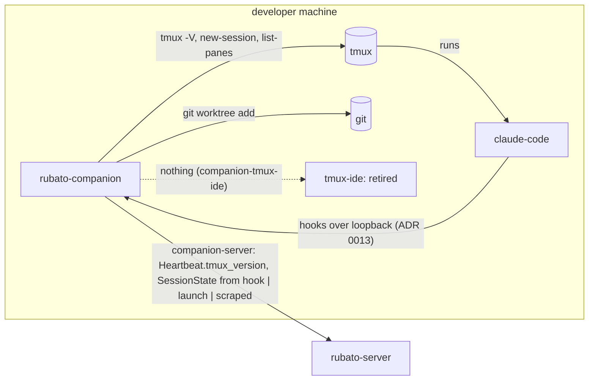

# Retire tmux-ide; the companion runs tmux and git itself

Issue: #147 · Design: [147-retire-tmux-ide/design.md](147-retire-tmux-ide/design.md) · ADR:
[0050](../decisions/0050-retire-tmux-ide.md) (proposed, supersedes 0003) · Map: seams
`companion-tmux-ide`, `companion-server`.

Track: **full**: a dependency goes, the `companion-tmux-ide` seam stops carrying anything, and
`crates/rubato-protocol` changes `schema/protocol/*.json`.

Issue #147 asks whether Rubato needs tmux-ide or whether the little we use is simpler to own.
The companion calls five tmux-ide commands and never `send`, `wait`, MCP or the SDK (design §1):
a git wrapper for worktrees, a status bar, agent state only for panes tmux-ide's own hooks
stamped, a change trigger that exists only for adopted sessions, and a version pin. Sessions are
already started with tmux, panes already found with tmux and `ps`, and a launched session's
events already come from our hooks. This plan retires tmux-ide. Agent state for agents, which
tmux-ide's MCP would have offered, is kept in mind as a later MCP server on `rubato-server`
(design §8), not built here.

## What the change does

- **A developer machine needs tmux, git and Claude Code, not tmux-ide.** The companion never runs
  `tmux-ide`; CI and the Gherkin suite no longer install it.
- **A launch creates the worktree with git**, at the same `<repo>-worktrees/<branch>` path:
  reusing a local branch, tracking `origin/<branch>` if it was pushed from elsewhere, or branching
  from the base ref (design §2). Then tmux and Claude Code start exactly as today.
- **The launch checks tmux instead of tmux-ide.** A tmux missing or below the pinned version
  (3.7) is refused as `missing_dependency` with the version in the detail; a hung `tmux -V` fails
  the launch at the command deadline.
- **Agent state comes only from our hooks.** A launched session reports as today. A session the
  developer started themselves shows as a pane with *unknown* state until they opt it in with the
  skill's `hooks.ts` (Q3).
- **The heartbeat names the tmux version** (`tmux_version`), and old companions and stored
  snapshots that still say `tmux_ide` keep parsing (Q2).
- **Operators see each reconcile and each launch outcome**: a `rubato.reconcile` span replaces
  `rubato.team_poll`, and a new `rubato.launches` counter by outcome and reason feeds a new
  "Launches by outcome" panel.
- **The docs stop telling people to install tmux-ide**: README, QUICKSTART, AGENTS.md (scope,
  architecture, "Decisions already made", "Don't"), and the map shows tmux-ide as retired (Q1).

## How we'll know it works

- [ ] **No tmux-ide anywhere it runs**: `grep -rn "tmux-ide\|tmux_ide" crates/rubato-companion/src .github`
  finds nothing but the deprecated wire names in `rubato-protocol`; the companion's Gherkin suite
  passes on a runner where `tmux-ide` is not on `PATH` (CI after this change), and prints its
  scenario count as today.
- [ ] **Worktree, three cases** (`worktree.feature`): new branch from the base ref; an existing
  local branch with no worktree; a branch only on `origin`, which the new worktree tracks. Each
  ends with the worktree at `<repo>-worktrees/<branch>` and a started session. Must fail: run
  against today's companion with a `tmux-ide` stand-in that exits 1, all three fail at
  `tmux-ide worktree create`.
- [ ] **A leftover directory is not overwritten** (`worktree.feature`): a directory at
  `<repo>-worktrees/<branch>` that git does not list as a worktree (a killed `worktree add`)
  fails the launch with the path in the error and leaves the directory as it was; a stale
  registration whose directory is gone is pruned and the launch succeeds (design §2).
- [ ] **The existing worktree is reused** (`worktree.feature`, unchanged scenario "A launch creates
  the worktree and the session", then a second launch after the session ends): no second
  `git worktree add`.
- [ ] **tmux pin**: `worktree.feature` "a tmux below the pinned version is refused": a `tmux`
  wrapper that reports `tmux 3.5` for `-V` and passes everything else to the real tmux → refused,
  `missing_dependency`, detail names `3.5` and `3.7`. `kernel::tmux` unit test parses `tmux 3.8`,
  `tmux 3.7a`, `tmux next-3.9` and rejects `tmux` with no version.
- [ ] **Deadlines still hold** (`launch-timeout.feature`): a tmux that hangs on `new-session` and a
  git that hangs on `worktree add` each fail the launch at the deadline with the command in the
  error, leave no tmux session, and leave no child running; hooks are forwarded while the launch
  hangs. Must fail: with the deadline removed from `gitx::worktree_add`, the git scenario times
  out the step instead of reporting `timed out after 5s`.
- [ ] **Lock not held while external commands run** (`launch::arm` unit tests): the slow stand-in
  is a `tmux` whose `-V` sleeps 1 s; the test still asserts the registry lock is free meanwhile.
- [ ] **State from hooks only** (`discovery.feature`): the scenario "A pane in an issue worktree is
  discovered, untrusted until a hook speaks" passes unchanged; a new scenario posts
  `user-prompt-submit.json` for that pane's cwd and the snapshot entry turns `working` from
  source `hook`. The `team --json` scenarios are removed.
- [ ] **Old data still parses** (`rubato-protocol` unit test): a `SessionState` with
  `"source": "tmux_ide"` and a `Heartbeat` with `tmux_ide_version` deserialize; a current
  companion's snapshot and heartbeat (fixtures `companion_sessions.json`,
  `companion_heartbeat.json`, regenerated) contain neither.
- [ ] **Heartbeat** (`pairing.feature`): "the server receives a heartbeat naming the tmux version",
  matching `tmux -V` on the runner.
- [ ] **Telemetry**: `e2e/run.ts` expects `rubato.hook.forward` and `rubato.reconcile`;
  `rubato.reconcile` carries `rubato.companion_id` and an error status when `tmux list-panes`
  fails (unit test in `sessions::tasks`, with a `tmux` stand-in that exits 1). A
  `launch::arm` unit test sees `rubato.launches` incremented once per result with
  `rubato.outcome` = `started`, `refused` or `failed`.
- [ ] **Dashboard**: `observability/check.ts` requires the panel "Launches by outcome" querying
  `rubato_launches_total`; a fixture dashboard without it fails `check.test.ts`.
- [ ] **Docs**: `grep -n "tmux-ide" README.md docs/QUICKSTART.md AGENTS.md` finds only the
  lines that say it was retired by ADR 0050; QUICKSTART's "What you need" lists tmux 3.7, git
  and Claude Code.
- [ ] **Map and plans still check** (CI plan check): every plan in `docs/plans/` passes against
  the changed map, and the count printed is the old count plus one (this plan).

## What it must not break

- **Own tmux only, no inbound access** (ADR 0004): the launcher's paired-user refusal runs first
  as today; `launch-refusal.feature` passes unchanged.
- **Panes are never scraped**: `kernel/tmux.rs` still reads pane metadata only; review row "Never
  scraped" in `review-checklist.md`.
- **Hooks for a launched session come only from its `--settings` file** (ADR 0013):
  `hooks.feature` and the `worktree.feature` settings assertion pass unchanged.
- **Identity from the branch** (ADR 0006): `sessions::identity` tests pass unchanged; worktrees
  keep their path, so a session in an existing worktree keeps its issue.
- **Progress**: a `scraped` session is still *unknown*, never *working*
  (`progress.rs` `stale_or_scraped_session_is_unknown_never_working`, unchanged).
- **Old `local.yml` files**: a config that still sets `tmux_ide_command` or `tmux_ide_min_version`
  parses (`kernel::config` unit test) and logs one `info!` per key.
- **Stored snapshots**: rows in `session_snapshots` written by today's companion load after the
  upgrade (`companion_link::store` test with a stored row containing `tmux_ide`).
- **The map's scenario player**: `start-a-session` still plays end to end in the web e2e after
  its tmux-ide step is dropped (Q1).

## How we'll debug it at 3 am

See the O-rows. New signals: span `rubato.reconcile` (replaces `rubato.team_poll`), counter
`rubato.launches` by `rubato.outcome` and `rubato.launch.reason` with its panel "Launches by
outcome", attribute `rubato.tmux.version` on the heartbeat. A launch failing in git shows its
command and stderr in `LaunchResult::Failed.error` (for example `git worktree add -b
issue/7-restock …: fatal: …`), which the web shows on the queue entry as `did not start: …`.
New log line: `info!(key, "local.yml sets a retired key; delete it")`.

## Affected parts

| Node | Status | What changes | Seams |
| --- | --- | --- | --- |
| rubato-companion | affected | git worktree, tmux pin, reconcile without `team --json`, no events watcher, `rubato.reconcile` span, `rubato.launches` counter, config keys removed; features, unit tests, CI | companion-tmux-ide, companion-server |
| rubato-protocol | affected | `Heartbeat.tmux_version`; doc comments on `StateSource::TmuxIde`, `Heartbeat.tmux_ide_version`, `Limits.team_poll_interval_secs`, `RefusalReason::MissingDependency`; otel names; schema snapshots; fixtures | companion-server |
| tmux-ide | affected | retired: no longer called; node and seam kept in the map, marked retired (Q1 a) | companion-tmux-ide |
| rubato-server | quiet | sample refusal texts in tests; `rubato.launches` panel added to the dashboard and its check | |
| web | quiet | regenerated `protocol.ts`; sample refusal texts in tests | |
| claude-code | quiet | launched exactly as today; tmux-ide's own user-level hooks are simply no longer needed on the machine | |

## Data models

| Model | Kind | Part | Change | Crosses | Note |
| --- | --- | --- | --- | --- | --- |
| `Heartbeat.tmux_version` | type | rubato-protocol | changed | companion-server | new optional string, from `tmux -V` (Q2 a) |
| `Heartbeat.tmux_ide_version`, `StateSource::TmuxIde` | type | rubato-protocol | changed | companion-server | still accepted, never sent; doc says deprecated (Q2 a) |
| `Limits.team_poll_interval_secs` | type | rubato-protocol | changed | companion-server | same name and default; now the reconcile interval |
| `heartbeat`, `companion_envelope`, `limits`, `server_envelope`, `session_state` schemas | schema | rubato-protocol | changed | companion-server | additive and descriptions; `schema/protocol/*.schema.json` |
| `CompanionConfig.tmux_min_version` | file | rubato-companion | changed | | new key in `local.yml` `companion:`, default `3.7`; `tmux_ide_command` and `tmux_ide_min_version` removed |
| `rubato.launches` | event | rubato-companion | new | | counter by `rubato.outcome`, `rubato.launch.reason`, `rubato.companion_id` |
| `rubato.reconcile`, `rubato.team_poll` | event | rubato-companion | changed | | span renamed; `rubato.team_poll` removed after PR 2 |

## Data flow

## Tasks

- [ ] **PR 0** `issue/147-retire-tmux-ide`: this plan, the design note, ADR 0050 (proposed).
  Design review.
- [ ] **PR 1** `issue/147-protocol`: failing first: the old-data-parses test (passes today, kept
  as a guard) and a `Heartbeat` round-trip test with `tmux_version` (fails: no such field). Then
  `tmux_version`, doc comments, `attr::TMUX_VERSION`, `span::RECONCILE`, `metric::LAUNCHES`,
  `attr::LAUNCH_REASON` (the old constants kept, marked deprecated), `UPDATE_SCHEMAS=1`,
  `gen:types`. Companion compiles with `tmux_version: None`.
- [ ] **PR 2** `issue/147-companion`: failing first: the three worktree scenarios and the tmux-pin
  scenario (fail on the tmux-ide stand-in), the hanging-git scenario, the reconcile span test, the
  `rubato.launches` test, the retired-keys config test, the hooks-only discovery scenario. Then
  `gitx::worktree_add` and `default_worktree_path` in `kernel/gitx.rs`, `Tmux::version()`,
  launcher without tmux-ide, reconcile without the fleet, `watch_events` and `kernel/tmux_ide.rs`
  removed, heartbeat with `tmux_version`, `features/fixtures/team.json` removed, the
  `launch::arm` stand-in moved to tmux, CI without tmux-ide, `e2e/run.ts` span list, the
  dashboard panel and its check, README, QUICKSTART, AGENTS.md (with the slices block for the
  companion's `kernel/`), `.claude/profiles/system-base.mmd`, the crate description in
  `Cargo.toml`, sample texts in server and web tests.
- [ ] **PR 3** `issue/147-map`: per Q1. With (a): the `tmux-ide` node and `companion-tmux-ide`
  seam descriptions say retired by ADR 0050, the seam's flows are removed, step 3 of the
  `start-a-session` scenario is dropped, the `rubato-companion` description already says it runs
  tmux and git; golden `overview.json` regenerated; plan check over every plan passes.
- [ ] **After PR 3**: open the follow-up issues: an MCP server on `rubato-server` for agent state
  (design §8); with Q1 (a), retiring the map ids for good; with Q3 (a), user-level hooks for
  manual sessions.

## Assumed, not yet approved

| # | Decision | Chosen | Alternatives | Scope |
| --- | --- | --- | --- | --- |
| Q1 | Eight merged plans name `companion-tmux-ide` and the plan check runs them all against today's map. What happens to the `tmux-ide` node and the seam? | (a) keep both ids, descriptions say retired by ADR 0050, the seam's flows and the scenario step that uses them removed; a follow-up issue retires the ids once the plan check can tell history from open work (recommended) | (b) delete both now and teach the plan check to check each plan against the map at its own `map_version` (a plan-check change, its own issue first); (c) delete both now and skip plans of closed issues in the plan check; (d) edit the merged plans to drop the id (rewrites records) | seam (companion-tmux-ide) |
| Q2 | What does the wire keep? | (a) `tmux_ide` and `tmux_ide_version` stay readable and are never sent; `Heartbeat.tmux_version` is added; `team_poll_interval_secs` keeps its name (recommended) | (b) as (a) and remove both old names now, with a migration rewriting `tmux_ide` in `session_snapshots`; (c) as (a) without `tmux_version`: the version only on the companion's heartbeat span | seam (companion-server) |
| Q3 | Sessions the developer starts outside Rubato | (a) as the skill already says: opt in per repo with `hooks.ts --out .claude/settings.local.json`, otherwise *unknown*; a follow-up issue for user-level hooks (recommended) | (b) the skill installs our hooks at user level now (needs a stable token across companion restarts and de-duplication with `--settings`, ADR 0013); (c) don't show manual sessions at all | seam (companion-server) |
| A4 | Pinned tmux version | 3.7, the floor README already states | 3.8, the version CI builds | node (rubato-companion) |
| A5 | Worktree when the branch already exists | local branch first, then `origin/<branch>` with `--track`, then `-b` from the base ref (design §2) | always `-b` from the base ref, failing when the branch exists | node (rubato-companion) |
| A6 | `rubato.sessions.discovered` series | `tmux_ide` dropped from the sources recorded (`StateSource::ALL` without it); the panel shows three series | keep a `tmux_ide` series pinned at 0 | node (rubato-companion) |
| A7 | Retired `local.yml` keys | ignored with one `info!` each at start | a hard error | node (rubato-companion) |

## O-rows

| Seam | Breaks like | Signal | Panel | Owner |
| --- | --- | --- | --- | --- |
| companion-tmux-ide | something still reaches for tmux-ide, or the git replacement fails where `worktree create` worked (a branch that exists, a dirty base) | counter `rubato.launches{rubato.outcome="failed"\|"refused", rubato.launch.reason}` rising with `rubato.companion_id`; span `rubato.launch` with error status and the git command and stderr in `LaunchResult::Failed.error` | Launches by outcome (new, Trust check row) | rubato-companion |
| companion-server | a companion stops reporting sessions after reconcile lost the fleet, or old snapshots stop parsing | span `rubato.reconcile` with error status and `rubato.companion_id`; gauge `rubato.sessions.discovered{rubato.session.source}` flat at zero for `hook` while the "Hooks/min vs working sessions" panel shows hooks; `warn!(error, "tmux list-panes failed")`; `error!(error, "storing snapshot")` on the server | Sessions discovered | rubato-server |

## Flows

| From | To | Seam | Kind | Carries |
| --- | --- | --- | --- | --- |
| rubato-companion | rubato-server | companion-server | data | Heartbeat with `tmux_version`; SessionState sourced from hook, launch or scraped only |

## ADRs proposed

| ADR | File | Blob |
| --- | --- | --- |
| 0050 | docs/decisions/0050-retire-tmux-ide.md | |

## Review map

1. Design §2 and `gitx::worktree_add` (PR 2): the three cases, the deadline, and the path kept
   identical to tmux-ide's, so existing worktrees and their identity don't move.
2. Q1: whether keeping retired ids in the map is acceptable, or the plan check should learn
   history first.
3. Design §5: nothing removed from the wire, so stored `session_snapshots` and an older companion
   keep parsing.
