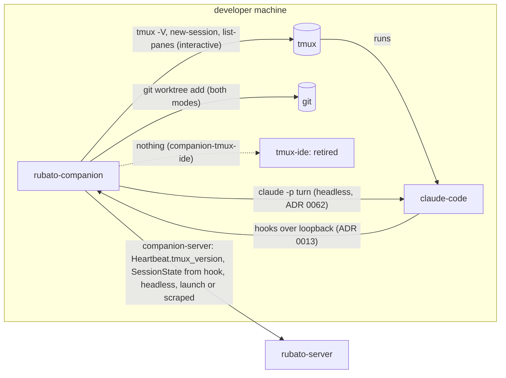

# Retire tmux-ide; the companion runs tmux and git itself

Issue: #147 · Design: [147-retire-tmux-ide/design.md](147-retire-tmux-ide/design.md) · ADR:
[0070](../decisions/0070-retire-tmux-ide.md) (proposed; supersedes 0003 and 0013 in part) · Map:
seams `companion-tmux-ide`, `companion-server`.

Track: **full**. A dependency goes, the `companion-tmux-ide` seam stops carrying anything, and
`crates/rubato-protocol` changes `schema/protocol/*.json`.

**Refreshed.** The first version was approved as plan 62db41a on 2026-11-14, with its ADR numbered
0050, on `issue/147-retire-tmux-ide`. Main has since given 0050 to rooms and moved about 270
commits. The design note's head lists what changed and where. In short:
- headless mode (ADR 0062) already makes worktrees with git, so both modes share one function;
- the MCP note now points at ADR 0071 instead of a server-side MCP;
- the order against #197's follow-ups is pinned;
- the design review added a targeted removal of a stale registration, `--no-track` for a new
  branch, a `companion.git_command` for tests, and `StateSource::ALL` kept whole;
- the PRs are three instead of four.

Issue #147 asks whether Rubato needs tmux-ide, or whether the little we use is simpler to own. An
interactive companion calls five tmux-ide commands, and a headless one none (design §1):
- a git wrapper for worktrees;
- a status bar;
- agent state, but only for panes tmux-ide's own hooks stamped;
- a change trigger that exists only for adopted sessions;
- a version pin.

Sessions are already started with tmux, and panes already found with tmux and `ps`. A launched
session's events already come from our hooks, and a headless turn's from its own process. This
plan retires tmux-ide.

## What the change does

- **A developer machine needs tmux, git and Claude Code, not tmux-ide.** The companion never runs
  `tmux-ide`, and CI and the Gherkin suite no longer install it.
- **A launch creates the worktree with git**, at the same `<repo>-worktrees/<branch>` path, in
  interactive and headless mode alike. It reuses a local branch, else tracks `origin/<branch>` if
  that was pushed from elsewhere, else branches from the base ref (design §2). Then tmux and
  Claude Code start exactly as today, or the first headless turn does.
- **An interactive launch checks tmux instead of tmux-ide.**
  - A tmux that is missing or below the pinned version (3.7) is refused as `missing_dependency`,
    with the version in the detail.
  - A hung `tmux -V` fails the launch at the command deadline.
  - A headless launch checks neither, as today (ADR 0062).
- **Agent state comes only from our hooks** (and, headless, from the turn process).
  - A launched session reports as today.
  - A session the developer started themselves shows as a pane with *unknown* state, until they
    opt it in with the skill's `hooks.ts` (Q3).
- **The heartbeat names the tmux version** (`tmux_version`). Old companions and stored snapshots
  that still say `tmux_ide` keep parsing (Q2).
- **Operators see each reconcile and each launch outcome.** A `rubato.reconcile` span replaces
  `rubato.team_poll`. A new `rubato.launches` counter, by outcome and reason, feeds a new "Launches
  by outcome" panel.
- **The docs stop telling people to install tmux-ide.**
  - README, QUICKSTART and AGENTS.md change: scope, architecture, the companion's kernel block,
    "Decisions already made" and "Don't".
  - The map shows tmux-ide as retired (Q1).

## How we'll know it works

- [ ] **No tmux-ide anywhere it runs.** `grep -rn "tmux-ide\|tmux_ide" crates/rubato-companion/src .github`
  finds only these expected hits:
  - the heartbeat's `tmux_ide_version: None` (a wire field kept by Q2);
  - the two retired key names in `kernel/config.rs`, for their `info!` line;
  - the comment at `sessions/launches.rs:145`, left for #224 (Decision 10).

  The companion's Gherkin suite passes on a runner where `tmux-ide` is not on `PATH` (CI after this
  change), and prints its scenario count as today.
- [ ] **Worktree, three cases** (`worktree.feature`):
  - a new branch from the base ref;
  - an existing local branch with no worktree;
  - a branch only on `origin`, which the new worktree tracks.

  Each ends with the worktree at `<repo>-worktrees/<branch>` and a started session. To fail on
  purpose: run against today's companion with a `tmux-ide` stand-in that exits 1, and all three
  fail at `tmux-ide worktree create`.
- [ ] **A leftover directory is not overwritten** (`worktree.feature`).
  - A directory at `<repo>-worktrees/<branch>` that git does not list as a worktree (a killed
    `worktree add`) fails the launch, with the path in the error, and leaves the directory as it
    was.
  - A stale registration for the launch's branch whose directory is gone (`prunable` in
    `git worktree list --porcelain`) is removed with `git worktree remove -- <path>`, and the
    launch succeeds at the default path (design §2).
  - No other worktree registration of the repository changes: the scenario holds a second stale
    registration for another branch, and it is still listed afterwards.
- [ ] **The existing worktree is reused** (`worktree.feature`): the unchanged scenario "A launch
  creates the worktree and the session", then a second launch after the session ends, runs no
  second `git worktree add`.
- [ ] **Headless uses the same function** (`gitx` unit test, a temporary repo with a bare origin):
  the three cases and the leftover check, called with the arguments the headless path passes. The
  existing `headless.feature` scenarios pass unchanged.
- [ ] **The branch never reads as an option**: a `gitx` unit test points `companion.git_command`
  at a recording wrapper around the real git, and sees `--` before the path in all three cases.
  `check_branch` still runs first (`launch-branch.feature`, unchanged scenarios).
- [ ] **A new branch has no upstream** (`gitx` unit test, case 3): `git rev-parse @{u}` fails in the
  new worktree, so the agent's first `git push -u origin <branch>` sets it. Case 2 tracks
  `origin/<branch>`. To fail on purpose: without `--no-track`, `@{u}` is the base ref's remote
  branch.
- [ ] **tmux pin**:
  - `worktree.feature` "a tmux below the pinned version is refused": a `tmux` wrapper reports
    `tmux 3.5` for `-V` and passes everything else to the real tmux. The launch is refused as
    `missing_dependency`, and the detail names `3.5` and `3.7`.
  - A `kernel::tmux` unit test parses `tmux 3.8`, `tmux 3.7a` and `tmux next-3.9`, and rejects
    `tmux` with no version.
- [ ] **Deadlines still hold** (`launch-timeout.feature`).
  - A tmux that hangs on `new-session`, and a git that hangs on `worktree add`, each fail the
    launch at the 5 s deadline, with the command in the error. They leave no tmux session and no
    child running.
  - Hooks are forwarded while the launch hangs.
  - The hanging git is `companion.git_command` pointed at a wrapper that hangs on `worktree add`
    and passes everything else to the real git, as the tmux-ide wrapper is injected through
    `tmux_ide_command` today.
  - To fail on purpose: with the deadline removed from `gitx::worktree_add`, the git scenario
    times out the step instead of reporting `timed out after 5s`.
- [ ] **Lock not held while external commands run** (`launch::arm` unit tests): the slow stand-in
  is a `tmux` whose `-V` sleeps 1 s, and the test still asserts the registry lock is free
  meanwhile.
- [ ] **State from hooks only** (`discovery.feature`).
  - The scenario "A pane in an issue worktree is discovered, untrusted until a hook speaks" passes
    unchanged.
  - A new scenario posts `user-prompt-submit.json` for that pane's cwd, and the snapshot entry
    turns `working` from source `hook`.
  - The three tmux-ide scenarios are removed.
- [ ] **Old data still parses** (`rubato-protocol` unit test). A `SessionState` with
  `"source": "tmux_ide"` and a `Heartbeat` with `tmux_ide_version` deserialize. A current
  companion's heartbeat fixture (`companion_heartbeat.json`, regenerated) has `tmux_version` and
  no `tmux_ide_version`.
- [ ] **Heartbeat** (`pairing.feature`): "the server receives a heartbeat naming the tmux version",
  matching `tmux -V` on the runner. A `stale::heartbeat` unit test,
  `a_headless_heartbeat_names_no_tmux`, sees `tmux_version: None` with no tmux to run.
- [ ] **Sources still covered**: `StateSource::ALL` keeps `TmuxIde`, so
  `all_sources_cover_every_variant_once` and `progress.rs`'s loop over `ALL` keep testing it. The
  companion's `record_gauges` and `counts_by_source` skip it (A6), and their tests (`tasks.rs`,
  `registry.rs`, `discovery.rs`) expect hook, headless, launch and scraped.
- [ ] **Telemetry**:
  - `e2e/run.ts` expects the spans `rubato.hook.forward` and `rubato.reconcile`, the metric
    `rubato.launches` and the attribute key `rubato.outcome`.
  - `rubato.reconcile` carries `rubato.companion_id`, and an error status when `tmux list-panes`
    fails. This is a unit test in `sessions::tasks`, with a `tmux` stand-in that succeeds on
    `list-sessions` and exits 1 on `list-panes` (a failing `list-sessions` reads as no server,
    `kernel/tmux.rs:141`).
  - A `launch::arm` unit test sees `rubato.launches` incremented once per result, with
    `rubato.outcome` = `started`, `refused` or `failed`, and `rubato.reason` on refusals. The same
    test sees the `rubato.launch` log line's `outcome` field as that word, not a `Discriminant`.
- [ ] **Dashboard**: `observability/check.ts` requires the panel "Launches by outcome" querying
  `rubato_launches_total`. A fixture dashboard without it fails `check.test.ts`.
- [ ] **Docs**: `grep -n "tmux-ide" README.md docs/QUICKSTART.md AGENTS.md` finds only the lines
  that say it was retired by ADR 0070. QUICKSTART's "What you need" lists tmux 3.7, git and Claude
  Code.
- [ ] **Map and plans still check** (CI plan check): every plan in `docs/plans/` passes against the
  changed map, and the count printed is the count before PR 3.

## What it must not break

- **Own tmux only, no inbound access** (ADR 0004): the launcher's paired-user refusal runs first, as
  today, and `launch-refusal.feature` passes unchanged.
- **Panes are never scraped**: `kernel/tmux.rs` still reads pane metadata only. Its one write, the
  session_input paste (ADR 0051), is unchanged; `session-messages.feature` passes unchanged.
  AGENTS.md "Don't scrape tmux panes for state" keeps its rule, now naming hooks and
  `tmux list-panes` metadata instead of `team --json`.
- **Hooks for a launched session come only from its `--settings` file** (ADR 0013):
  `hooks.feature` and the `worktree.feature` settings and header-file assertions (ADR 0063) pass
  unchanged.
- **Headless mode** (ADR 0062): `headless.feature` passes with tmux unusable. Only the wording of
  one step changes ("tmux and tmux-ide unusable" becomes "tmux unusable"). A headless launch checks
  no tmux, and its heartbeat sends `tmux_version: None` (`a_headless_heartbeat_names_no_tmux`).
- **Identity from the branch** (ADR 0006): the `sessions::identity` tests pass unchanged. Worktrees
  keep their path, so a session in an existing worktree keeps its issue.
- **Progress**: a `scraped` session is still *unknown*, never *working*
  (`progress.rs` `stale_or_scraped_session_is_unknown_never_working`, unchanged).
- **Old `local.yml` files**: a config that still sets `tmux_ide_command` or `tmux_ide_min_version`
  parses (`kernel::config` unit test), and logs one `info!` per key.
- **Stored snapshots**: rows in `session_snapshots` written by today's companion load after the
  upgrade. A new `companion_link` test (PR 1) stores a row with a `tmux_ide` session and asserts
  that `all_sessions` returns that session. That assertion matters, because the read path turns a
  row that does not parse into an empty list (`companion_link/store.rs:49`).
- **The map's scenario player**: `start-a-session` still plays end to end in the web e2e after its
  tmux-ide step is dropped (Q1).
- **#197's follow-ups**: this change leaves alone the hook receiver's routes, the `claude` argument
  list in `launch.sh` and the turn script, `LaunchRecord` and `server_link` (design §8). `git diff
  --stat` on PR 2 shows no change under `hooks/`, `server_link/` or `sessions/launches.rs`.

## How we'll debug it at 3 am

See the O-rows. New signals:
- span `rubato.reconcile`, replacing `rubato.team_poll`;
- counter `rubato.launches`, by `rubato.outcome` and `rubato.reason`, with its panel
  "Launches by outcome";
- attribute `rubato.tmux.version` on the start line `tmux found`;
- the existing `rubato.launch` log line (`launch/arm.rs:115`), whose `outcome` field becomes
  `started`, `refused` or `failed`. Today it prints a `Discriminant`.

A launch failing in git shows its command and stderr in `LaunchResult::Failed.error` (for example
`git worktree add -b issue/7-restock -- …: fatal: …`). The web shows that on the queue entry as
`did not start: …`. New log line: `info!(key, "local.yml sets a retired key; delete it")`.

## Affected parts

| Node | Status | What changes | Seams |
| --- | --- | --- | --- |
| rubato-companion | affected | git worktree for both modes, tmux pin, reconcile without `team --json`, no events watcher, `rubato.reconcile` span, `rubato.launches` counter, config keys removed; features, unit tests, CI | companion-tmux-ide, companion-server |
| rubato-protocol | affected | `Heartbeat.tmux_version`; doc comments on `StateSource::TmuxIde`, `Heartbeat.tmux_ide_version`, `Limits.team_poll_interval_secs`, `RefusalReason::MissingDependency`; otel names; schema snapshots; fixtures | companion-server |
| tmux-ide | affected | retired: no longer called; node and seam kept in the map, marked retired (Q1) | companion-tmux-ide |
| rubato-server | quiet | sample refusal texts in tests; the "Launches by outcome" panel added to the dashboard and its check | |
| web | quiet | regenerated `protocol.ts`; sample refusal texts in tests | |
| claude-code | quiet | launched exactly as today; tmux-ide's own user-level hooks are simply no longer needed on the machine | |

## Data models

| Model | Kind | Part | Change | Crosses | Note |
| --- | --- | --- | --- | --- | --- |
| `Heartbeat.tmux_version` | type | rubato-protocol | changed | companion-server | new optional string, from `tmux -V`; `None` from a headless companion (Q2) |
| `Heartbeat.tmux_ide_version`, `StateSource::TmuxIde` | type | rubato-protocol | changed | companion-server | still accepted, never sent; the doc says deprecated (Q2) |
| `Limits.team_poll_interval_secs` | type | rubato-protocol | changed | companion-server | same name and default; now the reconcile interval |
| `heartbeat`, `companion_envelope`, `limits`, `server_envelope`, `session_state` schemas | schema | rubato-protocol | changed | companion-server | additive, and descriptions; `schema/protocol/*.schema.json` |
| `launch_result` schema | schema | rubato-protocol | changed | companion-server | the `missing_dependency` description only |
| `CompanionConfig.tmux_min_version`, `CompanionConfig.git_command` | file | rubato-companion | changed | | new keys in `local.yml` `companion:`, defaults `3.7` and `git`; `tmux_ide_command` and `tmux_ide_min_version` removed |
| `rubato.launches` | event | rubato-companion | new | | counter by `rubato.outcome`, `rubato.reason`, `rubato.companion_id` |
| `rubato.reconcile`, `rubato.team_poll` | event | rubato-companion | changed | | span renamed; `rubato.team_poll` removed after PR 2 |

## Data flow

## Tasks

- [ ] **PR 1** `issue/147-retire-tmux-ide-2`: this plan, the design note and ADR 0070 (proposed);
  the design review; the approval. Then, on the same branch, the protocol change.
  - At approval: the status lines of ADR 0003 and ADR 0013 add "superseded in part by 0070"
    (Decision 16).
  - Failing first:
    - the old-data-parses test (it passes today, and is kept as a guard);
    - the stored-snapshot `companion_link` test, which asserts the session comes back;
    - a `Heartbeat` round-trip test with `tmux_version` (it fails: no such field).
  - Then:
    - `tmux_version`;
    - the doc comments on `Heartbeat`, `Limits` and `RefusalReason`, and the plain comment on
      `StateSource::TmuxIde` (Decision 15);
    - `attr::TMUX_VERSION`, `span::RECONCILE` and `metric::LAUNCHES` (by the existing
      `attr::OUTCOME` and `attr::DROP_REASON`). The old constants are kept, marked deprecated.
  - Then `UPDATE_SCHEMAS=1` and `gen:types`.
  - The companion compiles with `tmux_version: None`.
- [ ] **PR 2** `issue/147-companion`, from main after PR 1.
  - Failing first:
    - the three worktree scenarios and the tmux-pin scenario (they fail on the tmux-ide stand-in);
    - the leftover-directory and stale-registration scenarios, and the hanging-git scenario;
    - the `gitx` argv, no-upstream and headless-cases unit tests;
    - the reconcile span test, the `rubato.launches` test and `a_headless_heartbeat_names_no_tmux`;
    - the retired-keys config test and the hooks-only discovery scenario.
  - Then:
    - `companion.git_command`, threaded through `gitx`;
    - `gitx::worktree_add` (three cases, `--no-track` for a new branch, leftover, `--`) and
      `default_worktree_path` in `kernel/gitx.rs`, used by both modes;
    - the stale registration for the launch's branch removed before the lookup (Decision 12);
    - `DEFAULT_TIMEOUT` moved from `kernel/tmux_ide.rs` to `kernel/proc.rs`;
    - `Tmux::version()` and `version_at_least` in `kernel/tmux.rs`, and the launcher's tmux under
      `command_timeout()`;
    - the launcher without tmux-ide, and reconcile without the fleet;
    - `watch_events` and `kernel/tmux_ide.rs` removed, and the heartbeat with `tmux_version`
      (`None` in headless mode);
    - `TmuxIde` skipped in `record_gauges` and `counts_by_source` (A6);
    - the `rubato.launch` line's `outcome` as a word, and `rubato.launches` counted beside it;
    - `features/fixtures/team.json` removed, and the `launch::arm` stand-in moved to tmux;
    - CI without tmux-ide, and `e2e/run.ts`'s span, metric and attribute lists;
    - the dashboard panel and its check;
    - README, QUICKSTART, AGENTS.md (scope, architecture, "What each part emits", the companion's
      `kernel/` block, "Decisions already made", "Don't"), `.claude/profiles/system-base.mmd`,
      the crate description in `Cargo.toml`, and sample texts in server and web tests.
  - Lands before #222, #223 and #225 (#197's order).
- [ ] **PR 3** `issue/147-map`, per Q1.
  - The `tmux-ide` node and the `companion-tmux-ide` seam descriptions say retired by ADR 0070.
  - The seam's flows are removed, and step 3 of the `start-a-session` scenario is dropped.
  - The server golden `overview.json`, and the plan-check, skill and web tests that pin the real
    map, are re-recorded, failing first.
  - The deprecated otel constants are removed.
  - The plan check over every plan passes.
- [ ] **After PR 3**: open the follow-up issues: retiring the map ids for good, once the plan check
  can tell history from open work (Q1); and user-level hooks for manual sessions (Q3).

## Assumed, not yet approved

| # | Decision | Chosen | Alternatives | Scope |
| --- | --- | --- | --- | --- |
| A4 | Pinned tmux version | 3.7, the floor README already states | 3.8, the version CI builds | node (rubato-companion) |
| A5 | Worktree when the branch already exists | the local branch first, then `origin/<branch>` with `--track`, then `-b` from the base ref (design §2) | always `-b` from the base ref, failing when the branch exists | node (rubato-companion) |
| A6 | `rubato.sessions.discovered` series | the companion's `record_gauges` and `counts_by_source` skip `TmuxIde`, so the panel shows hook, headless, launch and scraped; `StateSource::ALL` in the protocol stays whole | keep a `tmux_ide` series pinned at 0 | node (rubato-companion) |
| A7 | Retired `local.yml` keys | ignored, with one `info!` each at start | a hard error | node (rubato-companion) |

## Decisions

| # | Decision | Chosen | Why | Decided by |
| --- | --- | --- | --- | --- |
| 1 | Q1: the `tmux-ide` node and `companion-tmux-ide` seam (nine merged plans name the seam, and the plan check runs them all against today's map) | (a) keep both ids, with descriptions saying retired by ADR 0070; remove the seam's flows and the scenario step that uses them; a follow-up retires the ids once the plan check can tell history from open work | deleting them fails CI on history; teaching the plan check each plan's own `map_version` is its own change | Mattias Jonsson (m0x6A), by approving plan 62db41a on 2026-11-14, whose recommended option this was |
| 2 | Q2: what the wire keeps | (a) `tmux_ide` and `tmux_ide_version` stay readable and are never sent; `Heartbeat.tmux_version` is added; `team_poll_interval_secs` keeps its name | stored `session_snapshots` rows and older companions keep parsing | Mattias Jonsson (m0x6A), by approving plan 62db41a on 2026-11-14, whose recommended option this was |
| 3 | Q3: sessions the developer starts outside Rubato | (a) opt in per repo with `hooks.ts --out .claude/settings.local.json`, as the skill already says, otherwise *unknown*; no MCP for them (ADR 0071 §7); a follow-up issue for user-level hooks | a manual session has no launch to bind hooks or MCP to | Mattias Jonsson (m0x6A), by approving plan 62db41a on 2026-11-14, whose recommended option this was |
| 4 | ADR number | 0070, renumbered from 0050 | main gave 0050 to rooms; 0070 is free on main and on every open branch | agent (delegated by Mattias, 2026-11-15) |
| 5 | What ADR 0070 supersedes | 0003 and 0013 in part: tmux-ide as runner, reconciliation source and pin; 0013's tmux-ide backstop sentence. Claude-Code-only, tmux required (interactive) and never scraped stand | 0051 and 0062 already took parts of 0003; superseding all of it would also drop rules that stay | agent (delegated by Mattias, 2026-11-15) |
| 6 | MCP after tmux-ide | nothing built or taken here; design §8 now points at ADR 0071 (MCP in the companion, launched sessions only) instead of a server-side MCP | ADR 0071 settled where agent MCP lives after this note's first version | agent (delegated by Mattias, 2026-11-15) |
| 7 | One worktree function for both modes | interactive mode uses the `gitx::worktree_add` headless mode got from #122, extended with the `origin` case, the leftover check and the removal of a stale registration for the branch | two implementations of one path rule would drift; headless gains the `origin` case | agent (delegated by Mattias, 2026-11-15) |
| 8 | `--` before git's positional arguments | always, in all three `worktree add` forms | the branch comes from the server; #192 did the same for tmux-ide (issue #155); `check_branch` stays the first guard | agent (delegated by Mattias, 2026-11-15) |
| 9 | Deadline of the launcher's tmux calls | `companion.command_timeout()`, as tmux-ide's calls had; reconcile's `list-panes` keeps `proc::LOCAL_TIMEOUT` | the launch-timeout scenario keeps its 5 s deadline; a hung tmux at launch fails like a hung tmux-ide did | agent (delegated by Mattias, 2026-11-15) |
| 10 | Order against #197's follow-ups | PR 2 lands before #222, #223 and #225, and changes nothing under `hooks/`, `server_link/`, `sessions/launches.rs` or the `claude` argument list | #197's plan orders it so; the two changes then never edit the same lines | agent (delegated by Mattias, 2026-11-15) |
| 11 | PR split | three PRs: plan with protocol, companion, map | the plan and the additive protocol change are reviewed together; the map change re-records goldens on its own | agent (delegated by Mattias, 2026-11-15) |
| 12 | A stale registration for the launch's branch | removed with `git worktree remove -- <path>` before the lookup at `launcher.rs:168`, with a `warn!` naming the path; never a repository-wide `git worktree prune` | `git worktree list` still lists a worktree whose directory is gone, so the launcher would reuse it; a global prune would also drop the developer's other worktrees, for example on an unmounted disk | agent (delegated by Mattias, 2026-11-15) |
| 13 | Upstream of a new branch (case 3) | `--no-track`: no upstream until the agent's first `git push -u`; case 2 keeps `--track origin/<branch>` | `-b <b> <path> origin/main` sets `@{u}` to `origin/main`, and a bare `git push` is then refused under `push.default=simple`; headless mode does this today | agent (delegated by Mattias, 2026-11-15) |
| 14 | How tests swap git | a new `companion.git_command` (default `git`), threaded through `gitx` like `tmux_command` | git is hard-coded today; a `PATH` wrapper would also catch the test harness's own git calls, and `set_var` races the parallel tests | agent (delegated by Mattias, 2026-11-15) |
| 15 | Where `StateSource::TmuxIde` is marked deprecated | a plain `//` comment, not a `///` doc comment | a doc-comment change would alter the `overview` and `issue_summary` schemas and pull `web-server` into a change that does not touch it | agent (delegated by Mattias, 2026-11-15) |
| 16 | Superseded ADRs' status lines | 0003 and 0013 get "superseded in part by 0070" in their status lines, in PR 1 after approval | `plan.ts handoff` and `adrs.ts` do not touch the ADRs a new one supersedes; status moves, the text does not | agent (delegated by Mattias, 2026-11-15) |

## O-rows

| Seam | Breaks like | Signal | Panel | Owner |
| --- | --- | --- | --- | --- |
| companion-tmux-ide | something still reaches for tmux-ide, or the git replacement fails where `worktree create` worked (a branch that exists, a dirty base, a leftover directory, a stale registration) | counter `rubato.launches{rubato.outcome="failed"\|"refused", rubato.reason}` rising with `rubato.companion_id`; the `rubato.launch` log line with `launch_id`, `issue` and `outcome`; the git command and stderr in `LaunchResult::Failed.error`, shown on the queue entry | Launches by outcome (new, Trust check row) | rubato-companion |
| companion-server | a companion stops reporting sessions after reconcile lost track of panes | span `rubato.reconcile` with error status and `rubato.companion_id`; gauge `rubato.sessions.discovered{rubato.session.source}` flat at zero for `hook` while the "Hooks/min vs working sessions" panel shows hooks; `warn!(error, "tmux list-panes failed")` | Sessions discovered | rubato-server |

## Flows

| From | To | Seam | Kind | Carries |
| --- | --- | --- | --- | --- |
| rubato-companion | rubato-server | companion-server | data | Heartbeat with `tmux_version`; SessionState sourced from hook, headless, launch or scraped only |

## ADRs proposed

| ADR | File | Blob |
| --- | --- | --- |
| 0070 | docs/decisions/0070-retire-tmux-ide.md | ce779e0327acac8a5a8487ec00e3e73d70cf7607 |

## Review map

1. Design §2 and `gitx::worktree_add` (PR 2): the three cases, `--`, the deadline, and the path
   kept identical to tmux-ide's, so existing worktrees and their identity don't move, now shared
   with headless mode.
2. Design §8 and Decision 10: what PR 2 must not touch, so #197's follow-ups land on top without
   conflict.
3. Design §5: nothing removed from the wire, so stored `session_snapshots` and an older companion
   keep parsing.
