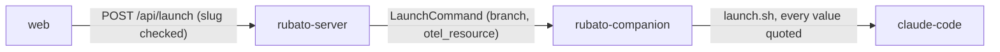

# Launch script trusts server values inside single quotes

The companion writes `launch.sh` from a `LaunchCommand`. Values from the server (the branch,
the repo, the map node ids in `OTEL_RESOURCE_ATTRIBUTES`) go inside single quotes with only
commas and spaces replaced (`crates/rubato-companion/src/launch/script.rs:28-46`), so a `'` ends
the quoted string and the rest runs on the developer's machine. The branch comes from
`LaunchRequest.slug`, which the server does not check (`crates/rubato-server/src/launch/handler.rs:119`),
and the same branch names the worktree folder (`kernel/tmux_ide.rs:203`), so `../` escapes it.
Only the caller's own companion receives the launch, so this is hardening.

## What the change does

- Every value the companion writes into `launch.sh` is one shell word, whatever it contains: a `'` or `$(…)` in a branch, repo, node id, path or setting stays text.
- The companion refuses to launch on a branch or base ref with `..`, a leading `-` or `/`, an empty path part, a `.lock` ending, or a character other than a letter, digit or `._/-`. The launch reports `Failed` with the reason; no worktree is made.
- `POST /api/launch` answers 422 to a `slug` that is not letters and digits in words joined by single hyphens. A slug made from the issue title is not checked and always has that shape.

## How we'll know it works

- [x] `sh_quote` round-trips `it's`, `'`, `$(touch /tmp/x)`, a newline and the empty string through a real `sh` (`launch/script.rs` unit test).
- [x] `check_ref` accepts `issue/27-launch-without-lock`, `origin/main`, `issue/3-v0.2` and `issue/9-sök-räkna`, and refuses quote, `..`, leading `-` and `/`, `//`, `.lock`, `$(…)` and a space (`launch/script.rs` unit test).
- [x] `is_slug` accepts what `slugify` makes from five titles, including `Öppna kartan` and an empty one, and refuses ten odd slugs (`launch/prompt.rs` unit test).
- [ ] The companion's Gherkin suite and the end-to-end run in CI pass unchanged: real launches still start.

## What it must not break

- Launches on branches made from issue titles, including titles with Swedish letters: `slugify` keeps any letter, so `check_ref` and `is_slug` take letters, not only ASCII.
- `claude_command` from the developer's `workspace.yml`, which may carry arguments: written as before.
- The `rubato.*` resource attributes Claude Code exports (`OTEL_RESOURCE_ATTRIBUTES` keeps the same `k=v,k=v` text).

## How we'll debug it at 3 am

A refused branch shows as a `LaunchResult::Failed` with the reason "… is not a branch name the companion accepts" on the issue, from the existing launch span; a refused slug is a 422 on `POST /api/launch`, in the server's request span. See the O-rows.

## Affected parts

| Node | Status | What changes | Seams |
| --- | --- | --- | --- |
| rubato-companion | affected | `launch.sh` quotes every value; branch and base ref checked before the worktree | companion-server, companion-claude-code |
| rubato-server | affected | a launch request's slug must have the slug shape | web-server |

## Data models

None.

## Data flow

## Tasks

- [x] `sh_quote` and `check_ref` in `launch/script.rs`, with unit tests; quote every value in `launcher_script`.
- [x] `launcher.rs`: `check_ref` on branch and base ref before the worktree; quote the tmux command.
- [x] `is_slug` in `launch/prompt.rs` with a test against `slugify`; 422 in `launch/handler.rs`.
- [x] `cargo fmt`, `cargo clippy -D warnings`, server and companion unit tests.

## Assumed, not yet approved

| # | Decision | Chosen | Alternatives | Scope |
| --- | --- | --- | --- | --- |
| A1 | Which letters a branch and slug may hold | any Unicode letter or digit, as `slugify` already produces | ASCII only, with `slugify` changed to match (renames branches of non-ASCII titles) | seam |
| A2 | Track | small: no schema or contract type changes, only values refused that no Rubato part produces | full, since `LaunchRequest.slug` and `LaunchCommand.branch` now refuse some values | seam |

## O-rows

| Seam | Breaks like | Signal | Panel | Owner |
| --- | --- | --- | --- | --- |
| companion-server | a launch on a real branch is refused | `LaunchResult::Failed` with "is not a branch name the companion accepts", on the companion's launch span | Interactive map | rubato-companion |
| companion-claude-code | the session starts with a wrong resource attribute or none | `rubato.issue` and `rubato.node` missing on Claude Code's own OTel export for the session | Rubato overview, cost per issue | rubato-companion |
| web-server | the web's Start is refused for a slug it sent | 422 on `POST /api/launch` in the server's request span | Interactive map | rubato-server |

## Flows

| From | To | Seam | Kind | Carries |
| --- | --- | --- | --- | --- |
| web | rubato-server | web-server | control | POST /api/launch with a checked slug |
| rubato-server | rubato-companion | companion-server | control | LaunchCommand whose branch the companion checks |
| rubato-companion | claude-code | companion-claude-code | control | launch.sh with every value quoted |

## ADRs proposed

None.
