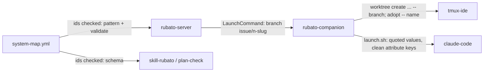

# Launch script trusts server values inside single quotes

Issue: #155, with the two Companion bullets of #170 that close the same routes · Design:
[155-branch-and-map-ids/design.md](155-branch-and-map-ids/design.md) · Map: `rubato-companion`,
`rubato-protocol`, `system-map`, `rubato-server`.

Track: **full**. `schema/system-map.schema.json` and the protocol schemas that embed
`SystemMap` gain an id pattern, and the companion narrows what it accepts on `companion-server`
and how it calls tmux-ide on `companion-tmux-ide`.

Part 1 is on main (PR #156): every value in `launch.sh` is quoted with `sh_quote`, the companion
refuses a branch with `..` or a leading `-` (`check_ref`), and `POST /api/launch` answers 422 to a
malformed slug. This plan is part 2 (design §1): the branch must be the issue's own
`issue/<n>-<slug>`, tmux-ide gets `--` before positionals, and map ids get one character rule
at the source.

## What the change does

- The companion launches only on the issue's own branch, `issue/<n>-<slug>`, where `<n>` is the command's issue number and the slug is words of letters and digits joined by single hyphens. Any other branch is a `Failed` launch with the reason, before any fetch, worktree or tmux session.
- The companion passes `--` before the branch to `tmux-ide worktree create` and before the session name to `tmux-ide adopt`.
- Resource attribute keys in `OTEL_RESOURCE_ATTRIBUTES` keep only letters, digits and `._-`; any other character becomes `_`.
- A map whose node or seam id is not lower-case letters, digits and hyphens (1 to 64, no hyphen at either end) fails to load on the server, fails `plan.ts check` and the plan check, with "id … is not a map id". The server keeps serving the map it had.
- The draft editor uses the same rule, from the protocol, instead of its own copy.

## How we'll know it works

- [ ] `IssueRef::is_branch_for` accepts `issue/7-restock` and `issue/7-öppna-kartan` for #7 and refuses `issue/9-x`, `issue/7-../x`, `issue/7-a/b`, `issue/7-x.lock`, `issue/7-a--b`, `main` and `issue/7` (`crates/rubato-protocol/src/ids.rs` unit test).
- [ ] Gherkin `launch-branch.feature`: a launch for issue 7 on `issue/9-other` fails with "is not issue/7-" and leaves no worktree and no tmux session; a slug `../../escape` fails the same way.
- [ ] A stub tmux-ide that records its argv shows `worktree create --from origin/main --no-session -- issue/7-x` and `adopt -- <name>` (`crates/rubato-companion/src/kernel/tmux_ide.rs` unit test).
- [ ] A key `a b,c=d'e` is written as `a_b_c_d_e` (`crates/rubato-companion/src/launch/script.rs` unit test).
- [ ] `SystemMap::validate` reports `BadId` for `A`, `a_b`, `-a`, `a'b` and a 65-character id, on a node and on a seam, and accepts `a`, `a-b` and 64 characters (`crates/rubato-protocol/src/map.rs` unit test).
- [ ] `schema/system-map.schema.json` has the pattern on `MapNode.id` and `Seam.id`; snapshots regenerated, `schema_snapshot.rs` passes.
- [ ] plan-check Vitest: `schema/fixtures/maps/bad-ids.yml` fails `loadMapText` on the schema, naming the id.
- [ ] The draft's `apply` still refuses `Bad_Id` with its own message (`crates/rubato-server/src/map_draft/apply.rs` tests unchanged).

## What it must not break

- Launches on branches the server makes, including from non-ASCII titles: the protocol test feeds `slugify` output for five titles through `is_branch_for`, and `worktree.feature` launches `issue/7-restock`.
- Part 1's quoting: the regression test of #155 in `script.rs` (a node id `a'$(touch${IFS}<dir>/p)'` in `otel_resource`, the script through `sh -n`, then run with `claude_command` stubbed) prints the id literally and leaves no `<dir>/p`; the Gherkin launch with such a node id leaves no `pwned` file in the worktree.
- Every map in the repo still loads: a protocol test validates the eight maps (`docs/design/rubato-map.yml`, `e2e/fixtures/team-map.yml`, `web/e2e/fixtures/shop-map.yml`, `schema/fixtures/bad-map.yml`, `schema/fixtures/maps/*.yml`) and prints how many maps and ids it checked; it fails on purpose with `bad-ids.yml`. The skill's and plan-check's Vitest suites pass.
- `claude_command` from the developer's `local.yml` may carry arguments and is written as is (documented on `CompanionConfig::claude_command`); the Gherkin stand-in claude still starts.
- The 422 on `POST /api/launch` for a bad slug: the server's `is_slug` test passes against the protocol rule.
- `web/src/protocol.ts` regenerated and diffed in CI (a pattern adds no TypeScript type).

## How we'll debug it at 3 am

See the O-rows. A refused branch is a `LaunchResult::Failed` whose error starts "branch … is not issue/<n>-<slug>", on the companion's `rubato.launch` span and on the issue. A map refused for an id is `rubato.map.load_failures` going up with the log line "system map invalid: id … is not a map id (node)"; the "Map age" panel shows the map stops getting newer. plan-check prints `rubato.plan.check` with the schema error.

## Affected parts

| Node | Status | What changes | Seams |
| --- | --- | --- | --- |
| rubato-protocol | affected | `ids::is_branch_slug`, `IssueRef::is_branch_for`; `map::MAP_ID_PATTERN`, `is_map_id`, `MapError::BadId`; schema pattern on `MapNode.id`, `Seam.id`; snapshots | companion-server, server-system-map |
| system-map | affected | `schema/system-map.schema.json`: node and seam ids get the pattern | server-system-map, skill-system-map |
| rubato-companion | affected | branch must be `issue/<n>-<slug>` for the command's issue; `--` to tmux-ide; resource attribute keys sanitised; regression and Gherkin tests | companion-server, companion-tmux-ide, companion-claude-code |
| rubato-server | affected | `is_slug` from the protocol; the draft's `valid_id` from the protocol | web-server, server-system-map |
| plan-check | quiet | validates maps with the regenerated schema; a fixture and a test, no code change | |
| skill-rubato | quiet | `map.ts` and `plan.ts check` load maps through plan-check's loader; `install.ts` copies the new schema | skill-system-map |

## Data models

| Model | Kind | Part | Change | Crosses | Note |
| --- | --- | --- | --- | --- | --- |
| `MapNode.id`, `Seam.id` | schema | system-map | changed | server-system-map | `schema/system-map.schema.json` gains `pattern` `^[a-z0-9](?:[a-z0-9-]{0,62}[a-z0-9])?$` |
| `SystemMap` in `schema/protocol/*.schema.json` | schema | rubato-protocol | changed | server-system-map | system_map, map_response, overview and every schema that embeds it; regenerated |
| `MapError::BadId` | type | rubato-protocol | new | server-system-map | Rust only, not on the wire |
| `LaunchCommand.branch` | type | rubato-protocol | changed | companion-server | shape unchanged; the companion refuses a value that is not `issue/<n>-<slug>` for the command's issue |

## Data flow

## Tasks

- [x] Protocol, test first: `is_branch_for` / `is_branch_slug` tests in `ids.rs` (fail: no function), then the functions; server `is_slug` re-exports it.
- [x] Protocol, test first: `validate` id tests in `map.rs` (fail: no rule), then `MAP_ID_PATTERN`, `is_map_id`, `BadId`; `#[schemars(pattern)]` on both ids; `UPDATE_SCHEMAS=1`; `pnpm gen` for `web/src/protocol.ts`.
- [x] Protocol: the every-map-in-the-repo test, with `schema/fixtures/maps/bad-ids.yml` as the must-fail case.
- [x] Server: the draft's `valid_id` calls `is_map_id`; existing tests unchanged.
- [x] plan-check: Vitest for `bad-ids.yml`.
- [x] Companion, test first: stub tmux-ide argv test (fail: no `--`), then `--` in `worktree_create` and `adopt`.
- [x] Companion, test first: key sanitising test (fail: `'` kept), then the key rule; the #155 regression test; doc on `claude_command`.
- [x] Companion: `launcher.rs:149` calls `is_branch_for` (one line); Gherkin `launch-branch.feature` with its steps module.
- [x] `cargo fmt`, `cargo clippy -D warnings` and `cargo test` for the three crates; plan-check and skill Vitest.

## Assumed, not yet approved

| # | Decision | Chosen | Alternatives | Scope |
| --- | --- | --- | --- | --- |
| Q1 | Which letters a branch slug may hold, on the companion and the server | (a) any Unicode letter or digit, as `slugify` and `is_slug` on main produce and accept | (b) ASCII `[a-z0-9]` only, as #170 suggests (`^issue/\d+-[a-z0-9-]+$`), with `slugify` changed to drop or transliterate other letters: a title like "Öppna kartan" gets a different branch than today; (c) ASCII on the companion only, refusing branches the server makes today | seam |
| Q2 | A map with an id outside the rule | (a) refused: the server keeps its last map and counts `rubato.map.load_failures`; plan-check fails the map's next PR | (b) accepted for now with a log line and a finding on the map, refused in a later release; (c) accepted, rule only in the draft editor (today) | seam |
| Q3 | Which ids the rule covers | (a) node and seam ids: what pins, plans and launches carry | (b) scenario ids too (they share the namespace; all 9 in the repo pass) | seam |
| A4 | How the companion reports a refused branch | `LaunchResult::Failed` with the reason, as `check_ref` on main | a new `RefusalReason`, a protocol enum change on `companion-server` | node |
| A5 | tmux-ide versions that read `--` | every version from the pinned 2.9.0 on: tmux-ide uses Node's `util.parseArgs` (read in 2.9.24); CI's Gherkin run uses the real binary | raise `tmux_ide_min_version` | node |
| A6 | A resource attribute key outside `[A-Za-z0-9._-]` | each such character becomes `_` | refuse the launch | node |

## O-rows

| Seam | Breaks like | Signal | Panel | Owner |
| --- | --- | --- | --- | --- |
| companion-server | a launch on the server's own branch is refused by the companion | `LaunchResult::Failed` whose error starts "branch … is not issue/", on the companion's `rubato.launch` span with `rubato.issue` | Interactive map | rubato-companion |
| companion-tmux-ide | tmux-ide reads `--` as the branch and creates the wrong worktree, or fails | `LaunchResult::Failed` "tmux-ide worktree create" with tmux-ide's stderr, on `rubato.launch`; Gherkin `worktree.feature` in CI | Interactive map | rubato-companion |
| companion-claude-code | a resource attribute key is rewritten and the session's cost loses `rubato.issue` or `rubato.node` | `rubato.issue` and `rubato.node` missing on Claude Code's own OTel export for the session | Cost per issue | rubato-companion |
| server-system-map | a team map with an id outside the rule stops loading | `rubato.map.load_failures` with `rubato.workspace`, log "system map invalid: id … is not a map id" | Map age | system-map |
| skill-system-map | `map.ts` or `plan.ts check` refuses a team's map | `rubato.plan.check` line with "system map fails schema/system-map.schema.json" and the id | Plan check log lines | system-map |
| web-server | the web's Start is refused for a slug it sent | 422 on `POST /api/launch` in the server's request span | Interactive map | rubato-server |

## Flows

| From | To | Seam | Kind | Carries |
| --- | --- | --- | --- | --- |
| system-map | rubato-server | server-system-map | data | SystemMap whose node and seam ids match the id rule |
| system-map | skill-rubato | skill-system-map | data | node and seam ids that match the schema pattern |
| rubato-server | rubato-companion | companion-server | control | LaunchCommand whose branch is issue/<n>-<slug> for its issue |
| rubato-companion | tmux-ide | companion-tmux-ide | control | worktree create and adopt with -- before positionals |
| rubato-companion | claude-code | companion-claude-code | control | launch.sh with quoted values and clean attribute keys |

## Review map

1. `crates/rubato-protocol/src/ids.rs`: `is_branch_slug` and `IssueRef::is_branch_for`.
2. `crates/rubato-protocol/src/map.rs`: `MAP_ID_PATTERN`, `is_map_id`, and the id loop in `validate`.
3. `crates/rubato-companion/src/kernel/tmux_ide.rs`: `--` in `worktree_create` and `adopt`.

## ADRs proposed

None. Q1–Q3 are numbered questions; if the answers should outlive this plan, the rule can be
recorded as an ADR that refines 0006 and 0007.
