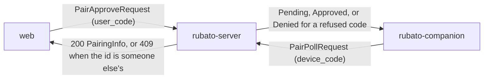

# Refuse a pairing approval that would take over another person's companion

Issue: #160 · Design: [160-pairing-takeover/design.md](160-pairing-takeover/design.md). A team
member can take over another person's companion pairing: every member sees each pairing's
`companion_id` in the overview, `POST /api/pair/start` stores whatever id it is sent, and approving
the code upserts the `pairings` row for that id with the approver as its new user
(`crates/rubato-server/src/pairing/store.rs:87`). The fix keeps the binding ADR 0011 already
states: a companion id stays with the person who first paired it.

## What the change does

- **S1** Approving a code whose `companion_id` is paired to another person answers 409 with a
  sentence saying so, and changes nothing about that person's pairing (user, token, revoked or not).
- **S2** The refused code ends `denied`: the companion polling it is told `Denied` at once, and the
  code cannot be approved again.
- **S3** Each refusal is counted as `rubato.web.rejected` with `rubato.route=/api/pair/approve` and
  `rubato.reason=companion_taken`, with the info line `web write rejected` naming the approver.
- **S4** A pairing revoked by its owner stays the owner's: another person's approval of that id is
  refused the same way (see Q1), and the owner can pair it again.

## How we'll know it works

- [ ] `a_teammate_cannot_take_over_another_persons_companion` (integration): B pairs X; A starts with X and approves: 409; A's code polls `Denied`; B's row is unchanged; B's token still opens `/ws/companion`. Fails on today's code (200). Proves S1, S2.
- [ ] `refusals_are_counted_by_route_and_reason` (`crates/rubato-server/src/app.rs`) counts one `companion_taken` on `/api/pair/approve` for an approval of a companion another login owns, and its count line goes from 8 to 9 reasons. Proves S3.
- [ ] `a_revoked_companion_stays_with_its_owner` (integration): B pairs X, revokes; A approves X: 409; B pairs X again: 200 and not revoked. Fails on today's code. Proves S4.

## What it must not break

- Re-pairing your own companion with the same id replaces the token and clears `revoked_at`: new test `pairing_your_own_companion_again_replaces_the_token` (old token 401, new one connects).
- Pairing, revoking and launching as today: the existing integration tests `bad_and_revoked_tokens_are_refused`, `launch_goes_only_to_the_callers_own_connected_companion`, `queue_refuses_another_users_and_revoked_companions`, and every test using `Harness::pair`.
- The companion's `pair` command: unchanged; `Denied` already ends it (`crates/rubato-companion/src/pairing/pair.rs:95`); its tests in `pair.rs` still pass.
- No wire type changes: `schema/protocol/*.json` unchanged (the schema test in `rubato-protocol`).

## How we'll debug it at 3 am

See the O-rows. New: the reason `companion_taken` on the existing `rubato.web.rejected` counter and
the existing `web write rejected` info line, shown on the "Web writes rejected" panel; its
description lists the new reason.

## Affected parts

| Node | Status | What changes | Seams |
| --- | --- | --- | --- |
| rubato-server | affected | `approve_pairing_code` keeps the owner: the upsert only updates a row of the same user, a refused code is marked `denied`, the handler answers 409 and counts the refusal | companion-server, web-server |
| rubato-companion | quiet | none; a refused code polls `Denied`, which `pair` already reports | companion-server |
| web | quiet | none; the panel shows the refusal's text as it shows any error | web-server |

## Data models

| Model | Kind | Part | Change | Crosses | Note |
| --- | --- | --- | --- | --- | --- |
| `pairings` upsert | table | rubato-server | changed | | no column change; `user` is never overwritten |
| `pairing_codes.status` = `denied` | table | rubato-server | changed | companion-server | the status existed and was never written; now set on a refused approval |
| `POST /api/pair/approve` 409 | type | rubato-server | new | web-server | a refusal with a text body; `PairApproveRequest` and `PairingInfo` unchanged |
| `rubato.web.rejected{reason=companion_taken}` | event | rubato-server | new | | a new reason value on an existing counter |

## Data flow

## Tasks

1. Failing tests first in `crates/rubato-server/tests/integration.rs`: `a_teammate_cannot_take_over_another_persons_companion`, `a_revoked_companion_stays_with_its_owner` (both fail with 200 today), `pairing_your_own_companion_again_replaces_the_token` (guards the kept path); `Harness::pair_as(user, companion_id)` behind `Harness::pair`; and the `companion_taken` case in `refusals_are_counted_by_route_and_reason` (fails: not counted).
2. `pairing/store.rs`: `approve_pairing_code` returns `Approval { Approved, NotFound, Taken }`; the upsert drops `user` from `SET` and adds `WHERE pairings.user = excluded.user`; on zero rows, mark the code `denied` in the same transaction.
3. `pairing/handlers.rs`: map `Taken` to 409 with a sentence; count `app.reject(PAIR_APPROVE, "companion_taken", user)`.
4. `observability/dashboards/rubato-overview.json`: add `companion_taken` to the "Web writes rejected" description.
5. `cargo fmt --all`, `cargo clippy -p rubato-server --all-targets -- -D warnings`, `cargo test -p rubato-server`.

## Assumed, not yet approved

| # | Decision | Chosen | Alternatives | Scope |
| --- | --- | --- | --- | --- |
| Q1 | Who may pair a `companion_id` whose pairing another person revoked | 1. nobody but its first user (implemented) | 2. anyone, once revoked (the issue's "live pairing"; hands over the old spend history); 3. the server mints every `companion_id` (changes `PairStartRequest`, the companion and the schema) | seam |
| A1 | Status of a refused approval | 409 Conflict with a text body | 403 Forbidden | node |
| A2 | Reason value | `companion_taken` | `not_own_companion` (used by the queue for a different refusal) | node |
| A3 | Overview still lists every `companion_id` | kept: the lanes need it, and the id can no longer be claimed | hide ids of other people's companions | node |

## O-rows

| Seam | Breaks like | Signal | Panel | Owner |
| --- | --- | --- | --- | --- |
| companion-server | a companion's pairing is moved to another person, so its owner's companion is refused on reconnect; or a legitimate re-pair is refused | `rubato.events.dropped{rubato.reason=auth}` rising for a companion that was connected; `rubato.web.rejected{rubato.route=/api/pair/approve, rubato.reason=companion_taken}` with the info line `web write rejected` naming `rubato.user`; `pairing approved` info line with `companion_id` and `user` | Events dropped; Web writes rejected | rubato-server |
| web-server | the approve form answers 409 to someone pairing their own machine, or 200 to a takeover | `rubato.web.rejected{rubato.route=/api/pair/approve}` by reason; the `web write rejected` line names who was refused | Web writes rejected | rubato-server |

## Flows

| From | To | Seam | Kind | Carries |
| --- | --- | --- | --- | --- |
| rubato-server | web | web-server | control | 409 on a pairing approval whose companion is paired to another person |
| rubato-server | rubato-companion | companion-server | control | Denied when polling a code whose approval was refused |

## ADRs proposed

None.

## Review map

1. `crates/rubato-server/src/pairing/store.rs` `approve_pairing_code`: the upsert's `WHERE` and the `denied` branch.
2. `crates/rubato-server/src/pairing/handlers.rs` `approve`: 409 and the counted reason.
3. `crates/rubato-server/tests/integration.rs`: the three pairing tests.
