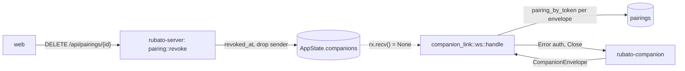

# Design: revoking a pairing closes the companion websocket (#161)

Plan: [../161.md](../161.md). Full track: an auth change on the `companion-server` seam. No
protocol type changes; the companion already handles `Error { auth }` and a closed socket.

## Where it sits on the map

## Today (verified at e36d1f3)

- `pairing::revoke` updates the row and removes the `CompanionConn`, sending one `Error` first
  (`crates/rubato-server/src/pairing/handlers.rs:108-115`).
- `handle` selects on `Some(msg) = rx.recv()` and `stream.next()`
  (`crates/rubato-server/src/companion_link/ws.rs:91-123`). Once the sender is dropped the first
  arm's pattern fails; `tokio::select!` disables it and keeps polling the stream, so the loop runs
  on reads alone.
- `on_envelope` uses the `PairingRow` from the upgrade (`ws.rs:110`) and stores sessions, launch
  results, cap hits and stale events (`ws.rs:241-292`) with no second look at `revoked_at`.
- On exit `handle` removes `companions[companion_id]` unconditionally (`ws.rs:124`). When a
  companion reconnects before its old socket ends, the old socket's exit removes the new entry.

## The change

1. **The sender closing ends the socket.** The `rx` arm matches `msg = rx.recv()`; `Some` sends as
   today; `None` sends a Close frame and breaks. Because the revoke handler sends the `Error`
   before dropping the sender, the companion gets `Error { auth, "pairing revoked" }` then Close.
2. **Every envelope proves the pairing.** `handle` keeps the bearer token. Before an envelope is
   handed to `on_envelope`, `pairing::authenticate(&app.db, token)` is read again. A row that is
   missing, revoked, or names another companion id (a re-pair replaced the token) means: count
   `rubato.events.dropped{rubato.reason="revoked"}`, log `warn`, send `Error { auth }`, Close,
   break. Nothing is recorded, so the sequence number is not consumed and a later honest replay
   is not lost. The fresh row is what `on_envelope` uses, so `last_companion_seq` in a later
   `Welcome` is current too. This closes the window between the revoke's database write and the
   sender being dropped, and it does not depend on the in-memory table at all.
3. **Only the owning socket removes its entry.** `CompanionConn` gains `conn: Uuid`, new per
   upgrade. A second connection for the same companion replaces the entry, which drops the first
   sender, which closes the first socket by (1). On exit, `handle` removes the entry only when
   its `conn` is the one it inserted.

Cost: one indexed `SELECT` on `pairings.token_hash` per envelope. A companion sends a heartbeat
and a snapshot every few seconds; this is noise next to `record_event`'s insert.

## What the companion sees

Nothing new on the wire. `Error { code: "auth" }` exists; a closed socket already makes
`server_link` reconnect with back-off, and the upgrade then answers 401 for a revoked token, as
`bad_and_revoked_tokens_are_refused` shows. A companion that was replaced by a second connection
of its own reconnects and becomes the newest, which replaces the other: two companion processes
with one token would flap. That is a misconfiguration and shows as a rising `sender_dropped`
disconnect count in the log; it is not made worse than today, where the second process silently
stole launches.

## Not done here

- A periodic sweep of open sockets against `pairings` (A1 alternative). The per-envelope check
  covers every write; a silent revoked socket holds no state.
- The identity fields inside messages (#162), done separately.
