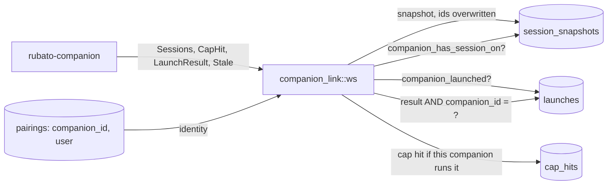

# Design: the server takes a companion's identity from its pairing (#162)

Plan: [../162.md](../162.md). Full track: an auth change on the `companion-server` seam. No
protocol type or schema changes; the fields stay on the wire and the server stops believing them.

## Where it sits on the map

## The one rule

The socket is authenticated as one pairing (`ws.rs:31`, the bearer token). The `Hello` already
checks its claimed `companion_id` and `user` against it (`ws.rs:203`). Every later message is read
the same way: the identity is the pairing's. A field in the payload that names a companion or a
user is either overwritten (a snapshot, a stale event) or checked (a cap hit, a launch result).

## Per message

| Message | Today | After |
| --- | --- | --- |
| `Sessions` | each session's `companion_id` and `user` stored as sent; the row key and spend already use the pairing | both fields set from the pairing before `canonicalise_repos` and the store; a `warn` when any differed |
| `CapHit` | stored for any issue | stored when `launches` has a row for this companion and issue, or this companion's stored snapshot has a session on the issue; otherwise `Ack`, `identity` drop, no notify |
| `LaunchResult` | `UPDATE launches ... WHERE id = ?` | `... WHERE id = ? AND companion_id = ?`, and the read that returns the issue too; no row means no queue settle and an `identity` drop |
| `Stale` | stored under `s.companion_id` | stored under the pairing's id |
| `Heartbeat` | the metric already uses the pairing | unchanged |

## Why both launches and the snapshot for a cap hit

An honest companion sends a cap hit in two places: the attempt limit, right after it refuses a
`LaunchCommand` (`crates/rubato-companion/src/launch/arm.rs:74-83`, so a launch row for this
companion exists), and the spend cap after a hook (`spend/arm.rs:31-37`, for a session whose cap
came from a launch). The launch check covers both. The snapshot check keeps a session the server
did not launch but the companion reports (a manual session that carries a cap) working, as the
existing fixture replay does. Repos compare without case, since a spend hit takes its repo from
the session's remote, which may be spelled differently from the launch.

## Why `Ack`, not `Error`

The companion keeps an envelope in its outbox until it is acknowledged and logs an `Error` without
clearing it (`crates/rubato-companion/src/server_link/client.rs:185-199`). An `Error` would make a
refused envelope come back on every reconnect. `Ack` plus a counter keeps the companion's state
right and makes the refusal visible on the server, which is the side that decides.

## Residual

A companion paired to A can still name a session on any issue in its own snapshot, under its own
lane and A's name, and then send a cap hit for that issue. That marks the issue Blocked from A's
own machine, in A's name, visible in A's lane. It is no longer impersonation; whether a user may
block an issue someone else is running is a policy question for another issue.
