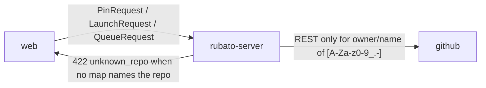

# Pins, launches and queue entries only for repos the map names

`POST /api/pins` stores `req.issue.repo` as given (`crates/rubato-server/src/pins/handlers.rs:17-42`);
only the target is checked against the map. Every pinned issue joins the poll set and its repo the
polled repos (`crates/rubato-server/src/tasks.rs:102-107,160-162`), so the server reads its meta,
plan file, pull request and comments with the App's installation token and shows them to every
logged-in user. Team membership means "can access the installation" (`auth/team.rs:17-28`), not
per-repo access, so any member can read an issue of any repo the installation covers. This change
refuses an issue whose repo no map names, at every door that puts an issue into Rubato, and makes
the GitHub client refuse a repo string that is not a plain `owner/name`.

## What the change does

- `POST /api/pins` (and `/api/w/{ws}/pins`) answers 422 with "`<repo>` is not a repo the map
  names" when the issue's repo is not named by that workspace's map (in `repos[]` or on a node),
  compared case-insensitively, and writes no row. The refusal is counted in `rubato.web.rejected`
  with route `/api/pins` and reason `unknown_repo`, like `unknown_id` and `kind_mismatch`.
- `POST /api/launch` refuses the same way (422, reason `unknown_repo`, route `/api/launch`) before
  it looks for a companion, so an old pin row for a repo the map no longer names cannot start a
  session that reads it.
- `POST /api/queue` refuses an issue whose repo no workspace's map names (422, reason
  `unknown_repo`, route `/api/queue`). The queue is a team route, not per workspace (ADR 0049), so
  it checks against the union of the maps. It is checked after the own-lane check, so someone
  else's lane still answers 403 first.
- A `Map:` line whose issue's repo is not named by the workspace's map pins nothing and is counted
  in `rubato.backlog.map_lines` with outcome `unknown_repo`, not recorded (the map may gain the repo
  later). Today the listing only hands over lines of repos the workspace's map names
  (`github_poll/backlog.rs:111-113`); this makes `apply_map_lines` safe on its own.
- The GitHub client refuses a repo that is not exactly `owner/name` with each half made of
  `[A-Za-z0-9_.-]+` and neither half `.` or `..` (`kernel/github/api.rs:313`), before any REST path
  is built. Strings like `o/r/../..` never reach a URL.
- The web's pin flow already shows the server's words ("#N was not pinned to X: o/r is not a repo
  the map names", `web/src/App.tsx:105`); nothing changes there.

## How we'll know it works

- [ ] Integration test: a pin for `elsewhere/secret#1` on the fixture map gets 422, writes no row, and `rubato.web.rejected{route="/api/pins",reason="unknown_repo"}` is 1; a pin for the map's repo in other case (`M0X6A/Rubato#1`) gets 201.
- [ ] Integration test: a launch for an issue of an unnamed repo with a pin row inserted directly gets 422 and sends no `LaunchCommand`; reason `unknown_repo` counted on `/api/launch`.
- [ ] Integration test: queueing an issue of an unnamed repo on your own lane gets 422 and adds no row; someone else's lane still gets 403.
- [ ] Unit test in `pins/map_lines.rs`: a line for `elsewhere/secret` pins nothing, counts `unknown_repo`, and pins once the map names the repo.
- [ ] Unit test in `kernel/github/api.rs`: `split_repo` accepts `m0x6A/rubato`, `o/r.js`, `o/a_b-c`; refuses `o`, `o/`, `/r`, `o/r/x`, `o/..`, `../r`, `o/r?x=1`, `o/r#1`, `o/r%2F`, `o r/x`. The test prints how many cases it checked.

## What it must not break

- Pins, launches and queue entries for issues of the map's repos keep working: the existing integration tests that pin, launch and queue (`crates/rubato-server/tests/integration.rs`, `workspaces_scope.rs`) stay green; a fixture that pins a repo its map does not name is fixed by naming the repo, not by loosening the check.
- `Map:` lines of the map's repos keep pinning once (ADR 0026): `a_line_pins_once_and_an_unpin_sticks` and the integration test at `integration.rs:1798`.
- Unpinning is unchanged: `DELETE /api/pins` stays unchecked, so a pin row for a repo that left the map can still be removed.
- Creating an issue (`new_issue`) is unchanged; it already refuses an unnamed repo.
- No wire type changes: `schema/protocol/*.json` and `web/src/protocol.ts` stay as generated (`cargo test -p rubato-protocol` schema check).

## How we'll debug it at 3 am

See the O-rows. New values only: reason `unknown_repo` on routes `/api/pins`, `/api/launch` and
`/api/queue` in `rubato.web.rejected` and its `web write rejected` info line (with the user);
outcome `unknown_repo` in `rubato.backlog.map_lines`. A refused repo string in the GitHub client
shows as `poll failed for issue` with "repo must be owner/name" in its error.

## Affected parts

| Node | Status | What changes | Seams |
| --- | --- | --- | --- |
| rubato-server | affected | pins, launch and queue refuse an issue of a repo no map names; Map: lines likewise; the GitHub client validates owner/name | web-server, server-github |
| web | quiet | already shows the server's refusal text on a failed pin | web-server |

## Data models

None.

## Data flow

## Tasks

1. Failing test first: `split_repo` cases in `kernel/github/api.rs`; then validate in `split_repo`.
2. Failing test first: the `Map:` line `unknown_repo` unit test; then add `check_repo` next to `check_target` in `pins/map_lines.rs` and use it in `apply_one`.
3. Failing test first: the pin integration test (422, no row, counted; other case accepted); then `check_repo` in `pins::add_pin`.
4. Failing test first: the launch integration test, with the pin row written straight to SQLite so only the new check can refuse it; then the check in `launch::launch`.
5. Failing test first: the queue integration test; then the check in `queue::add` against `app.union_repos()`.
6. Fix fixtures that pin, launch or queue repos their map does not name; update the descriptions of the "Web writes rejected" and "Map lines" panels to list `unknown_repo`.
7. `cargo fmt --all`, `cargo clippy -p rubato-server --all-targets -- -D warnings`, `cargo test -p rubato-server`.

## Assumed, not yet approved

| # | Decision | Chosen | Alternatives | Scope |
| --- | --- | --- | --- | --- |
| A1 | Where owner/name is validated | In the server's GitHub client (`split_repo`), so no wire type or schema changes | Validate in `IssueRef` deserialisation in rubato-protocol (a seam change: every IssueRef on every seam would refuse) | node |
| A2 | Track | Small: no wire type, schema or flow changes; the web-server seam only refuses requests it used to accept | Full, because refusing new inputs narrows the web-server contract | node |
| A3 | Queue's map | The union of every workspace's map, because `/api/queue` is a team route (ADR 0049) | Scope the queue per workspace (a seam change, out of scope) | node |
| A4 | Unpin | `DELETE /api/pins` is not checked, so stale rows can be removed | Refuse it too | node |

## O-rows

| Seam | Breaks like | Signal | Panel | Owner |
| --- | --- | --- | --- | --- |
| web-server | a pin, launch or queue entry for a repo the map names is refused | `rubato.web.rejected{rubato.route, rubato.reason="unknown_repo"}` and the `web write rejected` info line with `rubato.user`, `rubato.route`, `rubato.reason` | Web writes rejected | rubato-server |
| server-github | a repo the map names is refused by the GitHub client, so its issues stop being read | `poll failed for issue` warn line with `issue` and "repo must be owner/name"; `rubato.backlog.map_lines{rubato.outcome="unknown_repo"}` for Map: lines | Map lines | rubato-server |

## Flows

| From | To | Seam | Kind | Carries |
| --- | --- | --- | --- | --- |
| rubato-server | web | web-server | data | 422 unknown_repo for a pin, launch or queue entry of a repo no map names |

## ADRs proposed

None.

## Review map

1. `crates/rubato-server/src/pins/map_lines.rs` — `check_repo`, shared by the pin route, Map: lines and launch.
2. `crates/rubato-server/src/kernel/github/api.rs:313` — `split_repo` validation.
3. `crates/rubato-server/src/queue/handlers.rs` — the union-of-maps check after the own-lane check.
