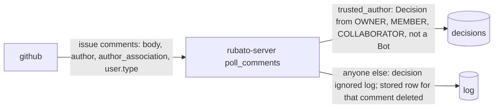

# Decision: comments count only from team members

Issue: #164 · ADR 0062 (*proposed*). The server records a `Decision:` comment from any GitHub
user, while `Review:` and `Approved:` count only from members (ADR 0027): `poll_comments` checks
`trusted_author` only when the comment parses as a review or an approval
(`crates/rubato-server/src/github_poll/poll.rs:321-323`), and any other comment that parses as a
`DecisionRecord` is upserted with no author check (`poll.rs:397-411`). On a public connected repo
an outsider can add official-looking decisions to any pinned issue. The skill's `plan.ts wait`
already reports a decision only from a trusted author (`skills/rubato/scripts/lib/comments.ts:97`).
This change makes the server read decisions the same way.

## What the change does

- **A decision counts only from the team.** A `Decision:` comment is shown on the issue and its
  parts only when its author is not a Bot and has association OWNER, MEMBER or COLLABORATOR, the
  rule `trusted_author` already applies to reviews and approvals.
- **An ignored decision is logged, not silent.** A `Decision:` comment from anyone else logs
  `decision ignored` at info with the issue, comment id, author and reason (`bot` or
  `association <A>`), like `review ignored` and `approval ignored`.
- **Rows recorded before the fix go.** When a comment is ignored, a decision row already stored
  for that comment id is deleted, so an outsider's decision recorded by an earlier server does not
  stay on the map.
- **The skill says so.** SKILL.md step 2 says `Decision:` comments are decisions made by a team
  member; the Approvals panel description names `decision ignored`.

## How we'll know it works

- [ ] Integration test (FakeGitHub): on a pinned issue, `Decision:` comments from a NONE author, a
  CONTRIBUTOR and a Bot with association MEMBER give no decision in the overview; one from a MEMBER
  gives one (`decisions_count_only_from_members`). It fails on purpose before the fix (three
  outsider decisions are recorded today).
- [ ] Integration test: a decision row stored for a comment (written straight into `decisions` as
  an older server would have) is gone after a poll that reads that comment from a NONE author.
- [ ] The existing `reviews_and_approvals_count_only_from_members` still passes with its OWNER
  decision counted.
- [ ] `cargo clippy -p rubato-server --all-targets -- -D warnings` and `cargo test -p rubato-server`
  clean.

## What it must not break

- Decisions from members still show, with their fields (`protocol_fixtures_replay_derives_progress` and `poll_makes_the_same_github_calls_per_issue`,
  `crates/rubato-server/tests/integration.rs:348-368` and `:1588`, both OWNER).
- Review and approval reading (ADR 0027): `reviews_and_approvals_count_only_from_members`,
  `editing_the_plan_makes_an_approval_stale`.
- One GitHub call per issue per full pass: no new call (the `github_calls` budget tests).
- The skill's reading stays equal to the server's: `skills/rubato/test/approval.test.ts` over
  `schema/fixtures/comments/authors/` (unchanged; `trusted_author` is reused, not copied).

## How we'll debug it at 3 am

See the O-rows. New: the `decision ignored` log line (info, `rubato-server`), fields
`rubato.issue`, `comment_id`, `author`, `kind = decision`, `reason`.

## Affected parts

| Node | Status | What changes | Seams |
| --- | --- | --- | --- |
| rubato-server | affected | `poll_comments` gates decisions on `trusted_author`; deletes the row of an ignored decision; `delete_decision` in `github_poll/store.rs` | server-github |
| github | quiet | the same comments read the same way; nothing new asked | server-github |
| skill-rubato | affected | SKILL.md step 2 wording only; `comments.ts` already gates decisions | |

## Data models

| Model | Kind | Part | Change | Crosses | Note |
| --- | --- | --- | --- | --- | --- |
| `decisions` rows | table | rubato-server | changed | server-github | no schema change; rows only from trusted authors, an ignored comment's row deleted |
| `decision ignored` log line | event | rubato-server | new | server-github | info; issue, comment id, author, reason |

## Data flow

## Tasks

- [ ] Failing test first: `decisions_count_only_from_members` in `crates/rubato-server/tests/integration.rs`, using `issue_71_with` and `comment()` with NONE, CONTRIBUTOR, Bot+MEMBER and MEMBER authors; the stale-row case seeds `decisions` directly. Run it and see it fail.
- [ ] `poll_comments` (`github_poll/poll.rs`): extend the untrusted branch to decisions (`kind = "decision"`), call `store::delete_decision` for the ignored comment; doc comment updated.
- [ ] `store::delete_decision(db, issue, comment_id)` in `github_poll/store.rs`.
- [ ] SKILL.md step 2; Approvals panel description in `observability/dashboards/rubato-overview.json`.
- [ ] ADR 0062 (*proposed*), pinned below.
- [ ] `cargo fmt --all`; clippy and tests for rubato-server.

## Assumed, not yet approved

| # | Decision | Chosen | Alternatives | Scope |
| --- | --- | --- | --- | --- |
| Q1 | Trust rule for `Decision:` comments on server-github | (a) `trusted_author`, as reviews and approvals (ADR 0062, recommended) | (b) record them and mark outsiders' as untrusted in the web; (c) leave as is | seam (server-github): ADR 0062 proposed, approval accepts it |
| A1 | Rows stored before the fix | delete the row when its comment is read and ignored | leave them; a one-off migration that cannot know the author | node (rubato-server) |
| A2 | Metric for ignored decisions | log line only, as for reviews and approvals | a counter `rubato.comments.ignored{kind}` | node (rubato-server) |

## O-rows

| Seam | Breaks like | Signal | Panel | Owner |
| --- | --- | --- | --- | --- |
| server-github | a teammate's decision stops showing (association read wrong, e.g. empty), or an outsider's shows | `decision ignored` log line with `reason` and `author` (Loki, `rubato-server`); the overview's `decisions` per issue; span `rubato.github.call{rubato.github.endpoint=comments}` for the read | Approvals (description names `decision ignored`) | rubato-server |

## Flows

| From | To | Seam | Kind | Carries |
| --- | --- | --- | --- | --- |
| github | rubato-server | server-github | data | Decision: comments with author, association and user type; recorded only from team members |

## ADRs proposed

| ADR | File | Blob |
| --- | --- | --- |
| 0062 | docs/decisions/0062-decision-comments-count-only-from-the-team.md | 0780ca7ce79728697f814a5591bcfa54678ac806 |

## Review map

1. `crates/rubato-server/src/github_poll/poll.rs` `poll_comments`: the untrusted branch now covers decisions, and deletes a stored row.
2. `crates/rubato-server/tests/integration.rs` `decisions_count_only_from_members`: the four authors and the stale row.
3. `docs/decisions/0062-decision-comments-count-only-from-the-team.md`: the trust rule on server-github.
