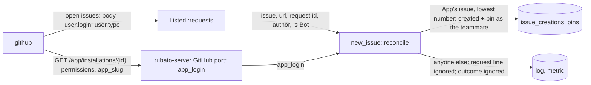

# A Rubato-Request: line finishes a creation only on the App's own issue

Issue: #165. If GitHub's answer to an issue POST is lost (any error but 403), the creation stays
`opening` and the next open-issues listing looks for its `Rubato-Request:` line
(`crates/rubato-server/src/new_issue/handlers.rs:168-200`, ADR 0025). `Listed::requests()` takes
that line from any listed issue, whoever wrote it (`github_poll/backlog.rs:65-75`). Duplicate ids
go into a `HashMap`, so the highest issue number wins (`new_issue/reconcile.rs:34`). `finish()`
then pins the match with `created_by` set to the teammate who asked (`reconcile.rs:61-70`). On a
public repo, an outsider who copies the line into their own issue before the next listing gets
that issue pinned under a teammate's name, and the real issue stays unpinned. ADR 0025 already
says "the issue's author on GitHub is the App". This change makes the listing check it.

## What the change does

- **Only the App's issue finishes a creation.** An `opening` creation is finished only by a
  listed issue whose author is a Bot (`user.type == "Bot"`) and, once the server has read the
  installation, whose login is the App's own, `<app_slug>[bot]` from
  `GET /app/installations/{id}`. Before the first read it accepts any Bot.
- **The first issue wins.** When several accepted issues in the same repo carry the same request
  id, the lowest issue number is the one pinned. It was created first, and the App sends each id
  once. Ids are matched per repo, so a same id in another repo no longer hides the right one.
- **An outsider's line is logged, not silent.** A listed issue that carries the request id of an
  `opening` row but is not the App's logs `request line ignored` at info, with the issue, the
  request id, the author and the reason (`not a bot` or `bot <login>, not <app login>`). It also
  counts `rubato.issues.created{rubato.outcome=ignored}`.

## How we'll know it works

- [ ] Integration test (FakeGitHub), `a_request_line_counts_only_on_the_apps_issue`: a create
  times out, and the listing then holds the App's issue plus two later issues with the same
  `Rubato-Request:` line, one from a NONE human and one from another Bot. After a poll the App's
  issue is the one created and pinned, under the teammate. The two others are not pinned, and the
  ignored outcome is counted. It fails on purpose before the fix: the highest number (the
  impostor) wins.
- [ ] The same test with the App's own login unknown (`app_login` `None`): the human's issue is
  still refused and the App's issue is found.
- [ ] Unit test in `kernel/github/api.rs`: `issues_from_page` reads `author_is_bot` from
  `user.type`, and a page without `user` gives `false`.
- [ ] Unit test in `kernel/github/mod.rs`: after `refresh_issue_permission` against the stand-in
  (now answering `app_slug`), `app_login()` is `rubato-test[bot]`. A personal-token port answers
  `None`.
- [ ] `cargo clippy -p rubato-server --all-targets -- -D warnings`, `cargo test -p rubato-server`,
  and `cargo test -p rubato-protocol` (doc-comment change only) are clean.

## What it must not break

- A create that timed out is still found and pinned:
  `a_create_that_timed_out_is_found_by_its_request_line`. The fake's created issues are now Bot
  issues, as GitHub's are.
- A create that is never seen still fails after ten minutes: `a_create_unseen_for_ten_minutes_fails`.
- `Map:` line placement (ADR 0026) reads the same listing and still gates on association: the
  backlog and suggestion tests (`github_poll/backlog.rs`, `github_poll/suggest.rs`).
- Dev mode (`LocalGit`) still runs the "New issue here…" flow: its created issues carry the Bot
  flag and its `app_login` is `rubato[bot]`.
- No new GitHub call: `app_slug` comes from the installation read the server already makes
  (`poll_makes_the_same_github_calls_per_issue`, the call-budget tests).

## How we'll debug it at 3 am

See the O-rows. New: the `request line ignored` log line (info) and the outcome `ignored` on
`rubato.issues.created`. A teammate's creation that is wrongly refused (for example, a slug read
wrong) shows as `ignored` naming the App's own login. Ten minutes later it becomes
`failed` with `issue creation failed step=unseen` (warn, existing).

## Affected parts

| Node | Status | What changes | Seams |
| --- | --- | --- | --- |
| rubato-server | affected | `OpenIssueInfo.author_is_bot`; `GitHubApi::app_login` read with the installation; `Listed::requests` carries author and Bot flag; `reconcile` accepts only the App's issue, lowest number per repo and id, logs and counts the others | server-github |
| github | quiet | `user.type` of each listed issue and `app_slug` of the installation, both already in answers the server reads | server-github |
| rubato-protocol | affected | doc comment of `ISSUES_CREATED` in `otel.rs` names the outcome `ignored`; no type or schema change | |

## Data models

| Model | Kind | Part | Change | Crosses | Note |
| --- | --- | --- | --- | --- | --- |
| `OpenIssueInfo` | type | rubato-server | changed | server-github | new `author_is_bot` from `user.type`; server-side struct, not the protocol schema |
| `GitHubApi::app_login` | type | rubato-server | new | server-github | `<app_slug>[bot]` from `GET /app/installations/{id}`, as last read |
| `new_issue::Found` | type | rubato-server | changed | | carries `author` and `author_is_bot` |
| `rubato.issues.created{outcome=ignored}` | event | rubato-server | changed | server-github | a new outcome value on an existing counter |
| `request line ignored` log line | event | rubato-server | new | server-github | info; issue, request id, author, reason |

## Data flow

## Tasks

- [ ] Failing test first: `a_request_line_counts_only_on_the_apps_issue` in `crates/rubato-server/tests/integration.rs`, with an impostor issue numbered above the App's. Run it and see the impostor pinned.
- [ ] `OpenIssueInfo.author_is_bot` (`kernel/github/api.rs`), parsed in `issues_from_page`; the fake's and `LocalGit`'s created issues set it; test literals updated.
- [ ] `GitHubApi::app_login` (default `None`); `Octo` stores `app_slug` from `refresh_issue_permission`; the fake answers its `app_login` field; `LocalGit` answers `rubato[bot]`. Stand-in answers `app_slug`; unit tests first.
- [ ] `Listed::requests` returns author and Bot flag; `tasks.rs` builds `Found` with them.
- [ ] `reconcile`: index accepted issues by (repo, request id), keep the lowest number; log and count `ignored` for a refused issue whose id names an `opening` row.
- [ ] `otel.rs` doc comment of `ISSUES_CREATED`; Issues created panel description if it lists outcomes.
- [ ] `cargo fmt --all`; clippy and tests for rubato-server and rubato-protocol.

## Assumed, not yet approved

| # | Decision | Chosen | Alternatives | Scope |
| --- | --- | --- | --- | --- |
| Q1 | Which listed issue may finish an `opening` creation (server-github) | (a) a Bot whose login is the App's `<app_slug>[bot]`, any Bot until the installation is read (recommended, implemented; enforces ADR 0025's "the issue's author on GitHub is the App", no new ADR) | (b) any Bot, never the login; (c) the App or a trusted member (`trusted_author`); (d) (a) plus a new ADR recording it | seam (server-github) |
| A1 | Several accepted issues with one id | lowest issue number | newest by `created_at`; refuse and let the row fail | node (rubato-server) |
| A2 | Login unknown (installation not read yet, e.g. a restart and a failed read) | accept any Bot | refuse all until read: the row may fail after ten minutes | node (rubato-server) |
| A3 | Where the App's login comes from | `app_slug` in the installation read the server already makes | `GET /app` (one more call); a config value | node (rubato-server) |

## O-rows

| Seam | Breaks like | Signal | Panel | Owner |
| --- | --- | --- | --- | --- |
| server-github | the App's own issue is refused (slug or `user.type` read wrong) and the creation fails after ten minutes; or an outsider's issue is pinned under a teammate | `rubato.issues.created{rubato.outcome}` (`ignored`, `found`, `failed`); `request line ignored` log line with `author` and `reason`; `issue creation failed step=unseen` (warn); span `rubato.github.call{rubato.github.endpoint=installation}` for the slug read | Issues created | rubato-server |

## Flows

| From | To | Seam | Kind | Carries |
| --- | --- | --- | --- | --- |
| github | rubato-server | server-github | data | open issues with author login and user type; the installation's app_slug with its permissions |

## ADRs proposed

None.

## Review map

1. `crates/rubato-server/src/new_issue/reconcile.rs` `reconcile`: who may finish a creation, and lowest number per repo and id.
2. `crates/rubato-server/src/kernel/github/api.rs` `refresh_issue_permission` and `issues_from_page`: where `app_login` and `author_is_bot` come from.
3. `crates/rubato-server/tests/integration.rs` `a_request_line_counts_only_on_the_apps_issue`.
