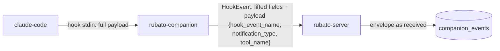

# Keep only an allowlist of the hook payload before it leaves the companion

Issue: #166. Small track: two map parts (`rubato-protocol`, `rubato-companion`), the wire type and
the generated schema under `schema/protocol/` unchanged.

The companion copies the whole Claude Code hook stdin into `HookEvent.payload`
(`crates/rubato-protocol/src/hook.rs:80-81,101`). For `PreToolUse` and `PostToolUse` that is
`tool_input` and `tool_response` (Bash commands and their output, the contents of files read or
written, `.env` included); for `UserPromptSubmit` it is the prompt. The companion forwards it
unchanged (`crates/rubato-companion/src/hooks/arm.rs:77`) and the server stores the whole envelope
in `companion_events.payload` (`crates/rubato-server/src/companion_link/ws.rs:174-177`,
`companion_link/store.rs:27`), while it reads only `session_id` and `hook_event_name`
(`ws.rs:237-239`). Nothing reads the rest. This change keeps a small allowlist of payload keys and
drops everything else where the event is built, so it never leaves the developer's machine.

## What the change does

- **Tool input, tool output and prompts stay on the developer's machine.** `HookEvent::from_payload`
  keeps only `hook_event_name`, `notification_type` and `tool_name` in `payload`; every other key
  (`tool_input`, `tool_response`, `prompt`, `message`, and any key a later Claude Code adds) is
  dropped before the event reaches the outbox, the websocket or the server's `companion_events`.
- **The server sees the same lifted fields as today.** `session_id`, `cwd`, `transcript_path`,
  `permission_mode`, `notification_type`, `tool_name` and the event kind are still lifted, so
  session status, block cause and spend work as before.
- **The wire type does not change.** `payload` stays an optional JSON value; a server or a
  companion of either version reads the other's envelopes as today.

## How we'll know it works

- [ ] `hook::tests::post_tool_use_secret_does_not_leave_the_companion`: a `PostToolUse` payload with
  `tool_response.stdout = "SECRET"`, `tool_input.command` and a `prompt`, built with
  `from_payload` and serialised as a `CompanionMessage::Hook`, does not contain `SECRET` or the
  command or the prompt (fails on today's code: the payload is copied whole).
- [ ] `hook::tests::payload_keeps_only_the_allowlist`: for every key in a fixture payload, the
  kept payload has exactly the allowlisted keys present in the input and no other; prints how many
  keys it checked.
- [ ] `arm::tests` (companion): the `CompanionMessage::Hook` the arm sends for a `PostToolUse` with
  a secret in `tool_response` does not contain it.

## What it must not break

- Status and block cause from hooks: `hook::tests::implied_block_cause_names_the_blocking_hook`,
  `lifts_common_fields_*` (updated: it now asserts the allowlisted payload), the companion's
  `hooks/apply.rs` and `sessions` tests.
- The wire schema: `crates/rubato-protocol/tests/schema_snapshot.rs` passes with
  `schema/protocol/hook_event.schema.json` unchanged (the field's doc comment, which becomes the
  schema description, is not edited; see Q1).
- Spend: it reads the transcript path, which is lifted, not the payload (`spend` tests, untouched).
- Replay dedupe on `companion_events` (`companion_link` tests, untouched).

## How we'll debug it at 3 am

See the O-rows. No new signal: the risk is that a hook stops moving a session, which the existing
`rubato.hook.forwarded` metric and the `rubato.inbound_event` span already show.

## Affected parts

| Node | Status | What changes | Seams |
| --- | --- | --- | --- |
| rubato-protocol | affected | `HookEvent::from_payload` keeps only an allowlist of payload keys | companion-server |
| rubato-companion | affected | a test that the forwarded `Hook` message carries no tool output; no code change | companion-server |
| rubato-server | quiet | stores what it receives, now without tool input, output or prompts | companion-server |

## Data models

| Model | Kind | Part | Change | Crosses | Note |
| --- | --- | --- | --- | --- | --- |
| `HookEvent.payload` | type | rubato-protocol | changed | companion-server | same type (`Option<Value>`); content limited to `hook_event_name`, `notification_type`, `tool_name` |

## Data flow

## Tasks

- [ ] Plan, `plan.ts check`, review, `Review:` on #166
- [ ] Failing test first: `post_tool_use_secret_does_not_leave_the_companion` in `hook.rs`
- [ ] `from_payload` keeps only `PAYLOAD_ALLOWLIST`; update `lifts_common_fields_and_keeps_payload`; add `payload_keeps_only_the_allowlist`
- [ ] Companion test in `hooks/arm.rs`: the sent `Hook` message holds no tool output
- [ ] `cargo fmt`, clippy and tests for `rubato-protocol` and `rubato-companion`; schema snapshot unchanged

## Assumed, not yet approved

| # | Decision | Chosen | Alternatives | Scope |
| --- | --- | --- | --- | --- |
| Q1 | The `payload` field's schema description still reads "The raw hook payload, for traces and for fields this version does not lift" | (a) leave the doc comment, explain the allowlist in a plain comment and on `from_payload`; schema unchanged, small track | (b) edit the description in this PR: `schema/protocol/hook_event.schema.json` changes, full track; (c) drop `payload` from the wire type: a breaking seam change | seam (companion-server) |
| Q2 | Rows already in `companion_events` and envelopes from companions not yet upgraded | (a) out of scope here; a follow-up issue for a server-side scrub on receipt and a purge of stored payloads | (b) also null `Hook.payload` on the server before `record_event` in this PR; (c) also add a migration that purges stored hook payloads | seam (companion-server) |
| A1 | Allowlist | `hook_event_name`, `notification_type`, `tool_name`, as the issue suggests | drop `payload` entirely (`None`) | node (rubato-protocol) |
| A2 | A payload that is not a JSON object | `payload: None` | keep it | node (rubato-protocol) |

## O-rows

| Seam | Breaks like | Signal | Panel | Owner |
| --- | --- | --- | --- | --- |
| companion-server | hook events stop moving sessions on the server because something it needed was filtered out, or tool output reaches `companion_events` again | `rubato.hook.forwarded` (by `rubato.hook_event`, `rubato.companion_id`) against working sessions; the server's `rubato.inbound_event` span with `kind=hook` and the `hook` log line with `rubato.session_id`, `rubato.hook_event`; the regression test `post_tool_use_secret_does_not_leave_the_companion` in CI | Hooks/min vs working sessions | rubato-server |

## Flows

| From | To | Seam | Kind | Carries |
| --- | --- | --- | --- | --- |
| rubato-companion | rubato-server | companion-server | data | HookEvent with lifted fields and an allowlisted payload: no tool input, tool output or prompt |

## ADRs proposed

None.

## Review map

1. `crates/rubato-protocol/src/hook.rs` `from_payload`: the allowlist and where it is applied.
2. `crates/rubato-protocol/src/hook.rs` tests: the `SECRET` regression test.
3. `crates/rubato-companion/src/hooks/arm.rs` tests: what the arm actually sends.
