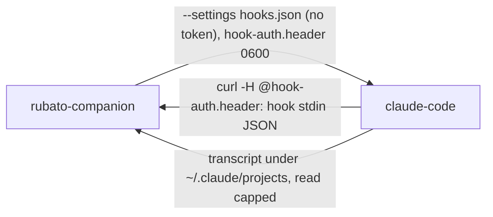

# Keep the hook token out of argv; read only real transcripts, capped

Issue: #167 · Design: [167-hook-token-transcript/design.md](167-hook-token-transcript/design.md)
· ADR 0050 (*proposed*, supersedes ADR 0013's hook command). Full track: an auth change on seam
`companion-claude-code` and a change to an accepted ADR.

The loopback hook receiver is guarded only by a bearer token that every hook puts in curl's argv,
which any local user can read with `ps`. With it, a forged hook can name any `transcript_path`;
the companion reads it whole, so a fake transcript trips the spend cap and kills the real
session, and `/dev/zero` exhausts the companion's memory. This keeps the token off every command
line, compares it in constant time, and reads only capped regular files under the Claude
projects dir.

## What the change does

- **No hook command carries the token.** Each launch writes a 0600 `hook-auth.header` next to
  its `hooks.json`; every hook runs `curl -H @'<header file>' ...`. The skill's template has
  `{port}` and `{header_file}`, no `{token}`.
- **Manual opt-in without the token on a command line.** The companion writes
  `hook-auth.header` in its state dir at start; `hooks.ts --port 
 --header-file <path>` and
  `rubato-companion render-hooks` render from it, and `hooks.ts --token` is refused with a
  message saying what to pass instead. `rubato-companion status` prints the header file's path.
- **The token is compared in constant time.**
- **Only real transcripts are read.** A hook's `transcript_path` is read for spend only when it
  resolves (symlinks followed) to a regular file under `$CLAUDE_CONFIG_DIR/projects` or
  `~/.claude/projects`, of at most 256 MiB; otherwise the companion logs
  `rubato.transcript.refused` with the reason, counts `rubato.events.dropped` with
  `rubato.reason = transcript`, keeps the session's last spend and takes no cap decision.

## How we'll know it works

- [ ] `render_hooks` unit test: no rendered command in the embedded template contains the token, `{token}` or `{header_file}`; every command contains `-H @'<path>'`; a path with a space and a `'` round-trips through `sh -c` (Rust `#[test]`).
- [ ] `hooks.ts` Vitest: the rendered template has no `Bearer` and quotes the header path; `--token` is refused with the header-file message.
- [ ] Gherkin `hooks.feature`: "A hook run as Claude Code runs it reaches the companion": the rendered command for `Stop` from the state dir's header file, run with `sh -c` and the fixture on stdin, is accepted and forwarded; and the header file is mode 0600.
- [ ] Gherkin `worktree.feature`: the launched session's settings file holds no token and its header file is 0600 (needs tmux-ide).
- [ ] `HookEndpoint::save` unit test: the state dir's `hook-auth.header` is 0600 and holds the bearer line; manual run: `rubato-companion status` prints its path and `render-hooks` output has no token.
- [ ] `ct_eq` unit test: equal, unequal same length, unequal length, empty.
- [ ] `spend/transcript.rs` unit tests: a file under the root is read; refused with the right reason for `/dev/zero` (`not_a_file`), a path outside the root (`outside_root`), a symlink inside the root pointing outside (`outside_root`), `..` escaping the root (`outside_root`), a directory (`not_a_file`), a file over a small test cap (`too_large`), a missing file (`unreadable`).
- [ ] Gherkin `hooks.feature`: "A hook naming /dev/zero as its transcript is refused, not read": with pricing configured, the companion logs `rubato.transcript.refused`, keeps running, and still forwards the hook.
- [ ] `spend::after_hook` test: a refused transcript counts `rubato.events.dropped{rubato.reason="transcript"}` and records no spend.

## What it must not break

- Hook delivery for launched sessions: the existing `hooks.feature` scenarios (8 recorded hooks, the 401 without a token) and `worktree.feature`'s settings-file step.
- Spend from a real transcript and the spend cap: `sum.rs` tests unchanged; the e2e run's "spend from the transcript" check (stand-in moved to the Claude projects layout).
- The 401 for a missing or wrong token, counted as `auth` (existing scenario).
- tmux-ide's own hooks: nothing it reads changes; `--settings` merge as in ADR 0013.
- `skills/rubato` install copies `hooks.json` byte-identical (existing install test).
- Telemetry names come from `otel.rs` (`all_names()` namespace test).

## How we'll debug it at 3 am

See the O-rows. New: the `rubato.transcript.refused` warn line (`rubato.reason`, `path`) and the
`transcript` value of `rubato.reason` on `rubato.events.dropped`. Registered in
`crates/rubato-protocol/src/otel.rs`.

## Affected parts

| Node | Status | What changes | Seams |
| --- | --- | --- | --- |
| rubato-companion | affected | header file per launch and in the state dir, `render_hooks` with a header path, constant-time token check, `spend/transcript.rs` guard, `status` prints the header path | companion-claude-code |
| claude-code | affected | hook commands read the bearer from a file; transcripts outside its projects dir no longer count | companion-claude-code |
| skill-rubato | affected | `hooks.json` template `{header_file}`; `hooks.ts --header-file`, `--token` refused; SKILL.md "Don't" line | |
| rubato-protocol | affected | event name `rubato.transcript.refused` in `otel.rs` (no schema change) | |

## Data models

| Model | Kind | Part | Change | Crosses | Note |
| --- | --- | --- | --- | --- | --- |
| `hooks.json` template | file | skill-rubato | changed | | `{header_file}` replaces `{token}` |
| rendered hooks file (`--settings`) | file | rubato-companion | changed | companion-claude-code | no token; `-H @'<header file>'` |
| `hook-auth.header` | file | rubato-companion | new | companion-claude-code | 0600, `Authorization: Bearer <token>`; per launch and in the state dir |
| `rubato.transcript.refused` | event | rubato-companion | new | | `rubato.reason`, path |
| `rubato.events.dropped` reason `transcript` | event | rubato-companion | changed | | new value of `rubato.reason` |

## Data flow

## Tasks

- [ ] **PR** `issue/167-hook-token-transcript`: this plan, design note, ADR 0050 (*proposed*); `plan.ts check`; review; `Review:` on #167
- [ ] `render_hooks` test first (fails: the token is in every command), then `{header_file}` in `hooks.json`, `render_hooks(template, port, header)`, `write_header`; launcher writes the per-launch header; `HookEndpoint::save` writes the state dir's; `render-hooks` and `status`
- [ ] `hooks.ts` Vitest first (fails: `Bearer` in the output), then `--header-file`, `--token` refused; SKILL.md, skills README
- [ ] `ct_eq` test, then the constant-time check in `server.rs`
- [ ] `spend/transcript.rs` tests first (fails on purpose: `/dev/zero` is read today and the test would hang, so it runs `sum_file` with the guard only), then the guard, `sum_file` through it, the refusal log and counter in `after_hook`, the event name in `otel.rs`
- [ ] Gherkin: hooks.feature scenarios for the rendered command and `/dev/zero`; worktree.feature step for the header file
- [ ] e2e stand-in writes its transcript under the Claude projects layout
- [ ] After approval: ADR 0050 accepted with `adrs.ts accept`; ADR 0013's status moves to `superseded by 0050` in the same commit

## Assumed, not yet approved

| # | Decision | Chosen | Alternatives | Scope |
| --- | --- | --- | --- | --- |
| Q1 | How the token reaches curl | (a) `curl -H @<0600 file>` next to `hooks.json`, written per launch | (b) `curl --config <file>` holding the whole request; (c) a Unix socket in a 0700 dir, no token; (d) an environment variable | seam (companion-claude-code): blocks, in ADR 0050 |
| Q2 | Which transcript paths are read | (a) regular files under `$CLAUDE_CONFIG_DIR/projects` or `~/.claude/projects`, symlinks resolved | (b) also under the session's worktree; (c) a list of roots in `local.yml`; (d) any path, size cap only | seam (companion-claude-code): blocks, in ADR 0050 |
| A1 | Size cap | 256 MiB, a constant in the spend slice | 64 MiB; configurable in `local.yml` | node (rubato-companion) |
| A2 | Manual opt-in | `hooks.ts --header-file <state>/hook-auth.header`; `--token` refused | keep `--token` and write the header file from it (the token is then in `hooks.ts`'s argv) | node (skill-rubato) |
| A3 | Incremental transcript reading | not in this change; the whole capped file is read per hook, as today | read from the last offset per session | node (rubato-companion) |
| A4 | Counter for a refused transcript | `rubato.events.dropped` with `rubato.reason = transcript` (existing panel) | a new metric | node (rubato-companion) |

## O-rows

| Seam | Breaks like | Signal | Panel | Owner |
| --- | --- | --- | --- | --- |
| companion-claude-code | hooks stop arriving because `curl -H @file` fails (old curl, header file missing or unreadable), or forged posts are refused; or a real transcript is refused (non-default Claude layout) and spend stops moving | `rubato.hook.forwarded` at 0 while sessions are working (`SessionWorkingNoHooks` alert, `rubato.companion_id`); `rubato.events.dropped` by `rubato.reason` (`auth`, `transcript`); the `rubato.transcript.refused` warn line with `rubato.reason` and path, inside the `rubato.hook.forward` span with `rubato.session_id` | Hooks/min vs working sessions; Events dropped | rubato-companion |

## Flows

| From | To | Seam | Kind | Carries |
| --- | --- | --- | --- | --- |
| rubato-companion | claude-code | companion-claude-code | control | `--settings` hooks file whose commands read the bearer from a 0600 header file, never from argv |
| claude-code | rubato-companion | companion-claude-code | data | hook payloads on stdin with the bearer from the header file; the transcript, read only under the Claude projects dir and capped |

## ADRs proposed

| ADR | File | Blob |
| --- | --- | --- |
| 0050 | docs/decisions/0050-hook-token-in-a-header-file.md | 89511af7b8ba515e7bf7dd5298889f646f8cd9bf |

## Review map

1. `skills/rubato/hooks.json` and `hooks/template.rs` `render_hooks`: no token in any command, and the quoting of the header path.
2. `spend/transcript.rs`: canonicalize, root prefix, regular file from the open handle, `take(cap + 1)`.
3. `hooks/server.rs` `receive`: the constant-time check and the `auth` count.
