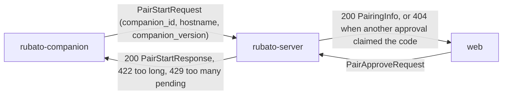

# Bound what anonymous pairing starts can store, and approve a code only once

Issue: #168 · Design: [168-pair-start-limits/design.md](168-pair-start-limits/design.md).
Anonymous `POST /api/pair/start` adds a `pairing_codes` row per call with no limit, its strings
are bounded only by axum's 2 MB body limit, and nothing ever deletes an expired code, so anyone who
can reach the server can grow its SQLite file until the shared server degrades. In the same file,
`approve_pairing_code` reads then updates with no `status = 'pending'` guard, so two concurrent
approvals of one code can both pass.

## What the change does

- **S1** A pairing start whose `hostname` or `companion_version` is longer than 255 characters is refused with 422 and a sentence naming the field; nothing is stored.
- **S2** While 50 codes are pending and unexpired, a further start is refused with 429 and a sentence saying to try again in a few minutes; nothing is stored. The cap is checked and the row inserted in one statement.
- **S3** Every poll tick deletes the codes that expired more than an hour ago, whatever their status, and logs `pairing codes swept` with how many.
- **S4** A code is approved at most once: the claim updates only a pending, unexpired code and its row count is read; a second approver gets 404 and changes nothing.
- **S5** Each refusal in S1 and S2 is counted as `rubato.web.rejected` with `rubato.route=/api/pair/start` and `rubato.reason` `field_too_long` or `pending_cap`.

## How we'll know it works

- [ ] `pair_start_refuses_long_fields` (integration): 256-character hostname and version give 422 each, 255 give 200, and no row is stored for the refused ones. Fails today (200). Proves S1.
- [ ] `pair_start_caps_pending_codes` (integration, cap 3 in config): three starts 200, the fourth 429; after one is approved, a start is 200 again. Fails today. Proves S2.
- [ ] `sweep_deletes_codes_long_expired` (store unit test): a code expired two hours ago is deleted, one expired a minute ago and a pending one are kept, and it returns 1. Fails today (no sweep). Proves S3.
- [ ] `claim_refuses_a_code_already_claimed` (store unit test): the claim step on a code already claimed returns false and leaves the first approval's user and token. Fails until the guard is in. Proves S4.
- [ ] `concurrent_approvals_of_one_code_pair_once` (integration): ten users approve one code at once; one 200, nine 404, one `pairings` row. Proves S4 end to end (can pass by luck; the unit test is the one that fails on purpose).
- [ ] `refusals_are_counted_by_route_and_reason` (`app.rs`) counts `field_too_long` and `pending_cap` on `/api/pair/start`; its count line goes from 8 to 10 reasons. Proves S5.

## What it must not break

- Pairing, polling and approving as today: every integration test that uses `Harness::pair` (it starts, polls `Pending`, approves, polls `Approved`, then `Denied`).
- A late poll of a just-expired code still answers `Expired` (the hour of grace; `sweep_deletes_codes_long_expired` keeps a code expired a minute ago).
- The companion's `pair`: unchanged; it already fails on a non-2xx start (`crates/rubato-companion/src/pairing/pair.rs:67`); its tests in `pair.rs` still pass.
- No wire type change: the new constants are `const`s; `schema/protocol/*.json` unchanged (the protocol schema test).
- The poll loop: the sweep runs after the tick in `tasks::run` and logs, never returns, an error; `shutdown_ends_the_supervised_poll_task_cleanly` and the tasks tests still pass.

## How we'll debug it at 3 am

See the O-rows. New: reasons `field_too_long` and `pending_cap` on the existing
`rubato.web.rejected` counter (panel "Web writes rejected", description updated), and the info line
`pairing codes swept` with `gone`; a failed sweep logs `sweeping pairing codes failed` at error.

## Affected parts

| Node | Status | What changes | Seams |
| --- | --- | --- | --- |
| rubato-server | affected | `pairing::start` checks lengths and the pending cap; `create_pairing_code` inserts only under the cap; `approve_pairing_code` claims with a guard; `sweep_codes` runs in the poll loop; config `pairing_max_pending` | companion-server, web-server |
| rubato-protocol | affected | `PAIR_FIELD_MAX_CHARS`, `PAIRING_CODES_MAX_PENDING` constants in `pairing`; no schema change | companion-server |
| rubato-companion | quiet | none; a 422 or 429 start fails `pair` with the status, as any error does | companion-server |
| web | quiet | none; a 404 for a code another approval claimed shows as any 404 does | web-server |

## Data models

| Model | Kind | Part | Change | Crosses | Note |
| --- | --- | --- | --- | --- | --- |
| `pairing_codes` | table | rubato-server | changed | | rows deleted an hour after expiry; no column change |
| `POST /api/pair/start` 422 and 429 | type | rubato-server | new | companion-server | refusals with a text body; `PairStartRequest` unchanged |
| `PAIR_FIELD_MAX_CHARS`, `PAIRING_CODES_MAX_PENDING` | type | rubato-protocol | new | companion-server | constants both sides can read |
| `rubato.web.rejected{reason=field_too_long, pending_cap}` | event | rubato-server | new | | new reason values on an existing counter |

## Data flow

## Tasks

1. Failing tests first: `pair_start_refuses_long_fields`, `pair_start_caps_pending_codes`, `concurrent_approvals_of_one_code_pair_once` in `crates/rubato-server/tests/integration.rs`; `sweep_deletes_codes_long_expired`, `claim_refuses_a_code_already_claimed` in `pairing/store.rs`; the two reasons in `refusals_are_counted_by_route_and_reason`.
2. `rubato-protocol/src/pairing.rs`: the two constants.
3. `kernel/config.rs`: a `pairing_max_pending` field next to `pairing_ttl_secs`, default `PAIRING_CODES_MAX_PENDING` (no environment variable, like the TTL), so tests can lower it.
4. `pairing/handlers.rs` `start`: length check (422), cap (429), each counted with `app.reject`.
5. `pairing/store.rs`: `create_pairing_code` inserts under the cap and says whether it did; `claim_code` with the guard, used first in `approve_pairing_code`; `sweep_codes`.
6. `tasks.rs` `run`: call `pairing::sweep_codes` after each tick.
7. Dashboard "Web writes rejected" description: the two reasons.
8. `cargo fmt --all`; `cargo clippy` and `cargo test` for `rubato-server` and `rubato-protocol`; `cargo test -p rubato-companion` (pairing tests).

## Assumed, not yet approved

| # | Decision | Chosen | Alternatives | Scope |
| --- | --- | --- | --- | --- |
| Q1 | How to bound pending codes | 1. one global cap of 50 pending, unexpired codes (implemented): a flood can hold off a real pairing for up to one TTL but cannot grow the database | 2. per client IP (the peer is the reverse proxy's address; `X-Forwarded-For` is caller-written); 3. both, per IP from a trusted proxy header plus the global cap | seam |
| A1 | Field length limit | 255 characters each, 422 above | 253 (DNS max) for hostname only; truncate instead of refusing | node |
| A2 | Grace after expiry before deletion | one hour, so a late poll still reads `Expired` | delete at expiry | node |
| A3 | Where the sweep runs | every tick in `tasks::run`, outside the tick, so a missing map does not stop it | only on the full lane inside the tick, next to the token sweep | node |
| A4 | Answer to a second approver of one code | 404, as for any code that is not pending | 409 | node |

## O-rows

| Seam | Breaks like | Signal | Panel | Owner |
| --- | --- | --- | --- | --- |
| companion-server | a real companion cannot pair: its start is refused for length or because the cap is held by a flood; or the sweep stops and codes pile up again | `rubato.web.rejected{rubato.route=/api/pair/start}` by `rubato.reason` (`field_too_long`, `pending_cap`) with the info line `web write rejected`; info `pairing codes swept` with `gone`; error `sweeping pairing codes failed` | Web writes rejected | rubato-server |
| web-server | a person approving a code is told 404 although the code is theirs and pending; or two approvals of one code both succeed | `pairing approved` info line with `companion_id` and `rubato.user` (two for one code would show the race is back); 404 responses on `/api/pair/approve` in the HTTP trace (`TraceLayer`) | Web writes rejected (for the neighbouring start refusals); the trace of the request | rubato-server |

## Flows

| From | To | Seam | Kind | Carries |
| --- | --- | --- | --- | --- |
| rubato-server | rubato-companion | companion-server | control | 422 or 429 on a pairing start that is too long or over the pending cap |
| rubato-server | web | web-server | control | 404 on an approval of a code another approval already claimed |

## ADRs proposed

None.

## Review map

1. `crates/rubato-server/src/pairing/store.rs`: `create_pairing_code`'s insert under the cap, `claim_code`'s guard, `sweep_codes`.
2. `crates/rubato-server/src/pairing/handlers.rs` `start`: the 422 and 429 and their reasons.
3. `crates/rubato-server/src/tasks.rs` `run`: where the sweep runs.
