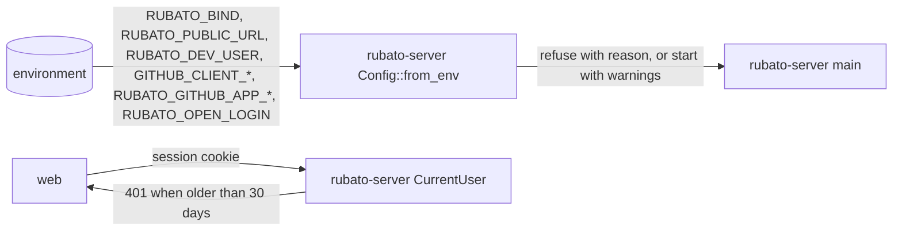

# Refuse to start open to anyone off loopback

Issue: #169 · Design: [169-refuse-open-start/design.md](169-refuse-open-start/design.md) · ADR
0064 (*proposed*, supersedes the "behaves as before" sentence of ADR 0022). Full track: an auth
change on the `web-server` seam.

Two server configurations open the server to anyone and start with at most a warning: OAuth
without the GitHub App (any GitHub account logs in; sessions never expire on the server), and
`RUBATO_DEV_USER` (any client picks its login with `x-rubato-dev-user`). The fix: when the server
is not local, refuse to start in either mode, unless the operator opts in to open OAuth login
with `RUBATO_OPEN_LOGIN=1`. Sessions also end on the server after 30 days.

## What the change does

- **The dev user stays on the developer's machine.** With `RUBATO_DEV_USER` set, a server that
  binds a non-loopback address or has a non-loopback public URL exits at start with the reason.
  There is no opt-in.
- **Open OAuth login is a written choice.** With `GITHUB_CLIENT_ID` and `GITHUB_CLIENT_SECRET` but
  no GitHub App, a server that is not local exits at start unless `RUBATO_OPEN_LOGIN=1`; with it,
  it starts and warns that login is open to any GitHub account. A value other than `1` is a
  start-up error.
- **Local runs keep working.** A server bound to loopback with a loopback public URL starts in
  either mode, as today, and warns that login is open.
- **Sessions end on the server.** A web session older than 30 days (the cookie's lifetime) is
  refused with 401 in every mode, counted as `rubato.web.rejected{reason=session_expired}`; the
  web sends the person through login again.

## How we'll know it works

- [ ] `config::tests::is_local_needs_loopback_bind_and_url`: 127.0.0.1, ::1 and `localhost` count; 0.0.0.0 bind, a LAN IP, a hostname and a URL without a host do not.
- [ ] `config::tests::dev_user_off_loopback_refuses_to_start`: `exposure` errs naming `RUBATO_DEV_USER` when not local, with or without `RUBATO_OPEN_LOGIN=1`; warns when local.
- [ ] `config::tests::oauth_without_app_off_loopback_needs_open_login`: errs naming `RUBATO_OPEN_LOGIN` when not local and unset; warns with it set to `1`; warns when local; nothing when the App is configured; errs on `RUBATO_OPEN_LOGIN=yes`.
- [ ] Both config tests fail on today's code (no check exists), shown by running them before the fix.
- [ ] `tests/integration.rs::a_session_ends_after_thirty_days`: an OAuth-only harness session created 31 days ago gets 401 on read, write and websocket; one created 29 days ago gets 200/201/101. `auth::team::tests::a_session_counts_for_thirty_days` checks the limit itself; the refusal goes through the same `app.reject` as `team_record_stale` (counted by the `app.rs` refusal test), with reason `session_expired`.
- [ ] `pnpm e2e` and `web/e2e/run.sh` still start their servers (dev user on 127.0.0.1; App server on 127.0.0.1); CI runs both.

## What it must not break

- The browser tests and the full e2e: dev user on 127.0.0.1 bind and URL (`web/e2e/run.sh:60`, `e2e/run.ts:128-130`); guarded by CI's `web` and `e2e` jobs.
- The server integration suite: it builds `Config::for_tests`, not `from_env`, so the dev user keeps working there (`cargo test -p rubato-server`).
- An App server: never open, never refused; `session_needs_a_fresh_team_record_when_the_app_is_configured` and the App e2e server.
- `without_the_app_login_stays_open`: a fresh OAuth-only session still gets 200/201/101.
- The running instance recorded in `.claude/profiles/dockge.md` is an App: unaffected.

## How we'll debug it at 3 am

See the O-rows. New: the refusal messages of `exposure` (process exit, on stderr, before
telemetry starts), the start-up warning "login is open to any GitHub account", and the reason
`session_expired` on `rubato.web.rejected` with the existing `web write rejected` log line.

## Affected parts

| Node | Status | What changes | Seams |
| --- | --- | --- | --- |
| rubato-server | affected | `Config::from_env` refuses open modes off loopback (`exposure`, `is_local`); `CurrentUser` refuses sessions older than 30 days; `store::web_session` returns `created_at`; QUICKSTART documents `RUBATO_OPEN_LOGIN` | web-server |
| web | quiet | an expired session answers 401, which the web already handles as needs-login | web-server |

## Data models

| Model | Kind | Part | Change | Crosses | Note |
| --- | --- | --- | --- | --- | --- |
| `RUBATO_OPEN_LOGIN` | file | rubato-server | new | | environment variable, `1` or unset |
| `rubato.web.rejected` reason `session_expired` | event | rubato-server | changed | web-server | new reason value on the existing counter |

## Data flow

## Tasks

- [ ] **PR 0** `issue/169-refuse-open-start`: this plan, the design note, ADR 0064 (*proposed*); `plan.ts check`; review; `Review:` on #169
- [ ] Tests first: `is_local_needs_loopback_bind_and_url`, `dev_user_off_loopback_refuses_to_start`, `oauth_without_app_off_loopback_needs_open_login` in `kernel/config.rs` against stub `is_local`/`exposure` that never refuse (fail on purpose); then the real functions, called at the end of `from_env`; move the open-login warnings out of `main.rs`
- [ ] Test first: `a_session_ends_after_thirty_days` in `tests/integration.rs` (fails: no expiry); then `created_at` from `store::web_session`, `SESSION_MAX_AGE_SECS` and reason `session_expired` in `auth/team.rs`, the check in `auth/current_user.rs`
- [ ] Docs: QUICKSTART's OAuth-only and dev-user paragraphs; the "Web writes rejected" panel description lists `session_expired`
- [ ] `cargo fmt --all`, `cargo clippy -p rubato-server --all-targets -- -D warnings`, `cargo test -p rubato-server`
- [ ] After approval: record ADR 0064's acceptance (`adrs.ts accept`) and add the superseded note to ADR 0022's status line

## Assumed, not yet approved

| # | Decision | Chosen | Alternatives | Scope |
| --- | --- | --- | --- | --- |
| Q1 | What counts as local | (a) bind **and** public URL both loopback | (b) public URL only, as the issue words it; (c) bind only | seam (web-server) |
| Q2 | An opt-in for the dev user off loopback | (a) none: refuse always | (b) `RUBATO_OPEN_LOGIN=1` covers it too; (c) a separate `RUBATO_DEV_USER_ANYWHERE=1` | seam (web-server) |
| Q3 | Server-side session lifetime | (a) 30 days from creation, every mode, the cookie's `Max-Age` | (b) 7 days, as the team record; (c) only without the App | seam (web-server) |
| A1 | `RUBATO_OPEN_LOGIN` values | `1` or unset; anything else is a start-up error | accept `true`/`yes` | node (rubato-server) |
| A2 | Where the check runs | `Config::from_env`, before telemetry, like the other config errors; reason on stderr | in `main` after telemetry init, so the refusal is also a log record | node (rubato-server) |
| A3 | A URL host that does not parse | not local | local | node (rubato-server) |

## O-rows

| Seam | Breaks like | Signal | Panel | Owner |
| --- | --- | --- | --- | --- |
| web-server | a team server stops starting after the upgrade, or an open server starts off loopback, or people are logged out unexpectedly | refusal on stderr ("RUBATO_DEV_USER is set and the server is not local", "OAuth is configured without the GitHub App … RUBATO_OPEN_LOGIN=1"), the process exit and the container health check; start-up `warn` "login is open to any GitHub account"; `rubato.web.rejected` with `rubato.reason=session_expired` and the `web write rejected` info line with `rubato.user` | Web writes rejected (exists, `rubato-overview.json`); the Dockge stack's container status for the exit | rubato-server |

## Flows

| From | To | Seam | Kind | Carries |
| --- | --- | --- | --- | --- |
| rubato-server | web | web-server | control | 401 for a session older than 30 days, so the web logs in again |

## ADRs proposed

| ADR | File | Blob |
| --- | --- | --- |
| 0064 | docs/decisions/0064-refuse-to-start-open-off-loopback.md | 3eb8643919f4ce3301b0ff48dae0011858aa5829 |

## Review map

1. `crates/rubato-server/src/kernel/config.rs` `is_local` and `exposure`: the refuse/warn table of design D2, and its tests.
2. `crates/rubato-server/src/auth/current_user.rs`: the 30-day session check runs after the dev-user branch and after the team record check, so an App session without a record still reports `team_record_stale`.
3. ADR 0064 against ADR 0022: what is superseded and what stands.
