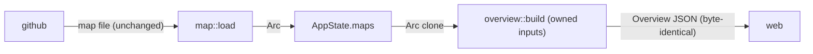

# Server: share loaded maps and build the overview without per-issue copies

Every read of a workspace map deep-copies it (the `SystemMap` and the raw YAML), and every
overview build filters every table once per issue and clones what matches. Most of these copies
exist only to get out from under a lock guard or a borrowed signature (#171). This change keeps
each loaded map behind an `Arc`, reads the workspace list once per request or tick, and builds the
overview from inputs it owns, grouped once per issue. What the server answers does not change:
the overview's JSON is the same, byte for byte, for the same inputs.

## What the change does

- A map read (`map_of`, `default_map`) hands out a shared pointer to the loaded map instead of a
  deep copy; a reload swaps the pointer, so a reader holding the old map keeps a consistent one.
- `GET /api/workspaces` and every caller of the workspace list read name, version and load time
  without copying any map.
- One `GET /api/overview` reads the workspace list once and each map once; the gauges read it
  once per tick, not once per workspace inside the loop.
- `overview::build` takes its inputs by value, groups sessions, pins, plans, decisions, reviews,
  approvals, spend and launch versions by issue once, and moves each issue's rows into its
  summary; `plan_fit` for the current map runs once per issue; asking whether a map names a
  repo allocates nothing.
- The poll tick does not clone every map twice, borrows the open-pull listing, asks the branch
  heads a yes-or-no question, and keeps `BranchPrefs` borrowed.

## How we'll know it works

- [ ] `overview::golden_tests::build_matches_the_golden`: a rich fixture (three workspaces, pins,
      launches, live and ended sessions, a parse error, plans that fit here, elsewhere and
      nowhere, decisions, two reviews, stale and current approvals, cap hits, spend series,
      launch-version mismatches, backlog, layout, pulls, traffic) builds an overview whose JSON
      equals `tests/fixtures/golden/overview_build.json`, recorded on `main` before any refactor.
      It prints how many issues, findings and bytes it compared.
- [ ] `overview::golden_tests::a_changed_input_fails_the_golden`: the same fixture with one
      session's status changed does not equal the golden (the check fails on purpose).
- [ ] `tests/workspaces_golden.rs` still passes: the single-map server's overview, pins and draft
      equal `fixtures/golden/overview.json`.
- [ ] `kernel::state` test: `map_of` twice returns the same `Arc` (`Arc::ptr_eq`), and a
      `set_map` afterwards leaves the earlier `Arc` unchanged.
- [ ] The golden test prints the build time of the fixture before and after (a `println!`, no new
      dependency); the PR quotes both.

## What it must not break

- The overview, map, workspaces, pins, launch, approve, layout, draft and propose routes answer
  as before: `tests/integration.rs`, `tests/workspaces*.rs` and the slice unit tests.
- A map fetch that fails keeps the cached map (`map::load` tests `invalid_flows_keep_the_previous_map`,
  `loaded_at_follows_loads_and_survives_failures`).
- A proposal still compares against the YAML that was loaded (`map_draft::propose` tests).
- The gauges record the same values (`overview::gauges` paths exercised by `tests/integration.rs`
  metrics assertions).
- The slice layout test (`src/slices.rs`): no new slice, no new edge.

## How we'll debug it at 3 am

See the O-rows. No new log line, metric or finding: the change keeps every existing signal at the
same site. If the overview ever differs from before, `build_matches_the_golden` names the first
differing JSON path.

## Affected parts

| Node | Status | What changes | Seams |
| --- | --- | --- | --- |
| rubato-server | affected | `AppState.maps` holds `Arc<LoadedMap>`; overview build over owned, grouped inputs; poll-tick copies removed | web-server, server-system-map |

## Data models

None.

## Data flow

## Tasks

1. Golden first, on `main`'s code: `overview::golden_tests` with the rich fixture; record
   `tests/fixtures/golden/overview_build.json`; add `a_changed_input_fails_the_golden`.
2. Failing test `map_of_shares_one_map`; then `maps: RwLock<BTreeMap<String, Arc<LoadedMap>>>`,
   `map_of` and `default_map` return `Option<Arc<LoadedMap>>`; callers adjusted; `map::list`
   reads under one guard.
3. Overview handler and inputs: one `list_workspaces` per request, reused for findings, the
   switcher and the other workspaces; gauges: one list per tick; `cross_workspace_findings`,
   `list_open_issues` take borrowed `(&str, &SystemMap)` slices.
4. `overview::build(inputs: OverviewInputs, …)`: group rows by issue once, move them out;
   `plan_fit` once; a non-allocating `names_repo` in the overview slice. Golden stays green.
5. Poll tick: no double map clone; `pulls.rs` borrows `OpenPulls`; `heads()` answers a set of
   issue numbers; single-lookup map entries in `poll.rs`; `BranchPrefs` with `Option<&str>`.
6. `cargo fmt`, `clippy -D warnings`, `cargo test -p rubato-server`.

## Assumed, not yet approved

| # | Decision | Chosen | Alternatives | Scope |
| --- | --- | --- | --- | --- |
| A1 | How a map is shared | `Arc<LoadedMap>` behind the existing `tokio::sync::RwLock` | `ArcSwap` (a new dependency) | node |
| A2 | The per-change overview cache (issue item 3) | Not in this change: the overview depends on `now` (staleness, `generated_at`) and on companion connections that change without a `notify`, so a cached body could show a stale session as working | Cache the shared part keyed by a generation counter bumped by `notify`, with a time bound | node |
| A3 | The companion skipping unchanged snapshots on the hook path (issue item 3) | Not in this change: it is `rubato-companion`, outside this server-only change | Do it here | node |
| A4 | The envelope text → struct → `Value` → `String` path (`companion_link/ws.rs`, `store.rs`) | Left for the companion-link PRs in flight (#180), to avoid conflicts | Do it here | node |
| A5 | A non-allocating `names_repo` | A private function in the overview slice, not a `SystemMap` method | A method in `rubato-protocol` (a contract change, out of scope) | node |

## O-rows

| Seam | Breaks like | Signal | Panel | Owner |
| --- | --- | --- | --- | --- |
| web-server | the overview answers 500 or differs from before after the refactor | `request failed` error log with `slice=overview`; `rubato.issues.by_state` gauges, computed by the same `build`, shift without a change in GitHub or sessions | Issues by state | rubato-server |
| server-system-map | a reload swaps the map but readers keep serving the old one | `rubato.map.loaded_at` per `rubato.workspace` stops advancing while `rubato.map.loaded` counts loads | Map age | rubato-server |

## Flows

| From | To | Seam | Kind | Carries |
| --- | --- | --- | --- | --- |
| rubato-server | web | web-server | data | Overview: map, issues with derived progress, findings, companions, backlog, layout, open pull requests per repo, per workspace, with the list of workspaces; a pull request's detail |

## ADRs proposed

None.

## Review map

1. `crates/rubato-server/src/overview/build.rs` `build`: the grouping and the moves.
2. `crates/rubato-server/src/kernel/state.rs` `maps`, `map_of`.
3. `crates/rubato-server/src/overview/golden_tests.rs`: the fixture and the golden.
