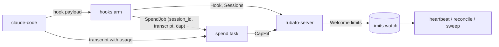

# Spend work off the companion's dispatch loop

Issue: #172 · Small track: one deployable (`rubato-companion`), no wire or schema change, no
new dependency.

The companion's `Dispatch` holds `&'a` borrows (`crates/rubato-companion/src/runtime.rs:226-235`),
so nothing it owns can move into a task and the spend work is awaited inside the select loop
(`runtime.rs:251-253`): the pricing map is cloned per hook, the whole transcript is re-read, and
on a cap hit `kill_session` is awaited, all while no hook event and no server message (Welcome,
Launch, an auth `Error`) is handled. This moves spend to its own task fed by a queue that
coalesces by session, holds shared state as `Arc`s, and fixes four smaller borrow-shaped
workarounds in the same crate.

## What the change does

- **Hooks and server messages keep flowing while spend is summed.** The dispatch loop hands each
  hook's spend work to a `spend` task over an mpsc and moves on; it never awaits a transcript
  read or a `kill_session`.
- **A burst of hooks for one session costs one sum, not one per hook.** The spend task takes
  everything queued when it wakes and keeps only the newest job per `session_id`.
- **Pricing is shared, not copied.** `pricing` is an `Arc<BTreeMap<String, ModelPrice>>`, cloned
  as a pointer per sum.
- **No whole registry `Entry` is cloned under the lock** to read one or two fields
  (`hooks/arm.rs:69-73`, `spend/arm.rs:34-35`).
- **The live `Limits` is a `tokio::sync::watch`.** No `.lock().unwrap()` in an essential task;
  the heartbeat and reconcile loops wake when a `Welcome` changes the limits and use the new
  interval at once instead of after the old timer.
- **Reconcile compares snapshots as structs** (`SessionState` already derives `PartialEq`), not
  as JSON strings built under the registry lock.
- **An ack pops the outbox from the front** while `seq <= acked`, instead of `retain` over up to
  10,000 entries.

## How we'll know it works

- [ ] `runtime.rs` test `hooks_and_server_messages_flow_while_spend_is_slow`: a spend step that
      blocks until released; while it is blocked, a second hook is forwarded (`Hook`,
      `Sessions` reach the outbound channel) and a `Welcome` updates the limits watch; after the
      release the step has run once for the first hook and once for the coalesced rest.
      Main's shape cannot run it (the arm awaits `after_hook` inline, so the second hook waits for the sum); the `started` and `next_out` timeouts are what fail when the loop blocks.
- [ ] `spend/task.rs` test `pending_jobs_coalesce_by_session`: three jobs for `s1` and one for
      `s2` queued before the task wakes give two steps, `s1` with its newest transcript path.
- [ ] `server_link` test `an_ack_pops_only_what_it_covers`: outbox seqs 5..=9, ack 7 leaves
      8, 9; an ack below the front leaves it whole; an ack past the back empties it.
- [ ] `stale/heartbeat.rs` test `a_new_welcome_wakes_the_heartbeat`: interval 3600 s, one
      heartbeat sent, limits changed to 1 s, a second heartbeat within 2 s.
- [ ] Review of the diff: no `.cloned()` of a registry `Entry` in `hooks/arm.rs` or
      `spend/arm.rs`, no `std::sync::Mutex<Limits>` and no `serde_json::to_string` of a
      snapshot left in the crate (`rg` in the PR description), pricing one `Arc` built at start.
- [ ] Existing `sum.rs`, `hooks/arm.rs`, `sweep.rs` and `sessions/tasks.rs` tests still pass.

## What it must not break

- The hook arm's order, `Hook` then `Sessions`: `hooks/arm.rs` test
  `hook_forwarded_carries_the_companion_id`.
- Spend summing and the cap: `sum.rs` tests; the `CapHit` path is unchanged code inside
  `after_hook`, now run by the spend task.
- A snapshot goes to the server only when it changed: reconcile's comparison, now on structs;
  `discovery.feature` and `stale.feature` (those needing tmux-ide do not run on this machine).
- Supervision: the spend task is essential; `supervise` tests unchanged, and its ending logs
  `rubato.task.exited`.
- Replay after reconnect: `outbox` keeps everything above the ack (new unit test) and the
  existing pairing and hooks scenarios.

## How we'll debug it at 3 am

See the O-rows. No new telemetry names. If the spend task dies, the supervisor logs
`rubato.task.exited` with `rubato.task = spend` and the companion exits non-zero; if it stalls,
`spend_usd` on the session snapshots stops moving while `rubato.hook.forwarded` keeps rising.

## Affected parts

| Node | Status | What changes | Seams |
| --- | --- | --- | --- |
| rubato-companion | affected | spend task and queue, `Arc`s in `Dispatch`, pricing as `Arc`, field reads under the registry lock, `Limits` over `watch`, struct snapshot comparison, outbox pop-front | companion-server, companion-claude-code |
| rubato-protocol | quiet | nothing; `SessionState` already derives `PartialEq` and `Limits` is `Copy` | |

## Data models

None.

## Data flow

## Tasks

1. **PR** `issue/172-spend-off-dispatch`: this plan; `plan.ts check`; review; `Review:` on #172.
2. `spend/task.rs` test `pending_jobs_coalesce_by_session` first (fails: no task), then the
   task: an mpsc of `SpendJob`, drained and coalesced per wake, each job run by a step.
3. `runtime.rs` test `hooks_and_server_messages_flow_while_spend_is_slow` first (fails: the
   step is awaited in the arm), then `Dispatch` owning `Arc`s and the hook arm sending a
   `SpendJob`; the spend task spawned as essential with `spend::after_hook` as its step.
4. `pricing` built once at start as `Arc<BTreeMap<..>>` from the config (the config type and its YAML stay as they are); `after_hook` reads
   `tmux_session` only, under the lock; `hooks/arm.rs` reads transcript and cap only.
5. `heartbeat` test `a_new_welcome_wakes_the_heartbeat` first (fails: the timer is not
   interrupted), then `Limits` over `watch` in `runtime.rs`, `welcome.rs`, `heartbeat.rs`,
   `sweep.rs`, `sessions/tasks.rs`.
6. Reconcile keeps the last `Vec<SessionState>` and compares structs, outside the lock.
7. `an_ack_pops_only_what_it_covers` first, then `drop_acked` popping from the front.

## Assumed, not yet approved

| # | Decision | Chosen | Alternatives | Scope |
| --- | --- | --- | --- | --- |
| A1 | Where spend runs | its own essential task fed by an unbounded mpsc, coalescing pending jobs by `session_id` (newest wins) | spawn one task per hook from the arm (no coalescing, concurrent sums per session) | node (rubato-companion) |
| A2 | Incremental transcript reading | not in this change; each sum reads the whole transcript, as today and as PR #188's guard does | read from the last offset per session | node (rubato-companion) |
| A3 | A cap hit's `kill_session` | awaited inside the spend task, off the dispatch loop | spawned and forgotten | node (rubato-companion) |
| A4 | Reacting to a new `Welcome` | heartbeat and reconcile wake on `limits.changed()` and run their body at once; sweep reads the current value each second | keep the timers and read the new value on the next tick | node (rubato-companion) |
| A5 | Proof that the loop is not blocked | a Rust test with an injected blocking step, not a Gherkin scenario: deterministic, no timing on transcript size | a Gherkin scenario with a large transcript | node (rubato-companion) |

## O-rows

| Seam | Breaks like | Signal | Panel | Owner |
| --- | --- | --- | --- | --- |
| companion-server | the spend task stalls or dies: `CapHit` stops arriving and `spend_usd` on snapshots freezes, while hooks still flow | `rubato.task.exited` error line with `rubato.task = spend` (companion exits non-zero, then `CompanionSilent` on `rubato.companion.heartbeat`); `rubato.cap.hit` warn line with `issue`; `rubato.hook.forwarded` by `rubato.companion_id` keeps rising | Companions; Hooks/min vs working sessions | rubato-server |
| companion-claude-code | a slow or huge transcript delays spend; after this change it no longer delays hooks, so hooks keep their rate while spend lags | `rubato.hook.forward` span per hook with `rubato.session_id` (latency no longer includes the sum); `rubato.events.dropped` by `rubato.reason` | Hooks/min vs working sessions; Events dropped | rubato-companion |

## Flows

None.

## ADRs proposed

None.

## Review map

1. `crates/rubato-companion/src/runtime.rs` `Dispatch`: owns `Arc`s, sends a `SpendJob`, awaits nothing slow.
2. `crates/rubato-companion/src/spend/task.rs`: drain and coalesce per wake; newest job per session wins.
3. `crates/rubato-companion/src/stale/heartbeat.rs` and `sessions/tasks.rs`: the `limits.changed()` arm.
