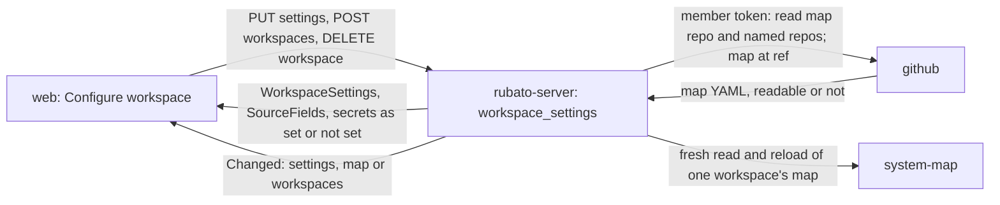

# Workspace settings at runtime: a Configure workspace view instead of env vars

Most of what describes a workspace is set in the server's environment or in the workspaces file:
which map it shows, where its traffic comes from (one source for the whole server) and its
launch defaults (also server-wide). So adding a workspace, or changing one, takes a redeploy, and
two applications on one server cannot read two Prometheus tenants. The issue draws a hard line
between the **application** (the server process) and its **workspaces**. This change moves
workspace settings into the server's database, where a team member sets them at runtime from a
**Configure workspace** view. Application settings stay in the environment, are never shown
there and have no API. The environment and the workspaces file seed the database once, so a
running deploy keeps working with no config change. Design:
[`189-configure-workspace/design.md`](189-configure-workspace/design.md) (S1–S7, N1–N9 refer to
its §1). ADR 0075.

## What the change does

- **S1.** A team member opens **Configure workspace** from a header item that is always drawn,
  also on a server with one workspace. The view shows:
  - the workspace's name and map source (`map_repo`, `map_path`, `map_ref`);
  - its traffic source (an adapter and its fields, drawn from the adapter's field list);
  - its launch defaults (spend cap, attempt limit).

  Secrets show only as "set" or "not set". No application setting appears in the view or the
  API.
- **S2.** A saved change takes effect without a restart. A moved `map_ref` reloads that
  workspace's map, and a changed traffic source restarts that workspace's traffic task. No other
  workspace changes.
- **S3.** A member creates a workspace (an id, a name, and a map that their own GitHub token can
  read, in a map whose named repos it can read too). It appears in every browser's switcher.
  They can delete any workspace but `default`. Its rows are kept as orphans, and its id cannot be
  created again while they remain.
- **S4.** A refused change answers with a reason and changes nothing:
  - the start-up checks' reasons;
  - a changed `map_repo` or `map_path`;
  - a ref move on a `map_file` workspace, or while its map draft is open;
  - a map that does not load fresh at that ref;
  - a repo the member's token cannot read;
  - a bad URL;
  - a secret without `RUBATO_TOKEN_KEY`;
  - a source set while `RUBATO_DEV_TRAFFIC` is set;
  - a stale edit;
  - an id with kept rows;
  - any write on a server open to any GitHub account.
- **S5.** The first start after the upgrade seeds the settings in one transaction: every
  workspace of the file (or `default` from `RUBATO_MAP_*`), each with the set `RUBATO_TRAFFIC_*`
  and `RUBATO_DEFAULT_*` values copied once. After that the database owns them. Every start warns
  once for each such variable or file entry still set, and says whether it differs.
- **S6.** Each workspace with a source has its own report, findings, gauges, notifications and
  stale alert. A launch takes its defaults from its workspace, else 25 USD and 3 attempts; the
  plan's front matter still wins.
- **S7.** Every change logs `workspace config changed` and records the span
  `rubato.workspace.config_changed` with `rubato.workspace`, `rubato.user` and the changed key
  names. Values are never recorded.

## How we'll know it works

- [ ] **S5** `workspace_settings::tests::seed_from_file_and_env_once`. Setup: a workspaces file
      with `default` and `shop`, and `RUBATO_TRAFFIC_PROMETHEUS_URL`, a header and
      `RUBATO_DEFAULT_SPEND_CAP_USD` set. It checks that:
      - the first start writes both rows in one transaction, each with the URL, the sealed
        header and the cap;
      - a second start with a changed file writes nothing and warns once per item, saying
        "differs";
      - a start with the header and no token key refuses, naming the variable.

      It prints the rows and warnings it checked.
- [ ] **S3, S4** `tests/workspace_settings.rs::a_refused_change_is_refused`: a table of 22
      cases, each answering 4xx with its reason, counted on `rubato.web.rejected`, and leaving
      the row and its revision unchanged. The cases are:
      - a bad id, a duplicate id, the same map twice, deleting `default`;
      - a changed `map_repo`, a changed `map_path`;
      - a ref move on a `map_file` workspace, a ref move while the draft has an op;
      - a ref that does not exist, with a cached map present;
      - a map repo the member cannot read, a named repo the member cannot read;
      - `ftp://`, userinfo, `127.0.0.1`, `[::ffff:127.0.0.1]`, `169.254.169.254`,
        `fd00:ec2::254`, `100.100.100.200`;
      - a secret with no token key;
      - a source while `RUBATO_DEV_TRAFFIC` is set;
      - an id with kept rows;
      - any write while the server is open login.

      It prints how many cases it checked. Its must-fail twin runs the same table with the
      address guard off and expects the metadata URL to be accepted.
- [ ] **S1, S4** `…::get_never_returns_a_secret`: a stored header reads back as
      `{"set": true}`, and the raw body does not contain it.
- [ ] **S4** `…::a_new_origin_clears_the_secrets`: a URL with a new host and secrets "keep"
      stores no secrets; the same URL with secrets "set" keeps the new ones.
- [ ] **S4** `…::a_stale_edit_answers_409`: two `PUT`s at revision 4; the second answers 409
      with revision 5.
- [ ] **S2** `…::a_ref_change_reloads_only_that_workspace`: `shop`'s map is at the new version,
      and `default`'s `loaded_at` is unchanged. It sends `Changed { map, workspace: shop }`. A
      poll reload of the old ref that finishes afterwards is dropped (revision check).
- [ ] **S3** `…::create_and_delete`. Create: the workspace appears in `GET /api/workspaces`, an
      unscoped `Changed { workspaces }` is sent, and `rubato.workspaces.configured` is
      recorded again. Delete: its pins are kept, the orphan count is recorded again, and an
      in-flight map load does not bring it back.
- [ ] **S7** `…::a_change_is_recorded_without_values`: the captured span and log line have the
      key names, and no value or secret.
- [ ] **S6** `traffic::supervisor_tests::each_workspace_reads_its_own_source`. Setup: two
      Prometheus stand-ins, one per workspace. It checks that:
      - each overview shows its own seams;
      - changing `shop`'s source restarts only `shop`'s task;
      - a report from the cancelled generation never lands;
      - clearing the source records `rubato.traffic.configured{shop}` 0.
- [ ] **S4** `traffic::guard_tests::every_connect_is_checked`: a host resolving to `127.0.0.1`
      and an IP-literal URL both fail at connect as a failing source, unless the server is
      local. A 302 is not followed, and `HTTPS_PROXY` is ignored.
- [ ] **S6** `observability/alerts/tests/rubato.test.yml`: `TrafficReportStale` fires for
      `shop` alone and names it.
- [ ] **S6** `launch::tests::defaults_come_from_the_workspace`: `shop` with a cap of 5 carries 5;
      `default` without one carries 25 and 3; front matter wins over both.
- [ ] **S1, S2, S3** Web: `features/settings` unit tests (fields from the field list; secrets
      set or not set and keep, replace or clear; the 409, 422 and refusal messages).
      `e2e/settings.spec.ts` on the dev server renames `shop` and moves `default`'s `map_ref`
      to the seeded branch `issue/901-lens`, and the switcher and map follow without a reload.
      On the single-map server it opens the view from the header item and creates nothing.

## What it must not break

- **N1** ADR 0044's start-up refusals: `kernel::workspaces` tests, with `check` shared.
- **N2** Single-workspace deploys look as before: `tests/workspaces_golden.rs` unchanged, plus
  the `workspaces` e2e specs. Only the header item is new.
- **N3** ADR 0049 routes and `check_workspace`: `tests/workspaces_scope.rs`.
- **N4** Orphan counting: the `kernel::workspaces::report` tests, plus the re-record after a
  create or delete.
- **N5** Traffic with one workspace: `overview::traffic_tests`. `traffic::prometheus_tests` gets
  a seed-path test in PR 1, before PR 2 changes its source, so the old path stays guarded.
- **N6** Front-matter caps win: the existing launch tests.
- **N7** Same-origin writes (ADR 0066): the new routes sit under the same route layer;
  `app::tests::cross_origin_writes_are_refused_and_counted` gains a settings route.
- **N8** Map draft and proposal: a ref move is refused while the draft is open (a case in the
  table).
- **N9** The `workspace config` start-up log, with source `database` (asserted in the seed test).
- The AGENTS.md slice blocks: the slice layout tests in each deployable. The protocol block
  gets the new module by hand (no test checks it).

## How we'll debug it at 3 am

See the O-rows. New signals:
- the log line `workspace config changed` (info: workspace, user, keys);
- the span `rubato.workspace.config_changed`;
- the start-up warning `workspace setting still set outside the database` with `differs`;
- `rubato.traffic.configured{rubato.workspace}`;
- `rubato.traffic.fetches`, `rubato.traffic.report_age` and the traffic gauges, now with
  `rubato.workspace`;
- `TrafficReportStale` per workspace;
- a source failing with reason `secrets_unsealable`.

A refusal is `rubato.web.rejected{rubato.route, reason}`, with these reasons:
- `bad_id`, `duplicate`, `same_map`, `default_kept`, `id_has_rows`;
- `map_source_fixed`, `map_file`, `draft_open`, `map_invalid`, `repo_unreadable`;
- `url_refused`, `no_token_key`, `dev_traffic_set`;
- `changed_meanwhile`, `open_login`.

## Affected parts

| Node | Status | What changes | Seams |
| --- | --- | --- | --- |
| rubato-server | affected | new slice `workspace_settings` (table, seed, drift warnings, routes, validation, member-token checks, write lock, change span); kernel registry with revisions replacing `Config::workspace_entries`; `seal`/`open` moved to the kernel; per-workspace traffic supervisor, adapter field lists and connect guard; revision-checked map loads; launch defaults per workspace | web-server, server-system-map, server-github |
| web | affected | new feature `settings`: the Configure workspace view drawn from the adapter's field list, create and delete, a header item always drawn | web-server |
| rubato-protocol | affected | new module `workspace_settings` (settings, backend-neutral traffic source, field list, update, new workspace, reasons, routes); span name in `otel` | web-server |
| system-map | quiet | read per workspace as before; a moved `map_ref` is a fresh read and a reload | server-system-map |
| github | quiet | the map read at the new ref; the member's token reading the map repo and the repos it names | server-github |

## Data models

| Model | Kind | Part | Change | Crosses | Note |
| --- | --- | --- | --- | --- | --- |
| `workspace_settings` | table | rubato-server | new | | migration 0027, owned by slice `workspace_settings`; integer `revision`; unique map; secrets sealed; no `map_file` |
| `WorkspaceSettings` | type | rubato-protocol | new | web-server | what the view reads; secrets as `SecretState` |
| `TrafficSourceSettings` | type | rubato-protocol | new | web-server | adapter name, fields as text, secrets set or not; backend-neutral (ADR 0040) |
| `SourceFields` | type | rubato-protocol | new | web-server | each adapter's field list: name, label, kind, required, secret |
| `WorkspaceSettingsUpdate` | type | rubato-protocol | new | web-server | carries the revision it read; secrets keep, set or clear |
| `NewWorkspace` | type | rubato-protocol | new | web-server | id, name, map source |
| `WebEvent::Changed` reasons `settings`, `workspaces` | event | rubato-protocol | changed | web-server | reasons only; the type is unchanged |
| `rubato.workspace.config_changed` | event | rubato-server | new | | span name in `rubato-protocol::otel` |

## Data flow

## Tasks

PR 1: kernel registry, secrets, table, seed and drift warnings, with no change in behaviour.
1. Failing first:
   - `seed_from_file_and_env_once` (N9 included);
   - a test that a workspace added to the registry shows in `GET /api/workspaces` and passes
     `check_workspace`;
   - the `prometheus_tests` seed-path test (N5).
2. The work:
   - migration `0027_workspace_settings.sql`;
   - move `seal` and `open` to `kernel::secrets`;
   - `Option` seed inputs in `Config`;
   - the registry `watch` in `AppState`, filled by `AppState::new` from `Config`;
   - slice `workspace_settings` with its store, `seed` (one transaction) and the drift
     warnings;
   - the composition root loads the registry from the table;
   - move the 12 `workspace_entries()` call sites to the registry;
   - `map_file` read from the file or env by id;
   - update the AGENTS.md server block.

PR 2: per-workspace traffic and launch defaults.
3. Failing first: `each_workspace_reads_its_own_source`, `every_connect_is_checked`, the
   per-workspace `TrafficReportStale` rule test, `defaults_come_from_the_workspace`, and the
   revision-checked reload (unit, in `map`).
4. The work:
   - `Source` adapters publish a field list, and `PrometheusConfig::from_fields` is the one
     validator;
   - the supervisor, `Essential`, subscribed to the registry, with generations;
   - the dev-file task feeding every workspace;
   - `AppState::traffic` keyed by workspace;
   - `rubato.traffic.configured` and `rubato.workspace` on every traffic instrument;
   - the alert `max by (rubato_workspace)`, naming the workspace;
   - the checking connector, `.no_proxy()` and no redirects;
   - launch defaults from the registry;
   - `map::load::fetch_and_validate` and revision-checked `reload_ws`.

PR 3: the settings API.
5. Protocol types, schema snapshots (`UPDATE_SCHEMAS=1`), `schema.rs`, generated
   `web/src/protocol.ts`, the span name in `otel`, and the AGENTS.md protocol block.
6. Failing first: `a_refused_change_is_refused` and its must-fail twin,
   `get_never_returns_a_secret`, `a_new_origin_clears_the_secrets`, `a_stale_edit_answers_409`,
   `a_ref_change_reloads_only_that_workspace`, `create_and_delete`,
   `a_change_is_recorded_without_values`, and the cross-origin case.
7. The work:
   - the routes, the write lock and the validation;
   - the member-token checks (ADR 0030);
   - the open-login refusal;
   - sealing;
   - the span and log;
   - the swap, the reload and the notifies;
   - `report` re-run after a create or delete.

PR 4: the web view.
8. Failing first: the `features/settings` unit tests and `e2e/settings.spec.ts` on both e2e
   servers.
9. The work:
   - the view, the create and the delete, and the header item;
   - the AGENTS.md web block;
   - the README's configuration section, with the backup-before-upgrade line and the rollback.
10. `pnpm observability:check`: the "Web writes rejected" description lists the new reasons, a
    "Workspace config changes" panel reads the log line, and the traffic panels split by
    workspace.

## Assumed, not yet approved

| # | Decision | Chosen | Alternatives | Scope |
| --- | --- | --- | --- | --- |
| A1 | Order in the switcher | a `position` column: file order at seed, new workspaces last | by id | node |
| A2 | What a delete does to the workspace's map draft and proposal | kept as orphan rows, like every scoped row | close the proposal PR | node |
| A3 | The change record | key names only, as the issue says; the map reload's log line already gives the loaded version | log non-secret values such as `map_ref` | node |
| A4 | The drift warning | warn while a variable or entry is still set, as the issue says, and say whether it differs | warn only when it differs | node |

## Decisions

| # | Decision | Chosen | Why | Decided by |
| --- | --- | --- | --- | --- |
| 1 | Source of truth (#189 Q1) | a: the file and env seed once in one transaction, the database owns, start-up warns while they are still set | a running deploy keeps working with no config change, as the team lead set | agent (delegated by Mattias, 2026-11-15) |
| 2 | Who may configure (#189 Q2) | a: any logged-in team member, as with the map draft; refused entirely on an open-login server | no role model exists yet; an open server would give the internet an outbound request | agent (delegated by Mattias, 2026-11-15) |
| 3 | Map source after create (#189 Q3) | b: `map_repo` and `map_path` fixed; `map_ref` may move, not while the draft is open, not on a `map_file` workspace; an id with kept rows cannot be created again | pins, layout, drafts and dismissals are keyed to the map's ids | agent (delegated by Mattias, 2026-11-15) |
| 4 | Traffic URL constraint (#189 Q4) | b: http(s), no userinfo, no proxy, no redirects; loopback, link-local, unspecified, multicast, IPv4-mapped forms, `fc00::/7` and `100.64.0.0/10` refused on every connect unless the server is local; RFC 1918 allowed | the team's Prometheus is on a LAN address; covers the metadata addresses; no new application setting | agent (delegated by Mattias, 2026-11-15) |
| 5 | Which repos a member may use (seam question; the issue's "the team may use") | a: the member's own GitHub token (ADR 0030) must read the map repo and every repo the new map names, on create and on a ref move | the issue rules out installation reach (#163's class); this is the narrowest test that still lets a member add a new application. Alternatives: b) only repos an existing workspace names; c) installation reach, waiving the criterion | agent (delegated by Mattias, 2026-11-15); for Mattias to confirm |
| 6 | Headers in the env at seed without `RUBATO_TOKEN_KEY` (seam question) | the start refuses and names the variable | loud and fixed by one env change. Alternatives: seed without headers and warn, so traffic fails until someone sets them; or store them unsealed (refused) | agent (delegated by Mattias, 2026-11-15); for Mattias to confirm |
| 7 | Which workspaces the env traffic and caps seed (seam question) | every workspace seeded at that start (a one-time copy) | today they apply to every workspace, so a running deploy keeps its traffic lens and caps; this differs from the issue's "Decided" (default only). Alternative: default only, with a warning per other workspace | agent (delegated by Mattias, 2026-11-15); for Mattias to confirm |
| 8 | The traffic contract | backend-neutral: adapter name, fields as text, secrets set or not, and a field list the adapter publishes | ADR 0040: only the adapter knows the backend | agent (delegated by Mattias, 2026-11-15) |
| 9 | `RUBATO_DEV_TRAFFIC` | stays a process dev switch feeding every workspace; storing a source while it is set is refused; a start with both warns that stored sources are ignored | a path and a dev switch, never runtime (#189) | agent (delegated by Mattias, 2026-11-15) |
| 10 | `map_file` | never stored; read from the file or env by id at every start | a path on the server's disk is an application setting by the issue's own divider | agent (delegated by Mattias, 2026-11-15) |
| 11 | Migration number | 0027 | 0024 is #144's, 0025 #82's, 0026 #208's (team lead) | agent (delegated by Mattias, 2026-11-15) |
| 12 | Approve plan for build | yes | approved by Mattias in the Claude Code session ("approve all"), 2026-11-16 | Mattias (m0x6A) |

## O-rows

| Seam | Breaks like | Signal | Panel | Owner |
| --- | --- | --- | --- | --- |
| web-server | a member cannot save a valid change, a refused change is stored, or a secret leaks | `rubato.web.rejected{rubato.route, reason}` on the settings routes; span `rubato.workspace.config_changed` and log line `workspace config changed` with `rubato.workspace`, `rubato.user` and the keys | Web writes rejected; Workspace config changes (new) | rubato-server |
| server-system-map | a moved `map_ref` does not load, an old-ref load lands after the move, or every workspace reloads | `rubato.map.load_failures{rubato.workspace}` and `rubato.map.loaded_at{rubato.workspace}`; a refused change answers `map_invalid` | Map age; Web writes rejected | system-map |
| server-github | a repo the member cannot read is accepted, or every create fails the check | span `rubato.github.call` for the member-token reads (endpoints `repo` and `contents`); `rubato.web.rejected{reason=repo_unreadable}` | GitHub calls by endpoint; Web writes rejected | rubato-server |

## Flows

| From | To | Seam | Kind | Carries |
| --- | --- | --- | --- | --- |
| web | rubato-server | web-server | control | workspace settings updates, new workspaces and deletes, as the member |
| rubato-server | web | web-server | data | WorkspaceSettings and each adapter's field list, with secrets as set or not set |
| rubato-server | web | web-server | control | WebEvent Changed with reason settings, map or workspaces |
| rubato-server | system-map | server-system-map | control | a fresh read and reload of one workspace's map at its new ref |
| github | rubato-server | server-github | data | whether the member can read the map repo and each repo the map names |

## ADRs proposed

| ADR | File | Blob |
| --- | --- | --- |
| 0075 | docs/decisions/0075-workspace-settings-live-in-the-server-database.md | 9d12cb7b5ebc4f9f54c06eaadda82f7b04a664cc |

## Review map

1. `crates/rubato-server/src/workspace_settings/`: the write lock, validation, member-token checks, secret clearing on a new origin.
2. `crates/rubato-server/src/traffic/`: the supervisor's generations and the connect guard (IP literals, no proxy, no redirects).
3. `crates/rubato-server/src/map/load.rs`: `fetch_and_validate` and the revision-checked reload.
