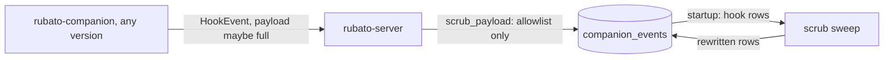

# Server: scrub hook payloads on receipt and purge stored ones

Issue: #190, follow-up of #166 (PR #179, plan 166 Q2). Small track: two map parts
(`rubato-protocol`, `rubato-server`), no change under `schema/protocol/`, no migration.

#179 makes the companion keep only `PAYLOAD_ALLOWLIST` (`hook_event_name`, `notification_type`,
`tool_name`) in `HookEvent.payload` (`crates/rubato-protocol/src/hook.rs:62,93-109`). Two gaps
remain on the server. A companion that is not upgraded still sends the full payload, and the server
stores the whole envelope in `companion_events.payload`
(`crates/rubato-server/src/companion_link/ws.rs:174-177`, `companion_link/store.rs:27`). Rows
already stored keep whatever older companions sent. This change applies the same allowlist on
receipt, before the row is written, and rewrites the hook rows already stored down to it at
startup. Every removed key is counted as `rubato.events.scrubbed`.

## What the change does

- **An old companion's tool input, tool output and prompts are not stored.** When a `Hook` envelope
  arrives, the server keeps only the `PAYLOAD_ALLOWLIST` keys of `HookEvent.payload` before it
  writes `companion_events`, with the same function the companion uses. An upgraded companion's
  envelope is stored unchanged.
- **Hook payloads already stored are rewritten down to the allowlist.** At startup, before it
  serves, the server reads every `companion_events` row of kind `hook`, applies the same function
  to the envelope's `payload` field and writes back only the rows that changed. It logs one line
  with how many rows it checked, how many it rewrote and how many keys it removed. A second start
  rewrites nothing.
- **Every removed key is counted.** Counter `rubato.events.scrubbed`, by `rubato.reason`
  (`receipt` or `stored`), drawn on the "Events dropped" panel next to the drops.

## How we'll know it works

- [ ] `rubato-protocol` `hook::tests::scrub_payload_counts_what_it_removes`: a full `PostToolUse`
  payload with `tool_response.stdout = "SECRET"`, `tool_input` and `prompt` keeps exactly the
  allowlisted keys and reports the number removed; an allowlisted payload reports 0; a non-object
  payload becomes `None` and reports 1.
- [ ] `companion_link::ws::tests::an_old_companions_hook_is_stored_without_its_tool_output`: a full
  `PostToolUse` `HookEvent` (built by hand, as a companion before #179 sends it) with
  `tool_response.stdout = "SECRET"` goes through `on_envelope`; the `companion_events` row does not
  contain `SECRET`, and `rubato.events.scrubbed{rubato.reason="receipt"}` equals the keys removed.
  Fails on today's code.
- [ ] `companion_link::scrub::tests::stored_hook_payloads_are_rewritten_once`: a database with a
  hook row seeded with `SECRET`, an already-clean hook row and a `heartbeat` row. After the sweep
  the seeded row no longer holds `SECRET`, the other two are byte-identical, the report reads 2 hook
  rows checked, 1 rewritten and the keys removed, and a second sweep rewrites 0.
- [ ] `pnpm observability:check` passes with the new series on the "Events dropped" panel.

## What it must not break

- Replay dedupe on `(companion_id, seq)`: the scrub happens before `record_event` and does not
  touch `seq`; `a_replayed_hello_is_a_warning_and_a_counted_drop_and_a_heartbeat_is_quiet` and the
  integration test counting `companion_events` stay green.
- The `hook` log line and session status: the server reads only `session_id` and
  `hook_event_name` (`ws.rs:237-239`), both lifted fields that the scrub does not touch.
- The wire schema: `crates/rubato-protocol/tests/schema_snapshot.rs` passes with
  `schema/protocol/*` unchanged (the change adds a function and an otel name, no type).
- `otel::tests::every_name_is_in_the_rubato_namespace_and_unique` with the new name listed.
- Startup: a sweep that fails logs an error and the server still starts (A2).

## How we'll debug it at 3 am

See the O-row. New: counter `rubato.events.scrubbed` and the startup log line
`stored hook payloads scrubbed` with `rows_checked`, `rows_rewritten`, `keys_removed`. A steady
nonzero `receipt` rate means some companion still runs a version from before #179.

## Affected parts

| Node | Status | What changes | Seams |
| --- | --- | --- | --- |
| rubato-protocol | affected | `scrub_payload` (the allowlist applied to a received or stored payload, with a count) and `HookEvent::scrub`; otel name `rubato.events.scrubbed` | companion-server |
| rubato-server | affected | `companion_link` scrubs a `Hook` envelope before `record_event` and sweeps stored hook rows at startup | companion-server |
| rubato-companion | quiet | already sends only the allowlist (#179); an old one keeps working, its extras are dropped on the server | companion-server |

## Data models

| Model | Kind | Part | Change | Crosses | Note |
| --- | --- | --- | --- | --- | --- |
| `companion_events.payload` | table | rubato-server | changed | companion-server | same column; hook rows hold at most the allowlisted keys in the envelope's `payload`; existing rows rewritten at startup |
| `rubato.events.scrubbed` | event | rubato-protocol | new | companion-server | counter name in `otel.rs`, by `rubato.reason` = `receipt` or `stored` |

## Data flow

## Tasks

1. Plan, `plan.ts check`, review, `Review:` on #190.
2. Failing test first: `scrub_payload_counts_what_it_removes` in `hook.rs`; then `pub fn scrub_payload` and `HookEvent::scrub`, reusing `allowlisted`.
3. Add `metric::EVENTS_SCRUBBED` to `otel.rs` and `all_names`; `Metrics::events_scrubbed` in the server's telemetry.
4. Failing test first: `an_old_companions_hook_is_stored_without_its_tool_output`; then the scrub in `on_envelope` before `record_event` (a few lines in `ws.rs`; the helper lives in a new `companion_link/scrub.rs`).
5. Failing test first: `stored_hook_payloads_are_rewritten_once` (the seeded `SECRET` row makes it fail before the sweep exists); then `scrub::sweep_stored`, called from `main.rs` after the state is built.
6. Add the `rubato_events_scrubbed_total` target to the "Events dropped" panel; `pnpm observability:check`.
7. `cargo fmt`, clippy and tests for `rubato-protocol` and `rubato-server`.

## Assumed, not yet approved

| # | Decision | Chosen | Alternatives | Scope |
| --- | --- | --- | --- | --- |
| A1 | How stored rows are purged | (a) a startup sweep in Rust: it reuses `scrub_payload` from `rubato-protocol` (one allowlist, not a second copy in SQL), counts what it removes, and is tested on a database built by `db::connect`; it is idempotent, so running at every start is safe, at the cost of one scan of the hook rows per start | (b) a data-only migration `0014` with SQLite JSON functions: one-off and testable like `migration_0013`, but the allowlist is copied into SQL and nothing counts or emits what it removed | node (rubato-server) |
| A2 | Sweep failure at startup | log an error and keep starting | refuse to start | node (rubato-server) |
| A3 | Count for a payload that is not a JSON object | 1 (the whole value is removed) | 0 | node (rubato-protocol) |
| A4 | Old values in SQLite free pages and in backups | out of scope: the sweep rewrites rows, it does not `VACUUM` or touch backups; that waits on #166's open question of who reads the DB and its backups and for how long | `VACUUM` after a sweep that rewrote rows | node (rubato-server) |

## O-rows

| Seam | Breaks like | Signal | Panel | Owner |
| --- | --- | --- | --- | --- |
| companion-server | an old companion's tool output reaches `companion_events` again, or the scrub removes a key the server needed and hooks stop moving sessions | `rubato.events.scrubbed` by `rubato.reason` (nonzero `receipt` = an old companion still sending); startup log `stored hook payloads scrubbed` with `rows_checked`, `rows_rewritten`, `keys_removed`; `rubato.hook.forwarded` against working sessions for the second case; the regression tests in CI | Events dropped; Hooks/min vs working sessions | rubato-server |

## Flows

| From | To | Seam | Kind | Carries |
| --- | --- | --- | --- | --- |
| rubato-companion | rubato-server | companion-server | data | HookEvent from any companion version; the server keeps only the allowlisted payload keys |

## ADRs proposed

None.

## Review map

1. `crates/rubato-server/src/companion_link/scrub.rs`: the receipt scrub and the startup sweep.
2. `crates/rubato-server/src/companion_link/ws.rs` `on_envelope`: where the scrub sits relative to `record_event`.
3. `crates/rubato-protocol/src/hook.rs` `scrub_payload`: the count.
