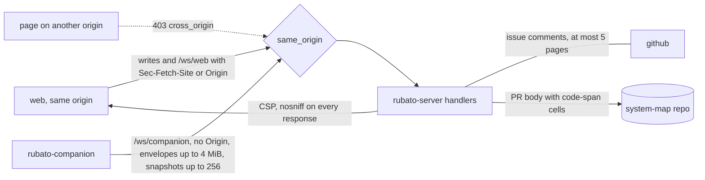

# Server hardening: same-origin writes, security headers, companion message caps, bounded comment reads

Issue: #193 (the server part of #170) · Design: [193-server-hardening/design.md](193-server-hardening/design.md)
· ADR 0066 (*proposed*). This is the full track. It changes the contract of two seams: browsers on
another origin can no longer write or open a websocket (`web-server`), and the server refuses
companion messages over a size (`companion-server`). It also adds a CSRF defence, which is an auth
change. No wire type or schema changes.

From the issue: "CSRF protection is SameSite=Lax alone. Add an Origin / `Sec-Fetch-Site` check for
non-GET routes and for websocket upgrades … The companion is not a browser, so its ws must keep
working without an Origin header." Also: no security headers, a Secure cookie that depends on the
`public_url` prefix, no companion message-size cap, unbounded comment reads, unescaped op summaries
in the App's PR body, and the OAuth callback echoing upstream error text.

## What the change does

- **S1 Same-origin writes.** A request that is not `GET`, `HEAD` or `OPTIONS`, and any websocket
  upgrade, is refused with `403 {"reason":"cross_origin"}` when the browser says it comes from
  another site (`Sec-Fetch-Site` other than `same-origin` or `none`). Without fetch metadata, it is
  refused when its `Origin` is neither the public URL's origin nor the request's own `Host`. A
  request with neither header (the companion, `curl`) passes as today (design D1).
- **S2 Security headers.** Every response carries `X-Content-Type-Options: nosniff` and a
  `Content-Security-Policy` that allows only the app's own origin, its websocket and inlined
  `data:` fonts, and forbids framing (D2).
- **S3 Insecure cookie warning.** The server warns at start when `RUBATO_PUBLIC_URL` is `http` on a
  host that is not loopback, because the session cookie then goes out without `Secure` (D3).
- **S4 Companion message cap.** The server reads a companion message of at most 4 MiB. A larger one
  ends the socket and is counted as `too_large` (D4).
- **S5 Sessions per snapshot.** A `Sessions` snapshot of more than 256 sessions is acknowledged,
  not stored, and counted as `too_many_sessions`. The previous snapshot stands (D5).
- **S6 Bounded comment reads.** An issue's comments are read from at most 5 pages, the newest 500
  comments, with a warning when the read is cut (D6).
- **S7 Escaped proposal body.** Each change and author in the map proposal's PR body is a code
  span, so a summary cannot add a mention, link, image or HTML, or break the table (D7).
- **S8 No upstream text at login.** A failed OAuth callback shows fixed text. GitHub's or the
  database's error text goes to the log (D8).

## How we'll know it works

- [ ] S1: `kernel::http::tests::cross_origin_table` covers at least 12 cases (each method class,
  each `Sec-Fetch-Site` value, `Origin` against the public URL and against `Host`, `null`, no
  headers, a websocket GET) and prints how many it checked. A case of an evil `Origin` expected to
  pass fails on purpose when its expectation is flipped (the test asserts both directions).
- [ ] S1: `tests/hardening.rs::cross_origin_writes_are_refused_and_counted`: a POST to
  `/api/map/reload` and `/api/map/draft/discard` with `Origin: https://evil.example` answers 403
  `cross_origin`. So does one with `Sec-Fetch-Site: same-site`. With `Sec-Fetch-Site: same-origin`,
  with the server's own `Origin`, or with no header it does not. `rubato.web.rejected{reason=cross_origin}`
  counts the refused ones with the route template.
- [ ] S1: `tests/hardening.rs::websocket_upgrades_check_the_origin`: `/ws/web` with an evil
  `Origin` is refused with 403. `/ws/companion` with a valid token and no `Origin` upgrades and
  gets `Welcome` after `Hello`. `/ws/companion` with an evil `Origin` is refused.
- [ ] S2: `tests/hardening.rs::every_response_carries_the_security_headers`: `/api/health`, a 404
  API path, and `index.html` served by the fallback carry both headers. The CSP names the public
  URL's `ws://` origin.
- [ ] S2: manual: `pnpm build`, then the server with `RUBATO_DEV_USER` and `RUBATO_WEB_DIST`, then
  headless Chromium (Playwright) loads `/`. No `securitypolicyviolation` event, the map renders,
  `/ws/web` connects. The result goes in the PR.
- [ ] S3: `kernel::config::tests::http_public_url_off_loopback_warns`:
  `http://rubato.lan:8080` warns. `http://127.0.0.1:8080`, `http://localhost`, `http://[::1]:1`
  and `https://rubato.example` do not.
- [ ] S4: `tests/hardening.rs::an_oversized_companion_message_ends_the_socket`: a 5 MiB text frame
  closes the socket and counts `rubato.events.dropped{reason=too_large}` once. A 3 MiB `Hook`
  envelope is acknowledged.
- [ ] S5: `tests/hardening.rs::a_snapshot_over_the_cap_is_not_stored`: 257 sessions are acknowledged,
  not stored (the overview still shows the earlier 1-session snapshot), and counted as
  `too_many_sessions`. 256 are stored.
- [ ] S6: `kernel::github::api::tests::issue_comments_read_at_most_five_pages`: against a stub that
  serves 12 pages with `Link` headers, it gets 6 requests (page 1, then pages 8–12) and comments
  701–1200, and logs `issue comments cut`. Against 3 pages it gets 3 requests and all 300.
- [ ] S7: `map_draft::propose::tests::summaries_are_code_spans`: a summary holding `@team`,
  `[x](https://e)`, `` ` ``, `|` and a newline renders as one row of three cells, with no `@` and no
  `[` outside a code span.
- [ ] S8: `tests/hardening.rs::the_callback_does_not_echo_upstream_errors`: a token stub answers
  `{"error":"bad_verification_code","error_description":"UPSTREAM-SECRET-TEXT"}`. The callback
  answers 502 with a body that lacks `UPSTREAM-SECRET-TEXT`, and counts `token_exchange_failed`.

## What it must not break

- The companion connects, pairs and replays without an `Origin` header: the existing integration
  tests that pair and connect (`tests/integration.rs` `Harness::pair`, `Harness::connect`) and the
  new no-`Origin` upgrade test.
- The browser flow, same-origin: `web/e2e` (dev and app projects, run in CI) and the manual
  headless load above. Fonts still load from the app's origin (`web/e2e/look.spec.ts`).
- Node `fetch` and Playwright `page.request` writes in the e2e suites (`web/e2e/map.spec.ts:16-19,139,369`,
  `motion.spec.ts:35`, `app-login.spec.ts:103`) send no `Sec-Fetch-Site`. They pass by rule 3 or 4.
  The e2e run in CI guards them.
- Every route still answers and is routed for its method: `app::tests::every_known_route_answers`
  sends no `Origin`, so it passes the check.
- Login and the team gate: `login_keeps_the_token_and_refresh_is_single_flight_with_compare_and_delete`
  and the `not_on_team` and `installation_lookup_failed` tests keep their text and status.
- Decisions, reviews and approvals on issues with fewer than 500 comments read exactly as before:
  the existing `github_poll` tests, which use `FakeGitHub` and are unchanged.
- The map proposal flow: the existing `map_draft` propose tests (`tests/integration.rs`) still open
  the PR. Their body assertions are updated only where a cell is now a code span.
- `schema/protocol/*.json` is unchanged: the schema export test.

## How we'll debug it at 3 am

See the O-rows. New signals, all on existing panels:

- `rubato.web.rejected{rubato.reason="cross_origin"}` and `warn!("cross-origin request refused")`
  with `rubato.route`, `method`, `origin`, `sec_fetch_site`.
- `rubato.web.rejected{reason=token_exchange_failed|user_lookup_failed}` and
  `error!("login failed", step, error)`.
- `rubato.events.dropped{reason="too_large"|"too_many_sessions"}`, with
  `warn!("companion socket read failed")` and `warn!("sessions snapshot over the cap")`.
- `warn!("issue comments cut")` with `rubato.repo`, `rubato.issue`, `pages`, `read`.
- The start-up warning about an `http` public URL off loopback.

## Affected parts

| Node | Status | What changes | Seams |
| --- | --- | --- | --- |
| rubato-server | affected | same-origin layer, security headers, start-up warning, companion socket caps, snapshot cap, bounded comment reads, escaped proposal body, fixed callback text | web-server, companion-server, server-github, server-system-map |
| web | quiet | nothing changes; its loads are checked against the CSP and it stays same-origin | web-server |
| rubato-companion | quiet | nothing changes; it sends no `Origin` and its largest envelope is under the cap | companion-server |
| github | quiet | comment reads are bounded; the PR body it receives is escaped | server-github |

## Data models

| Model | Kind | Part | Change | Crosses | Note |
| --- | --- | --- | --- | --- | --- |
| 403 `{"reason":"cross_origin"}` | type | rubato-server | new | web-server | answer to a cross-origin write or upgrade |
| `Content-Security-Policy`, `X-Content-Type-Options` headers | type | rubato-server | new | web-server | on every response |
| `rubato.web.rejected` reasons `cross_origin`, `token_exchange_failed`, `user_lookup_failed` | event | rubato-server | new | web-server | metric attribute values, no new metric |
| `rubato.events.dropped` reasons `too_large`, `too_many_sessions` | event | rubato-server | new | companion-server | metric attribute values, no new metric |
| map proposal PR body cells | file | rubato-server | changed | server-system-map | change and author as code spans |

## Data flow

## Tasks

- [ ] **PR 0** this plan, the design note and ADR 0066 (*proposed*); `plan.ts check`; review; `Review:` on #193
- [ ] 1. **Test first:** `kernel::http::tests::cross_origin_table` (fails: no function). Then `cross_origin` and the `same_origin` middleware in `kernel/http.rs`, wired as a `route_layer` on the API router in `app.rs`. Then `tests/hardening.rs` cross-origin and websocket tests, with a small harness of their own. — S1
- [ ] 2. **Test first:** `every_response_carries_the_security_headers` (fails: no header). Then `kernel::http::security_headers` as a `map_response` layer in `app.rs`. Then the manual headless load. — S2
- [ ] 3. **Test first:** `http_public_url_off_loopback_warns` (fails: no warning). Then `insecure_cookie_warning` at the end of `kernel/config.rs`, called once in `from_env`. — S3
- [ ] 4. **Test first:** `an_oversized_companion_message_ends_the_socket` (fails: the 5 MiB frame is read and nothing is counted). Then `max_message_size` and `max_frame_size` in `companion_link::ws::upgrade`, and the counted read error in `handle`. — S4
- [ ] 5. **Test first:** `a_snapshot_over_the_cap_is_not_stored` (fails: 257 are stored). Then the guard at the top of the `Sessions` arm. — S5
- [ ] 6. **Test first:** `issue_comments_read_at_most_five_pages` against a stub listener (fails: 12 requests). Then the bounded read in `kernel/github/api.rs`. — S6
- [ ] 7. **Test first:** `summaries_are_code_spans` (fails: the raw `@team` is in the body). Then `cell()` in `map_draft/propose.rs`, and the existing body assertions updated. — S7
- [ ] 8. **Test first:** `the_callback_does_not_echo_upstream_errors` (fails: the body holds the text). Then fixed answers in `auth/handlers.rs` callback. — S8
- [ ] 9. `cargo fmt`, `cargo clippy -p rubato-server --all-targets -D warnings`, `cargo test -p rubato-server`. Update the "Web writes rejected" and "Events dropped" panel descriptions with the new reasons, then `pnpm observability:check`.

## Assumed, not yet approved

| # | Decision | Chosen | Alternatives | Scope |
| --- | --- | --- | --- | --- |
| Q1 | An `http` public URL on a non-loopback host | (a) warn at start; the cookie stays non-Secure there | (b) refuse to start; (c) a `RUBATO_COOKIE_SECURE=1` override that forces `Secure`; (d) always `Secure` except on loopback | seam (web-server) |
| Q2 | Requests without `Sec-Fetch-Site` and without `Origin` | (a) allowed: not a browser (companion, `curl`, tests) | (b) refuse on cookie-authenticated routes only; (c) refuse everywhere except `/ws/companion` and `/api/pair/*` | seam (web-server) |
| Q3 | Where the 4 MiB and 256 caps live | (a) server constants, documented in ADR 0066 | (b) carried in `Welcome.limits`, so the companion trims before sending (a protocol schema change, later) | seam (companion-server) |
| A1 | A snapshot over the cap | drop it whole and keep the previous one | store the first 256 | node (rubato-server) |
| A2 | Comment window | the newest 5 pages of 100 | 10 pages; `since=` with a per-issue cursor (design D6) | node (rubato-server) |
| A3 | `/ws/web` inbound size | unchanged (the server reads nothing from a browser) | a 64 KiB cap | node (rubato-server) |
| A4 | Where the checks live | `kernel/http.rs` (infrastructure, names no slice), wired in `app.rs` | a new slice | node (rubato-server) |

## O-rows

| Seam | Breaks like | Signal | Panel | Owner |
| --- | --- | --- | --- | --- |
| web-server | a teammate's writes or `/ws/web` refused (a proxy that rewrites `Host` without a matching `RUBATO_PUBLIC_URL`, an old browser); the SPA blank or unstyled because the CSP blocks a load; a login that fails with no reason | `rubato.web.rejected{rubato.route, rubato.reason="cross_origin"}` with `warn!("cross-origin request refused")` carrying `origin` and `sec_fetch_site`; `rubato.web.rejected{reason=token_exchange_failed\|user_lookup_failed}` with `error!("login failed", step)`; for the CSP, the browser console's `securitypolicyviolation` and `rubato.ws.clients` at zero | Web writes rejected; Web clients | rubato-server |
| companion-server | a companion's socket closes on every replay of one message, or its lane stops updating | `rubato.events.dropped{rubato.reason="too_large"\|"too_many_sessions"}` with `warn!("companion socket read failed")` and `warn!("sessions snapshot over the cap")` naming `rubato.companion_id`; the `CompanionSilent` alert if the socket never stays up | Events dropped; Companions | rubato-server |
| server-github | approvals or decisions on a long issue not seen, or the comment poll burning rate limit | `rubato.github.calls{rubato.github.endpoint="comments"}` (every page counted); `warn!("issue comments cut")` with `rubato.repo`, `rubato.issue`, `pages`; `rubato.github.rate_limit.remaining` | GitHub calls by endpoint; GitHub calls · Rate limit | rubato-server |
| server-system-map | a map proposal's PR body renders wrong or pings people | `info!("map proposal state")` with the PR number, then the PR body on GitHub; `rubato.map.proposals{outcome}` | Map proposals | system-map |

## Flows

| From | To | Seam | Kind | Carries |
| --- | --- | --- | --- | --- |
| rubato-server | web | web-server | control | Content-Security-Policy and nosniff on every response; 403 cross_origin for a write or websocket from another origin |
| rubato-server | rubato-companion | companion-server | control | the socket ends on a message over 4 MiB; a snapshot over 256 sessions is acknowledged and not stored |
| github | rubato-server | server-github | data | issue comments, at most the newest 500 per issue |
| rubato-server | system-map | server-system-map | control | the map proposal PR body with each change and author as a code span |

## ADRs proposed

| ADR | File | Blob |
| --- | --- | --- |
| 0066 | docs/decisions/0066-same-origin-writes-security-headers-and-companion-caps.md | a8d031828e642e5443a29fd31f0e797d060a98ec |

## Review map

1. `crates/rubato-server/src/kernel/http.rs` `cross_origin`: the rule of design D1, and what passes without headers (Q2).
2. `crates/rubato-server/src/app.rs` `router`: where the two layers sit, so every API route and websocket is covered and the static fallback gets the headers.
3. `crates/rubato-server/src/companion_link/ws.rs` `upgrade` and the `Sessions` arm: the caps against the companion's 2 MiB hook limit.
