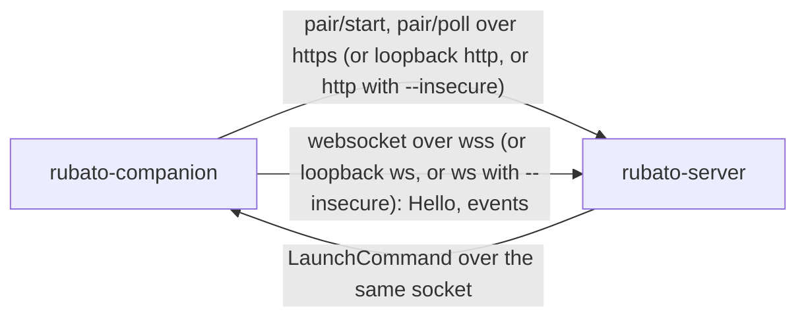

# Companion hardening: refuse plain http off loopback, private launch files

The companion part of #170. The companion accepts `http://` and `ws://` server URLs for any
host, so off loopback the pairing token travels in clear text and launch commands can be
injected on the network. It also writes each launch's files with the default umask. This change
refuses plain-text schemes off loopback unless the developer opts in with `pair --insecure`
(ADR 0067, proposed), and makes the launch directory and its prompt file private, as the hooks
file already is.

## What the change does

- `rubato-companion pair --server <url>` refuses an `http://` or `ws://` URL whose host is not loopback (`localhost`, `127.0.0.0/8`, `::1`), and any scheme other than `http`, `https`, `ws`, `wss`; it sends nothing, writes no `companion.json`, and its error names `--insecure`.
- `rubato-companion pair --insecure --server <url>` accepts an `http://` or `ws://` URL off loopback, logs a warning naming the URL and that the pairing token travels unencrypted, and stores `allow_plain_http: true` in `companion.json`. Pairing again without `--insecure` stores false. A `companion.json` without the field reads as false.
- A daemon whose `companion.json` names such a URL without the opt-in does not connect: its `server_link` task ends with the error, logged as `rubato.task.exited`, and the daemon exits non-zero instead of retrying forever. With the opt-in it starts without a flag and logs the same warning once per start.
- `https://`, `wss://` and loopback `http://` / `ws://` keep working as before, with or without the opt-in.
- Each launch's directory `launches/<id>/` is created with mode 0700, and `prompt.txt` is written with mode 0600 through `write_private`, as `hooks.json` already is.

## How we'll know it works

- [ ] Unit test `kernel::config::tests::server_urls` accepts `https://rubato.example`, `wss://rubato.example`, `http://127.0.0.1:8080`, `http://127.1.2.3`, `http://localhost:8080`, `http://LOCALHOST:8080/`, `http://[::1]:8080`, `ws://127.0.0.1` as protected with and without the opt-in; refuses `http://rubato.example`, `ws://10.0.0.5:8080`, `http://localhost.evil.example`, `http://127.0.0.1.evil.example`, `http://[::ffff:10.0.0.5]`, `ftp://127.0.0.1`, `not a url` without it, with an error naming `--insecure`; with it, returns plain-off-loopback for `http://rubato.example`, `ws://10.0.0.5:8080`, `http://192.168.1.20:8080` and still refuses `ftp://127.0.0.1` and `not a url`.
- [ ] Unit test `kernel::config::tests::an_older_state_file_does_not_allow_plain_http`: a `companion.json` without the field reads as false.
- [ ] Gherkin `pairing.feature` "Pairing refuses a plain-http server off loopback": the pair step fails with an error mentioning "https" and no state file exists.
- [ ] Gherkin `pairing.feature` "A companion paired with a plain-http server off loopback refuses to start": the daemon returns an error mentioning "--insecure" within 5 seconds.
- [ ] Gherkin `pairing.feature` "Pairing with --insecure to a plain-http LAN server succeeds and the daemon starts": a test server on this machine's LAN address; pairing with `--insecure` stores `allow_plain_http`, one "travel unencrypted" warning; the daemon starts, the server receives its hello, and a second warning is logged.
- [ ] Existing pairing and daemon scenarios pass against the loopback test server (`http://127.0.0.1:<port>`).
- [ ] Gherkin `worktree.feature` "A launch creates the worktree and the session" gains a step: the launch directory has mode 0700 and its `prompt.txt` mode 0600.
- [ ] Unit test `server_link::client::tests::ws_urls` still maps `https` to `wss` and loopback `http` to `ws`, maps an opted-in LAN `http` URL to `ws`, and refuses `http://rubato.example` without the opt-in.

## What it must not break

- Local runs against `http://127.0.0.1`: `docs/QUICKSTART.md:266`, `e2e/run.ts:126`, the Gherkin test server; guarded by the pairing and worktree scenarios and the e2e run.
- Existing `companion.json` files parse (the field defaults to false); guarded by `an_older_state_file_does_not_allow_plain_http`.
- The hooks file stays 0600 (`worktree.feature` settings step); #188 rewrites the same lines and must keep it.
- Pairing again keeps the companion id and never touches `seq.json` (existing `pair.rs` tests).

## How we'll debug it at 3 am

See the O-rows. A refused URL in a running daemon surfaces through the existing
`rubato.task.exited` error with `rubato.task=server_link` and an error naming the URL and
`--insecure`; the `pair` command prints the same error. New log line: a `warn` with field
`server=<url>` and the text "travel unencrypted", once at `pair --insecure` and once per daemon
start while `allow_plain_http` is set.

## Affected parts

| Node | Status | What changes | Seams |
| --- | --- | --- | --- |
| rubato-companion | affected | refuses plain-text server URLs off loopback before pairing or connecting unless paired with `--insecure` (stored, warned); launch dir 0700, prompt 0600 | companion-server |
| rubato-server | quiet | nothing; it keeps serving whatever scheme its deployment fronts it with | companion-server |

## Data models

| Model | Kind | Part | Change | Crosses | Note |
| --- | --- | --- | --- | --- | --- |
| companion.json `allow_plain_http` | file | rubato-companion | changed | | new bool, default false, set by `pair --insecure`; older files read as false |
| launches/&lt;id&gt;/prompt.txt | file | rubato-companion | changed | | mode 0600 (was umask); directory mode 0700 |

## Data flow

## Tasks

1. [ ] Failing unit test `kernel::config::tests::server_urls`, then `kernel::config::check_server_url(url, allow_plain_http) -> Transport` (parses with `url`, allows `https`/`wss` anywhere, `http`/`ws` on loopback, and `http`/`ws` elsewhere only with the opt-in, returned as `PlainOffLoopback`) and `warn_plain_http`.
2. [ ] Failing unit test `an_older_state_file_does_not_allow_plain_http`, then `State.allow_plain_http` with `#[serde(default)]`.
3. [ ] Failing Gherkin "Pairing refuses a plain-http server off loopback"; then call the check at the top of `pairing::pair`.
4. [ ] Failing Gherkin "A companion paired with a plain-http server off loopback refuses to start" (fixture: a `companion.json` naming `http://rubato.example.test`, which fails on purpose today by retrying forever); then `ws_url` returns `Result`, `Client::run` checks before its retry loop and returns the error.
5. [ ] Failing Gherkin "Pairing with --insecure to a plain-http LAN server succeeds and the daemon starts" (fails on purpose without the opt-in: the pair step errors); then `pair --insecure` in `main.rs`, `pair_and_save(.., allow_plain_http, ..)` stores it, `Client::allow_plain_http` from `runtime.rs`, the warning in `pair` and in `Client::run`.
6. [ ] Failing Gherkin step on the launch scenario (prompt mode 0644 under the default umask today); then `launch/launcher.rs` creates the launch dir with `DirBuilder` mode 0700 and writes the prompt with `write_private`.
7. [ ] `docs/QUICKSTART.md` section 6: the URL rule and `pair --insecure` for a LAN server.
8. [ ] `cargo fmt`, `cargo clippy -p rubato-companion --all-targets -D warnings`, `cargo test -p rubato-companion`.

## Assumed, not yet approved

| # | Decision | Chosen | Alternatives | Scope |
| --- | --- | --- | --- | --- |
| Q1 | Plain text off loopback | option 2 with persistence, answered by the maintainer in conversation on 2026-11-15: refuse unless `pair --insecure`, stored as `allow_plain_http` in `companion.json`, warned at pair and every start (ADR 0067); still needs the `Approved:` comment | refuse, no flag; warn and continue; a flag on every `run` | seam (companion-server): answered; ADR 0067 proposed, accepted by this plan's approval |
| A1 | What counts as loopback | the host `localhost` exactly, any IPv4 in `127.0.0.0/8`, IPv6 `::1`; not `*.localhost` names | resolve the name and check the address | node (rubato-companion) |
| A2 | Where the check lives | `kernel/config.rs`, beside `State.server_url`, named by both `pairing` and `server_link` | in `server_link`, named by `pairing` | node (rubato-companion) |
| A3 | `launch.sh` mode | unchanged; it holds no secret and now sits in a 0700 directory | write it 0700 too | node (rubato-companion) |
| A4 | Warning frequency in the daemon | once per start, before the retry loop, not per reconnect | per reconnect | node (rubato-companion) |

## O-rows

| Seam | Breaks like | Signal | Panel | Owner |
| --- | --- | --- | --- | --- |
| companion-server | a companion with an off-loopback http URL in its state and no opt-in, or a check too strict for a real deployment, stops connecting; or an opted-in companion sends its token unencrypted | `rubato.task.exited` error log with `rubato.task=server_link` and the refused URL naming `--insecure`; for a companion that reported before, the `rubato.companion.heartbeat` metric stops and `CompanionSilent` (labelled `seam: companion-server`) fires; a fresh `pair` fails on the developer's terminal; an opted-in companion logs a `warn` with `server=<url>` and "travel unencrypted" at every start. The alert pages the seam owner; the developer whose companion refuses fixes the URL | Companions (exists) | rubato-companion |

## Flows

None.

## ADRs proposed

| ADR | File | Blob |
| --- | --- | --- |
| 0067 | docs/decisions/0067-companion-reaches-the-server-over-tls-except-on-loopback.md | b6fbbe58f7e100617a34e715ec21820196be5d33 |

## Review map

1. `crates/rubato-companion/src/kernel/config.rs` — `check_server_url`: the loopback test and the opt-in; `State.allow_plain_http`.
2. `crates/rubato-companion/src/server_link/client.rs` — `ws_url` and the check and warning before the retry loop; `pairing/pair.rs` and `main.rs` for `--insecure`.
3. `crates/rubato-companion/src/launch/launcher.rs` — launch dir 0700, prompt 0600 (conflicts with #188 and #192).
