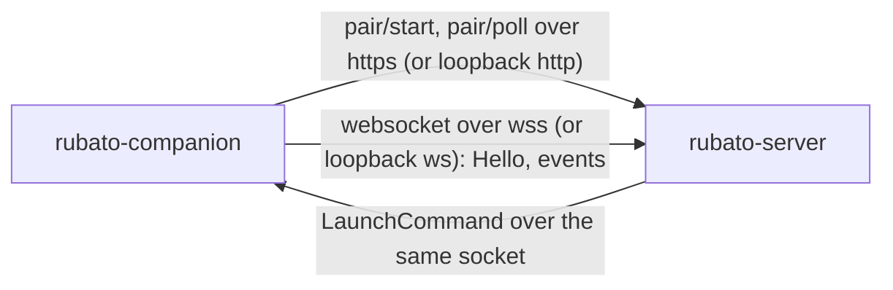

# Companion hardening: refuse plain http off loopback, private launch files

The companion part of #170. The companion accepts `http://` and `ws://` server URLs for any
host, so off loopback the pairing token travels in clear text and launch commands can be
injected on the network. It also writes each launch's files with the default umask. This change
refuses plain-text schemes except on loopback (ADR 0067, proposed) and makes the launch
directory and its prompt file private, as the hooks file already is.

## What the change does

- `rubato-companion pair --server <url>` refuses an `http://` or `ws://` URL whose host is not loopback (`localhost`, `127.0.0.0/8`, `::1`), and any scheme other than `http`, `https`, `ws`, `wss`; it sends nothing and writes no `companion.json`.
- A daemon whose `companion.json` names such a URL does not connect: its `server_link` task ends with the error, logged as `rubato.task.exited`, and the daemon exits non-zero instead of retrying forever.
- `https://`, `wss://` and loopback `http://` / `ws://` keep working as before.
- Each launch's directory `launches/<id>/` is created with mode 0700, and `prompt.txt` is written with mode 0600 through `write_private`, as `hooks.json` already is.

## How we'll know it works

- [ ] Unit test `kernel::config::tests::server_urls` accepts `https://rubato.example`, `wss://rubato.example`, `http://127.0.0.1:8080`, `http://127.1.2.3`, `http://localhost:8080`, `http://[::1]:8080`, `ws://127.0.0.1` and refuses `http://rubato.example`, `ws://10.0.0.5:8080`, `http://localhost.evil.example`, `http://127.0.0.1.evil.example`, `ftp://127.0.0.1`, `not a url`.
- [ ] Gherkin `pairing.feature` "Pairing refuses a plain-http server off loopback": the pair step fails with an error mentioning "https" and no state file exists.
- [ ] Gherkin `pairing.feature` "A companion paired with a plain-http server off loopback refuses to start": the daemon returns an error mentioning "https" within 5 seconds.
- [ ] Existing pairing and daemon scenarios pass against the loopback test server (`http://127.0.0.1:<port>`).
- [ ] Gherkin `worktree.feature` "A launch creates the worktree and the session" gains a step: the launch directory has mode 0700 and its `prompt.txt` mode 0600.
- [ ] Unit test `server_link::client::tests::ws_urls` still maps `https` to `wss` and loopback `http` to `ws`, and now refuses `http://rubato.example`.

## What it must not break

- Local runs against `http://127.0.0.1`: `docs/QUICKSTART.md:266`, `e2e/run.ts:126`, the Gherkin test server; guarded by the pairing and worktree scenarios and the e2e run.
- The hooks file stays 0600 (`worktree.feature` settings step); #188 rewrites the same lines and must keep it.
- Pairing again keeps the companion id and never touches `seq.json` (existing `pair.rs` tests).

## How we'll debug it at 3 am

See the O-rows. No new log line: a refused URL in a running daemon surfaces through the existing
`rubato.task.exited` error with `rubato.task=server_link` and an error naming the URL and
"https"; the `pair` command prints the same error on stderr.

## Affected parts

| Node | Status | What changes | Seams |
| --- | --- | --- | --- |
| rubato-companion | affected | refuses plain-text server URLs off loopback before pairing or connecting; launch dir 0700, prompt 0600 | companion-server |
| rubato-server | quiet | nothing; it keeps serving whatever scheme its deployment fronts it with | companion-server |

## Data models

| Model | Kind | Part | Change | Crosses | Note |
| --- | --- | --- | --- | --- | --- |
| launches/&lt;id&gt;/prompt.txt | file | rubato-companion | changed | | mode 0600 (was umask); directory mode 0700 |

## Data flow

## Tasks

1. [ ] Failing unit test `kernel::config::tests::server_urls`, then `kernel::config::check_server_url` (parses with `url`, allows `https`/`wss` anywhere and `http`/`ws` on loopback hosts only).
2. [ ] Failing Gherkin "Pairing refuses a plain-http server off loopback"; then call the check at the top of `pairing::pair`.
3. [ ] Failing Gherkin "A companion paired with a plain-http server off loopback refuses to start" (fixture: a `companion.json` naming `http://rubato.example.test`, which fails on purpose today by retrying forever); then `ws_url` returns `Result`, `Client::run` calls it before its retry loop and returns the error.
4. [ ] Failing Gherkin step on the launch scenario (prompt mode 0644 under the default umask today); then `launch/launcher.rs` creates the launch dir with `DirBuilder` mode 0700 and writes the prompt with `write_private`.
5. [ ] `cargo fmt`, `cargo clippy -p rubato-companion --all-targets -D warnings`, `cargo test -p rubato-companion`.

## Assumed, not yet approved

| # | Decision | Chosen | Alternatives | Scope |
| --- | --- | --- | --- | --- |
| Q1 | Plain text off loopback | refuse it, no override flag (ADR 0067) | an `--insecure` flag; warn and continue | seam (companion-server): ADR 0067 proposed, accepted by this plan's approval |
| A1 | What counts as loopback | the host `localhost` exactly, any IPv4 in `127.0.0.0/8`, IPv6 `::1`; not `*.localhost` names | resolve the name and check the address | node (rubato-companion) |
| A2 | Where the check lives | `kernel/config.rs`, beside `State.server_url`, named by both `pairing` and `server_link` | in `server_link`, named by `pairing` | node (rubato-companion) |
| A3 | `launch.sh` mode | unchanged; it holds no secret and now sits in a 0700 directory | write it 0700 too | node (rubato-companion) |

## O-rows

| Seam | Breaks like | Signal | Panel | Owner |
| --- | --- | --- | --- | --- |
| companion-server | a companion with an off-loopback http URL in its state, or a check too strict for a real deployment, stops connecting | `rubato.task.exited` error log with `rubato.task=server_link` and the refused URL; for a companion that reported before, the `rubato.companion.heartbeat` metric stops and `CompanionSilent` (labelled `seam: companion-server`) fires; a fresh `pair` fails on the developer's terminal. The alert pages the seam owner; the developer whose companion refuses fixes the URL | Companions (exists) | rubato-companion |

## Flows

None.

## ADRs proposed

| ADR | File | Blob |
| --- | --- | --- |
| 0067 | docs/decisions/0067-companion-reaches-the-server-over-tls-except-on-loopback.md | b781b77df23e7123fffd215b350a25ff8a2319c3 |

## Review map

1. `crates/rubato-companion/src/kernel/config.rs` — `check_server_url`: the loopback test.
2. `crates/rubato-companion/src/server_link/client.rs` — `ws_url` and the check before the retry loop.
3. `crates/rubato-companion/src/launch/launcher.rs` — launch dir 0700, prompt 0600 (conflicts with #188 and #192).
