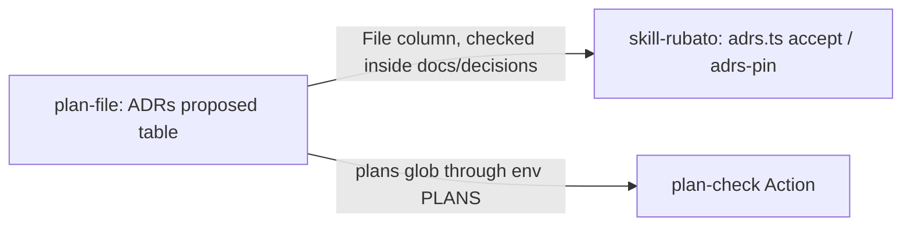

# CI and skill hardening: pin actions and downloads, plan-check lockfile and env inputs

The CI and skill part of #170. Third-party actions are pinned by a moving tag
(`.github/workflows/ci.yml:18,21,43`, `publish-observability.yml:37`, `actions/plan-check/action.yml:22`);
CI downloads tmux, a `latest` promtool and a global `tmux-ide` with no pin or checksum
(`ci.yml:28-30,99-110`); the plan-check Action runs `npm install` with no lockfile in every
consumer's workflow and interpolates `${{ inputs.map }}` and `${{ inputs.plans }}` into `run:`
(`action.yml:27,35`); `publish-observability.yml` installs with lifecycle scripts in the job that
later gets `GRAFANA_API_TOKEN` (`:42-58`); and `adrs.ts accept` and `plan.ts adrs-pin` join a
path taken from the plan's `## ADRs proposed` table with no containment check
(`skills/rubato/scripts/adrs.ts:100,189`). This closes each of those.

## What the change does

- Every third-party action in `.github/workflows/*.yml` and `actions/plan-check/action.yml` is pinned to a full commit SHA, with the release tag it was resolved from in a comment (`# v4.4.0`); `dtolnay/rust-toolchain` is pinned to the commit of its `stable` branch, commented `# stable`.
- CI builds tmux 3.8 only after `sha256sum -c` passes on the tarball, against the sha256 GitHub publishes for that release asset.
- CI runs promtool 3.16.0, not `latest`, checked against the release's `sha256sums.txt` entry; the GitHub API call that looked up `latest` is gone.
- CI installs `tmux-ide@2.9.24` instead of whatever is newest. npm checks the registry's integrity hash; no independent checksum is pinned (the GitHub release ships no npm tarball).
- `publish-observability.yml` installs with `pnpm install --frozen-lockfile --ignore-scripts`; the check, tests and publish steps run the same.
- The plan-check Action installs from a committed `actions/plan-check/package-lock.json` with `npm ci --ignore-scripts --omit=dev`, so a consumer's run gets the versions this repo tested, with no install scripts.
- The Action passes `map`, `plans` and `github.action_path` to its step through `env` and quotes them, as `maps` already is; an input with a `"`, `$(…)` or `;` is a path, never shell.
- `adrs.ts accept` refuses, per row, an ADR whose file resolves outside the map repo's decisions folder (a `..`, an absolute path, or a symlink that leads out), with reason `outside_decisions`, and writes nothing to it. `plan.ts adrs-pin` refuses such a row with an error and leaves the plan unchanged.

## How we'll know it works

- [x] A YAML parse (Node `yaml`) of the three workflow and action files succeeds, and a scan finds no `uses:` line without a 40-hex SHA and a `# <tag>` comment (run by hand; the count of `uses:` lines is printed).
- [x] `actions/plan-check`: `npm ci --ignore-scripts --omit=dev` in a fresh copy of the folder installs from the lockfile, and `node --experimental-strip-types src/cli.ts` on this repo's map and plans passes there (run by hand).
- [x] The Action's check step, run by hand in bash with `MAP`, `PLANS` and `ACTION_PATH` set the way `env:` sets them, checks this repo's plans; with `PLANS='docs/plans/*.md"; touch pwned; "'` it treats the value as a glob and creates no file.
- [x] `pnpm install --frozen-lockfile --ignore-scripts`, then `pnpm observability:check` and `pnpm observability:test` pass locally (done before the plan: 37 tests pass).
- [x] `skills/rubato/test/approval.test.ts` "refuses an ADR file outside the decisions folder": rows `../outside.md`, `docs/decisions/../../outside.md`, an absolute path, and a symlink in `docs/decisions` pointing out are each refused `outside_decisions`; the target file is unchanged; the in-folder 0099 row is still accepted. Fails on today's code.
- [x] `approval.test.ts` "adrs-pin refuses a row outside the decisions folder": `pinAdrs` throws naming the row, the plan file is byte for byte unchanged. Fails on today's code.
- [ ] CI on the pull request is green: the Rust, Node, web and e2e jobs run with the pinned actions, tmux, tmux-ide and promtool.

## What it must not break

- CI as it is: every job, the companion's Gherkin suite against tmux 3.8 and tmux-ide, the promtool rule tests and mutants. Guarded by CI on this pull request.
- Consumers of the plan-check Action: the same inputs, defaults and `rubato.plan.check` line. Guarded by plan-check's Vitest suite and the Node job's plan check on this repo.
- Accepting an in-folder ADR and pinning in-folder rows: the existing `adrs.ts accept` and `plan.ts wait` tests in `approval.test.ts`, unchanged.
- The publish workflow's dashboard and rule publish. pnpm 10 already skips dependency build scripts unless allowed, and the root package has no lifecycle scripts, so `--ignore-scripts` changes nothing that runs today; guarded by `observability:check` and `observability:test` locally, and the next run on main.

## How we'll debug it at 3 am

A pinned download whose bytes change fails CI at `sha256sum -c` with the file name, in the step that downloads it; a moved action tag no longer moves CI. A refused ADR row shows in the `rubato.adrs.accept` line as `refused: [{adr, reason: "outside_decisions"}]`, and `adrs-pin` exits 2 with "ADR file outside docs/decisions: <file>". See the O-rows.

## Affected parts

| Node | Status | What changes | Seams |
| --- | --- | --- | --- |
| plan-check | affected | `action.yml`: pinned `setup-node`, `npm ci --ignore-scripts` from a committed lockfile, inputs through `env` | plan-check-plan-file |
| skill-rubato | affected | `adrs.ts`: ADR paths from a plan must resolve inside the decisions folder, for `accept` and `adrs-pin` | skill-plan-file |

## Data models

<!-- ADR 0031. -->

| Model | Kind | Part | Change | Crosses | Note |
| --- | --- | --- | --- | --- | --- |
| `actions/plan-check/package-lock.json` | file | plan-check | new | | npm lockfile for `ajv` and `yaml`, installed with `npm ci` |

## Data flow

## Tasks

1. Failing tests first in `skills/rubato/test/approval.test.ts`: "refuses an ADR file outside the decisions folder" (four escaping rows, including a symlink) and "adrs-pin refuses a row outside the decisions folder". Both fail on today's code.
2. `adrs.ts`: a `decisionFile(cwd, dir, file)` helper that resolves the row and checks it lexically and through `realpath` against the decisions folder; `accept` refuses the row with `outside_decisions` before reading it; `pinAdrs` takes the decisions folder (from the map whose repo is `cwd`'s origin, else `docs/decisions`) and throws before writing. `plan.ts adrs-pin` passes it.
3. `actions/plan-check`: `npm install --package-lock-only` to write `package-lock.json`; `action.yml` uses `npm ci --ignore-scripts --omit=dev --no-audit --no-fund`, the pinned `setup-node`, and `env` for `MAP`, `PLANS` and `ACTION_PATH`. Check by hand as in "How we'll know it works", including the hostile `PLANS` value.
4. Workflows: pin every `uses:` to its SHA with the tag comment; tmux tarball and promtool checked with `sha256sum -c`; promtool 3.16.0; `tmux-ide@2.9.24`; `--ignore-scripts` in `publish-observability.yml`. YAML parse and the `uses:` scan by hand.
5. `pnpm test` in `skills/rubato` and `actions/plan-check`, `pnpm typecheck`, `plan.ts check`, the Node job's plan check.

## Assumed, not yet approved

| # | Decision | Chosen | Alternatives | Scope |
| --- | --- | --- | --- | --- |
| A1 | tmux-ide has no independent checksum | pin `tmux-ide@2.9.24` and rely on npm's registry integrity check | a tiny CI-only package with its own lockfile; download the npm tarball and pin its sha256 | node |
| A2 | Where the tmux checksum comes from | the sha256 GitHub records for the 3.8 release asset (tmux publishes no checksum file) | build from a pinned git commit instead of the release tarball | node |
| A3 | Keeping pins current | by hand, each bump in its own small PR | Dependabot for `github-actions` (a new configuration file and bot PRs) | node |
| A4 | `adrs-pin` on a row outside the folder | refuse the whole command, writing nothing | skip the row and pin the rest | node |
| A5 | Track | small: no seam contract, schema or wire type changes; the Action's inputs and output are the same, only how it installs and quotes | full, since `action.yml` is what other repos call | node |

## O-rows

| Seam | Breaks like | Signal | Panel | Owner |
| --- | --- | --- | --- | --- |
| plan-check-plan-file | the Action fails to install from the lockfile, or no longer finds the plans the glob names, so a PR is failed or passed without its plans checked | the install step failing in the consumer's job, or the job printing fewer `rubato.plan.check` lines (one per plan, with `ok`) than there are plan files; the plan-check → plan-file edge on the servicegraph (ADR 0061) going quiet | Plan check log lines | plan-check |
| skill-plan-file | an in-folder ADR is refused as outside (a symlinked checkout, a `decisions:` path with `..`), so an approved plan's ADRs stay proposed | the `rubato.adrs.accept` line with `refused: [{reason: "outside_decisions"}]`; its `rubato.skill.command` span for `adrs accept` with `rubato.exit_code` 1 | Skills emitting | skill-rubato |

## Flows

| From | To | Seam | Kind | Carries |
| --- | --- | --- | --- | --- |
| plan-file | plan-check | plan-check-plan-file | data | plan files named by the `plans` glob, passed through env |
| skill-rubato | plan-file | skill-plan-file | data | the ADRs proposed table's Blob column, only for files inside the decisions folder |

## ADRs proposed

None.

## Review map

1. `actions/plan-check/action.yml`: the `npm ci` step and the `env` block of the check step.
2. `skills/rubato/scripts/adrs.ts`: `decisionFile` and its two callers.
3. `.github/workflows/ci.yml`: the tmux and promtool steps with their checksums.
