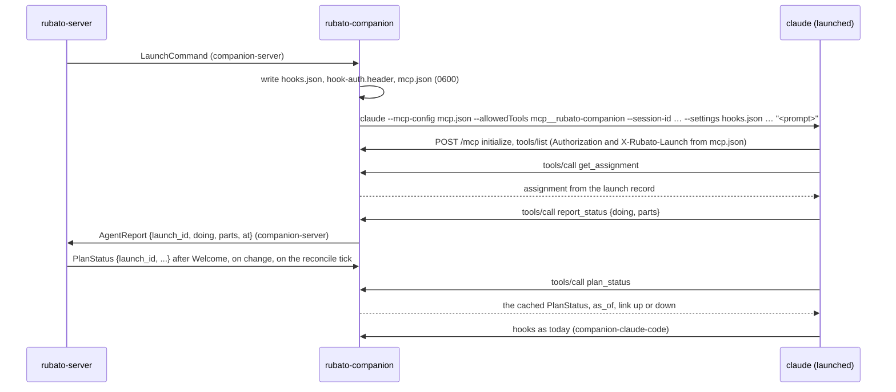

# 197: agents report to Rubato through one MCP server in the companion

Plan: [../197.md](../197.md) · ADR: [0071](../../decisions/0071-agent-mcp-in-the-companion.md)
(proposed) · Issue: m0x6A/rubato#197 · Map: new seam `companion-mcp` (rubato-companion —
claude-code; the agent calls the companion), flows changed on `companion-server`,
`companion-claude-code` and `web-server`.

This is a design issue. It decides where the agent-facing MCP server runs, what it offers and
what it never does, and splits the build into one follow-up issue per slice. Nothing here is
built in this PR; the map and the ADR are.

## 1. How an agent reports today

| What Rubato knows | Channel | Identity check | Code |
| --- | --- | --- | --- |
| Lifecycle and status (working, idle, blocked, ended) | Claude Code hooks, rendered per launch into `--settings`, posted to the loopback hook receiver, forwarded over the companion websocket (ADR 0013, ADR 0063) | the per-start token (constant time) and `X-Rubato-Launch` | `crates/rubato-companion/src/hooks/server.rs:119`, `:149`; `launch/launcher.rs:200-210` |
| Status of sessions Rubato did not start | `tmux-ide team --json` (ADR 0003), going away with #147 (its ADR, to be numbered 0070, is on that issue's branch) | the pane's cwd → branch | `sessions/tasks.rs`, `sessions/discovery.rs` |
| Where it is (repo, issue, branch) | derived: pane cwd or launch worktree → branch → issue (ADR 0006, ADR 0062) | the branch rule `issue/<n>-<slug>` | `sessions/identity.rs:50`, `launch/script.rs:51` |
| What it is doing | nothing but what a hook implies | — | — |
| Plan draft | the companion mirrors the plan bundle from the worktree at each settle point (ADR 0053) | the launch's worktree and owner | `plan_mirror/arm.rs:26` |
| Plan on the branch, approval record | the plan file at the branch head, read by the server (ADR 0009, ADR 0054) | the branch | server slices `plans`, `approve` |
| Review | `Review:` comments by a team member (ADR 0027), or the `Review:` reply in Rubato mode (ADR 0056) | team membership | `IssueSummary.review` (`rubato-protocol/src/progress.rs:228`) |
| Approval, to the agent | a `plan_approved` session message typed in as a prompt, with the `plan.ts handoff` command (ADR 0055); before the cutover, an `Approved:` comment the agent reads with `gh` | the paired user's own launch | server `approve/deliver.rs`, `approve/merged.rs:79`; companion `session_input` |
| Handoff outcome | `plan.ts handoff` posts its line to `/handoff` on the same receiver | the token and `X-Rubato-Launch` | `hooks/server.rs:120`, `hooks/handoff.rs` |

What the agent cannot do today: say in one line what it is working on, or ask Rubato a question
about itself ("which map parts is my issue pinned to?", "is my plan approved, at which
revision?"). It reads the issue with `gh`, the map from a local clone, and waits for a prompt.

## 2. What changes

One MCP server, named `rubato-companion` (so its tools are `mcp__rubato-companion__*`), offered
to every session Rubato launches. Three tools:

| Tool | Kind | Answers from | Never |
| --- | --- | --- | --- |
| `get_assignment` | read-only (`readOnlyHint`) | the companion's own launch record: repo, issue, branch, worktree, the map node and seam ids the issue was pinned to at launch, `map_version`, `plan_path`, planning mode, spend cap, attempt and attempt limit, spend so far | asks the server |
| `report_status` | signal | the agent: `doing` (one line, at most 200 characters) and `parts` (at most 8 map ids) | sets a progress state; touches the session's registry entry (§5) |
| `plan_status` | read-only (`readOnlyHint`) | the last `PlanStatus` the server pushed for this launch (§8): draft revision and whether it fits, the newest review, the counted approval whatever its source, whether the branch carries it; with `as_of` and whether the link is up; `unknown` before the first push | writes anything; waits |

Each tool takes an optional `issue` (`owner/name#n`), kept as a mistake catcher: when it is given
and is not the launch's issue, the call is refused with `reason: identity` and counted. It never
selects anything.

Not in this change, each a row in the plan's Decisions table:

- **No `submit_plan_draft`.** Drafts already reach Rubato from the worktree through the plan
  mirror (ADR 0053), at settle points, hashed. A second path would race the first.
- **No `wait_for_approval`.** The approval already arrives as a prompt (ADR 0055), and
  `plan_status` can be polled. A blocking tool would hold an HTTP request open across turns.
- **No map or ADR resources yet.** The skill keeps `map.ts` and `adrs.ts`, which read the local
  clone at a known sha (ADR 0010). A `rubato://map` resource is worth it once an agent-only
  client has no clone (#134); it is a later issue, not a slice here.
- **No tool that writes an approval, a review, a decision or a pin.** See §6.

## 3. Where it runs (Q1)

**In the companion, on the hook receiver's loopback port, as MCP over HTTP at `POST /mcp`.**

Why there:

- **Identity is already there.** The companion holds the launch record, the paired user and the
  worktree. A server-side MCP server would need a token per session and its own way to bind it to
  a launch, which is what #160 and #162 showed is easy to get wrong.
- **No inbound access.** The agent is a child of the companion's own launch on the same machine;
  the companion still only dials out to the server (ADR 0004). The loopback port already exists
  for hooks and `/handoff` (`hooks/server.rs:80,92`, bound to 127.0.0.1); it gains one route.
- **It works without the server.** `get_assignment` never needs the network; `plan_status`
  answers with its age when the link is down.

Why HTTP on the receiver and not stdio: Claude Code would spawn a stdio server as its own child
process (`rubato-companion mcp`), which then needs to reach the running companion anyway, with a
token of its own. That is a second hop and a second process to supervise. The receiver already
has the listener, the token, the constant-time check (`hooks/server.rs:130`) and the launch
header; Claude Code's MCP config takes an `http` server with `headers`.

**Launch flags.** `--mcp-config <configs...>` and `--allowedTools <tools...>` each take a list,
so they must not sit next to the prompt, the last positional word of `launch.sh`
(`launch/script.rs:135-142`). Both go first, right after the `claude` command and before
`--session-id`; in the headless turn script they go before `"$@"` (`launcher.rs:270`), whose
first word is `-p`. A `launch/script.rs` test runs the script against a stand-in `claude` that
prints its argv and checks the prompt still arrives as the last positional word.

The token reaches the session in `mcp.json`, written 0600 next to `hooks.json` and
`hook-auth.header` in the launch dir, and named on the command line only by path (ADR 0063 holds:
no token on any command line; `hooks/template.rs:47` `renders_embedded_template_without_the_token`
is the existing guard, extended to the exec line). `--strict-mcp-config` is not passed, so the
developer's own MCP servers still load. `--allowedTools mcp__rubato-companion` lets a headless
turn, which cannot answer a permission prompt, call the tools; it allows only this server's tools.
The server name `rubato-companion` is chosen so a repo's `.mcp.json` is unlikely to define one; a
Gherkin scenario with a project `.mcp.json` that defines `rubato-companion` pins which definition
Claude Code uses.

Against #147's design note §8, which put a later MCP server on `rubato-server`: that note was
thinking of an agent asking about *other* agents. This one answers the agent's own questions and
nothing else, which is the companion's knowledge; a team-wide question stays the web's job.

## 4. Identity (Q3)

The launch is the identity: the companion writes the launch id into `mcp.json` as
`X-Rubato-Launch`, and `/mcp` resolves it to the launch record. A request without a known launch
id gets HTTP 401 and counts `rubato.mcp.calls{rubato.outcome="refused", rubato.reason="no_launch"}`;
a call whose `issue` is another issue gets a tool error and counts `rubato.reason="identity"`.

Headless sessions (ADR 0062) are the same: the turn script passes the same `--mcp-config`, and
the launch id is the identity. A room's forked turn (ADR 0057) gets neither hooks nor MCP, as
today: forks never use `turn.sh` and `LAUNCH_ENV` strips the `RUBATO_*` variables
(`kernel/claude.rs:387`, `:452-490`); a `kernel/claude.rs` test pins that their arguments name no
`--mcp-config`.

On the server, an `AgentReport` is accepted only for a launch this pairing started, the same rule
as #162's fix for `CapHit`; anything else is dropped and counted
`rubato.events.dropped{rubato.reason="agent_report"}`. Map ids in `parts` that the workspace's map
does not have are dropped from the report and counted, never stored.

**Trust boundary: one OS user.** The receiver's token is per companion, not per launch
(`hooks/server.rs:32`); it is in the state dir's header file for manual sessions (ADR 0063) and
exported to every launched session as `RUBATO_HOOK_TOKEN`, next to `RUBATO_LAUNCH_ID`
(`launch/script.rs:73-88`). Launch ids are in `launches.json`. So a process of the same OS user can
call `/mcp` as another of that user's launches, as it can already post a hook for one. Launches of
one OS user are not isolated from each other, as in ADR 0063, whose threat is another OS user and
stays covered by the 0600 files. The harm is cosmetic (another of your own sessions' line, never
progress or approval). A per-launch token would not change this while `/hook` takes the shared one;
if hooks ever get per-launch tokens, `/mcp` follows.

## 5. Hooks stay (Q2)

Hooks are unchanged: the template, the receiver route, the `--settings` injection, the trust rule.
MCP carries only what the agent says on purpose.

- An agent that never calls MCP shows exactly as today.
- **`report_status` touches nothing in the companion's session registry:** not `status`, not
  `source`, not `last_seen` (which turns *working* into *unknown*, `session.rs:203-209`, and drives
  the stale sweep, `stale/sweep.rs:30`), not `last_hook_at` (`hooks/apply.rs:67-78`). The report
  lives in the `agent_mcp` slice's own map, with its own `at`.
  - Companion test: apply a report to a live entry; the next `Sessions` snapshot is byte-equal to
    the one before, and after the heartbeat interval the sweep still emits `rubato.session.stale`.
  - Server test: an `AgentReport` leaves `app.sessions` and the stored `session_snapshots` row
    unchanged.
- `derive_progress` does not read agent reports: its signature takes none
  (`rubato-protocol/src/progress.rs`). *Blocked* still comes from a hook or a cap hit, *Designing*
  and *Building* from the session and the plan.
- `SessionWorkingNoHooks` reads only hook and session series (`observability/alerts/rubato.rules.yml:20-24`);
  nothing in this change feeds it, so it keeps firing as today.

## 6. Plans and approval (Q4, Q5)

ADR 0053 holds: drafts come from the worktree through the plan mirror, and the approved plan
reaches the branch as a file at handoff. MCP only reads plan status.

No tool writes an approval. The real guard is structural: approval is a web route only (ADR 0054,
"agents and companions have no route to approve"), and `companion_link` reaches `approve` only
through `on_launch_started` and `on_handoff_report` (`companion_link/ws.rs:372`,
`approve/mod.rs:15-18`). Two tests hold it in place:

1. **Server, every companion message:** a test replays every `CompanionMessage` fixture in
   `crates/rubato-protocol/fixtures/` (an `AgentReport` among them) through `on_envelope` and
   asserts `rubato_approvals` and `plan_approvals` are unchanged. It prints how many fixtures it
   replayed, and fails when a new kind writes either table; a must-fail fixture is a test-only
   handler that inserts an approval row.
2. **Companion, every tool:** a test lists every tool and fails when a tool without `readOnlyHint`
   has a name or description matching `approv|accept|merge|handoff`. It prints how many tools it
   checked; a must-fail fixture adds a write tool `approve_plan`. It is the cheaper, second guard.

## 7. Scope against #147 (Q6)

The MCP server serves sessions Rubato launched, interactive or headless. It does not replace
`tmux-ide team --json` for sessions a developer starts by hand; #147 settles those (opt in with
`hooks.ts`, or *unknown*). A manual session could later be offered the same `mcp.json` by the
skill, but it has no launch id, so that needs its own identity rule and its own ADR.

## 8. Wire and storage

All additive; an older server or companion ignores what it does not know, gated by a capability.

| Model | Where | Shape |
| --- | --- | --- |
| `CompanionMessage::AgentReport` | companion → server | `{ launch_id, doing, parts: [id], at }` |
| `ServerMessage::PlanStatus` | server → companion | `{ launch_id, as_of, draft: {rev, at, fits} \| null, review: {track, outcome, plan_sha} \| null, approval: {source: comment \| rubato, by, at, plan_sha, comment_url \| approval_id, stale} \| null, branch: {sha, carries_approval} \| null }` |
| capability `agent_mcp` | both `Hello` and `Welcome` | the companion sends `AgentReport` only to a server that announced it; the server pushes `PlanStatus` only to a companion that announced it |
| `mcp.json` | companion launch dir, 0600 | `{"mcpServers":{"rubato-companion":{"type":"http","url":"http://127.0.0.1:<port>/mcp","headers":{"Authorization":"Bearer <token>","X-Rubato-Launch":"<id>"}}}}` |
| `LaunchRecord` | companion `launches.json` | gains `node_ids`, `map_version`, `planning`, `attempt`, `attempt_limit` (serde default) |
| `PlanStatus` cache | companion, `agent_mcp`, in memory | latest per launch; empty after a companion restart, so `plan_status` answers `unknown` until the first push |
| table `agent_reports` | server, new slice `agent_reports`, migration `0024_agent_reports.sql` (or the next free number) | one row per launch: `launch_id` (key), `companion_id`, `doing`, `parts`, `reported_at` |
| `companion_events` payload | server, `companion_link` | `AgentReport` stored with an empty payload in `stored_payload` (`ws.rs:574-585`), as ADR 0052 asks of new kinds |

**`PlanStatus` content.** Derived in `approve` (which already reads `plan_drafts` and
`github_poll`):
- `approval` from `approve::approvals()` (`approve/merged.rs:79`), the merged list of counted
  `Approved:` comments and Rubato approvals with their source. While the cutover is unset every
  counted approval is a comment (ADR 0054), and `plan_status` reports it as approved;
- `review` from the issue's newest counted `Review:` record (`IssueSummary.review`);
- `draft` from `plan_drafts`; `branch` from the plan read at the branch head, and whether its
  front matter carries the approval record.

**When it is sent.** `approve` recomputes `PlanStatus` for every live launch of a companion that
announced `agent_mcp`:
- after each `Welcome` to that companion (reason `welcome`);
- on `approve`'s reconcile tick, sending only what differs from the last one sent (reason
  `change`).
`companion_link` calls `approve::on_welcome(app, companion_id)` after it sends the Welcome; it
already names `approve` (`on_launch_started`, `ws.rs:372`), so the edge exists, and `approve`
sends through the kernel's `send_to_companion`, never through `companion_link`. The
last-sent map is per companion connection and cleared on disconnect, so a reconnect always gets a
fresh push. `send_to_companion` returns false for a companion that is offline
(`kernel/state.rs:302-307`); that is counted, and the next Welcome repairs it. Counter
`rubato.plan_status.sent{rubato.reason="welcome"|"change", rubato.outcome="sent"|"offline"}`.

**`agent_reports` retention.** Upserted only when the incoming `at` is newer than the stored one
(replays after a reconnect are older and ignored). In the `Sessions` arm of `companion_link`, rows
of that companion whose `launch_id` is not in its newest snapshot are deleted. Rollback: the table
is read only by `agent_reports`; dropping it loses nothing else.

**What leaves the machine (ADR 0052).** The `doing` line (at most 200 characters) and `parts` of a
launched session's report leave the machine. This is new text an agent writes, so ADR 0071
supersedes ADR 0052 in part, and `rubato-companion pair`'s "what leaves the machine" text names it.
The server keeps it only in `agent_reports`, never in `companion_events`, and never posts it to
GitHub. It is shown to everyone who may log in, as the session log is (ADR 0052). It is agent text
that may echo an issue body: React escapes it and the CSP from #204 applies.

`report_status` is throttled in the companion: at most one `AgentReport` per launch per 5 s; a
newer report replaces a pending one, so the server sees the latest. Throttled calls succeed for
the agent and count `rubato.outcome="coalesced"`.

## 9. MCP subset

Streamable HTTP, JSON-RPC 2.0 over `POST /mcp`, answered with `application/json` (no SSE stream:
the server never sends unprompted). Hand-written in the slice (about the size of `hooks/wire.rs`)
rather than a new SDK dependency; the follow-up may swap in `rmcp` if the subset grows, with its
own ADR. The transport rules it must keep:

- Requests: `initialize`, `ping`, `tools/list`, `tools/call`; anything else `-32601`.
- Notifications (`notifications/initialized` and any other message without an `id`) get `202
  Accepted` with no body, never a JSON-RPC answer.
- `initialize` answers a `protocolVersion` the slice supports: the client's when it is one of the
  list the slice pins, otherwise the newest it supports.
- No `Mcp-Session-Id` is issued, so a companion restart on the same port stays transparent.
- `GET /mcp` is `405`; a present `Origin` header that is not a loopback origin is `403`, as the
  spec requires of a localhost server.
- A `401` makes Claude Code try OAuth discovery (`GET /.well-known/*`); those get `404` and count
  `rubato.mcp.calls{rubato.outcome="refused", rubato.reason="discovery"}`, and the session shows
  the server as needing authentication.

## 10. What we'd lose, what to watch

- **A second thing on the loopback port.** A bug in `/mcp` could take the receiver down with it.
  The route has its own body limit (64 KiB) and a test floods `/mcp` while `/hook` and `/handoff`
  keep answering.
- **A server that never starts in a session.** If `initialize` fails, Claude Code carries on
  without it and the companion sees no calls at all. So the companion counts
  `rubato.mcp.not_initialized` once per launch that has had no `initialize` 5 minutes after start,
  and spans each `initialize` with `rubato.launch_id`.
- **Agents that report too much.** The throttle and the 200-character line bound it; the counter
  shows who calls what.
- **A signal people mistake for progress.** The web shows the line next to the session with its
  age, in the session's own lane and the issue's detail, never as a state chip.
- **Stale plan status.** `plan_status` always says `as_of`; the agent is told to treat an old one
  as unknown (skill follow-up).

## 11. Observability

| Signal | Where | Attributes |
| --- | --- | --- |
| span `rubato.mcp.call` | companion, per request, `initialize` included | `rubato.mcp.tool` (or the method), `rubato.launch_id`, `rubato.issue`, `rubato.outcome`, `rubato.reason` |
| counter `rubato.mcp.calls` | companion | `rubato.mcp.tool`, `rubato.outcome` (`ok`, `refused`, `coalesced`, `error`), `rubato.reason` |
| counter `rubato.mcp.not_initialized` | companion | `rubato.companion_id` |
| log `warn!(rubato.launch_id, rubato.mcp.tool, rubato.reason, "mcp call refused")` | companion | |
| span `rubato.inbound_event` (exists), kind `agent_report` | server, per inbound `AgentReport` | `rubato.companion_id`, `rubato.launch_id`, `rubato.issue`, `rubato.outcome` |
| counter `rubato.plan_status.sent` | server | `rubato.reason`, `rubato.outcome` |
| `rubato.events.dropped{rubato.reason="agent_report"}` | server | a report for a launch this pairing did not start, or an unknown part |
| panel "MCP calls by tool and outcome" | Trust check row of `rubato-overview.json` | `rubato_mcp_calls_total`, `rubato_mcp_not_initialized_total` |

`SessionWorkingNoHooks` is unchanged (§5).

## 12. Follow-ups, one per slice

| # | Slice | What |
| --- | --- | --- |
| 1 (#220) | `rubato-protocol` (`session`, `plan_draft`, `message`, `otel`) | `AgentReport`, `PlanStatus`, capability `agent_mcp`, otel names, schemas, `protocol.ts`, an `AgentReport` fixture |
| 2 (#221) | companion `agent_mcp` (new) | the MCP subset (§9), three tools, identity check, throttle, the not-initialized count, the tool guard; AGENTS.md companion block |
| 3 (#222) | companion `hooks` | mount `/mcp` on the receiver behind the same token check, with a body limit and the flood test |
| 4 (#223) | companion `launch` | write `mcp.json`, pass `--mcp-config` and `--allowedTools` first in `launch.sh` and the headless turn script; the argv test |
| 5 (#224) | companion `sessions` | `LaunchRecord` gains the assignment fields; lookup by launch id |
| 6 (#225) | companion `server_link` | send `AgentReport` when the server announced `agent_mcp`; receive `PlanStatus` into the slice's cache; the `pairing` slice's what-leaves-the-machine text (`pairing/mod.rs`) names the report |
| 7 (#226) | server `companion_link` | accept `AgentReport` only for this pairing's launches; empty payload in `companion_events`; delete stale `agent_reports` rows on `Sessions`; the every-fixture approval test |
| 8 (#227) | server `agent_reports` (new) | the table and its migration, the overview field; AGENTS.md server block |
| 9 (#228) | server `approve` | derive `PlanStatus` per live launch from `approvals()`, the review, drafts and the branch; send after Welcome and on change |
| 10 (#229) | web `companions` | show the line and its age on the session in the lane and in the issue detail |
| 11 (#230) | skill `rubato` | SKILL.md: call `get_assignment` first, `report_status` at phase changes, `plan_status` instead of guessing; hooks.ts unchanged |

Order: 1, then 5 and 3, then 2 and 4, then 6–9, then 10 and 11. Open PRs touch the same files and
land first: #147's companion PR and #199 (`launch/launcher.rs`, `runtime.rs`,
`server_link/client.rs`) before 3, 4 and 6; #204 (`companion_link/ws.rs`) before 7.
