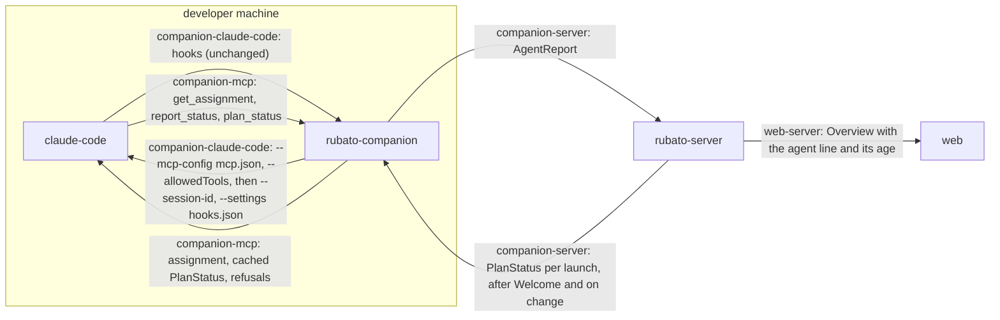

# Agents report to Rubato through one MCP server in the companion

Issue: #197 · Design: [197-agent-mcp/design.md](197-agent-mcp/design.md) · ADR:
[0071](../decisions/0071-agent-mcp-in-the-companion.md) (proposed, supersedes parts of 0004, 0052
and 0062) · Map: new seam `companion-mcp`, flows changed on `companion-server`,
`companion-claude-code` and `web-server`.

Track: **full**: a new seam in `docs/design/rubato-map.yml`, new flows on three seams, and the
build changes `schema/protocol/*.json`.

An agent tells Rubato about itself only through side channels (hooks, the branch, the worktree, a
typed prompt), and cannot say what it is doing or ask whether its plan is approved. This plan
makes one MCP server in each companion the channel for what a launched agent says on purpose:
three tools (`get_assignment`, `report_status`, `plan_status`) on the existing loopback hook
receiver, identity from the launch, hooks unchanged as the evidence. This PR is the design: the
note, ADR 0071, the map, and one follow-up issue per slice; the build is the follow-ups.

## What the change does

- **A launched session has a `rubato-companion` MCP server.** Every session Rubato launches,
  interactive or headless, starts with `--mcp-config` naming its own companion's `/mcp` on
  loopback, and may call its three tools without a permission prompt (design §3).
- **The agent can ask what it is on.** `get_assignment` returns the repo, issue, branch, worktree,
  pinned map parts, map version, plan path, planning mode, caps, attempt and spend so far, from
  the companion's launch record, with or without the server (design §2).
- **The agent can say what it is doing.** `report_status` takes one line and up to 8 map ids; the
  team sees the line next to that session, with its age. It is never a progress state (design §5).
- **The agent can ask where its plan stands.** `plan_status` returns the draft revision and
  whether it fits, the newest review, the counted approval whatever its source (an `Approved:`
  comment before the cutover, Rubato after it), and whether the branch carries it, as Rubato last
  sent it, with `as_of` (design §8).
- **Identity is the launch.** A call naming another issue is refused and counted; an argument
  never selects which issue a call reports for. Launches of one OS user are not isolated from
  each other (design §4).
- **No tool writes an approval**, and two tests fail if one appears (design §6).
- **The map shows the seam**: `companion-mcp` between rubato-companion and claude-code, with its
  flows; `companion-server` names `AgentReport` and `PlanStatus`, `companion-claude-code` the new
  launch flags, `web-server` the agent's line in the Overview.

## How we'll know it works

This PR:

- [ ] The design note answers the issue's three asks: every way an agent reports today (§1), what
  replaces it over MCP (§2), what we'd lose (§10).
- [ ] ADR 0071 is proposed, says the six answers were agent choices under delegation, and its
  Supersedes names only what it changes (0004, 0052, 0062).
- [ ] `plan.ts check docs/plans/197.md` and `pnpm plan-check --map docs/design/rubato-map.yml
  --plans "docs/plans/*.md"` pass, the count printed one more than on main (this plan).
- [ ] The tests that pin the real map pass with the new seam (failing first, then updated): web
  `graph.test.ts` and `minimap.test.tsx`, plan-check's and the skill's seam counts, the server
  golden `overview.json` re-recorded with `UPDATE_GOLDEN=1`, and the web e2e (no scenario added).
- [ ] One follow-up issue per slice in design §12, each with the three headings and a `Map:` line
  of real ids, on the project board.

The follow-ups (each states its own tests; the ones that hold this design):

- [ ] Launch (S1): a `launch/script.rs` test runs `launch.sh` against a stand-in `claude` that
  prints argv; the prompt is still the last positional word, after `--mcp-config` and
  `--allowedTools`.
- [ ] Assignment (S2): Gherkin, a stand-in `claude` reads `mcp.json`, calls `get_assignment`, and
  gets its own issue and pinned parts.
- [ ] Report (S3): a web lane test shows the line and "3 min ago" on the session that reported, and
  no state chip from it; the golden `overview.json` carries it.
- [ ] Plan status (S4): an `approve` test with a counted `Approved:` comment (git mode, cutover
  unset) answers `approval.source = comment`; a Rubato approval answers `rubato`; after a
  reconnect the Welcome push refreshes it; with the link down the companion answers the old
  `as_of`; before any push it answers `unknown`.
- [ ] Identity (S5): a request without a known `X-Rubato-Launch` gets 401; `report_status` with
  `issue` naming another issue is refused and counts `rubato.mcp.calls{rubato.outcome="refused",
  rubato.reason="identity"}`.
- [ ] Approval (S6): the server test replays every `CompanionMessage` fixture through
  `on_envelope`, prints the count, and finds `rubato_approvals` and `plan_approvals` unchanged; its
  must-fail handler that inserts an approval fails it. The companion tool guard prints its count
  and fails on a fixture write tool `approve_plan`.

## What it must not break

- **No inbound access** (ADR 0004): `/mcp` is a route on the receiver bound to 127.0.0.1
  (`hooks/server.rs:80,92`); the companion still only dials out. Guard: the receiver's bind test.
- **No token on a command line** (ADR 0063): the token is in `mcp.json` (0600), named by path.
  Guard: `hooks/template.rs:47` `renders_embedded_template_without_the_token`, and the follow-up's
  argv test asserts no token in `claude`'s argv.
- **Never *working* without hook evidence**: `report_status` touches none of `status`, `source`,
  `last_seen` or `last_hook_at` in the companion's registry, and no `SessionState` on the server.
  Guard: a companion test (snapshot byte-equal after a report; the stale sweep still emits
  `rubato.session.stale` after the heartbeat interval) and a server test (`app.sessions` and the
  stored snapshot unchanged after an `AgentReport`).
- **Progress is derived**: `derive_progress` takes no agent report. Guard: its signature.
- **What leaves the machine** (ADR 0052, superseded in part): only the capped line and parts, kept
  newest-per-launch in `agent_reports`. Guard: a `companion_link` test that no `doing` text is in
  `companion_events` (empty payload), and one that a launch gone from the snapshot loses its row.
- **Hooks keep answering under `/mcp` load**: a `hooks` test floods `/mcp` with oversized requests
  while `/hook` and `/handoff` still answer and forward.
- **Room forks stay without hooks and MCP** (ADR 0057): a `kernel/claude.rs` test that fork turn
  arguments name no `--mcp-config` (`kernel/claude.rs:452-490`, `LAUNCH_ENV` at `:387`).
- **Hooks unchanged** (ADR 0013, 0063): `hooks.feature` passes untouched.
- **Approval stays human**: the two guards above.
- **Rubato steers nobody**: `PlanStatus` is data about the paired user's own launch, sent only to
  its companion.
- **Existing plans and the map**: every plan in `docs/plans/` still checks against the map.

## How we'll debug it at 3 am

See the O-rows. New signals, all built in the follow-ups: span `rubato.mcp.call` (every request,
`initialize` included) and counters `rubato.mcp.calls` by `rubato.mcp.tool`, `rubato.outcome`,
`rubato.reason` and `rubato.mcp.not_initialized` (a launch with no `initialize` 5 minutes after
start) on a new panel "MCP calls by tool and outcome"; `rubato.events.dropped{rubato.reason="agent_report"}`
and `rubato.plan_status.sent{rubato.reason, rubato.outcome}` on the server; the existing
`rubato.inbound_event` span for kind `agent_report`. New log line in the companion:
`warn!(rubato.launch_id, rubato.mcp.tool, rubato.reason, "mcp call refused")`.

## Affected parts

| Node | Status | What changes | Seams |
| --- | --- | --- | --- |
| rubato-companion | affected | new slice `agent_mcp` (MCP subset, three tools, identity, throttle, `PlanStatus` cache); `/mcp` on the hook receiver; `mcp.json` and the flags at launch and in the headless turn script; `LaunchRecord` assignment fields; `AgentReport` out, `PlanStatus` in; `pair` text | companion-mcp, companion-claude-code, companion-server |
| claude-code | affected | started with `--mcp-config` and `--allowedTools mcp__rubato-companion` first; calls the tools | companion-mcp, companion-claude-code |
| rubato-protocol | affected | `AgentReport`, `PlanStatus`, capability `agent_mcp`, otel names, a fixture; schemas | companion-server |
| rubato-server | affected | `companion_link` accepts `AgentReport` for its own launches only, stores it with an empty payload, prunes `agent_reports` on `Sessions`; new slice `agent_reports`; `approve` derives and pushes `PlanStatus` | companion-server, web-server |
| web | affected | the agent's line and its age on the session in the lane and the issue detail | web-server |
| skill-rubato | affected | SKILL.md: when to call each tool; nothing installed | |

## Data models

| Model | Kind | Part | Change | Crosses | Note |
| --- | --- | --- | --- | --- | --- |
| `CompanionMessage::AgentReport` | type | rubato-protocol | new | companion-server | `{ launch_id, doing, parts, at }` |
| `ServerMessage::PlanStatus` | type | rubato-protocol | new | companion-server | draft, review, approval with source, branch, `as_of` (design §8) |
| capability `agent_mcp` | type | rubato-protocol | new | companion-server | in `Hello` and `Welcome` |
| `companion_envelope`, `server_envelope` schemas | schema | rubato-protocol | changed | companion-server | additive |
| `mcp.json` | file | rubato-companion | new | companion-mcp | 0600 in the launch dir; url, token, launch id |
| MCP tools `get_assignment`, `report_status`, `plan_status` | type | rubato-companion | new | companion-mcp | JSON-RPC over `POST /mcp` (design §9) |
| `PlanStatus` cache | type | rubato-companion | new | | in memory in `agent_mcp`, latest per launch; `unknown` after a restart until the first push |
| `launch.sh`, turn script | file | rubato-companion | changed | companion-claude-code | `--mcp-config`, `--allowedTools` before every other argument |
| `LaunchRecord` | file | rubato-companion | changed | | `launches.json` gains `node_ids`, `map_version`, `planning`, `attempt`, `attempt_limit` |
| `rubato.mcp.call`, `rubato.mcp.calls`, `rubato.mcp.not_initialized` | event | rubato-companion | new | | span and counters |
| `agent_reports` | table | rubato-server | new | | migration `0024_agent_reports.sql` (or the next free number); one row per launch, upserted when newer, pruned on `Sessions`; slice `agent_reports` |
| `companion_events` payload of `AgentReport` | table | rubato-server | changed | companion-server | stored empty by `stored_payload` (ADR 0052) |
| `rubato.plan_status.sent` | event | rubato-server | new | companion-server | counter by reason and outcome |
| `Overview` session agent line | type | rubato-server | changed | web-server | `doing`, `parts`, `reported_at` per launched session |

## Data flow

## Tasks

1. **This PR** `issue/197-agent-mcp`: plan, design note, ADR 0071 (proposed), the map's
   `companion-mcp` seam and the changed flows; tests that pin the real map run failing first
   (web `graph.test.ts`, `minimap.test.tsx`, plan-check and skill seam counts, the server golden),
   then updated and re-recorded; design review; follow-up issues per design §12.
2. Follow-ups, in the order of design §12, each its own issue and plan: protocol first (failing
   first: an `AgentReport` round-trip test, no such variant), then companion `sessions` and
   `hooks`, then `agent_mcp` and `launch`, then `server_link`, `companion_link`, `agent_reports`,
   `approve`, then web `companions` and the skill. #147's companion PR and #199 land before the
   `hooks`, `launch` and `server_link` follow-ups, and #204 before `companion_link`: they change
   the same files.

## Assumed, not yet approved

| # | Decision | Chosen | Alternatives | Scope |
| --- | --- | --- | --- | --- |
| A1 | Length of `doing` | at most 200 characters, one line; longer is cut with `…` | 140; refuse | node (rubato-companion) |
| A2 | Throttle of `report_status` | one `AgentReport` per launch per 5 s, newest wins, the call succeeds | per minute; refuse with `rate_limited` | node (rubato-companion) |
| A3 | `/mcp` body limit | 64 KiB, 413 above | the hook route's limit | node (rubato-companion) |
| A4 | Retention of `agent_reports` | a row is deleted when its launch is absent from its companion's newest `Sessions` snapshot | keep for the session log | node (rubato-server) |
| A5 | Not-initialized window | 5 minutes after the launch started | the heartbeat interval | node (rubato-companion) |

## Decisions

| # | Decision | Chosen | Why | Decided by |
| --- | --- | --- | --- | --- |
| 1 | Q1: where does the MCP server run? | (b) in the companion, for the sessions it launched; passed to `claude` with `--mcp-config`; forwards over the existing outbound websocket | the companion already holds the launch, the user and the worktree; no inbound access; works with the link down | agent (delegated by Mattias, 2026-11-15) |
| 2 | Q1: stdio or loopback HTTP? | loopback HTTP, `POST /mcp` on the hook receiver, the same token and constant-time check, the token in a 0600 `mcp.json` | stdio needs a relay child that reaches the companion anyway, with its own token; the receiver has the listener and the check (`hooks/server.rs:149`) | agent (delegated by Mattias, 2026-11-15) |
| 3 | Q2: do hooks go through MCP? | (a) no; hooks stay as they are, MCP only carries what the agent says on purpose; a report touches nothing in the session registry | the trust rule must not rest on the agent calling a tool | agent (delegated by Mattias, 2026-11-15) |
| 4 | Q3: identity | the launch id the companion wrote into `mcp.json`; branch and launch rules stay the source of truth; an `issue` argument naming another issue is refused and counted; headless uses the launch id | what an agent says is never identity (#162) | agent (delegated by Mattias, 2026-11-15) |
| 5 | Q3: isolation between one user's launches | none: the receiver's token stays per companion, and the ADR says so; no per-launch token | a per-launch `/mcp` token isolates nothing while `/hook` takes the shared one; the harm is cosmetic | agent (delegated by Mattias, 2026-11-15) |
| 6 | Q4: plans | ADR 0053 holds; no `submit_plan_draft`; MCP has read-only `plan_status` | the plan mirror already carries drafts; a second path would race it | agent (delegated by Mattias, 2026-11-15) |
| 7 | Q5: approval stays human | no tool writes it; a server test replays every companion message fixture and fails if one writes an approval table; a companion test fails on a non-read-only tool with an approve-like name | the structural guard (approval is a web route only, ADR 0054) needs a test that sees every message kind | agent (delegated by Mattias, 2026-11-15) |
| 8 | Q6: scope against #147 | serves only sessions Rubato launched; manual sessions stay #147's (hooks opt-in or *unknown*) | a manual session has no launch id to be its identity | agent (delegated by Mattias, 2026-11-15) |
| 9 | Tools in v1 | `get_assignment`, `report_status`, `plan_status`; no `wait_for_approval`, no map or ADR resources yet | the approval already arrives as a prompt; the skill reads the map from the local clone; resources wait for clients with no clone (#134) | agent (delegated by Mattias, 2026-11-15) |
| 10 | `report_status` shape | `doing` and `parts` only, no state enum; shown with its own last-seen time; never read by `derive_progress` | a state enum would be read as progress | agent (delegated by Mattias, 2026-11-15) |
| 11 | How `plan_status` gets its data | the server pushes `PlanStatus` per live launch after each Welcome and on change (reconcile tick), from `approve::approvals()` (comment and Rubato), the newest review, the draft and the branch; the companion caches it in memory | no request/response protocol on the websocket; works with the link down; correct before the cutover | agent (delegated by Mattias, 2026-11-15) |
| 12 | MCP implementation | Streamable HTTP subset hand-written in the slice, the transport rules of design §9; no SDK dependency | smallest reversible step; `rmcp` can follow with its own ADR | agent (delegated by Mattias, 2026-11-15) |
| 13 | Server name, permissions, other servers | `rubato-companion`; `--allowedTools mcp__rubato-companion`, both flags first; no `--strict-mcp-config`; room forks get no MCP | a less collidable name than `rubato`; a headless turn cannot answer a prompt; the flags take lists and would swallow the prompt; the developer's own servers keep loading | agent (delegated by Mattias, 2026-11-15) |
| 14 | Seam id and direction | `companion-mcp`, from rubato-companion to claude-code, owner rubato-companion; the flows say who calls whom | the same orientation as `companion-claude-code`, so the map stays acyclic for the layered layout; the companion owns the endpoint and its guard | agent (delegated by Mattias, 2026-11-15) |
| 15 | ADR 0071 supersedes | in part 0004 (what listens), 0052 (what leaves the machine) and 0062 (the client contract); 0003, 0013, 0053, 0063 unchanged | it changes nothing else they say | agent (delegated by Mattias, 2026-11-15) |
| 16 | Approve plan for build | yes | approved by Mattias in the Claude Code session, 2026-11-15 | Mattias (m0x6A) |

## O-rows

| Seam | Breaks like | Signal | Panel | Owner |
| --- | --- | --- | --- | --- |
| companion-mcp | the agent's calls are refused or fail (a launch id the companion no longer knows, a token that changed with the port, `/mcp` down), or the server never initializes in a session so no calls come at all | counter `rubato.mcp.calls{rubato.outcome="refused"\|"error", rubato.reason, rubato.mcp.tool}` rising; counter `rubato.mcp.not_initialized{rubato.companion_id}`; span `rubato.mcp.call` with error status, `rubato.launch_id`, `rubato.issue`; `warn!(rubato.launch_id, rubato.mcp.tool, rubato.reason, "mcp call refused")` | MCP calls by tool and outcome (new, Trust check row) | rubato-companion |
| companion-claude-code | a launch with the new flags fails to start, swallows the prompt, or a bad `mcp.json` takes the session down with hooks | span `rubato.launch` with error status and `LaunchResult::Failed.error`; then `rubato.hook.forwarded` at zero while working, alert `SessionWorkingNoHooks` | Hooks/min vs working sessions | rubato-companion |
| companion-server | reports dropped (another pairing's launch, unknown parts, an old server without `agent_mcp`) or `PlanStatus` not pushed, so `plan_status` goes stale | `rubato.events.dropped{rubato.reason="agent_report"\|"schema"}`; span `rubato.inbound_event` for kind `agent_report` with `rubato.companion_id`, `rubato.launch_id`; `rubato.plan_status.sent{rubato.outcome="offline"}` rising or `rubato.reason="welcome"` flat while companions connect | Events dropped | rubato-server |
| web-server | the agent's line shown without its age, or shown as a state | span `rubato.ws.fanout` after each accepted `agent_report`; the overview's `reported_at`; the web lane test | Web clients | rubato-server |

## Flows

| From | To | Seam | Kind | Carries |
| --- | --- | --- | --- | --- |
| claude-code | rubato-companion | companion-mcp | control | get_assignment and plan_status calls, with the launch id from mcp.json |
| claude-code | rubato-companion | companion-mcp | data | report_status: one line of what the agent is doing and its map parts |
| rubato-companion | claude-code | companion-mcp | data | the assignment, the cached PlanStatus with as_of, refusals with a reason |
| rubato-companion | claude-code | companion-claude-code | control | launch gains --mcp-config mcp.json and --allowedTools mcp__rubato-companion, first |
| rubato-companion | rubato-server | companion-server | data | AgentReport for a launch of this pairing |
| rubato-server | rubato-companion | companion-server | data | PlanStatus per live launched session, after Welcome and on change |
| rubato-server | web | web-server | data | Overview: the agent's line, parts and reported_at per launched session |

## ADRs proposed

| ADR | File | Blob |
| --- | --- | --- |
| 0071 | docs/decisions/0071-agent-mcp-in-the-companion.md | 26fbc56636d39493af0aa54c2da4cd728b9a786a |

## Review map

1. Design §3–§4: loopback HTTP on the hook receiver with the launch id as identity and one OS
   user as the trust boundary, against 0004's "nothing listens except hooks" and #147's note
   putting MCP on the server.
2. Design §5, §6 and §8: a report never touches the session registry or progress, the two
   approval guards, and `PlanStatus` from the merged approvals, pushed after each Welcome.
3. `docs/design/rubato-map.yml`: the `companion-mcp` seam and the changed flows on three seams,
   and the re-recorded goldens.
