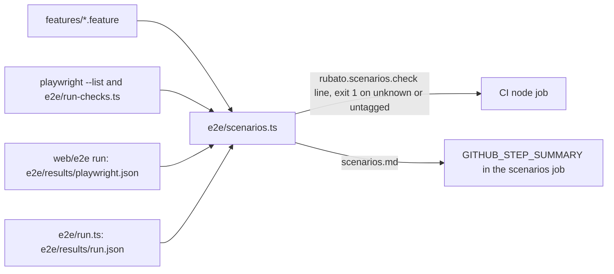

# App scenarios in Gherkin, and a report of which ones the e2e tests cover

Issue: #198 · ADR 0069 (*proposed*). The end-to-end suites, `e2e/run.ts` (server and companion,
two repos, three issues) and `web/e2e/*.spec.ts` (the web app against the real server), test a
lot, but "there is no written statement of what user scenarios rubato is supposed to support, and
no way to see which of those scenarios the e2e tests actually cover. A passing run says the tests
pass, not that the important flows are covered." This change writes the app's scenarios in
Gherkin, makes every e2e test cite the scenarios it covers, and adds a check and a report: which
scenarios are covered and passing, partly covered, or not covered, in CI's job summary and in a
local file.

Track: **small**. No seam, protocol schema, map or plan schema changes; no runtime code changes;
no new dependency (the Gherkin reader is a small one of our own, and Playwright's JSON reporter is
built in). It touches test files of `web`, the e2e harness and CI, which belong to no map part
(A1). One ADR, because the scenario files, their ids and the results files are a data format.

## What the change does

- **The app's scenarios are written down.** `features/<capability>.feature`, one file per
  capability (auth, workspaces, map, pins, new-issue, companions, launch, queue, progress, plans,
  findings, drafts, room, chat, repos, look, telemetry), each scenario in Given/When/Then from the
  user's side, with one stable id tag `@<capability>.<slug>`. Scenarios the tests do not reach yet
  are written too, so the gap is visible.
- **Every e2e test names the scenarios it covers.** Each Playwright test carries
  `{ tag: ["@<id>", …] }`; each `e2e/run.ts` check is an entry of `e2e/run-checks.ts` with its
  title and scenario ids, and a problem is recorded against the check it belongs to. The
  screenshot writer (`shots.spec.ts`), which asserts nothing, is tagged `@tooling`. The four
  `must fail:` tests (`look.spec.ts:35`, `motion.spec.ts:169`, `:180`, `perf.spec.ts:105`) cite
  the scenario whose check they prove and carry `@selftest`: listed apart, not counted as covering.
- **`pnpm scenarios check` keeps the link honest.** It reads the feature files and the list of
  tests (Playwright's `--list --reporter=json`, and `e2e/run-checks.ts`), prints
  `checked <n> scenarios and <m> tests` plus one `rubato.scenarios.check` JSON line, and fails
  when a test cites an id no scenario has, a test cites none and is not `@tooling`, or a scenario
  has no id, a malformed one or a duplicate. A scenario no test cites is a warning (an Actions
  `::warning` annotation in CI), not a failure.
- **`pnpm scenarios report` shows coverage.** After a run, it reads `e2e/results/playwright.json`
  (Playwright's JSON reporter, now always on) and `e2e/results/run.json` (written by `e2e/run.ts`
  on every run, also a failed one), falls back to the test list for a suite with no results
  (status *not run*), says which results files it read and which were missing, and writes a
  Markdown report to `e2e/results/scenarios.md`, and to `$GITHUB_STEP_SUMMARY` when set: totals
  first, then one row per scenario, grouped by capability, with the tests that cite it, marked by
  the first rule that holds (ADR 0069):
  1. ⬜ *not covered*: no test cites it (selftests and tooling do not count);
  2. ✅ *covered and passing*: every citing test passed;
  3. ⏸ *not run*: no citing test ran;
  4. 🟡 *partly covered*: the rest, with `p of m passed; f failed, s skipped, r not run`.

  The uncovered scenarios are also listed together at the end. It runs the same validation as
  `check` and exits non-zero only on that; a failing test fails its own job.
- **CI shows the report on every run.** The `web` and `e2e` jobs upload their results file
  (`if: ${{ !cancelled() }}`, `if-no-files-found: ignore`); a new `scenarios` job, after both and
  `if: ${{ !cancelled() }}`, checks out, runs `pnpm install` (no browsers), downloads the results
  by `pattern: e2e-results-*` with `merge-multiple` (a missing artifact is not an error), and
  writes the report into its job summary. A suite whose job stopped before writing results shows
  as *not run*, from `playwright test --list` and `e2e/run-checks.ts`. The `node` job runs
  `pnpm scenarios check`.
- **AGENTS.md says how we work now.** New features come with a scenario in `features/`, and e2e
  tests cite scenario ids; `features/` is in the repository layout.

## How we'll know it works

- [ ] Unit tests (`e2e/scenarios.test.ts`, `node --test`, run by `pnpm test`): the Gherkin reader
  returns features, scenarios, ids and steps from a fixture feature; it reports a scenario without
  an id, with two ids, with an id whose prefix is not the file's capability, and a duplicate id.
- [ ] Unit test that makes the check fail on purpose: a fixture test list with a test citing
  `@auth.no-such-scenario` gives an `unknown` finding and exit code 1 from the CLI
  (`scenarios.ts check --features <fixture> --tests <fixture>`); a test citing nothing gives
  `untagged` and exit 1; an uncovered scenario alone gives exit 0 and a warning.
- [ ] Unit tests for the report: from a Playwright JSON fixture (one passed, one failed, one
  skipped test; the shape and the `@`-less tags taken from a real 1.65 report) and a run.json
  fixture, the Markdown marks a scenario with all citing tests passed ✅, one with a failed or
  skipped citing test 🟡 with its counts, one with no citing test ⬜, one cited only by a
  `@selftest` ⬜, and one whose tests come from a `--list` report (no results) ⏸; the totals
  line counts each state, and the report exits 0 with test failures.
- [ ] `pnpm scenarios check` on the repo prints the counts and passes; every test in
  `web/e2e/*.spec.ts` and every check in `e2e/run-checks.ts` cites at least one scenario.
- [ ] `pnpm e2e` writes `e2e/results/run.json` with every check `passed` and its `checked`
  count; unit tests on the results builder (`e2e/run-checks.test.ts`): a problem marks that check
  `failed` and only it, a check reached with nothing examined is `failed`, and a run that stopped
  early marks the unreached checks `failed` with the reason.
- [ ] `cd web && ./e2e/run.sh` writes `e2e/results/playwright.json`; `pnpm scenarios report` then
  writes `e2e/results/scenarios.md` with the covered scenarios ✅.
- [ ] In CI, the `scenarios` job's summary shows the report on this PR.

## What it must not break

- The e2e suites themselves: the same tests run in the same projects and order (the Playwright
  `projects` block is unchanged; only `reporter` gains `json`). Guard: `playwright test --list`
  lists 100 tests in 9 files before and after the tags (recorded in the PR), and
  `./e2e/run.sh` passes.
- `e2e/run.ts` makes the same assertions, with the same messages, and exits non-zero on the
  same problems: every `problems.push` site becomes `checks.problem(<key>, …)` with the message
  unchanged, the exit code and the printed summary still come from the full list of problems
  (`checks.all()`). Guard: `pnpm e2e` passes; the results-builder tests above.
- The companion's Gherkin suites (`crates/rubato-companion/features/`): untouched, still run by
  cucumber-rs in `cargo test`.
- `pnpm typecheck` and `pnpm test` across the workspace; the web slice test
  (`web/src/features/features.test.ts`, unrelated to the new top-level folder).
- CI: no workflow that publishes is touched; the existing jobs keep their steps and add only an
  upload (and, in `node`, the check).

## How we'll debug it at 3 am

There is no seam and no runtime part here, so no O-row (see O-rows). New: the event name
`rubato.scenarios.check` (in `otel.rs` `event`, next to `PLAN_CHECK`). What a person looks at when
the check or report is red: the report's first lines (which results files were read, which
missing); the `rubato.scenarios.check` JSON line (scenarios, tests, `unknown`,
`untagged`, `invalid`, `uncovered`, `outcome`), printed by both `check` and `report`; the report's
table names each test with its file, line and project; `e2e/results/run.json` lists each run.ts
check's problems.

## Affected parts

| Node | Status | What changes | Seams |
| --- | --- | --- | --- |
| web | affected | test files only: each `web/e2e/*.spec.ts` test cites scenario ids in its `tag` detail; `playwright.config.ts` adds the JSON reporter to `e2e/results/playwright.json`. No app code. | |
| rubato-protocol | affected | `otel.rs` `event::SCENARIOS_CHECK = "rubato.scenarios.check"`, one constant; no type or schema changes | |
| rubato-server | quiet | exercised by both suites, unchanged | |
| rubato-companion | quiet | exercised by `e2e/run.ts`, unchanged | |

## Data models

| Model | Kind | Part | Change | Crosses | Note |
| --- | --- | --- | --- | --- | --- |
| `features/*.feature` | file | web | new | | app scenarios with `@<capability>.<slug>` ids; the spec, run by nothing (ADR 0069); filed under web for lack of a part (A1) |
| `e2e/results/playwright.json` | file | web | new | | Playwright's JSON reporter output; gitignored |
| `e2e/results/run.json` | file | web | new | | `{ suite: "run", tests: [{ key, title, file, scenarios, status, checked, problems }] }` from `e2e/run.ts`; gitignored (A1) |
| `rubato.scenarios.check` | event | rubato-protocol | new | | the check's JSON line: scenarios, tests, tooling, selftests, invalid, unknown, untagged, uncovered, outcome |
| `e2e/results/scenarios.md` | file | web | new | | the coverage report; gitignored, and the CI job summary |

## Data flow

## Tasks

1. Failing tests first: `e2e/scenarios.test.ts` with fixtures under `e2e/fixtures/scenarios/`
   (a feature file with good, id-less and misprefixed scenarios; a test list with a test citing
   `@auth.no-such-scenario` and one citing nothing; a Playwright JSON and a run.json with passed,
   failed and skipped tests). Run them and see them fail (no module).
2. `e2e/scenarios.ts`: the Gherkin reader, `validate()`, `coverage()`, `renderMarkdown()`, and
   the CLI (`check`, `report`, `--features`, `--tests`, `--playwright`, `--run`, `--out`); the
   `rubato.scenarios.check` line; `::warning` lines when `GITHUB_ACTIONS` is set. Root script
   `scenarios`; the `e2e` package's `test` runs `node --test`.
3. Failing test: `e2e/run-checks.test.ts` for the results builder (a problem marks only its
   check failed; a run that stopped early marks unreached checks failed). Then
   `e2e/run-checks.ts` (the checks, their titles and scenario ids, `results()`), and `e2e/run.ts`
   records each problem against its check, marks checks reached, and writes
   `e2e/results/run.json` at the end, also after a crash.
4. `features/*.feature`: the scenarios and ids. Covered ones are written from the tests' own
   assertions; the rest from AGENTS.md's v0 scope and the web capability block (approve, import,
   chat, stop, revoke, unpin, reorder, stale, cap hit).
5. Tag every Playwright test (`{ tag: [...] }`) and every run check; `shots.spec.ts` `@tooling`,
   the must-fail tests `@selftest`. `pnpm scenarios check` passes on the repo; `--list` still
   lists 100 tests.
6. `playwright.config.ts`: `["json", { outputFile: "../e2e/results/playwright.json" }]`;
   `.gitignore` `e2e/results/`. `otel.rs` `SCENARIOS_CHECK`.
7. CI: upload the results in `web` and `e2e` (`!cancelled()`, `if-no-files-found: ignore`); the
   `scenarios` job (`needs: [web, e2e]`, `!cancelled()`, checkout, pnpm install,
   `actions/download-artifact` pinned to a commit with `pattern` and `merge-multiple`); the check
   step in `node`.
8. AGENTS.md: How we work (a scenario per new feature; tests cite ids) and the layout line.
9. ADR 0069 (*proposed*), pinned below. Run `pnpm typecheck`, `pnpm test`, `pnpm scenarios check`,
   `pnpm e2e`, `web/e2e/run.sh`, `pnpm scenarios report`, plan check.

## Assumed, not yet approved

| # | Decision | Chosen | Alternatives | Scope |
| --- | --- | --- | --- | --- |
| A1 | Which map part the scenarios and the e2e harness belong to | none exists; file them under `web` in Data models, add no node | add an `e2e` node to rubato-map.yml (a map change, out of scope) | node (web) |
| A2 | Where the coverage tool lives | `e2e/scenarios.ts` in the `@rubato/e2e` package, run from the root as `pnpm scenarios` | `actions/` (it is not an Action); `web/` (it reads run.ts too) | node (web) |
| A3 | Reading Gherkin | our own small reader (Feature, Rule, Background, Scenario, Scenario Outline, Examples, tags, steps) | `@cucumber/gherkin` (a new dependency, for a spec nothing runs) | node (web) |
| A4 | A scenario all of whose citing tests failed | 🟡 partly covered, `0 of n passed; n failed` | a fifth state *failing* | node (web) |
| A5 | What a run.ts check needs to pass | reached, no problem, and at least one item examined (`checked` > 0) | reached and no problem | node (web) |
| A6 | Where the OTLP problem goes | the one `otlp` check covers metric names, attribute keys and span names together | three checks | node (web) |

## Decisions

| # | Decision | Chosen | Why | Decided by |
| --- | --- | --- | --- | --- |
| 1 | Gherkin as the source driving tests, or as spec with tests tagged | spec only; tests cite scenario ids (Playwright `tag` detail, `e2e/run-checks.ts` entries) | lighter; fits the existing Playwright specs and `e2e/run.ts`; no step layer (ADR 0069) | agent (delegated by Mattias, 2026-11-15) |
| 2 | Where app-level scenarios live | top-level `features/`, one `.feature` per capability, each scenario a stable `@<capability>.<slug>` id; the companion's crate features stay | same folder name as the companion's; one place for the app (ADR 0069) | agent (delegated by Mattias, 2026-11-15) |
| 3 | Report format | Markdown in `$GITHUB_STEP_SUMMARY` and `e2e/results/scenarios.md`; ✅ covered and passing, 🟡 partly (a citing test failed, skipped or did not run), ⬜ not covered | cheapest that shows in CI and locally; HTML or the map view later | agent (delegated by Mattias, 2026-11-15) |
| 4 | An uncovered scenario | warns (an Actions warning annotation and the report's list), does not fail | most scenarios are written ahead of their tests; fail later by a new ADR once coverage is high | agent (delegated by Mattias, 2026-11-15) |
| 5 | Where the report runs in CI | a `scenarios` job after `web` and `e2e`, `if: always()`, from both jobs' uploaded results | each job sees only its own suite; one report over both is the useful one | agent (delegated by Mattias, 2026-11-15) |
| 6 | A test that asserts no behaviour | tagged `@tooling`, listed apart, not counted as covering | the screenshot writer is skipped in CI and covers nothing | agent (delegated by Mattias, 2026-11-15) |
| 7 | `must fail:` tests | cite the scenario of the check they prove and carry `@selftest`; listed apart, not counted as covering | they assert, so not `@tooling`; a self-test of a check is not coverage of the scenario | agent (delegated by Mattias, 2026-11-15) |
| 8 | A scenario none of whose tests ran | its own mark, ⏸ *not run*, ahead of 🟡 | a missing suite must not read as a partial pass | agent (delegated by Mattias, 2026-11-15) |
| 9 | The check's event name | `rubato.scenarios.check`, added to `otel.rs` `event` | the names are kept in one list, like `rubato.plan.check` | agent (delegated by Mattias, 2026-11-15) |
| 10 | User scenarios and the map's scenarios (ADR 0024) | kept apart: different files, ids with a dot; a later link is possible | most user scenarios cross no seam | agent (delegated by Mattias, 2026-11-15) |
| 11 | Approve plan for build | yes | review passed, delegated approval | agent (delegated by Mattias, 2026-11-15) |
| 12 | run.ts exit code when a check examined nothing | exit 1, as for a problem (the results file says `the check examined nothing`) | the results file and the exit code must agree; it cannot happen on a run that passes today | agent (delegated by Mattias, 2026-11-15) |
| 13 | Where `target/` points in a worktree for `pnpm e2e` | run.ts keeps `${ROOT}/target/debug`; locally a symlink to the agreed `CARGO_TARGET_DIR` | no change to how CI builds | agent (delegated by Mattias, 2026-11-15) |

## O-rows

None: the change touches no seam (Affected parts lists none). It adds no runtime signal; the
check's own `rubato.scenarios.check` line is described under the 3 am section.

## Flows

None.

## ADRs proposed

| ADR | File | Blob |
| --- | --- | --- |
| 0069 | docs/decisions/0069-app-scenarios-in-gherkin-cited-by-e2e-tests.md | cca86fd7b79eb297fed5a83b0242681e1bf71b62 |

## Review map

1. `e2e/scenarios.ts` `validate()` and `coverage()`: what fails the check and how a scenario's state is derived.
2. `e2e/run.ts` and `e2e/run-checks.ts`: every problem is recorded against the right check, and the results file is written on a failed run too.
3. `features/*.feature` against the tags in `web/e2e/*.spec.ts`: does each tag claim only what its test asserts?
