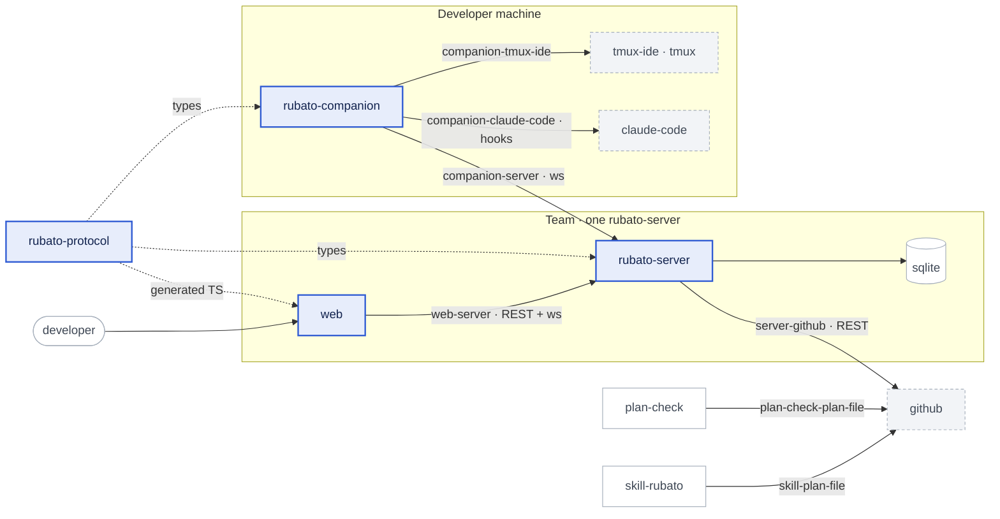
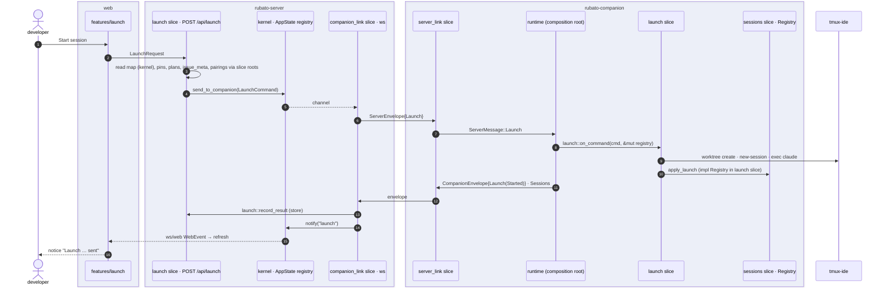
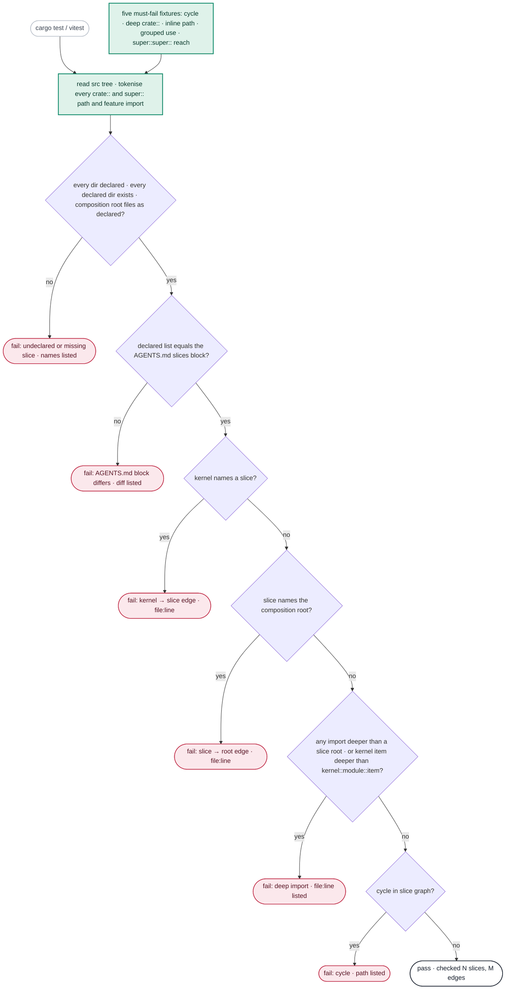
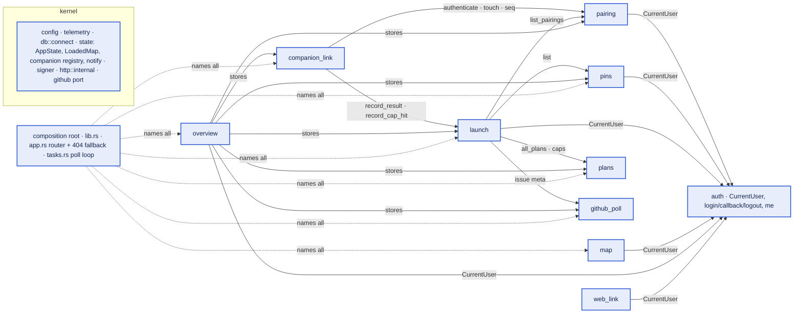
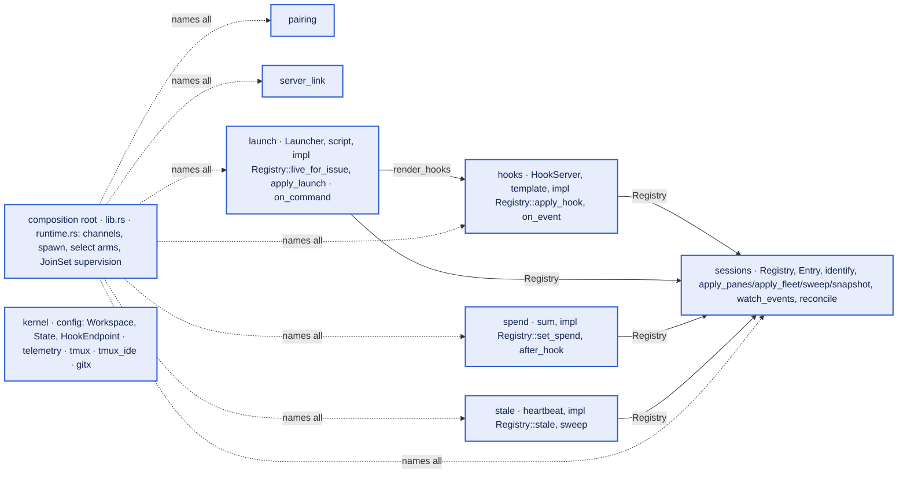
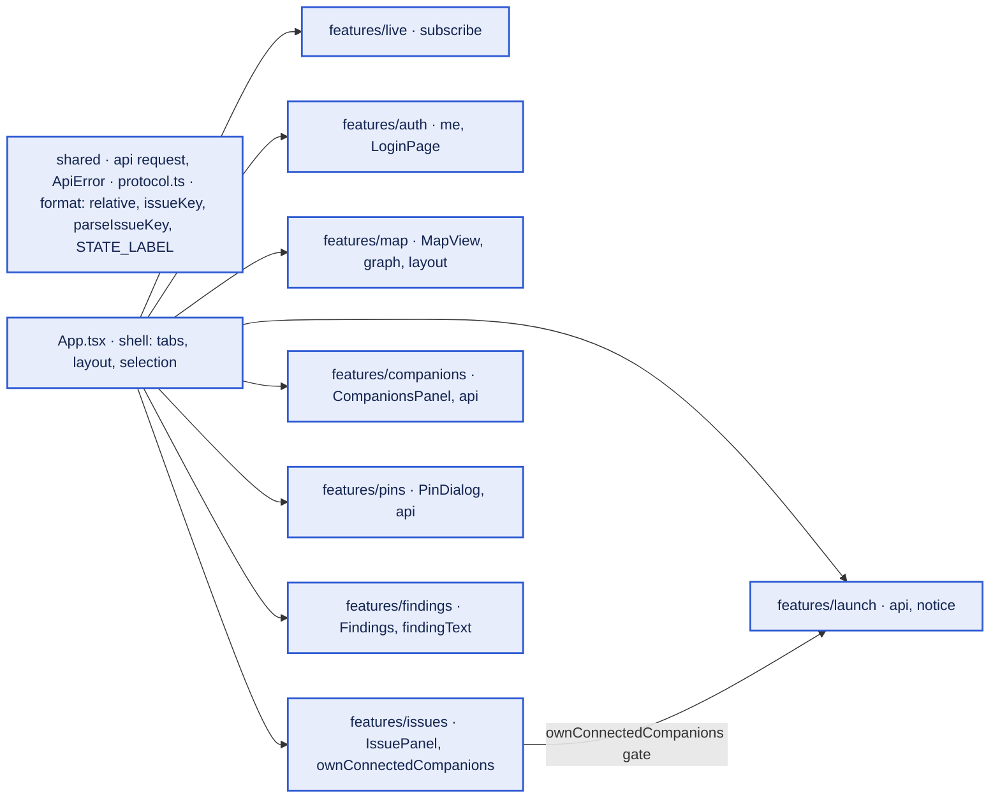

# Refactor codebase to use vertical slices

Issue: #20 · Plan: [../20.md](../20.md)

## 1. Problem

The issue, condensed: the code was laid out by technical layer (one `api.rs`, one `db.rs`, one
`daemon.rs` loop, one `api.ts`) when v0 was built in one pass; the author considers that a poor
base for building with agents and wants the code organised into vertical slices, where everything
a capability needs sits in one place. Which parts, in which order and with which boundaries was left
to planning: settled in the planning session as *every part*, *server → companion → web → protocol*,
and *one slice per capability a user or companion exercises*.

**Acceptance criteria** (from the issue)

- [ ] The code is organized into vertical slices.

## 2. Spec

### 2.1 What the change does

- **S1** — When a reader opens a deployable's source root, they see one folder per capability (named in D1 and listed in that crate's or package's root module doc), one `kernel/` folder, a small composition root (`lib.rs`, `main.rs`, `app.rs`, `tasks.rs` on the server; `lib.rs`, `main.rs`, `runtime.rs` on the companion; `main.tsx`, `App.tsx` on the web) and the test-only `slices.rs`. Every route, store query, websocket arm, task body, telemetry site and unit test for a capability lives under that capability's folder. `VERSION` lives in the kernel and is re-exported at the root for `main.rs`.
- **S2** — When a slice uses another slice, it names only that slice's root (`crate::<slice>::…` one segment deep in Rust, `features/<slice>/index.ts` in TypeScript). The kernel names no slice. Only the composition root may name everything. A check in each crate and package scans every `crate::<ident>` token (plain `use`, grouped `use crate::{…}`, inline paths) and every feature import, reports how many slices and edges it inspected, and fails on a cycle, a deeper import, or a kernel → slice edge. Edges made by inherent `impl` methods (D7) are invisible to it and accepted as such.
- **S3** — When a reader opens a deployable's `kernel/`, they find only leaf infrastructure: configuration, telemetry setup, storage connection, the shared state holder (`AppState` with the loaded map, the connected-companion registry, the web notify sender), cookie signing, and adapters to other people's tools (GitHub port; tmux, tmux-ide, git). Composition (router, periodic loop, runtime select) sits in the composition root, not in the kernel.
- **S4** — When any existing client exercises Rubato after the change, it observes what it observed before: the same HTTP routes and status codes, websocket envelopes, JSON Schemas, SQLite schema, CLI subcommands and flags, hook template, launch script, metric, span and event names, alert rules and dashboard panels. Six deliberate exceptions, each visible and each listed in the plan's Assumed table: (a) an unknown `/api/*`, `/ws/*` or `/auth/*` path answers 404 JSON instead of `index.html` or 405; (b) an *essential* background task that exits while shutdown is not requested ends the process with an error event and a non-zero exit; a clean Ctrl-C still exits 0; (c) a new counter `rubato.poll.ticks` with its alert and panel; (d) three literal span names become the `otel.rs` constants with the same strings; (e) `RUBATO_GITHUB_POLL_SECS` above 300 is clamped to 300 with a `warn!` (today it is unbounded; `web/e2e/run.sh:13` passes 3600 and keeps working); (f) the GitHub client gets connect and read timeouts, so a hung call ends as an error instead of hanging the poll loop.
- **S5** — When a test for a capability is needed, it is found under that capability: Rust unit tests inside the slice's modules, Gherkin step definitions in a module per feature file, web tests in the feature folder.
- **S6** — When a maintainer reads `AGENTS.md` "Repository layout", each deployable's slice list sits in a marked block (`<!-- slices: <deployable> -->` … `<!-- /slices -->`) that matches the folders on disk, and the layout test of that deployable fails when they drift. Each deployable's PR adds its own block.

### 2.2 How we'll know it works

| Proves | Evidence | Kind |
|---|---|---|
| S1, S3, S6, AC | `rubato_server::slices::layout_matches_declared_slices` and the companion twin: every `src/<dir>` is `kernel` or a declared slice, every declared slice exists, the composition-root file list is exactly as declared, and the fenced list inside `AGENTS.md`'s `<!-- slices: rubato-server -->` block equals the declared list (the block is added in the same PR); prints `checked N slices` | unit |
| S2 | `slices::imports_are_acyclic_and_shallow` (server, companion): tokenises every `crate::<ident>…` path and every `super::` chain (resolved by the file's depth) in every file except `slices.rs` itself (plain, grouped, inline), builds the slice graph, asserts no cycle, no import deeper than a slice root, no kernel → slice edge, no slice → root edge; kernel modules may be named two deep (`crate::kernel::state::AppState`); prints `checked N slices, M edges`. `slices::must_fail_fixtures_are_rejected` runs five fixtures from `tests/fixtures/slices/` (a cycle, a deep `crate::` import, an inline path, a grouped `use`, a `super::super::` reach into another slice) and asserts each is reported | unit |
| S2, S6 | `web/src/features/features.test.ts`: reads every import under `src/features/*`, asserts a feature imports other features only via `features/<name>/index.ts` and otherwise only `shared/`, and that the fenced list inside `AGENTS.md`'s `<!-- slices: web -->` block equals the folders; prints `checked N features, M imports`; two must-fail fixture strings (deep import, cycle) are rejected | vitest |
| S4 | `cargo test --workspace` green with no assertion changed except the ones S4's exceptions name; `pnpm -r test`; `pnpm e2e`; `cd web && pnpm gen:types && git diff --exit-code -- src/protocol.ts`; `git diff --exit-code main -- schema/ crates/rubato-server/migrations skills/rubato/hooks.json skills/rubato/prompt.md skills/rubato/SKILL.md web/e2e/run.sh`; `pnpm observability:check` reports 6 rules each with a test and a panel; `git diff --stat main -- observability/` shows only the added rule, its test case, the one added panel and the REQUIRED line in `check.ts` | integration / e2e / diff |
| S4 (config) | new `kernel::config::poll_interval_above_300_is_clamped_with_a_warning`: `RUBATO_GITHUB_POLL_SECS=3600` yields 300 and one entry in `Config::warnings`, which `main` logs as `warn!` right after `telemetry::init` (today `from_env` runs before the subscriber exists, `main.rs:10-11`, so a `warn!` inside it would be dropped) | unit |
| S4 (timeouts) | new `kernel::github::hung_github_call_ends_with_an_error`: `Octo::with_base_uri` against a local listener that accepts and never answers returns `Err` within `(1 + retries) × read timeout` plus a margin (octocrab's default `RetryConfig::Simple(3)` retries every transport error, so 4 × 15 s = 60 s worst case); the `rubato.github.call` span closes with `error` recorded (`#[instrument(err)]`) | unit |
| O6 | new `kernel::http::internal_logs_slice_and_error`: the helper returns the status and emits one `error!` with `slice` and `error` fields | unit |
| S4 (supervision) | new `supervise` unit tests in both crates: an essential task returning while shutdown is not set → `Err` and one `rubato.task.exited` event; a best-effort task returning → parks, no event; shutdown set → `abort_all`, `JoinError::Cancelled` treated as clean, `Ok` within 1 s | unit |
| S4 (routes) | new `rubato_server::app::every_known_route_answers`: probes the built router with a hand-kept list of (method, path) pairs: every `routes` constant with its method, `DELETE /api/pairings/<uuid>` (built with `format!` at `app.rs:343`), `/api/health`; asserts the body is never the fallback `{"error":"unknown api path"}` and the status is never 405; prints `probed N routes`. Second case: `GET /api/nope`, `/ws/nope`, `/auth/nope` are 404 JSON. Third case: with `web_dist` pointing at a tempdir holding `index.html`, `GET /some/page` is `text/html` 200 (the Rust CI job never builds `web/dist`) | integration |
| S4 (telemetry) | `e2e/run.ts` keys the OTLP receiver's names by the `service.name` string in each body (`rubato-server` or `rubato-companion`) and asserts every metric recorded on the happy path per binary, taken from the `metric::` sites on `main`: server {sessions.by_state, companion.heartbeat, ws.clients, map.loaded, github.rate_limit.remaining, github.rate_limit.limit, issues.by_state, seam.open_plans, plan.unknown_id_count, poll.ticks}; companion {companion.heartbeat, hook.forwarded, sessions.discovered, sessions.by_state}; failure-only counters (`events.dropped`, `map.load_failures`, `plan.parse_failures`) are excluded by name; prints `saw N/N metric names per binary` | e2e |
| S4 (live) | new `web_events_follow_every_action` in `tests/integration.rs`: subscribes to `/ws/web` and drives each of the thirteen `notify(` sites on `main` as its own action, awaiting the event separately: companion connected, companion disconnected, sessions, launch (from the launch handler `api.rs:342` *and* from the companion's launch result `ws_companion.rs:233`), cap hit, stale, map, pin and unpin (`api.rs:144,156`), pairing approve and revoke (`pairing.rs:93,140`), poll; prints `checked 13 notify sites` | integration |
| S4 (GitHub calls) | new `poll_makes_the_same_github_calls_per_issue`: `FakeGitHub` records every call as `(method, args)` in order; after one `tasks::poll_once` the list equals the one recorded on `main` for a fixture with three issues: one with a branch, a valid plan and an open PR (so `checks` is called); one with a branch, an unparseable plan and a merged PR (so `checks` is not called and the parse failure is stored); one with no branch and a `Decision:` comment (so `issue_comments` is still called) | integration |
| S5 | `ls crates/rubato-companion/tests/cucumber/steps/` has one module per `features/*.feature`; `cargo test -p rubato-companion` runs every scenario of all 6 features with the same count as on `main` plus the two new scenarios (N21, N22) | test run |

### 2.3 What it must not break

| # | Must keep working | Guarded by |
|---|---|---|
| N1 | Wire contract: the 33 JSON Schemas in `schema/protocol/` and the two aliases are byte-identical, doc comments included (they become `description`) | existing `schema_snapshot::exported_schemas_match_committed_snapshots`, `no_stale_snapshot_files` |
| N2 | `web/src/protocol.ts` regenerates identically | CI step `pnpm gen:types && git diff --exit-code` (.github/workflows/ci.yml:69) |
| N3 | SQLite schema and the derived-not-stored rule | `migrations/0001_init.sql` untouched (diff); existing `derived_state_is_never_stored` (integration.rs:495); `sqlx::migrate!("./migrations")` is manifest-relative so moving `db.rs` is safe |
| N4 | Every HTTP route, status code and websocket arm on `web-server` and `companion-server`, including `/api/health` (no protocol constant; used by `web/e2e/run.sh:17`, `e2e/run.ts:130`) | existing 6 integration tests; new `every_known_route_answers`; Playwright `web/e2e/map.spec.ts` |
| N5 | Companion CLI (`pair`, `run`, `status`, `render-hooks`, hidden `idle`) and its flags, used by `e2e/run.ts:147,189` and the Gherkin stand-in | Gherkin `pairing.feature`; `pnpm e2e` |
| N6 | Metric, span, event and attribute names and the alerts and dashboards that query them | existing `otel::all_names` test; `pnpm observability:check`; `promtool test rules` in CI; new e2e metric-name assertion |
| N7 | Compile-time embeds: `skills/rubato/prompt.md` (`api.rs:19`), `hooks.json` (`hooks.rs:112`), `workspace.example.yml` (`config.rs:230`), `features/fixtures/team.json` (`tmux_ide.rs:209`, `sessions.rs:482`) | paths re-pointed in the move; existing `prompt_renders_placeholders`, `renders_embedded_template`, `parses_the_example_workspace`, `parses_recorded_fleet`, `fleet_without_authority_is_scraped_and_unknown` |
| N8 | Plan parsing identical in Rust and TypeScript on the shared fixtures; `parses_every_plan_in_this_repo` reads every top-level `docs/plans/*.md` | existing tests; the feature index lives at `docs/FEATURES.md`, the design in a subfolder, so neither is parsed as a plan |
| N9 | Protocol fixture replay and dedupe on `companion-server`; `Welcome.last_seen_companion_seq` after reconnect | existing `fixtures::all_fixtures_round_trip`; `protocol_fixtures_replay_derives_progress` (replay at seq 9); new `welcome_carries_last_seen_seq_after_reconnect` |
| N10 | Own-tmux-only: a launch reaches only the caller's paired, connected companion; revoked tokens are refused | existing `launch_goes_only_to_the_callers_own_connected_companion`, `bad_and_revoked_tokens_are_refused`; Gherkin `launch-refusal.feature` |
| N11 | Stale detection, hook forwarding and discovery timing; the hook-arm order (apply → snapshot → send Hook → send Sessions → spend) | Gherkin `stale.feature`, `hooks.feature`, `discovery.feature`, `worktree.feature` |
| N12 | The whole chain: two repos, three issues, OTLP, plan check | `pnpm e2e` (e2e/run.ts) |
| N13 | Skill install vendoring `actions/plan-check/src` and `schema/` (install.ts:21-25); the skill's dynamic import of `check.ts`, `map.ts`, `parse-plan.ts` (vendor.ts:34-39); `action.yml` paths | plan-check and skill files unmoved (D10); `skills/rubato/test/skill.test.ts` |
| N14 | Public Rust API used from outside the lib crates: server `main.rs` and `tests/integration.rs` (`app::router`, `Config::for_tests`, `db::connect`, `poller::{reload_map, poll_once}`, `github::{Comment, GitHubApi, IssueInfo, PullInfo, FakeGitHub, Octo}`, `github_local::LocalGit`, `db::all_columns`, `AppState::new`); companion `main.rs` and `tests/cucumber.rs` (`daemon::{DaemonConfig, Handles, start}`, `sessions::Registry`, `Entry.status/source`, `hooks::{HOOKS_TEMPLATE, render_hooks}`, `config::*`, `pairing::pair`, `tmux`, `tmux_ide`, `gitx`) | each slice root re-exports these as `pub`; the two test crates change only `use` paths; `poll_once` lives on as `tasks::poll_once` |
| N15 | Web test ids (`node-<id>`, `issue-<n>`, `start-session`, `pin-*`, `companion-<user>`, `findings`) that Playwright and Vitest rely on | existing `web/test/*` moved with their components; `web/e2e/map.spec.ts` unchanged |
| N16 | Hard-coded paths in `e2e/run.ts` (target binaries, `e2e/claude`, `actions/plan-check/src/cli.ts`, `web/dist`, fixtures) and `web/e2e/run.sh` | none of these paths move (D10); `pnpm e2e`, `web/e2e/run.sh` |
| N17 | The SPA fallback: an unknown non-API GET (deep link) still serves `index.html` | existing Playwright run loads `/`; new test case with a tempdir `web_dist` asserts `/some/page` is `text/html` 200 while `/api/nope`, `/ws/nope`, `/auth/nope` are 404 JSON |
| N18 | All thirteen `notify()` sites, ten reasons: companion connected, companion disconnected, sessions, launch ×2, cap hit, stale, map, pin ×2, pairing ×2, poll (`ws_companion.rs:81,122,222,233,241,247`, `api.rs:108,144,156,342`, `pairing.rs:93,140`, `poller.rs:205`) | new `web_events_follow_every_action` driving all thirteen sites one by one (there is no such test today) |
| N19 | The server start and loop order, verbatim from `main.rs:35` and `poller.rs:142-318`: `warm_map` before the listener binds; the loop reloads the map when `map_age == 0` with `map_age = (map_age + secs) % 300` kept as is (so a restart reloads on its first tick and a GitHub outage does not retry every tick); `poll_once` skips when no map is loaded; per issue, under one `warn!(issue, error, "poll failed for issue")` that covers any GitHub or database error and skips the rest for that issue: upsert issue meta → find the branch → if a branch exists: fetch the plan file (parse failure is *recorded* with `plan.parse_failures` and `upsert_plan(error)` and does **not** skip; a missing file deletes the plan) → PR lookup, `checks` only when not merged → then, branch or not, decisions from the issue comments → after all issues: rate limit → gauges → `notify("poll")` | `tasks::run`/`tasks::poll_once` keep the sequence; integration.rs:346 calls it; new `first_tick_reloads_then_polls` on an empty database and on a warm database with a map file; `poll_makes_the_same_github_calls_per_issue` with the three-issue fixture |
| N20 | The envelope order: dedupe (`record_event`) → `set_last_companion_seq` → `touch` → arm → notify → Ack | replay at seq 9 (N9) and the new reconnect test |
| N21 | The companion runs with no adopted tmux-ide session: `tmux-ide events --follow` exits at once when `events.jsonl` is missing (fresh CI runners, new machines) and discovery falls back to the timer (`daemon.rs:165-180` today) | new Gherkin scenario in `discovery.feature`: daemon up with no events file, reconcile still snapshots, process alive after 3 s, log `tmux-ide events unavailable; timer only` |
| N22 | Clean shutdown: Ctrl-C on `rubato-companion run` and on `rubato-server` exits 0 within about a second with no `rubato.task.exited` event. Today the hook server (`axum::serve`, `hooks.rs:74`) and the dropped-counter task never return on their own; `tasks.abort_all()` (`daemon.rs:343`) ends them. Gherkin runs the runtime in-process (`cucumber.rs:354`) and must never see `process::exit`. "Shutdown requested" means `*rx.borrow() \|\| rx.has_changed().is_err()`, so a dropped sender counts as shutdown too | the runtime calls `abort_all` on shutdown and treats `JoinError::Cancelled` as clean (D12); `supervise` unit tests (S4 supervision row); new Gherkin scenario in `pairing.feature`: shutdown → `run` returns Ok within 1 s, no error event; server integration test sends `true` on the shutdown channel and awaits `Ok` |
| N23 | `skills/rubato/SKILL.md`, `hooks.json`, `prompt.md`, `decision-template.md`, `workspace.example.yml` and `scripts/` are installed into every connected repo by `install.ts:18-20` | all byte-identical (S4 diff list); the skill's slice note goes into a new `skills/rubato/README.md`, which `install.ts` does not copy |

### 2.4 How we'll debug it at 3 am

A move-only refactor fails by *omission*: a route not re-registered, a task not re-spawned, a
metric or `notify` call dropped on the way. Each is silent unless a signal goes absent, and the
default log filter is `info,sqlx=warn` (`telemetry.rs:29`), so every signal below is at `info` or
above, or is a metric.

| # | When this fails | How we find out | What localises it | What it tells us · first action |
|---|---|---|---|---|
| O1 | The server poll loop is not spawned, exits after its first tick, or a GitHub call hangs | new alert `ServerPollSilent`: `increase(rubato_poll_ticks_total[10m]) == 0 or absent_over_time(rubato_poll_ticks_total[10m])`, with a firing test and listed in `observability/check.ts` REQUIRED; the counter is re-exported flat every 60 s under cumulative OTLP; `RUBATO_GITHUB_POLL_SECS` is clamped to 300 so a healthy server cannot trip it; new stat panel "Poll ticks" in the Trust check row. A hung call no longer hangs the loop: the GitHub client has connect and read timeouts (D15), so after at most `(1 + retries) × read timeout` (60 s with octocrab's default three retries and a 15 s read timeout) it ends as `warn!(issue, error, "poll failed for issue")` and a *closed* `rubato.github.call` span with `rubato.github.endpoint` and `error` recorded via `#[instrument(err)]` (a span that never closes is never exported, so without the timeout there would be nothing to read). `supervise` runs concurrently with `axum::serve` in a `tokio::select!`, so a dead poll task takes the process down at once instead of at the next Ctrl-C | process down: `rubato.task.exited{rubato.task="poll"}` error event then non-zero exit (D12), health check fails. Process up: the `poll failed for issue` warn lines name the issue; the error span names the endpoint | exited → read the event's error, restart, check `tasks.rs`. Timeouts → the endpoint in the span; check GitHub status |
| O2 | An essential companion task (server_link client, hook server, heartbeat, reconcile, stale sweep, dropped-counter) exits while shutdown is not requested | the runtime joins its `JoinSet`: first essential exit → `rubato.task.exited{rubato.task}` error event, `run` returns `Err`, `main` exits non-zero; the heartbeat stops and `CompanionSilent` fires after 600 s. The events watcher is *not* essential: on exit it logs `info!("tmux-ide events unavailable; timer only")` and parks until shutdown (N21) | the event names the task; the tmux window shows the exit code | one slice's task returned · read its error, fix, `rubato-companion run` |
| O3 | A route is lost in the router | the web shows the error banner (JSON parse failure); the new 404 fallback for `/api/*`, `/ws/*` and `/auth/*` logs `warn!("unknown api path", path, method)` and answers 404 JSON instead of `index.html` or 405 | the warn line names method and path; `every_known_route_answers` fails pre-merge for every (method, path) pair including the `format!`-built revoke route | router assembly dropped a line · add it back in `app.rs` |
| O4 | A metric recording site is dropped in a move | the dashboard panel for that metric goes No data (a gauge keeps its last value only while the process lives); the e2e `saw N/N metric names per binary` fails pre-merge and names the binary | the metric name absent from Mimir for that `service.name` while siblings continue | one slice lost its instrument call · grep `metric::<NAME>` in that binary's slices |
| O5 | A `notify()` call is dropped so the web stops refreshing live | symptom: the live dot stays green but "refreshed …" stops advancing after an action; `web_events_follow_every_action` fails pre-merge | the missing `reason` in the test output names the slice | the slice handled the event but no longer notified · grep `notify(` in that slice |
| O6 | A store function moved to a slice targets the wrong table or loses a column | integration tests fail pre-merge; in production the overview shows issues stuck in one state | every slice handler maps store errors through `kernel::http::internal(slice, e)`, which logs `error!(slice, error=%e, "request failed")`; the pairing handlers' silent `map_err(\|_\| StatusCode)` (`pairing.rs:96,123,144`) go through it too, same status codes | the `slice` field names the slice · compare its `store.rs` SQL with the ownership table (§7) |

## 3. Where it fits

Every internal node changes; nothing external does. No new link.

`skill-rubato` and `plan-check` are quiet: the survey found them already one-file-per-capability (D10); they only gain a documented slice list. No code in them changes.

## 4. Main flow

The user-visible flows do not change. One sequence shows where the launch flow lands after the
move, slice by slice, so the reader can check that nothing is orphaned.

## 5. Control flow

The only new logic is the slice check that guards S2 in each crate and package.

## 6. Data flow

Slice dependency graphs per deployable, drawn from the real `crate::` paths. An edge means
"names the other slice's root". The kernel is imported by every slice and names none; the
composition root names everything and is named by nobody but `main.rs` and the test crates.

**rubato-server** (`crates/rubato-server/src/`)

Not drawn: every slice → kernel. `pins`, `launch` and `overview` read the *current map* from
kernel state (`app.map`, `api.rs:55,121-126,199-204`), not from the `map` slice, which only loads
and stores it. `github_poll` and `plans` depend on the kernel's GitHub port only. The issue set
the poll works on (pins ∪ launched ∪ sessions ∪ plans, `poller.rs:147-159` today) is assembled by
`tasks::poll_once` in the composition root and passed in, and the per-issue branch lookup that
feeds both the plan fetch and the PR lookup (`poller.rs:222-229`) is made once there:
`github_poll::upsert_meta(issue)` → `github_poll::find_branch(issue)` → if a branch:
`plans::fetch_and_store(issue, branch)` → `github_poll::poll_pr(issue, branch)` → always
`github_poll::poll_decisions(issue)`, so `github_poll` and `plans` name no other slice and GitHub
is called in the same order and the same number of times per issue as today (N19). That removes today's
`api ↔ poller` cycle and the `github_poll ↔ launch` cycle the first draft had. `Signer` and
`VERSION` move to the kernel, removing `state ↔ auth` and the `companion_link → lib.rs` edge
(`ws_companion.rs:183`). The graph is acyclic: `auth` ← handlers; `pairing` ← `companion_link`,
`launch`, `overview`; `launch` ← `companion_link`, `overview`; nothing names `overview`,
`web_link` or the composition root.

**rubato-companion** (`crates/rubato-companion/src/`)

`runtime.rs` (today's `daemon::{start, run}`) owns the channels and the `select!`; each arm is one
call into a slice (`hooks::on_event`, `launch::on_command`, `spend::after_hook`,
`server_link::on_welcome`). It also awaits the `JoinSet`: an *essential* task that exits while
shutdown is not requested is fatal (D12); the events watcher is best-effort and parks on exit.
`VERSION` moves to `kernel` (used by `daemon.rs:138` heartbeat and `main.rs`).

**web** (`web/src/`)

Features import `shared/` and their own files; `App.tsx` composes. The one cross-feature edge is
issues → launch (the start-session button).

**rubato-protocol** (`crates/rubato-protocol/src/`): kernel modules `ids`, `limits`, `message`
(envelopes), `otel`, `schema`; capability modules `auth` (Me; LOGIN/CALLBACK/LOGOUT/ME routes),
`pairing` (+PairingInfo, PairApproveRequest; PAIRINGS, PAIR_APPROVE), `session` (SessionState,
Heartbeat, StaleSession, StateSource, TmuxLocation), `hook`, `pins` (IssuePin, PinRequest; PINS),
`launch` (+LaunchRequest, LaunchResponse; LAUNCH), `map` (+MapResponse; MAP, MAP_RELOAD), `plan`,
`github`, `progress` (+Overview, IssueSummary, Finding; OVERVIEW), `web_link` (WebEvent; WEB_WS).
`web.rs` dissolves; every type keeps its name and its doc comment word for word, so every JSON
Schema is unchanged (schemars 1 titles `$defs` by type name; no name repeats; N1).

## 7. Data model and states

n/a — no migration, no new state. What changes is *ownership*, recorded here so SQL for a table
stays in one slice. All 15 tables of `0001_init.sql` appear. The two statements that touch two
tables stay inside one owner (`approve_pairing_code` pairing_codes→pairings, `db.rs:163`;
`issues_with_live_cap_hit` cap_hits↔launches, `db.rs:438`).

| SQLite table | Owning slice (server) | Written or read also by |
|---|---|---|
| users, web_sessions | auth | — |
| pairing_codes, pairings | pairing | companion_link via `pairing::{authenticate, touch, next_server_seq, set_last_companion_seq}` |
| companion_events, session_snapshots, stale_events | companion_link | composition root reads `all_sessions` for the poll issue set |
| pins | pins | launch, overview, composition root via `pins::list` |
| launches, cap_hits | launch | companion_link via `launch::{record_result, record_cap_hit}`; composition root via `launch::launched_issues` |
| map_cache | map | — |
| plans | plans | composition root via `plans::{all, fetch_and_store(issue, branch)}` |
| pull_requests, decisions, issue_meta | github_poll | launch via `github_poll::issue_meta`; overview via its reads; composition root via `github_poll::{upsert_meta, find_branch, poll_pr, poll_decisions, record_rate_limit}` |

## 8. Affected parts

| Project | Kind of change | Version bump | Migration | Generated clients |
|---|---|---|---|---|
| rubato-server | structure (move, split `db.rs`/`api.rs`/`poller.rs`, composition root), eight new tests, 404 API fallback, task supervision, poll-interval clamp, GitHub client timeouts, `rubato.poll.ticks` + alert + panel, its `<!-- slices -->` block in AGENTS.md | no | no | no |
| rubato-companion | structure (split `daemon.rs`/`sessions.rs`/`cucumber.rs`, runtime), supervision tests, two new scenarios, its `<!-- slices -->` block in AGENTS.md | no | no | no |
| web | structure (features folders, split `api.ts`/`graph.ts`), one new test, vitest include, its `<!-- slices -->` block in AGENTS.md | no | no | `protocol.ts` regenerated, must be identical |
| rubato-protocol | structure (regroup `web.rs`/`session.rs` by capability as flat modules; no `kernel/` folder, no slice test; `pub use` kept at root); additive: `metric::POLL_TICKS`, `event::TASK_EXITED`, `attr::TASK` in `otel.rs` | no | no | 33 schemas regenerated, must be identical |
| skill-rubato | docs only: a new `skills/rubato/README.md` (not installed); SKILL.md byte-identical | no | no | no |
| plan-check | docs only: slice note in the existing README | no | no | no |

## 9. Caveats to consider

| Caveat | Answer |
|---|---|
| Boundaries | No slice reaches another's tables or inner modules; the ownership table (§7) and the slice check (S2) enforce it. Shared live state (connected companions, web notify, loaded map) sits in kernel `AppState` because four or more slices need it (`ws_companion.rs:69-118`, `pairing.rs:134`, `api.rs:121,199,211,332`, `state.rs:58`). Composition lives outside the kernel so the kernel names no slice. |
| Idempotency | No handler semantics change. Replay dedupe stays first in the envelope sequence (`companion_link::store::record_event`, `db.rs:260`, INSERT OR IGNORE), tested at integration.rs seq 9 and by the new reconnect test (N9, N20). |
| Concurrency | Unchanged: single server instance (ADR 0008), one SQLite pool; companion Registry still behind one `Mutex`. The launch arm's `block_in_place` under the registry lock (`daemon.rs:316-325`) is moved verbatim and listed in §11 (it panics on a current-thread runtime; the binary uses the multi-thread runtime today). |
| Schema change and rollback | None. `0001_init.sql` untouched (N3). |
| Contract compatibility | Rust module paths inside the workspace change; the JSON Schemas (N1), the generated TS (N2), routes (N4) and CLI (N5) do not. ADR 0015 records that the seam is the schema, not Rust paths. New `otel.rs` names are additive. |
| Authorisation and tenancy | Unchanged. `CurrentUser` extractor stays the only way to a login (`auth.rs:85`); every handler slice depends on `auth` for it (drawn in §6); launch still filters pairings by caller (`api.rs:205-211`, N10). |
| Observability | Names unchanged except the additive counter and event (N6). New: `ServerPollSilent` alert on `rubato_poll_ticks_total` with a firing test and panel; task supervision event; route probe test; web-event test; e2e metric list per binary. Pre-existing mismatches found by the survey (companion emits `sessions_by_state`/`hook_forwarded` without `rubato.companion_id` though `SessionWorkingNoHooks` groups by it, so that alert cannot fire today; `sessions_discovered` has no `rubato.session.source`; `rubato.issues.by_state` uses a bare `state` key) are *not* fixed here: §11 lists them as a follow-up issue, and no §2.4 row relies on them. |
| Cost | None: no new calls, storage or tokens. |
| Testability | Every S has a named test or command (§2.2). The slice check has five must-fail fixtures, as AGENTS.md requires of every check. |
| Web: i18n | n/a — English only in v0 (profile). |
| Web: CSP and hosting | n/a — no new host, script or asset (`web/index.html`, `vite.config.ts`). |
| Web: States | Unchanged components; loading/empty/error surfaces move with them (`App.tsx:89-124`). |
| Web: Generated types | Still `src/protocol.ts` from `scripts/gen-types.ts`; path unchanged because CI and the map guard name it (`ci.yml:69`, `rubato-map.yml:143`). |
| Data: Hot tables | n/a — no DDL. |
| Data: Unbounded reads | Unchanged queries (overview reads whole tables today; one team, profile says do not flag). |
| Data: Retention | Unchanged; `stale_events` and `companion_events` are write-only today, listed in §11. |
| Project: Seam O-row | Every seam of the affected nodes has an O-row in `docs/plans/20.md`. |
| Project: Telemetry names | All from `otel.rs`; three literal span names (`ws_companion.rs:142`, `ws_web.rs:30`, `github.rs:77…`) are switched to the constants while moving (same strings; S4 exception d). |
| Project: Derived, not stored | Unchanged; `derived_state_is_never_stored` stays. |
| Project: Own tmux only | Unchanged (N10). |
| Project: Check reports its count | The slice checks print `checked N slices, M edges`; the route test prints `probed N routes`; the e2e prints `saw N/N per binary`. |
| Project: Log level | Every §2.4 signal is a metric, an `error!`/`warn!`/`info!` event, or a test; none relies on `TraceLayer` or `debug_span!`, which the default filter drops. |

### 9.1 Concurrency and idempotency

The feature writes no new state and adds no consumer, but it rewires every loop and the companion
consumer, so the ordering invariants a move can break are pinned here:

| Sequence that must survive the move | Today | Pinned by |
|---|---|---|
| Server start: `warm_map` → bind → spawn loop. Loop: `if map_age == 0 { reload_map }` → `poll_once` (skip when no map) → `map_age = (map_age + secs.max(5)) % 300` → sleep or shutdown. Per issue, inside one fallible block whose `Err` is logged once as `warn!(issue, error, "poll failed for issue")` and skips the rest for that issue: `github_poll::upsert_meta` → `github_poll::find_branch` → if Some: `plans::fetch_and_store(issue, branch)` (file → parse: Ok upserts the plan; parse `Err` increments `plan.parse_failures`, upserts the error and *continues*; missing file deletes the plan) → `github_poll::poll_pr(issue, branch)` (`pull_for_branch`; `checks` only when not merged; `upsert_pr`) → always `github_poll::poll_decisions(issue)` (`issue_comments` → `upsert_decision`). After all issues: `record_rate_limit` → `overview::refresh_gauges` → `notify("poll")` | `main.rs:35`, `poller.rs:142-205, 209-299, 301-318` | `tasks::run`/`tasks::poll_once` keep the order; integration.rs:346 calls `poll_once`; new `first_tick_reloads_then_polls` (empty and warm database), `poll_makes_the_same_github_calls_per_issue` with the three-issue fixture (N19) |
| Envelope: `record_event` dedupe (drop replay, still Ack) → `set_last_companion_seq` → `touch_pairing` → message arm → `notify` → Ack with `server_seq` | `ws_companion.rs:144-162` | replay at seq 9; new `welcome_carries_last_seen_seq_after_reconnect` (N9, N20) |
| Hook arm: `hook_forwarded` counter → under lock: `apply_hook`, read transcript and cap, `snapshot` → send `Hook` → send `Sessions` → spend sum in `spawn_blocking` → `set_spend` → cap hit: event, `CapHit`, kill session | `daemon.rs:279-310` | Gherkin `hooks.feature`, `stale.feature`; spend unit tests |
| Launch arm: lock registry → `block_in_place(Launcher::handle)` → unlock → `apply_launch` if Started → log → send `Launch` → send `Sessions` → wake reconcile | `daemon.rs:312-334` | Gherkin `worktree.feature`, `launch-refusal.feature` |
| Reconcile: panes + team in `spawn_blocking` → `apply_panes` → `apply_fleet` → `sweep` → `snapshot` → gauges → send `Sessions` only if changed → sleep or wake on `poll_rx` | `daemon.rs:187-238` | Gherkin `discovery.feature`; `vanished_pane_ends_the_session` |
| Events watcher: `events_follow` in `spawn_blocking`; each line wakes reconcile; on EOF or spawn failure the watcher ends and discovery is timer-only (today it returns `Ok(())`, `daemon.rs:166-180`) | `daemon.rs:160-186` | new scenario N21: no events file, daemon alive, `timer only` log line |
| Shutdown: `shutdown_rx` flips → the heartbeat, watcher, reconcile, stale and client tasks return `Ok` (`daemon.rs:152,182,234,250`, `client.rs:87,99,145`); the hook server and the dropped-counter never return on their own, so the runtime calls `abort_all` and treats `JoinError::Cancelled` as clean (today: `daemon.rs:343`) → `run` returns `Ok` within about 1 s → exit 0; no `task.exited` event | `daemon.rs:343`, `main.rs:98-104`, `hooks.rs:74` | `supervise` unit tests; new scenario N22; server test drops the shutdown sender |

Idempotency and concurrency mechanisms (single instance, `INSERT OR IGNORE`, `Mutex<Registry>`)
are unchanged. Deferred to follow-ups (§11): `block_in_place` under the lock; the unobserved
`let _ =` results at `ws_companion.rs:160,162,246` (moved as is; the new task supervision does not
cover them).

## 10. Decisions

### 1. A slice is a capability; the lists are fixed here
**Decision:** server: auth, pairing, companion_link, pins, launch, map, plans, github_poll, overview, web_link. companion: pairing, server_link, sessions, hooks, launch, spend, stale. web: live, auth, map, issues, companions, pins, launch, findings. protocol: auth, pairing, session, hook, pins, launch, map, plan, github, progress, web_link. **Rationale:** these are the nouns the progress model, the map's seams and the protocol messages already use; a user or companion exercises each one. (Rejected: mirroring protocol modules one-to-one, which would leave `web.rs`-shaped transport slices.)

### 2. Kernel = leaf infrastructure; composition root = wiring; the two are distinct
**Decision:** `kernel/` holds config, telemetry, storage connection, `AppState` (loaded map, companion registry, notify sender), signer, `http::internal`, the GitHub port, and on the companion the tmux, tmux-ide and git adapters. It names no slice. The composition root (`lib.rs`, `app.rs`, `tasks.rs`; `runtime.rs`; `App.tsx`) names every slice and is exempt from the depth rule. **Rationale:** the first draft put the router and loops in the kernel, which every slice imports, making a cycle through each slice (reviewer finding 1). Splitting wiring from infrastructure keeps the kernel from growing into today's `db.rs`. (Rejected: a `shared` slice any slice may add to.)

### 3. Cross-slice use only through the slice root; the graph is acyclic; a test enforces it
**Decision:** inner modules are `pub(crate)`; each slice root re-exports as `pub` exactly what another slice, `main.rs` or a test crate uses (N14 lists them). `slices.rs` (test-only, at the crate root, excluded from its own scan) in each crate and `features.test.ts` in web tokenise every `crate::<ident>` path (plain, grouped, inline) and every `super::` chain resolved by the file's depth, and every feature import; they check depth (a slice is named at most one segment deep; kernel items are named `crate::kernel::<module>::<item>`, and a nested kernel module such as `kernel/github/` re-exports its items from its own `mod.rs` so that rule holds), cycles, kernel → slice and slice → composition-root edges, compare the declared list with the deployable's `<!-- slices -->` block in `AGENTS.md`, print counts, and reject five must-fail fixtures kept as files under `tests/fixtures/slices/`. Inherent-method edges (D7) are invisible to the check and accepted. **Rationale:** AGENTS.md: every check reports its count and can fail on purpose; a `use`-line-only parser would miss the inline paths that form today's cycle (`poller.rs:177`, `api.rs:67`). (Rejected: a lint crate or ESLint boundaries plugin.)

### 4. One owning slice per table; other writers and readers go through the owner's root
**Decision:** ownership as in §7; `companion_link` calls `pairing::*` for token and sequence bookkeeping and `launch::*` for results and cap hits; the composition root assembles the poll issue set from `pins::list`, `launch::launched_issues`, `companion_link::all_sessions`, `plans::all`, and per issue calls `github_poll::upsert_meta`, `github_poll::find_branch`, then only with a branch `plans::fetch_and_store(issue, branch)` and `github_poll::poll_pr(issue, branch)`, then always `github_poll::poll_decisions(issue)`, so the branch is looked up once, decisions are still polled for branchless issues, a parse failure is recorded without skipping, and GitHub calls per issue stay in the same order as on `main` (guarded by `poll_makes_the_same_github_calls_per_issue`; `FakeGitHub` records each call as `(method, args)` in a `Vec` instead of today's `u64` count). **Rationale:** keeps SQL for one table in one file and keeps `github_poll` and `plans` free of slice dependencies, avoiding the `github_poll ↔ launch` cycle and an undrawn `plans → github_poll` edge (reviewer findings 2 and 4). (Rejected: letting `github_poll` read four slices' tables as today; looking the branch up twice.)

### 5. The protocol crate regroups by capability; the seam is the JSON Schema → ADR 0015
**Decision:** move types between protocol modules so `web.rs` and the route constants dissolve into capability modules; keep every type name, doc comment and the root `pub use` list; the 33 schema files must not change. Add `metric::POLL_TICKS`, `event::TASK_EXITED`, `attr::TASK` to `otel.rs`. **Rationale:** the binaries and web then mirror the contract slice for slice; schemars titles by type name so the wire format is untouched. The ADR states that Rust paths inside the workspace are not the `companion-server`/`web-server` seam. (Rejected: leaving the protocol as is.)

### 6. Periodic loops and the select dispatch live in the composition root and call slice functions
**Decision:** `tasks::run` (server) keeps the exact order and the `map_age` arithmetic in §9.1 and calls `map::reload`, `github_poll::upsert_meta`, `github_poll::find_branch`, `plans::fetch_and_store`, `github_poll::poll_pr`, `github_poll::poll_decisions`, `github_poll::record_rate_limit`, `overview::refresh_gauges`; it increments `rubato.poll.ticks` once per tick. `runtime.rs` (companion) spawns `stale::heartbeat`, `sessions::watch_events`, `sessions::reconcile`, `stale::sweep`, `hooks::count_dropped` and dispatches the select arms to `hooks::on_event`, `launch::on_command`, `spend::after_hook`, `server_link::on_welcome`. **Rationale:** removes the `api ↔ poller` cycle and the 270-line `daemon::run` while keeping the sequences a move could break written down. (Rejected: an event bus between slices.)

### 7. The companion Registry is shared; each slice adds its own `impl Registry`
**Decision:** `sessions` owns `Registry` and `Entry`; fields other slices or the test crate read (`status`, `source`, `spend_usd`, `transcript_path`, `spend_cap_usd`, `launch_id`, `stale_reported`) stay `pub`; `Registry.entries`, `find_by_session` and `find_by_pane` (`sessions.rs:94,110,116`) become `pub(crate)`, which opens the vector to every slice: the stated cost of this choice. `hooks`, `launch`, `spend`, `stale` each hold an `impl Registry { … }` block with their methods. **Rationale:** one in-memory model, methods next to the capability that needs them; Rust allows inherent impls anywhere in the crate; `tests/cucumber.rs:925-1015` reads the fields today (reviewer finding 5). (Rejected: per-slice side tables keyed by session id.)

### 8. Gherkin steps split per feature file; one shared World
**Decision:** `tests/cucumber.rs` becomes `tests/cucumber/main.rs` + `world.rs` (RubatoWorld, TestServer, helpers) + `steps/{pairing,launch_refusal,worktree,hooks,stale,discovery}.rs`; `Cargo.toml [[test]] path = "tests/cucumber/main.rs"`, `harness = false` kept. **Rationale:** S5; the feature files are already per capability. (Rejected: one steps file.)

### 9. Web features with co-located tests; `graph.ts` split
**Decision:** `src/features/<name>/` with `index.ts`, components, `api.ts`, tests; `shared/{api,format}.ts`; `vitest.config.ts` include becomes `src/**/*.test.{ts,tsx}`; `test/` keeps `setup.ts` and `fixtures.ts`. **Rationale:** `graph.ts` is a hub every component imports for one helper; formatting helpers go to `shared/format.ts`, map maths stays in `features/map/graph.ts`. (Rejected: keep `test/` flat.)

### 10. `skills/rubato` and `actions/plan-check` are already sliced; no code changes
**Decision:** document their slice list (one script per capability; plan-check is one capability whose files are pipeline stages) in a new `skills/rubato/README.md` and in `actions/plan-check/README.md`; move and delete nothing there; `SKILL.md` stays byte-identical because `install.ts:18` copies it into every connected repo (N23). **Rationale:** `install.ts`, `vendor.ts`, `e2e/run.ts`, `action.yml` and CI hard-code these paths (N13, N16). (Rejected: nesting plan-check sources under `src/check/`; removing their two dead items, which would make the nodes affected for no gain.)

### 11. Dead code found by the survey is removed in the move, listed, not silently
**Decision:** remove `db::latest_launch_at`, `CompanionConn.user`, `api.pairings`, `api.reloadMap`, `Metrics::kv`, `Tmux::pane_option`, `Workspace::repo_for_path`. `FakeGitHub::calls` stays: it becomes the guard for D4. **Rationale:** each is a confirmed zero-caller item; carrying it into a slice gives it a false home. Recorded in the plan's Assumed table (A1) so a reviewer can veto any line.

### 12. An essential background task that exits unexpectedly is fatal and loud; best-effort tasks park
**Decision:** each spawned task is marked essential or best-effort. Server: the poll loop is essential. Companion: server_link client, hook server, heartbeat, reconcile, stale sweep and dropped-counter are essential; the tmux-ide events watcher is best-effort (`tmux-ide events --follow` exits at once when no session is adopted, which is normal on a fresh machine and on CI). A `supervise(JoinSet<(TaskName, Essential, Result)>, shutdown)` function, unit-tested in both crates, awaits the set: an essential task that returns or panics *while shutdown is not requested* (`*rx.borrow() || rx.has_changed().is_err()` is false) logs `error!` event `rubato.task.exited{rubato.task, error}`, and `run` returns `Err`, which `main` turns into a non-zero exit. On the server `main` runs `tokio::select! { r = serve => …, r = supervise(…) => return r }`, so the poll task's death is seen while the listener is still up (today `main.rs:37-46` awaits the poll handle only after `serve` returns). No `process::exit` anywhere (Gherkin runs the runtime in-process). A best-effort task that ends logs `info!("tmux-ide events unavailable; timer only")` and parks until shutdown. On shutdown the runtime calls `abort_all` (the hook server and the dropped-counter never return on their own, `hooks.rs:74`, `daemon.rs:267`) and treats `JoinError::Cancelled` as clean, so the process exits 0 within about a second (N22). **Rationale:** today both binaries spawn loops nobody joins (`daemon.rs:107-293`, `main.rs:38,46`), so a task that dies after the move is silent until a user notices (first-pass blockers 3 and 4); dying loudly turns it into `CompanionSilent` / health-check failure, which already page. The first draft made every exit fatal, which would have crash-looped a healthy companion within a second (second-pass blocker 1). (Rejected: restart the task in a loop, which hides the bug; fatal for all tasks.)

### 13. Unknown `/api/*`, `/ws/*` and `/auth/*` paths answer 404 JSON
**Decision:** the router's fallback keeps serving `index.html` for non-API paths (SPA deep links, N17) and answers `404 {"error":"unknown api path"}` plus a `warn!(method, path)` for `/api/*`, `/ws/*` and `/auth/*`. **Rationale:** a lost route must not look like a page (first-pass blocker 3); `/auth/*` is outside `/api` (`web.rs:156-158`), so without it a lost login route would still serve `index.html`; the probe test asserts "not the fallback body", never "not 404", because handlers legitimately return 404 under the dev user. (Rejected: a hand-kept route list alone, which cannot fail on a missing registration.)

### 14. `RUBATO_GITHUB_POLL_SECS` is clamped, not rejected
**Decision:** `Config::from_env` clamps a poll interval above 300 s to 300 and pushes one line onto `Config::warnings`, which `main` logs as `warn!` right after `telemetry::init` (today `from_env` runs before any subscriber exists, `main.rs:10-11`, so the existing `RUBATO_SESSION_SECRET unset` warning at `config.rs:73` is already dropped; it moves onto the same list); today only `.max(5)` at `poller.rs:312`, no upper bound at `config.rs:56-58`; unit test `poll_interval_above_300_is_clamped_with_a_warning`. **Rationale:** the `ServerPollSilent` window is 10 m; an unbounded interval plus poll duration would fire it on a healthy server (second-pass finding 6). Rejecting the value would stop the server in CI's Playwright job, where `web/e2e/run.sh:13` passes 3600 (third-pass blocker 1), so the script and N16 stay untouched. Listed as S4 exception (e) and Assumed A8. (Rejected: refusing to start; tying the alert window to the interval, which the rule file cannot read.)

### 15. The GitHub client has timeouts
**Decision:** `Octo::new` sets a 10 s connect timeout and a 15 s read timeout on the octocrab builder (`set_connect_timeout`, `set_read_timeout`; today none, `github.rs:66-72`) and keeps octocrab's default `RetryConfig::Simple(3)`, so the worst case for one hung call is `(1 + 3) × 15 s = 60 s`, stated in O1; every `#[instrument(name = span::GITHUB_CALL)]` gains `err` so the closed span records the error; `Octo::with_base_uri` exists for tests; unit test `hung_github_call_ends_with_an_error` against a local listener that accepts and never answers, asserting `Err` within 60 s plus a margin. **Rationale:** O1's hang branch needs a signal; a `rubato.github.call` span that never closes is never exported, so a hung call left on-call with the poll-ticks alert and nothing to localise it (third-pass blocker 3). With the timeout the hang becomes the existing per-issue `warn!` plus a closed error span naming the endpoint. Listed as S4 exception (f) and Assumed A9. (Rejected: a timestamp gauge per endpoint; more telemetry for a signal the error span already carries.)

## 11. Out of scope / Open questions

- Telemetry mismatches found by the survey (companion metrics lacking `rubato.companion_id` / `rubato.session.source`, so `SessionWorkingNoHooks` cannot fire; `rubato.issues.by_state` bare `state` key; declared-but-unused spans `rubato.hook.forward`, `rubato.team_poll`) → follow-up issue "Companion telemetry attributes match the alerts".
- `block_in_place` under the registry lock in the launch arm (`daemon.rs:316-325`) → follow-up; moved verbatim.
- `let _ =` on `set_last_companion_seq`, `touch_pairing`, `store_stale` (`ws_companion.rs:160,162,246`) → follow-up; moved verbatim.
- `stale_events` and `companion_events` are write-only; `State.last_seq` never persisted → follow-up.
- Companion attempt-limit `CapHit` never emitted (`CapKind::Attempts`) → follow-up.
- Whether slices should become sub-nodes on the system map (so a pin can target `rubato-server/launch`) → not v0; question for the team.
- No dashboard panel shows map staleness: the "Map" stat panel queries `rubato_map_loaded` and `map_load_failures` only (`rubato-overview.json:291-311`); map freshness is visible in the `info!("map loaded …", version)` lines (`poller.rs:75,116`) and `loaded_at` in `/api/map`. Accepted gap, recorded in the plan's server-system-map O-row.

## 12. Review outcome

Stage 1 ran three times (design-reviewer, opus): twice in plan mode against the draft (4 blockers +
3 should-fix; 2 blockers + 5 should-fix), then on this file together with the stage-2 review of
`20.md` (3 blockers + 4 should-fix). Every item is handled below. `review.stage1` is set when the
next pass reports no blockers.

### Third pass (with stage 2)
Blockers: (1) D14 rejected a poll interval above 300 while `web/e2e/run.sh:13` passes 3600, which
would stop the server in CI's Playwright job → **fixed**: clamp with a `warn!` and a `Config` test
(D14, S4 e). (2) T1.1/T2.1/T3.1 compared with an AGENTS.md slice list that T5.2 wrote only after
PRs 1–4, and S6 named root READMEs that do not exist → **fixed**: each PR adds its own
`<!-- slices: <deployable> -->` block; S6 names AGENTS.md only. (3) O1's hang branch pointed at a
`rubato.github.call` span that never closes and so is never exported; the server-system-map O-row
pointed at `rubato.map.loaded`, a gauge re-exported at the same value → **fixed**: GitHub client
timeouts (D15, S4 f) turn a hang into the per-issue `warn!` and a closed error span; the map O-row
now reads `loaded_at` from `/api/map`.
Should-fix: (4) the poll split changed behaviour: decisions are polled for every issue, not only
branched ones; a parse failure is recorded and does not skip; the `map_age` modulo cycle is not
"older than 300 s"; `FakeGitHub::calls` is a `u64` and cannot check order → **fixed** (§9.1 row 1
rewritten from `poller.rs:142-318`; `poll_pr` and `poll_decisions` split; list-recording fake;
three-issue fixture; warm-database case). (5) "on shutdown every task returns `Ok`" was false (hook
server and dropped-counter never return) and the fatal path had no automated test → **fixed**
(`abort_all` + `Cancelled` clean; `supervise` unit tests; N22). (6) three guards narrower than their
rows: 6 of 10 notify reasons, an incomplete metric list, a `crate::`-only tokeniser with no kernel
depth rule → **fixed** (all ten reasons; metric lists from the `metric::` sites; `super::` resolved
with a fifth fixture; kernel two-deep rule stated). (7) ADR 0015 claimed a `kernel/` and a slice
test for the protocol crate; T5.2 edited the installed SKILL.md; the ADR was accepted only at PR 4
→ **fixed** (ADR wording; `skills/rubato/README.md` instead, SKILL.md in the S4 diff list, N23;
ADR accepted at PR 0). Also: dead-code tasks cite D11; A6 scoped to the `web-server` seam.
Risk map, third pass: the poll split (verify the endpoint sequence on the three-issue fixture);
companion runtime supervision and shutdown (Ctrl-C exits 0 within 1 s); the config clamp against
`run.sh`; the router fallback (sound as designed); the slice check's `super::` handling.
Found sound: the envelope, hook and launch arm orders; `sqlx::migrate!`; the schema export keyed by
file stem; the design subfolder skipped by `parses_every_plan_in_this_repo`; the alert expression
and the Trust check row; the `pairing.rs` silent `map_err` claim.

### Second pass (summary)
Blockers: (1) D12 fail-fast kills a healthy companion within a second: the events watcher returns
`Ok(())` on spawn failure or EOF and `tmux-ide events --follow` exits when `events.jsonl` is
missing; every task returns `Ok` on shutdown; Gherkin runs the runtime in-process → **fixed**:
D12 essential/best-effort split, no `process::exit`, N21, N22. (2) S6 evidence was "reviewer
reads … manual" → **fixed**: the layout tests compare the declared list with AGENTS.md.
Should-fix: (3) `crate::VERSION` in `lib.rs` makes a slice → root edge; `slices.rs` undeclared →
**fixed** (VERSION to kernel; `slices.rs` declared and excluded; fixtures as files). (4) no slice
owns the per-issue branch lookup → **fixed** (D4 order: find_branch → plans → PR; `FakeGitHub::calls`
kept; new GitHub-calls test). (5) route probe cannot pass (dev user 404s; `format!` revoke route;
`web_dist` relative and unbuilt in Rust CI; `/auth/*` outside the fallback) → **fixed** (S4 routes
row, D13, N17). (6) alert fires with a long poll interval; O1 has no hang branch; rule not in
`check.ts` REQUIRED → **fixed** (D14, O1). (7) e2e union cannot localise; `internal()` logs no
slice; pairing swallows errors; companion-server O-row names a signal that never raises →
**fixed** (per-`service.name` e2e list; `internal(slice, e)`; O-row re-pointed at the pre-merge test).

### Risk map (look here first)
1. **Companion supervision (D12)** in `runtime.rs`: three tasks end with `Ok` on purpose today (events watcher, dropped-hook counter when its sender drops, every task on shutdown). Verify: run with no `events.jsonl` and with tmux-ide off `PATH`; Ctrl-C and read the exit code. → N21, N22.
2. **Per-issue poll split** across `tasks::poll_once`, `github_poll`, `plans`: one branch lookup feeds two slices; a plan error skips the PR step today. Verify: GitHub calls per issue per tick equal before and after. → §9.1 row 1, `poll_makes_the_same_github_calls_per_issue`.
3. **Router and fallback** in `app.rs`: the revoke route is `format!`-built, `/auth/*` is outside `/api`, `web_dist` is relative in tests. Verify: delete each `.route` line in turn and watch the probe fail. → D13, `every_known_route_answers`.
4. **`companion_link` envelope across three stores**: order pinned in §9.1 and found sound against `ws_companion.rs:144-162`; the seq writes are `let _ =` and the replay is logged at `debug`. Verify: replay at seq 9 plus the reconnect test.
5. **Protocol regroup**: `rubato_protocol::web::routes` is used at `app.rs:327` and `integration.rs:9`; the 33 schema files are named by type. Verify: `cargo test -p rubato-protocol` with no `UPDATE_SCHEMAS`.

Checked and found sound by the reviewer: every §6 edge against the real `crate::` paths; §7 covers all of `db.rs` and the two two-table statements stay with one owner; inherent impls across modules; the hard-coded paths D10 relies on; `sqlx::migrate!` is manifest-relative; `#[instrument(name = CONST)]` is accepted by tracing-attributes 0.1.31; every map id used in the plan exists; the sampled dead-code items have no callers.

### Problematic patterns
- *Guard that cannot fail* (TraceLayer/debug spans as signals; hand-list route test; `use`-only parser; metric-name union; "not 404" assertion) → fixed: §2.4 uses metrics, `error!`/`warn!`/`info!` events and probe tests; D3 tokenises all paths; D13; per-binary e2e list; "not the fallback body".
- *God component* (kernel holding router, loop, port, registry) → fixed by D2: composition root distinct from kernel.
- *Cross-context read* (`github_poll` reading four slices' tables; `launch` reading `issue_meta`) → fixed by D4: issue set and branch lookup in the composition root; `launch → github_poll::issue_meta` is a one-way edge, drawn.
- *Fail-fast on an optional dependency* (every task exit fatal) → fixed by D12: essential versus best-effort.
- *Swallowed exception* (pre-existing `let _ =`, `map_err(|_| …)` in pairing; unjoined JoinSet) → JoinSet fixed by D12; pairing errors now logged through `internal(slice, e)`; `let _ =` listed in §11, moved as is.
- *Shared mutable model with impls in several slices* (D7) → accepted; the `pub(crate)` cost is stated in D7.
- *Deleting test instrumentation as dead code* (`FakeGitHub::calls`) → fixed: kept and used by the GitHub-calls test.
- *Lock across a call* (`block_in_place` under the lock) → accepted for a move-only change, §11.
- *Scope creep* (dead code, constants, alert, e2e assertions, 404 fallback, supervision, interval bound) → each tied to an S/N/O row and listed in the plan's Assumed table; D11 no longer touches the quiet nodes.

### Fourth pass (stage 2)
Verdict: **no blockers**; the three third-pass blockers are closed in substance. Seven should-fix
items, all taken: (1) octocrab's default `RetryConfig::Simple(3)` multiplies the read timeout, the
spans lacked `err`, and `Octo::new` had no base URI for a test → D15 states the 60 s worst case,
adds `err` and `with_base_uri`. (2) the clamp `warn!` would be logged before the subscriber exists →
`Config::warnings`, logged after `telemetry::init` (D14). (3) server supervision had to run
concurrently with `serve`, and a dropped sender is a shutdown → D12, N22, T1.11. (4) the
server-system-map O-row named a signal not on its panel → re-pointed at the `map loaded` log lines;
the missing panel is an accepted gap in §11. (5) 13 `notify` sites behind 10 reasons → the test
drives all 13 (N18). (6) fixture count and §5 branches out of step; kernel depth rule contradicted the
nested `kernel/github/` layout → five fixtures everywhere, two branches added, nested kernel
modules re-export from `mod.rs` (D3). (7) `otel.rs` additions ordered after their users; no test
named for `internal`; T5.4 untagged → T1.4b, `internal_logs_slice_and_error`, T5.4 tagged process.
Risk map, fourth pass: the GitHub client under a hang (time the test, read the span status); server
supervision placement; startup warnings before the subscriber; the poll split (re-read, sound;
`plans::fetch_and_store` also needs the map for `plan_path_for`).

### Findings
None open after the fourth pass. `review.stage1` and `review.stage2` set to `passed` on 2026-11-08.
