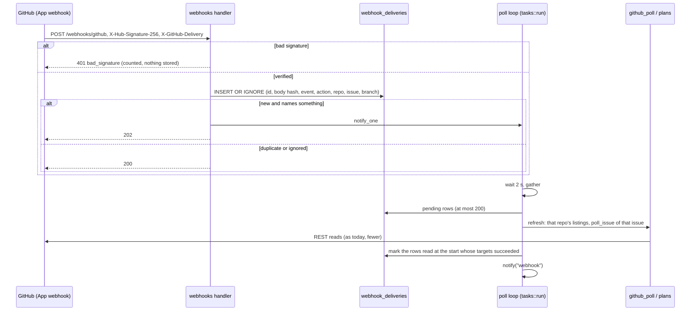

# Design 208: GitHub App webhooks, and the poll as a catch-up

Plan: [../208.md](../208.md) · ADR 0074 (*proposed*) · Map: seam `server-github`.

## Why

The poll reads every tracked issue every 60 s (`crates/rubato-server/src/tasks.rs:110`,
`Limits::github_poll_interval_secs`), and on 2026-11-15 the installation's 5,000-call budget ran
out before the hourly reset. Most of those reads find nothing new. The App can tell the server
what changed, and the poll then only has to catch what a delivery missed.

## What exists

- `tasks::Poller::tick(app, lane)` (`tasks.rs:110`) is the only GitHub reader on a timer. Per tick:
  open issues of the union of repos (ADR 0019, 0048), `Map:` lines, coverage, then per tracked issue
  `read_meta → RepoView::branch → plans::fetch_and_store when the head moved → poll_pr →
  poll_comments on the full lane` (`tasks.rs:285-345`), discovery of untracked plans (ADR 0032),
  every open pull request (ADR 0034), then local work (link comments, seam notices, room sweep,
  map proposal, gauges, the rate-limit read, `notify("poll")`).
- The loop `tasks::run` (`tasks.rs:427`) counts loop passes as time: `map_age += secs`
  (`tasks.rs:449`) and `LaneClock` adds `secs` per call (`tasks.rs:77-88`).
- `list_repo_pulls` deletes the pull rows of every repo not in the set it walks
  (`github_poll/pulls.rs:54`, `forget_others`); `list_open_issues` → `record_gauges` forgets the
  backlog of every repo not in its set (`github_poll/backlog.rs:210, 243-249`).
- The same-origin layer (`kernel/http.rs:130`, ADR 0066) is a `route_layer` over every API route
  in `app.rs:146`; routes added after that call are not under it.
- `hmac 0.12` and `sha2 0.10` are already dependencies of `rubato-server` (`Cargo.toml:30-31`).

## Decisions

**D1 Endpoint and switch.** `POST /webhooks/github`. `RUBATO_GITHUB_WEBHOOK_SECRET` set (not empty)
turns it on; it is read once into `Config` as a `WebhookSecret` whose `Debug` prints
`[redacted]`, and is never logged, stored or sent. Unset: every method on `/webhooks/*` answers the
404 JSON of an unknown API path, and the server logs one line at start, `github webhooks off`.
Set: one line `github webhooks on` with the path and the catch-up interval. The deployed server
has no secret, so it behaves as today.

**D2 Verification first.** The route sets `DefaultBodyLimit` to 5 MiB and takes the body as a
`Result`, so an oversized body is answered 413 *and counted* `too_large` (GitHub caps payloads at
25 MB; a push that size is rare and the catch-up covers it). It computes HMAC-SHA256 of the raw
bytes under the secret. `X-Hub-Signature-256` must be `sha256=` and 64 lower-case hex characters,
and the MAC is checked with `Mac::verify_slice` (constant time). A missing, malformed or wrong
signature answers 401 `{"reason":"bad_signature"}`, stores nothing, wakes nothing, and is counted
`rejected`. Nothing in the body or the other headers is trusted before this. The unsigned headers it
logs on refusal (`X-GitHub-Delivery`, `X-GitHub-Event`) are cut to 64 characters of
`[A-Za-z0-9._-]`.

**D3 Outside the same-origin check, on purpose.** The route is added to the router after the
`same_origin` `route_layer`, with a comment saying why: GitHub is not a browser, and the signature
is the authentication. (GitHub sends neither `Origin` nor `Sec-Fetch-Site`, so it would pass the
check anyway; the placement makes that independent of the rule.) A test sends a signed delivery
with `Sec-Fetch-Site: cross-site` and an evil `Origin` and sees it accepted, and the same with a bad
signature refused with 401 (not 403).

**D4 Recorded once, bounded.** Table `webhook_deliveries` (migration 0026), owned by the new slice
`webhooks`:

| Column | Type | Note |
| --- | --- | --- |
| `delivery_id` | TEXT PK | `X-GitHub-Delivery`, at most 64 characters |
| `body_sha256` | TEXT UNIQUE | hex SHA-256 of the body: the same signed body under another id or event header is a duplicate |
| `event` | TEXT | `X-GitHub-Event`, at most 64 |
| `action` | TEXT NULL | the payload's `action`, at most 64 |
| `repo` | TEXT NULL | `repository.full_name`, at most 200 |
| `issue_number` | INTEGER NULL | the issue it resolves to (D5) |
| `branch` | TEXT NULL | the head branch or pushed branch, at most 255 |
| `received_at` | TEXT | RFC 3339 |
| `outcome` | TEXT | `accepted` or `ignored` |
| `attempts` | INTEGER | refreshes tried that failed |
| `refreshed_at` | TEXT NULL | set when what it names was read; set at once for `ignored` |

`INSERT OR IGNORE` on both keys: a redelivery, or a replay of a captured body under fresh headers,
answers 200 `duplicate` and changes nothing. The unsigned headers are therefore no lever: a body
counts once. No payload body is kept. Rows older than 7 days are deleted on the 60 s tick. Pending
rows are read oldest first, at most 200 per pass.

**D5 What a delivery names.** A pure function of event, action and a few payload fields. First,
a push to a workspace's `map_repo` at `map_ref` reloads the maps, whatever else is true. Then a
repo that is neither in the union of workspace repos nor a tracked issue's repo is ignored.

| Event | Resolves to | Refresh |
| --- | --- | --- |
| `issues`, actions `opened`, `edited`, `closed`, `reopened`, `deleted`, `transferred` | `issue.number` | the issue on the full lane, and the repo's open issues listing (a new issue's `Map:` line, title, state). Other actions (`labeled`, `assigned`, …) are ignored |
| `issue_comment` | `issue.number`; ignored when `issue.pull_request` is present | the issue, full lane (comments: `Decision:`, and `Review:`/`Approved:` until the cutover) |
| `pull_request` | the issue of `pull_request.head.ref` when it is an `issue/` branch | that issue, fast lane, and the repo's open pull requests (ADR 0034) whatever the branch, with checks of pull requests no tracked issue owns |
| `check_suite` | the issue of `check_suite.head_branch` | as `pull_request` |
| `check_run`, action `completed` only | the issue of `check_run.check_suite.head_branch` | as `pull_request`; other actions ignored |
| `push` to `refs/heads/issue/…` | that issue | the issue, fast lane (the new head makes the plan read, ADR 0023) |
| anything else (`ping`, `installation`, a tag push, …) | nothing | stored `ignored`, answered 200 |

An issue a delivery names that is not tracked gets the repo's open issues listing too, so ADR 0032
discovery can read its plan (one listing and its branch listing). Resolving a branch to an issue
uses `IssueRef::number_from_branch`, the poll's rule.

**D6 One writer.** The handler answers 202 at once and calls `Notify::notify_one` on a kernel
`Notify` (a wake during a pass keeps its permit). The poll loop is the only task that reads GitHub
on a timer or writes the GitHub-derived tables, as today. On a wake it waits 2 s to gather a burst,
then runs a *refresh*: only the targets of the pending rows, then `notify("webhook")`. No
housekeeping on a wake.

**D7 One scoped pass.** `Poller::tick(app, lane)` keeps its signature and behaviour (it is
`pass(app, lane, Scope::All)` plus housekeeping) so every existing caller and test is unchanged.
`Poller::pass(app, lane, scope)` with `Scope::Targets(&Targets)`:
- `poll_issue` for named tracked issues (lane from D5), **and for every tracked issue not yet in
  `seen`**: newly pinned (UI or `Map:` line), launched, created, discovered issues get their first
  pass on the next tick as today, and cost nothing once seen;
- the open issues listing for repos with an `issues` delivery or a named untracked issue; and, with
  webhooks on, for every repo on each full lane (every 300 s, one call per repo), so the backlog,
  `Map:` lines and the "Backlog age" panel keep their pace;
- discovery only for named untracked issues;
- `list_repo_pulls` for repos with a pull request or check delivery;
- the full-lane work that reads the database or makes one call (`approve::reconcile`,
  `auth::sweep_tokens`, `refresh_issue_permission`, coverage) stays on the 300 s full lane.

Both listing functions get two sets: the repos to list, and the repos that still exist (the
union). Only the second decides what is forgotten, so a refresh for repo A never touches repo B's
`repo_pulls`, `repo_pulls_status`, `backlog_repos` or `open_issues` rows.

**D8 Cadence by time, not by passes.** A pure `tasks::Cadence` holds deadlines in seconds of a
monotonic clock: the 60 s tick (`github_poll_interval_secs`), the 300 s full lane, the 300 s map
reload, and the catch-up. `run` asks it what is due at `Instant::now()`; tests drive it with
numbers, so the budget test runs the production cadence.
- Webhooks off: every tick is `tick(lane)`, the lane from the 300 s deadline. This is today's
  behaviour; the only difference is that a slow tick no longer shifts the next full lane.
- Webhooks on: every 60 s tick is `pass(lane, scope)` then housekeeping. The scope is `All` when
  the catch-up (`RUBATO_GITHUB_CATCHUP_SECS`, default 900, clamped to 300–3600 with a warning) is
  due, else the pending targets plus unseen issues. A catch-up is always a full lane.
- A wake (D6) runs a refresh and moves no deadline; `rubato.poll.ticks` counts ticks only.

**D9 Marking.** A pass reads the pending rows at its start and marks only those ids, so a delivery
that arrives during a pass waits for the next one. A row is marked when its issue's `poll_issue`
succeeded (repo-level targets are marked once their step ran; their errors are logged as today).
A failed one gets `attempts + 1`; at 3 it is marked anyway with `warn!("webhook refresh gave up")`
naming the issue, and the catch-up reads it. One line per pass: `info!("webhook refresh",
deliveries, issues, failed, marked)`.

**D10 Catch-up changes.** On a catch-up with webhooks on, for each issue already in `seen` and not
in a repo the installation does not cover (`uncovered_repos`: GitHub sends it no webhooks), the
poller compares before and after: issue title and state, the PR's number, open, draft, merged and
checks, and the plan head. A difference counts `rubato.github.catchup.changes{kind}`, sets
`rubato.github.catchup.last_change_at`, and logs `info!("catch-up found a change no delivery
brought")` with `rubato.issue` and `kind`.

**D11 The rate-limit read.** GitHub does not count `GET /rate_limit` against the budget and answers
it when the budget is gone. What was wrong: `tick` returns early with no map loaded, or on a
database error, before the read (`tasks.rs:113-116, 118-131`), and a failed read was a `debug!`
line, so `GitHubRateLimitLow` could go quiet on a stale gauge. Now `tick` reads the rate limit last
on every path (an inner function, then the read), housekeeping reads it every 60 s with webhooks
on, and a failed read is `warn!("rate limit read failed")`. Tests: every read but the rate limit
fails; no map loaded.

**D12 Telemetry** (names in `rubato-protocol::otel`):
- `rubato.github.webhook.deliveries` counter by `rubato.github.event` (one of the six, `ping`, or
  `other`, so the series stay bounded) and `rubato.outcome` (`accepted`, `duplicate`, `ignored`,
  `rejected`, `malformed`, `too_large`, `error`). `error` is a store failure, answered 500 with
  `error!("webhook store failed")`; GitHub does not retry, the catch-up covers it.
- `rubato.github.webhook.last_accepted_at`: unix seconds of the newest `accepted` delivery (read
  back from the table at start, 0 before any); ignored ones (`ping`, other repos) do not count;
- `rubato.github.webhook.pending_oldest_seconds`: age of the oldest unmarked accepted row, 0 when
  none;
- `rubato.github.catchup.last_change_at` and `rubato.github.catchup.changes{kind}` (D10);
- the three gauges are recorded every 60 s tick and only while webhooks are on, so with webhooks
  off they are absent and the rules below stay silent. Gauges and counters are created without a
  unit (the `_seconds` suffix pitfall of `observability/check.ts`);
- a `rubato.inbound_event` span per delivery with `rubato.github.event`, `rubato.repo`,
  `rubato.issue` and `rubato.outcome`; `warn!("webhook refused")` for 401, 400 and 413.

Alerts (seam `server-github`, owner `rubato-server`, panel "Webhooks"), on gauges so no counter
`increase()` can miss a first sample:
- `GitHubWebhooksSilent` (ticket):
  `max(rubato_github_catchup_last_change_at) - max(rubato_github_webhook_last_accepted_at) > 1800`.
  The catch-up had to find a change more than 30 minutes after the last accepted delivery: the hook
  is broken (URL, secret, tunnel, App events) and the poll is hiding it. A working hook keeps
  `last_accepted_at` ahead; a quiet team has no changes; a delivery resolves it.
- `GitHubWebhooksStuck` (ticket): `max(rubato_github_webhook_pending_oldest_seconds) > 300`.
  Deliveries arrive and are not applied (refresh failing or the loop stuck).

## Sequence

## Tests

The webhook tests live in the crate (`webhooks/tests.rs`), not in `tests/`, because the in-memory
metric reader is `cfg(test)` in the lib (as in plan 193). They start the router on a loopback port
with `FakeGitHub` and sign bodies with the test secret.

## Concurrency and idempotency

- One writer of the GitHub-derived tables: the loop task. The handler writes only its own table.
- The delivery id and the body hash are the idempotency keys; the refresh is idempotent anyway (it
  reads current state), and out-of-order deliveries are harmless for the same reason.
- Two deliveries for one issue in one burst cost one refresh.
- Restart with pending rows: they are read on the first tick.
- A delivery that arrives during a pass is not marked by it (D9).

## Budget

Catch-up at 30 tracked issues: about 2 calls per repo plus about 2 per issue with an open pull
request and 1 per issue for comments, every 15 minutes, plus one open-issues listing per repo every
300 s: a few hundred calls an hour (the test measures it and must stay under 10% of 5,000). A
delivery costs at most the branch and pull listings of its repo (shared within a pass), the issue's
checks and, on the full lane, its comments. Housekeeping adds one `rate_limit` read a minute, which
GitHub does not count.

## What Mattias configures to turn it on

1. On the server: `RUBATO_GITHUB_WEBHOOK_SECRET=<random, e.g. openssl rand -hex 32>`; optionally
   `RUBATO_GITHUB_CATCHUP_SECS` (default 900).
2. A way for GitHub to reach `POST <public URL>/webhooks/github` (only that path needs exposing).
3. In the GitHub App's settings: Webhook active, URL `<that URL>/webhooks/github`, the same secret
   (content type is JSON for an App); subscribe to Issues, Issue comment, Pull request, Check
   suite, Check run and Push. GitHub offers each event only with its read permission (Issues, Pull
   requests, Checks, Contents), which the poll's reads already use; check them under Permissions.
4. Watch `rubato.github.webhook.deliveries` for `accepted` and GitHub's "Recent Deliveries" tab.

Until all of these are set, the server polls as today.
