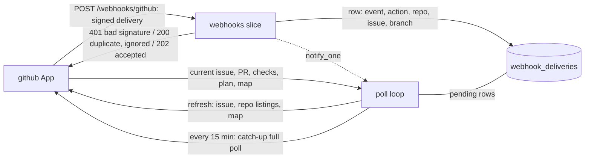

# Server: learn about GitHub changes from App webhooks, not a per-issue poll

Issue: #208 · Design: [208-github-webhooks/design.md](208-github-webhooks/design.md) · ADR 0074
(*proposed*). Full track: a new inbound endpoint, request-signature authentication, and a change
to the `server-github` seam's flows. From the issue: "the deployed server had used up the GitHub
App installation's rate limit … The poll asks GitHub every 60 s about every open issue … Most of
those reads find nothing new." The App sends webhooks; the server verifies each one, records it,
and refreshes only what it names. The poll stays as a slow catch-up. Off by default: until the
secret and the App's webhook URL are configured, the server polls exactly as today.

## What the change does

- **S1 Off unless configured.** Without `RUBATO_GITHUB_WEBHOOK_SECRET`, `/webhooks/github` answers
  404 like any unknown API path, the server logs `github webhooks off` once at start, and the poll
  is unchanged (design D1, D8).
- **S2 Signed deliveries only.** With the secret, `POST /webhooks/github` accepts a delivery only
  when `X-Hub-Signature-256` is the HMAC-SHA256 of the raw body under the secret, compared in
  constant time. Otherwise it answers 401, stores nothing and counts it. A body over 5 MiB is 413,
  one that is not JSON or lacks the GitHub headers is 400; both counted (D2).
- **S3 Outside the same-origin check.** The endpoint is not under the ADR 0066 same-origin layer;
  the signature is its authentication (D3).
- **S4 Once per delivery.** A verified delivery is recorded once by its `X-GitHub-Delivery` id and
  once by its body's SHA-256, with the event, action, repo, issue and branch it names and no
  payload. A redelivery or a replayed body answers 200 and changes nothing. Rows are kept 7 days
  (D4).
- **S5 Refresh what it names.** Within seconds, the poll loop refreshes only the issue, the repo's
  open issues or open pull requests (any branch), or the map that the delivery names, through the
  existing `github_poll` and `plans` reads, and forgets nothing of other repos (D5, D6, D7).
  Events: `issues` (opened, edited, closed, reopened, deleted, transferred), `issue_comment`,
  `pull_request`, `check_suite`, `check_run` (completed), `push`.
- **S6 Slow catch-up, by clock.** With webhooks on, the full poll runs every
  `RUBATO_GITHUB_CATCHUP_SECS` (default 900, 300–3600). Newly tracked issues still get their first
  read on the next 60 s tick; the open-issues listing and the database-only full-lane work keep
  their 300 s lane; the loop ticks every 60 s for local work and the rate-limit read. Deadlines are
  kept by clock, so a wake moves none of them (D7, D8).
- **S7 Planning reads stay until the cutover.** `Review:`, `Approved:` and `Decision:` comment reads
  are kept on catch-ups, first reads and `issue_comment` deliveries; nothing the cutover still
  needs is removed.
- **S8 A broken hook is not quiet.** Deliveries are counted by event and outcome; the newest
  accepted delivery, the oldest unapplied one and the newest change the catch-up had to find are
  gauges; `GitHubWebhooksSilent` fires when the catch-up finds a change more than 30 minutes after
  the last accepted delivery, and `GitHubWebhooksStuck` when an accepted delivery waits over 5
  minutes (D9, D10, D12).
- **S9 The rate-limit read is not quiet either.** `tick` reads the rate limit on every path,
  including no map loaded and a database error; a failed read logs at `warn`; with webhooks on it
  is read every 60 s (D11).

## How we'll know it works

- [ ] S1: `webhooks::tests::off_without_a_secret_answers_404` (any method on `/webhooks/github`
  gives 404 JSON) and `kernel::config::tests::webhook_secret_and_catchup_from_env` (unset or empty
  is off; the catch-up defaults to 900 and clamps 10 → 300 and 99999 → 3600 with a warning; the
  secret's `Debug` is `[redacted]`).
- [ ] S1: the existing poll tests in `tests/integration.rs` pass unchanged with webhooks off, and
  `tasks::tests::cadence_with_webhooks_off_is_every_tick` (every tick reads all, a full lane every
  300 s).
- [ ] S2: `webhooks::verify::tests::signatures` checks at least 8 cases (a vector computed with an
  independent HMAC, a wrong secret, one flipped body byte, upper-case hex refused, no `sha256=`
  prefix, short hex, missing header, non-hex characters), each with its expected result, and
  prints how many it checked.
- [ ] S2: `webhooks::tests::a_bad_signature_is_refused_and_counted`: 401, no row, no wake,
  `rubato.github.webhook.deliveries{outcome=rejected}` is 1. `..._malformed_and_too_large_are_counted`:
  signed non-JSON and a missing `X-GitHub-Delivery` are 400 `malformed`; a 6 MiB body is 413
  `too_large`.
- [ ] S3: `webhooks::tests::a_signed_delivery_passes_the_same_origin_check`: with
  `Sec-Fetch-Site: cross-site` and `Origin: https://evil.example`, a good signature is accepted
  (202) and a bad one is 401, not 403; an ordinary API write with the same headers is still 403.
- [ ] S4: `webhooks::tests::a_redelivery_changes_nothing`: the same id twice, and the same body
  under a new id, give 202 then 200 `duplicate` twice: one row, one refresh.
- [ ] S5: `webhooks::event::tests::what_a_delivery_names`: the D5 table row by row, including the
  ignored ones (comment on a PR, `check_run` created, `issues` labeled, tag push, other repo,
  `ping`) and a map-branch push in a repo no map part names; prints how many it checked.
- [ ] S5: `webhooks::tests::a_delivery_refreshes_only_what_it_names`: a `pull_request` closed
  (merged) delivery for `issue/5-x` moves issue 5 to Done with no call for issue 6, and repo B's
  `repo_pulls`, `repo_pulls_status`, `backlog_repos` and `open_issues` rows and `listed_at` are
  unchanged. Also: `issues` opened with a `Map:` line pins the issue; `push` to `issue/7-x` reads
  the new plan; `issue_comment` reads issue 8's comments; a `push` for an untracked issue's
  branch discovers its plan.
- [ ] S6: `webhooks::tests::the_loop_refreshes_within_seconds`: with `tasks::run` running and
  webhooks on, a signed delivery changes the overview within 10 s.
- [ ] S6: `tasks::tests::cadence_with_webhooks_on`: driven with numbers, 100 wakes in a minute
  move no deadline; ticks every 60 s, full lanes every 300 s, catch-ups every 900 s, map reloads
  every 300 s; prints how many steps it checked.
- [ ] S6: `webhooks::tests::a_newly_pinned_issue_is_read_on_the_next_tick`: webhooks on, an issue
  pinned from the API with an open PR shows In review after one tick that is not a catch-up.
- [ ] S6: `webhooks::tests::a_dropped_delivery_is_fixed_by_the_catch_up`: a merge with no delivery
  stays In review through refreshes and ticks, becomes Done on the catch-up, and counts
  `rubato.github.catchup.changes` once and sets `last_change_at`; a change in an
  uncovered repo is not counted.
- [ ] S6: `webhooks::tests::the_catch_up_stays_well_inside_the_budget`: 30 tracked issues, one
  hour of the production `Cadence` with webhooks on: under 10% of 5,000 calls; prints the count.
- [ ] S6: `webhooks::tests::marking_follows_the_pass`: a delivery stored during a pass is not
  marked by it; a failed `poll_issue` leaves its row pending with `attempts` 1; at 3 it is marked
  with `webhook refresh gave up`.
- [ ] S7: the comment tests in `tests/integration.rs` (approvals, reviews, decisions, cutover) pass
  unchanged; `issue_comment` reaches `poll_comments` (S5 test).
- [ ] S8: `observability/alerts/tests/rubato.test.yml` fires `GitHubWebhooksSilent` and
  `GitHubWebhooksStuck` on purpose, and keeps them quiet with recent deliveries, with no catch-up
  change, with a catch-up interval of 3600 s and only ignored deliveries counted, and with webhooks
  off (series absent); `pnpm observability:check` lists both in the "never silent" set.
- [ ] S9: `webhooks::tests::the_rate_limit_is_read_when_every_other_read_fails` (the fake's
  `exhausted` switch: every read but `rate_limit` answers `API rate limit exceeded`) and
  `..._with_no_map_loaded`: the tick records the gauge both times.

## What it must not break

- The poll with webhooks off, call for call: `tests/integration.rs` poll and budget tests
  (`thirty_tracked_issues_stay_inside_the_rate_limit_budget`, the call-order guards that end in
  `rate_limit`) run unchanged.
- Progress is derived: deliveries update inputs (`issue_meta`, `pull_requests`, `plans`), never a
  state; `derived_state_is_never_stored` (`tests/integration.rs:866`) scans every table, the new one
  included.
- Every signal keeps a last-seen time: the backlog's `listed_at` (still every 300 s, so the
  "Backlog age" panel thresholds hold), the PR rows and the map's `loaded_at` are written by the
  same code; a missed delivery is late, not wrong, and counted (S8).
- Other repos' rows survive a refresh: the S5 test.
- Newly pinned, launched, created and discovered issues are read on the next tick: the S6 test.
- ADR 0025's "within five minutes" for the Issues permission, link comments, room sweeps and
  approval reconcile: they stay on the 300 s lane and the 60 s tick (the S6 cadence test).
- The same-origin check for every other route: `app::tests::cross_origin_writes_are_refused_and_counted`.
- Unknown `/api`, `/ws`, `/auth` paths still 404, and every known route answers: `app::tests`
  (`known_routes` and the unknown-path list gain `/webhooks/github`).
- `GitHubRateLimitLow` and `ServerPollSilent`: their promtool tests; the loop still ticks every
  60 s with webhooks on, and wakes do not count as ticks.
- `schema/protocol/*.json` unchanged (no wire type changes): the schema snapshot test.
- The slice layout check (`slices.rs`) with the new `webhooks` block line in AGENTS.md.

## How we'll debug it at 3 am

See the O-rows. New: `rubato.github.webhook.deliveries{rubato.github.event, rubato.outcome}`,
`rubato.github.webhook.last_accepted_at`, `rubato.github.webhook.pending_oldest_seconds`,
`rubato.github.catchup.last_change_at`, `rubato.github.catchup.changes{kind}`, the alerts
`GitHubWebhooksSilent` and `GitHubWebhooksStuck`, `warn!("webhook refused")` (status, reason, the
claimed delivery id and event, sanitised), `error!("webhook store failed")`,
`info!("webhook refresh")` (deliveries, issues, failed, marked), `warn!("webhook refresh gave
up")`, `info!("catch-up found a change no delivery brought")` (`rubato.issue`, `kind`), the start
lines `github webhooks off` / `github webhooks on`, and `warn!("rate limit read failed")`.

## Affected parts

| Node | Status | What changes | Seams |
| --- | --- | --- | --- |
| rubato-server | affected | new slice `webhooks` (endpoint, verification, deliveries table), the poll loop's cadence by clock and scoped pass, config, metrics, the rate-limit read on every path | server-github |
| github | affected | the App sends webhooks to the server once Mattias configures them; nothing else changes | server-github |
| rubato-protocol | affected | metric and attribute names in `otel.rs` only; no wire type or schema | server-github |

## Data models

| Model | Kind | Part | Change | Crosses | Note |
| --- | --- | --- | --- | --- | --- |
| `webhook_deliveries` | table | rubato-server | new | server-github | migration 0026; id, body hash, event, action, repo, issue, branch, received_at, outcome, attempts, refreshed_at; no payload; 7 days |
| GitHub webhook delivery (`X-Hub-Signature-256`, `X-GitHub-Delivery`, `X-GitHub-Event`, JSON body) | event | rubato-server | new | server-github | read, verified, reduced to the row above |
| `rubato.github.webhook.deliveries`, `.last_accepted_at`, `.pending_oldest_seconds`, `rubato.github.catchup.changes`, `.last_change_at`, attribute `rubato.github.event` | event | rubato-protocol | new | server-github | names in `otel.rs` |
| `RUBATO_GITHUB_WEBHOOK_SECRET`, `RUBATO_GITHUB_CATCHUP_SECS` | file | rubato-server | new | server-github | process environment; the secret is never logged or stored |

## Data flow

## Tasks

1. **PR 0** this plan, the design note, ADR 0074 (*proposed*), the map's new `server-github` flow;
   `plan.ts check`; review; delegated approval.
2. **Test first:** `webhook_secret_and_catchup_from_env` (fails: no fields). Then `WebhookSecret`,
   `github_webhook_secret`, `github_catchup_secs` in `kernel/config.rs`, and the names in
   `rubato-protocol::otel` with the metrics in `kernel/telemetry.rs`. — S1, S6, S8
3. **Test first:** `webhooks::verify::tests::signatures` (fails: no module); then `verify.rs`. — S2
4. **Test first:** `webhooks::event::tests::what_a_delivery_names` (fails); then `event.rs`, the
   pure D5 table. — S5
5. **Test first:** migration 0026 and `webhooks::store` tests (insert once by id and by body hash,
   pending oldest first, mark by id, attempts, prune after 7 days, last accepted time, oldest
   pending age). — S4
6. **Test first:** `off_without_a_secret_answers_404`, bad signature, malformed and too large,
   same-origin bypass and redelivery (fail: no route). Then `webhooks::handler`, the route in
   `app.rs` after the `same_origin` layer, the `Notify` in `AppState`, the start line. — S1–S4
7. **Test first:** `cadence_with_webhooks_off_is_every_tick`, `cadence_with_webhooks_on` (fail: no
   `Cadence`). Then `tasks::Cadence`. — S6
8. **Test first:** `a_delivery_refreshes_only_what_it_names`, `a_newly_pinned_issue_is_read_on_the_next_tick`,
   `marking_follows_the_pass` (fail). Then `Poller::pass(lane, scope)` with `tick` as `pass(All)`
   plus housekeeping, the two-set listings in `list_open_issues` and `list_repo_pulls`, marking.
   — S5, S6, S7
9. **Test first:** `a_dropped_delivery_is_fixed_by_the_catch_up`, `the_catch_up_stays_well_inside_the_budget`,
   `the_loop_refreshes_within_seconds` (fail). Then `run` on the `Cadence`, the catch-up change
   count (D10), the three gauges, pruning. — S6, S8
10. **Test first:** the two rate-limit tests with the fake's `exhausted` switch (fail: no gauge with
    no map). Then the read on every path of `tick` and the `warn!`. — S9
11. **Test first:** the promtool cases for both alerts and their `REQUIRED` entries in
    `observability/check.ts` (fail: no rule). Then the rules and the "Webhooks" panel. — S8
12. AGENTS.md slice block line for `webhooks`; `cargo fmt`, clippy, `cargo test -p rubato-server`
    and `-p rubato-protocol`, `pnpm observability:check`, `pnpm observability:test`, plan-check.

## Assumed, not yet approved

| # | Decision | Chosen | Alternatives | Scope |
| --- | --- | --- | --- | --- |
| A1 | Where the refresh runs | in the poll loop task, woken by `Notify::notify_one` (D6) | in the request handler; a second task | node |
| A2 | Body limit | 5 MiB, 413 counted `too_large` | axum's 2 MiB default; GitHub's 25 MB | node |
| A3 | Burst gathering | 2 s after the first wake | none; 10 s | node |
| A4 | Retention | 7 days, pruned on the 60 s tick; at most 200 pending rows per pass | 30 days; an hourly row cap | node |
| A5 | `check_run` actions | only `completed`; `check_suite` all | every action | node |
| A6 | Failed refreshes | 3 attempts, then left to the catch-up with a `warn!` | retry until the catch-up | node |

## Decisions

| # | Decision | Chosen | Why | Decided by |
| --- | --- | --- | --- | --- |
| 1 | Endpoint and switch | `POST /webhooks/github`; on only with `RUBATO_GITHUB_WEBHOOK_SECRET`, read once into config; off answers 404 and logs once at start | the deployed server stays as today until the secret and URL are set; most reversible | agent (delegated by Mattias, 2026-11-15) |
| 2 | Authentication | HMAC-SHA256 of the raw body, `X-Hub-Signature-256`, constant-time compare; 401 otherwise | GitHub's own scheme; no other credential on the path | agent (delegated by Mattias, 2026-11-15) |
| 3 | Same-origin check | the route sits outside the ADR 0066 layer, explicitly, with tests both ways | GitHub is not a browser; the signature is the authentication | agent (delegated by Mattias, 2026-11-15) |
| 4 | What is stored | one row per `X-GitHub-Delivery` id and per body SHA-256, no payload, 7 days | idempotent redelivery; a captured body cannot be replayed under fresh unsigned headers | agent (delegated by Mattias, 2026-11-15) |
| 5 | Events | `issues` (opened, edited, closed, reopened, deleted, transferred), `issue_comment`, `pull_request`, `check_suite`, `check_run` (completed), `push`; a push to a map branch reloads the map | what still happens on GitHub (issue #208); other `issues` actions would cost a listing for nothing Rubato shows | agent (delegated by Mattias, 2026-11-15) |
| 6 | Catch-up | `RUBATO_GITHUB_CATCHUP_SECS`, default 900, 300–3600, always a full lane; first reads of new issues on the next tick; the open-issues listing and database-only full-lane work every 300 s; the loop at 60 s; deadlines by clock | the issue's 15–30 min, without slowing what rides the tick (review F1, F5) | agent (delegated by Mattias, 2026-11-15) |
| 7 | Planning reads | comment reads stay on catch-ups, first reads and `issue_comment` until the cutover | `comment_approvals_until` is unset on the deployed server | agent (delegated by Mattias, 2026-11-15) |
| 8 | How GitHub reaches the server | not decided by Rubato: any ingress that exposes only `POST /webhooks/github`; no relay product is a dependency | the signature makes the path safe to expose alone; deployment is Mattias's (issue Q1) | agent (delegated by Mattias, 2026-11-15) |
| 9 | Silent-hook alerts | `GitHubWebhooksSilent` (catch-up change more than 30 min after the last accepted delivery) and `GitHubWebhooksStuck` (an accepted delivery unapplied over 5 min), both tickets, on gauges | gauges have no first-sample blind spot; the poll still covers both at 15 min, so tickets, not pages (review F3) | agent (delegated by Mattias, 2026-11-15) |
| 10 | Rate-limit read | last in `tick` on every path, `warn!` on failure, every 60 s with webhooks on | GitHub does not count `/rate_limit` and answers it when exhausted; the early returns and the `debug!` line hid failures (review F7) | agent (delegated by Mattias, 2026-11-15) |
| 11 | ADR | 0074 supersedes, while webhooks are on, the "every tick" clauses of ADRs 0019, 0023, 0032, 0034, 0048 and the "every request" clause of 0066; with webhooks off each stands whole | issue Q3; review F2 | agent (delegated by Mattias, 2026-11-15) |
| 12 | Listings under a repo filter | two sets: repos to list, and repos that still exist (the union) | a refresh for one repo must not forget the others (review F4) | agent (delegated by Mattias, 2026-11-15) |
| 13 | Marking | only the rows read at a pass's start, only for targets that succeeded | a delivery during a pass, or a failed read, is not lost (review F6) | agent (delegated by Mattias, 2026-11-15) |

## O-rows

| Seam | Breaks like | Signal | Panel | Owner |
| --- | --- | --- | --- | --- |
| server-github | the hook stops delivering (URL, secret, tunnel or App events wrong) and states lag by up to 15 min; deliveries refused or not applied; a refresh that reads too much; the budget runs out again | `rubato.github.webhook.deliveries{rubato.github.event, rubato.outcome}` (`rejected`, `malformed`, `too_large`, `error` with `warn!("webhook refused")` / `error!("webhook store failed")`); `rubato.github.webhook.last_accepted_at` against `rubato.github.catchup.last_change_at` (alert `GitHubWebhooksSilent`); `rubato.github.webhook.pending_oldest_seconds` (alert `GitHubWebhooksStuck`) with `info!("webhook refresh")`; `rubato.github.catchup.changes` with `info!("catch-up found a change no delivery brought")` naming `rubato.issue`; `rubato.github.calls` by endpoint and `GitHubRateLimitLow`; `rubato.inbound_event` span per delivery with `rubato.repo`, `rubato.issue`, `rubato.outcome` | Webhooks; GitHub calls · Rate limit | rubato-server |

## Flows

| From | To | Seam | Kind | Carries |
| --- | --- | --- | --- | --- |
| github | rubato-server | server-github | data | App webhook deliveries, signed with X-Hub-Signature-256: which issue, pull request, check or branch changed |
| rubato-server | github | server-github | control | the answer to a delivery: 202 accepted, 200 duplicate or ignored, 401 bad signature |

## ADRs proposed

| ADR | File | Blob |
| --- | --- | --- |
| 0074 | docs/decisions/0074-learn-github-changes-from-app-webhooks.md | c06202eac67de3cef0e691ac8ddd64e01d369f6e |

## Review map

1. `crates/rubato-server/src/app.rs` `router`: the webhook route after the `same_origin` layer, and the 404 when off.
2. `crates/rubato-server/src/webhooks/verify.rs` and `handler.rs`: the signature check before anything is read, and the two dedupe keys.
3. `crates/rubato-server/src/tasks.rs` `Cadence`, `run` and `Poller::pass`: the cadence by clock with webhooks on and off, the scope, and marking.
