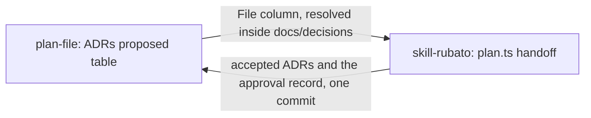

# plan.ts handoff keeps ADR paths in the decisions folder

#195 made `adrs.ts accept` and `plan.ts adrs-pin` refuse an `## ADRs proposed` row whose file
resolves outside the decisions folder, because the plan is text an agent wrote. `plan.ts handoff`
(#122) is a third reader of that File column and has no such check. Today it reads and rewrites
`join(top, r.file)` (`skills/rubato/scripts/lib/handoff.ts:205,232`). The bundle check does not
stop it: `bundle_paths` and the companion's mirror drop a row that leads out of the worktree, so
the approved bundle still matches. The accept loop then writes through a `..` path, through a path
inside the worktree but outside `docs/decisions`, or through a symlink in `docs/decisions` that
leads out. This change gives handoff the same rule.

## What the change does

- `plan.ts handoff` resolves each pinned ADR row with `decisionFile` (`skills/rubato/scripts/adrs.ts:94`) against the decisions folder of the map whose repo the checkout is. A row outside that folder is never read or written, and is reported in `adrs_left`. The handoff still commits the plan and its bundle and pushes.
- The rerun path, where the handoff commit already exists, applies the same rule when it works out which ADRs this approval accepted.
- An ADR inside the folder is accepted exactly as before.

## How we'll know it works

- [x] `skills/rubato/test/handoff.test.ts` "never reads or writes a pinned row outside docs/decisions": three pinned rows, each a proposed ADR at its pinned blob, are all left unchanged and listed in `adrs_left`: `../outside.md` (outside the worktree), `docs/0094-loose.md` (inside the worktree, outside the folder) and `docs/decisions/0095-link.md` (a symlink that leads out). The in-folder 0099 is still accepted, and a rerun pushes the same commit with the same lists. Fails on today's code: `adrs_accepted` comes back as `0099, 0093, 0094, 0095`, and all three outside files are rewritten.
- [x] The test's stand-in for the companion now reads the bundle as `plan_mirror/bundle.rs` does, regular files inside the worktree only. Without that, the symlinked row gave `bundle_changed` before the ADR loop was reached.

## What it must not break

- A handoff that accepts the in-folder ADR, a rerun, a run that stopped before its commit, `plan_changed`, `bundle_changed`, `adr_changed`, a failed push, and a handoff outside the map repo: the existing tests in `handoff.test.ts`, unchanged in what they assert.
- `adrs.ts accept` and `adrs-pin` keep #195's rule: `approval.test.ts`, unchanged.
- The installed copy stays byte-identical to the repo: `install.test.ts`.

## How we'll debug it at 3 am

See the O-rows. Nothing new is logged. A row refused by this rule shows in the `rubato.plan.handoff` line's `adrs_left`, which the agent relays in its reply and the session log keeps, and the ADR stays *proposed*.

## Affected parts

| Node | Status | What changes | Seams |
| --- | --- | --- | --- |
| skill-rubato | affected | `lib/handoff.ts`: pinned ADR rows are resolved inside the decisions folder before they are read or written | skill-plan-file |
| plan-file | quiet | the `## ADRs proposed` table is read as before; only where its File column may lead changes | skill-plan-file |

## Data models

None.

## Data flow

## Tasks

1. Failing test first in `skills/rubato/test/handoff.test.ts`: "never reads or writes a pinned row outside docs/decisions", with three escaping rows (one a symlink) and the in-folder 0099, then a rerun. Make the test's companion stand-in read regular files inside the worktree only, as `plan_mirror/bundle.rs` does. It fails on today's code with all four ADRs accepted.
2. `lib/handoff.ts`: find the map whose repo is the checkout's origin and its `decisions` folder (default `docs/decisions`), and add `adrFile(file)`, which is `decisionFile` inside the map repo and null outside it. Use it in the rerun's accepted list, in the bundle's pinned-blob rule and in the accept loop. A null row goes to `adrs_left`.

## Assumed, not yet approved

| # | Decision | Chosen | Alternatives | Scope |
| --- | --- | --- | --- | --- |
| A1 | A pinned row outside the folder at handoff | leave it proposed and list it in `adrs_left`, and still commit and push | refuse the whole handoff with a new outcome (a protocol change to `HandoffLine`, and the plan is already approved) | node |

## Decisions

None.

## O-rows

| Seam | Breaks like | Signal | Panel | Owner |
| --- | --- | --- | --- | --- |
| skill-plan-file | an in-folder ADR is wrongly left proposed (a symlinked checkout, a `decisions:` path with `..`), so an approved plan's ADRs are not accepted in its handoff commit | the `rubato.plan.handoff` line with the ADR in `adrs_left` and outcome `committed`; its `rubato.skill.command` span for `plan handoff`; the handoff report the companion relays | Skills emitting | skill-rubato |

## Flows

| From | To | Seam | Kind | Carries |
| --- | --- | --- | --- | --- |
| skill-rubato | plan-file | skill-plan-file | data | at handoff, the approval record and the accepted ADRs, only for files inside the decisions folder |

## ADRs proposed

None.

## Review map

1. `skills/rubato/scripts/lib/handoff.ts` `adrFile` and its three uses: every read or write of a pinned row goes through it.
2. `skills/rubato/test/handoff.test.ts` `makeWorld`'s `args()`: the companion stand-in now skips files outside the worktree, and the existing tests still pass with it.
