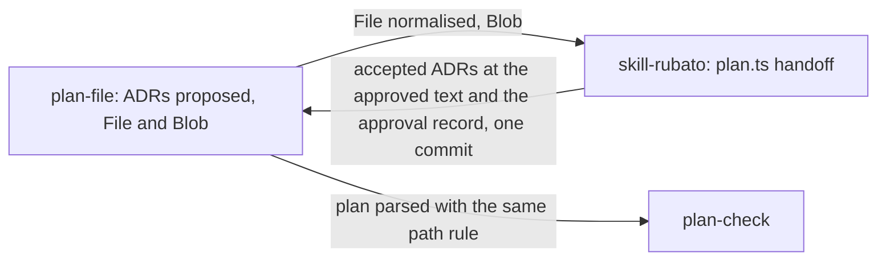

# Handoff counts an ADR at its pinned blob only for the text it would write

Issue: #212 · Map: `skill-rubato` · Track: small (two parts, no seam contract, no schema change).

`plan.ts handoff` checks the bundle against the approval. An ADR in the decisions folder that
already reads as accepted by this approval counts at the blob the plan pinned, so a run that
stopped after writing the acceptance and before its commit can finish. Two holes, both found by
the design review of #210: the rule trusts two lines (`acceptedInRubato`), so an ADR whose body
was rewritten after the approval, with those two lines set, also passes, and the handoff commits
a decision text nobody approved; and the pinned blob is looked up by the raw File cell, while
the bundle's paths are normalised, so a `./docs/decisions/…` row never finds its pin and a
rerun is a false `bundle_changed`.

## What the change does

- An in-folder ADR counts at its pinned blob only when its text is exactly what this handoff
  would have written: the text at the pinned blob was `proposed`, and the file is
  `acceptedText(<that text>, rubatoAcceptance(by, date, url, self))`. Any other text counts at
  its real blob, so an edited body, or a rewritten *Decided by* on an ADR that was already
  accepted, is `bundle_changed` and nothing is written. The refusal's `error` names each such
  ADR and why (pinned text not in this clone, not proposed, or a different text).
- The accept loop uses the same rule, and only for rows the bundle carries: a pinned row that
  the bundle's table parser skipped is left proposed, never reported as accepted.
- The text at the pinned blob is kept in the worktree's git object store, without a commit:
  `plan.ts adrs-pin` writes each pinned ADR as a loose object (`git hash-object -w
  --no-filters`), and the handoff writes it again before its first write, checking that git
  stores it under the pinned sha; a keep that fails or hashes differently ends the run with
  `error` before anything is written. When the object is missing at a rerun (pinned and
  stopped in another clone), the ADR counts at its real blob: a refusal, never a silent pass.
- The pinned blob is keyed by the File cell normalised with the rule `bundle_paths` uses
  (`./a/../b` → `b`), so a `./`-prefixed row that stopped before its commit is committed on
  the rerun.

## How we'll know it works

- [ ] `handoff.test.ts` "an ADR edited after the approval, with the accepted lines set, is
  bundle_changed": the body differs, Status and Decided by are as this approval writes them;
  today it commits, after the change it refuses and writes nothing.
- [ ] `handoff.test.ts` "a `./` row that stopped before its commit is committed": today
  `bundle_changed`, after the change `committed` with `adrs_accepted: ["0099"]`.
- [ ] `handoff.test.ts` "an accepted ADR whose pinned text is not in git counts at its real
  blob": the object is pruned from the test repo; the handoff refuses with `bundle_changed`.
- [ ] The existing "counts at its pinned blob" test still passes, now with the text the
  handoff itself writes (`acceptedText` of the pinned text) instead of a hand-written string.
- [ ] `handoff.test.ts`: after `pinAdrs`, `git cat-file -t <blob>` is `blob`.
- [ ] `handoff.test.ts` "an ADR pinned already accepted, its Decided by rewritten as this
  approval would, is bundle_changed", with `was not proposed` in the error.
- [ ] `handoff.test.ts` "the handoff keeps the pinned text itself": the pin's object is
  removed, a `pre-commit` hook stops the first run after its ADR write (`error`), the rerun
  without the hook is `committed` with `adrs_accepted: ["0099"]`. Removing the handoff's own
  keep makes it fail (checked by hand once).
- [ ] The edited-body test also expects `error` to name ADR 0099 and the reason.

## What it must not break

- Every other handoff outcome and its exit code: the `plan.ts handoff` suites in
  `skills/rubato/test/handoff.test.ts` (first run, rerun after the commit, push_failed,
  outside the map repo, the #210 folder rules) pass unchanged.
- `plan.ts adrs-pin` outside a git checkout still pins: writing the object is best effort
  (`handoff.test.ts` "adrs-pin outside a git checkout still fills the Blob column").
- The bundle hash stays the twin of `rubato_protocol::plan_hash`: the shared fixtures under
  `schema/fixtures/plans/bundle/` run in both suites; the normaliser is the one `bundlePaths`
  already uses, now exported, not a second copy.

## How we'll debug it at 3 am

See the O-rows. No new log line: a refusal is the existing `rubato.plan.handoff` line with
outcome `bundle_changed`, and its `error` now names both hashes and each ADR that reads as
accepted by this approval but did not count at its pin, with the reason. First action:
`differs` or `not proposed` means someone changed the ADR after the approval, so ask for a new
approval; `not in this clone's objects` means restore the proposed text from the approved draft
revision in Rubato and rerun the same handoff command.

## Affected parts

| Node | Status | What changes | Seams |
| --- | --- | --- | --- |
| skill-rubato | affected | `lib/handoff.ts`: the pinned-blob rule compares the whole text with what this handoff writes, keyed by the normalised path, and keeps the pinned text as a git object before writing; `adrs.ts` `pinAdrs` writes the object too | skill-plan-file |
| plan-check | affected | `src/bundle.ts` exports its path normaliser for the skill; the rule itself does not change | plan-check-plan-file |
| plan-file | quiet | the `## ADRs proposed` table and the handoff commit are as before | skill-plan-file, plan-check-plan-file |

## Data models

None.

## Data flow

## Tasks

1. Failing tests first in `skills/rubato/test/handoff.test.ts`: the edited-body test (commits
   today), the `./` row test (`bundle_changed` today), and the missing-object test. Rewrite the
   existing "counts at its pinned blob" test to write `acceptedText(ADR_TEXT,
   rubatoAcceptance(…))`, the text a stopped run leaves.
2. `actions/plan-check/src/bundle.ts`: export `normalisePath` unchanged.
3. `skills/rubato/scripts/adrs.ts` `pinAdrs`: after computing each blob, `git hash-object -w
   --no-filters <file>` in `cwd`, ignoring failure. Test: `git cat-file -t` is `blob`.
4. `skills/rubato/scripts/lib/handoff.ts`: key `pinnedBlob` by the normalised File cell; add
   `acceptedAtPin(top, text, pin)`, true only when `git cat-file blob <pin>` succeeds and
   `text === acceptedText(pinned, rubatoAcceptance(a.by, date, a.url, a.self))`; use it in the
   bundle rule; before the ADR writes, `git hash-object -w --no-filters --stdin` each original
   text. The accept loop's `acceptedInRubato` branch stays (the bundle check has already
   passed by then).
5. Run `pnpm --filter ./skills/rubato test`, `pnpm --filter ./actions/plan-check test`, `pnpm
   typecheck`, `pnpm plan-check`.

## Assumed, not yet approved

| # | Decision | Chosen | Alternatives | Scope |
| --- | --- | --- | --- | --- |
| A1 | Where the pinned text is kept while uncommitted | a loose object in the worktree's git object store, written at pin and again before the acceptance | a sidecar file next to the plan (it would show in the draft bundle and the mirror); reversing `acceptedText` (not exact) | node |
| A2 | The rerun after the handoff commit exists | unchanged: it commits nothing and only pushes; its `adrs_accepted` is read from the working tree and may over-report, which the server only logs | read each ADR at the commit (`git show <commit>:<path>`) | node |

## Decisions

| # | Decision | Chosen | Why | Decided by |
| --- | --- | --- | --- | --- |
| 1 | Design review blockers (3am error text, the `proposed` condition and the accept loop, the handoff's own keep tested and checked) | folded into the plan and the tasks | review passed after fixes | agent (delegated by Mattias, 2026-11-15) |
| 2 | Approve plan for build | yes | review passed, delegated approval | agent (delegated by Mattias, 2026-11-15) |

## O-rows

| Seam | Breaks like | Signal | Panel | Owner |
| --- | --- | --- | --- | --- |
| skill-plan-file | a rerun after a stopped handoff is refused (the pinned object was pruned, or a row the normaliser reads differently), so an approved plan does not reach its branch | the `rubato.plan.handoff` line with outcome `bundle_changed` and both hashes in `error`; its `rubato.skill.command` span for `plan handoff` with `rubato.exit_code` 8; the handoff report the companion relays; `ApprovalNoHandoff` fires after 30 minutes | Approvals waiting for handoff; Skills emitting | skill-rubato |
| plan-check-plan-file | the exported normaliser drifts from `rubato_protocol::plan_hash::normalise_path`, so plan-check and the server hash a bundle differently | the shared `schema/fixtures/plans/bundle/` cases fail in the plan-check suite and in `cargo test -p rubato-protocol`; on a PR, the `rubato.plan.check` line with a bundle mismatch | Skills emitting | plan-check |

## Flows

| From | To | Seam | Kind | Carries |
| --- | --- | --- | --- | --- |
| skill-rubato | plan-file | skill-plan-file | data | at handoff, an ADR's acceptance only over the text the approval pinned |

## ADRs proposed

None.

## Review map

1. `skills/rubato/scripts/lib/handoff.ts` `acceptedAtPin` and the bundle rule that calls it: the only place an ADR may count at a blob other than its own.
2. `skills/rubato/scripts/lib/handoff.ts` the object write just before the ADR writes, and `adrs.ts` `pinAdrs`: the pinned text must be in git before any acceptance is written.
3. `skills/rubato/test/handoff.test.ts` the rewritten "counts at its pinned blob" test: it now uses the exact text a stopped run leaves.
