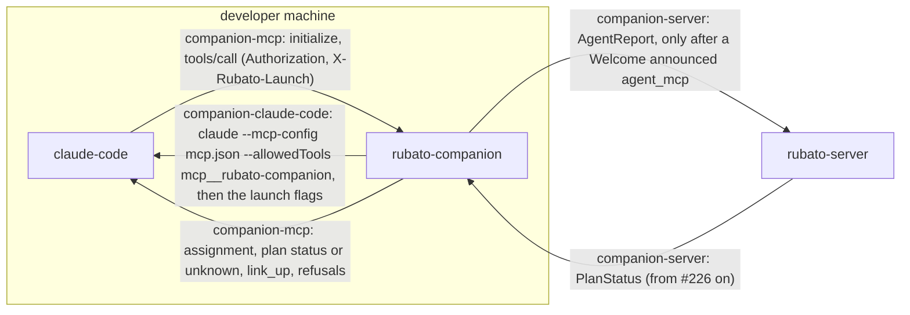

# Agent MCP in the companion: protocol, the agent_mcp slice, /mcp, launch flags

Issues: #220 #221 #222 #223 #224 #225 · Design: [220-agent-mcp-companion/design.md](220-agent-mcp-companion/design.md)
· Built under the design of #197 ([plan](197.md), [design](197-agent-mcp/design.md), ADR
[0071](../decisions/0071-agent-mcp-in-the-companion.md), accepted) · Map: `companion-mcp`,
`companion-claude-code`, `companion-server`.

Track: **full**. `crates/rubato-protocol` changes `schema/protocol/*.json`, a new slice arrives,
and three seams change. Their flows are already in the map from #197.

ADR 0071 says a session Rubato launches asks its own companion what it is on, says what it is
doing, and asks where its plan stands, over MCP on the companion's loopback hook receiver. This
plan builds the protocol types and the companion side of that, one PR per issue. The server side
is plan #226, the first to announce `agent_mcp`. Until then a companion with this change:
- serves `get_assignment` fully;
- takes `report_status` and sends nothing on;
- answers `plan_status` as `unknown`.

## What the change does

- **The protocol carries an agent's report and its plan status** (#220): `AgentReport` from
  companion to server, `PlanStatus` from server to companion, the `agent_mcp` capability, limits
  and telemetry names. The server compiles against it and drops `AgentReport` until #226
  (design §1).
- **The companion remembers what a launch was for** (#224). The pinned map parts, map version,
  planning mode, attempt, attempt limit and launch time are known before the session starts and
  survive in `launches.json` (design §2).
- **The loopback receiver serves `/mcp`** (#222) behind the same token, with a 64 KiB limit and
  its own auth count, without slowing hooks (design §3).
- **A launched session's agent can call three tools** (#221, design §4):
  - `get_assignment` answers from the launch;
  - `report_status` takes one line and up to 8 parts, throttled, and is sent only to a server
    that takes it;
  - `plan_status` answers the last `PlanStatus`, or `unknown`.
  - A call with no known launch, or one naming another issue, is refused and counted.
- **Every launched session gets the server** (#223). `mcp.json` is written 0600, and
  `--mcp-config … --allowedTools mcp__rubato-companion` go right after the claude command, in
  `launch.sh` and in the headless turn script. Room forks get neither (design §5).
- **The companion talks `agent_mcp` with the server** (#225). It announces the capability,
  takes `PlanStatus` into the cache, answers whether the link is up, and says what leaves the
  machine (design §6).
- **Operators see the calls**: span `rubato.mcp.call`, counters `rubato.mcp.calls`,
  `rubato.mcp.reports` and `rubato.mcp.not_initialized`, panel "MCP calls by tool and outcome".

## How we'll know it works

- [ ] **Protocol** (#220). Failing first: `agent::tests` round-trips an `AgentReport` and a
  `PlanStatus` (no such types yet). Then:
  - the fixtures `companion_agent_report.json` and `server_plan_status.json` pass
    `all_fixtures_round_trip`, which prints a count two higher than on main;
  - the `agent_report` schema puts `MAP_ID_PATTERN` on `parts`;
  - `UPDATE_SCHEMAS=1 cargo test -p rubato-protocol --test schema_snapshot` shows an additive
    diff, and `pnpm typecheck` passes on the regenerated `protocol.ts`.
- [ ] **Server drops it** (#220). Failing first (it doesn't compile until the variant exists): a
  `companion_link` test sends the `AgentReport` fixture. It expects
  `rubato.events.dropped{rubato.reason="agent_report"}` once, an empty payload in
  `companion_events`, and `app.sessions` unchanged.
- [ ] **Assignment** (#224). Failing first:
  - `sessions::launches` round-trips a `LaunchRecord` with an `Assignment`;
  - a file from today's companion (fixture) loads with `None`;
  - after `begin_launch(cmd)` and before `apply_launch`, `assignment_of(cmd.id)` returns it;
  - after `end_launch` of a failed launch it returns `None`, and for an unknown or ended launch
    too.
- [ ] **Receiver** (#222). Failing first, `hooks::server` tests:
  - `POST /mcp` without the token gets 401 and counts `mcp_auth`, not `auth`;
  - with the token it reaches a stand-in router and sees `LaunchHeader`;
  - a 65 KiB body gets 413;
  - `GET /.well-known/x` without a token reaches the open router;
  - the flood test: every hook is forwarded and every `/handoff` answered.
- [ ] **Tools** (#221). Failing first, `agent_mcp` tests through `serve_with` (the merged router),
  against a registry with one launch:
  - `get_assignment` returns its issue, branch, parts and caps;
  - `initialize` for a launch that is still pending (after `begin_launch`) succeeds;
  - without `X-Rubato-Launch`, or with an unknown launch, `initialize` gets `-32001` and
    `tools/call` gets a tool error, both counting `refused`/`no_launch`, never 401;
  - `issue` naming another issue gets `isError` and counts `refused`/`identity`;
  - `plan_status` before any push answers `unknown`, and after `on_plan_status` answers that
    status. An older `as_of` pushed later does not replace it.
- [ ] **Transport** (#221, through `serve_with`):
  - `notifications/initialized` gets 202 and no body;
  - an unknown method gets -32601 and counts tool `unknown`;
  - `GET /mcp` gets 405;
  - `Origin: https://evil.example` gets 403;
  - `GET /.well-known/oauth-authorization-server` with no headers gets 404 and counts
    `discovery`;
  - `initialize` with `protocolVersion: 2025-11-25` gets that version back, and an unknown
    version gets `2025-11-25`;
  - no `Mcp-Session-Id` header.
- [ ] **Throttle and drain** (#221):
  - three `report_status` calls in 1 s give one pending report with the last line, and two
    count `coalesced`;
  - a 300-character `doing` is cut to 200 with `…`;
  - a part `Bad_Id` is dropped;
  - with `agent_mcp` absent from the server capabilities, the drain sends nothing, empties the
    map and counts `rubato.mcp.reports{not_sent, server_too_old}`;
  - with it present, one `AgentReport` goes out and counts `sent`.
- [ ] **Never *working*** (#221): a report applied to a live entry leaves the next `Sessions`
  snapshot byte-equal, and the stale sweep still emits `rubato.session.stale` after the
  heartbeat interval.
- [ ] **Not initialized** (#221):
  - a launch whose `launched_at` is 6 minutes old with no request counts
    `rubato.mcp.not_initialized` once over two ticks;
  - one that made any authenticated request counts nothing;
  - a launch restored at start counts nothing.
- [ ] **Load** (#221): the #222 flood test is repeated against the real `agent_mcp` routers
  with `tools/call get_assignment`, and every hook is still forwarded.
- [ ] **Tool guard** (#221): it prints `checked 3 tools`. The must-fail case with `approve_plan`
  added fails.
- [ ] **Launch** (#223). Failing first: a `launch/script.rs` test runs `launch.sh` against a
  stand-in `claude` that prints its argv, one word per line, with `claude_command` set to
  `claude --model x`. Then:
  - the words after `--model x` are `--mcp-config <dir>/mcp.json --allowedTools mcp__rubato-companion --session-id`;
  - the prompt is still the last word, and no word holds the token;
  - the same holds for `turn.sh` called with `-p hello`.
- [ ] **mcp.json** (#223): mode 0600, parsing as the shape in design §5. `worktree.feature`
  asserts it sits next to `hooks.json`.
- [ ] **Gherkin** (#223). A new `agent-mcp.feature` launches a session. A step posts
  `initialize` and `get_assignment` with the headers from `mcp.json`, the way
  `fire_launched_hook` posts hooks (`tests/cucumber/world.rs:432-470`). The answer names the
  issue. The suite prints its scenario count.
- [ ] **Manual check** (#223, recorded in the PR): with real `claude`, a generated `launch.sh`
  starts a session whose `/mcp` shows `rubato-companion` connected and the prompt delivered. A
  project `.mcp.json` that also defines `rubato-companion` is noted with the definition Claude
  Code used.
- [ ] **Link** (#225). Failing first:
  - Gherkin with the server stand-in: the Hello carries `agent_mcp`; with `agent_mcp` in the
    Welcome, one `report_status` reaches the stand-in as one `AgentReport`; without it, none
    does, and the log has the drain's line; a `PlanStatus` from the stand-in answers the next
    `plan_status`, with `link_up: true`;
  - unit test: `plan_status` with the link down says `link_up: false`;
  - unit test: `WHAT_LEAVES` names the agent's line and parts.
- [ ] **Dashboard** (#221): `observability/check.ts` requires "MCP calls by tool and outcome"
  querying `rubato_mcp_calls_total`. A fixture dashboard without it fails `check.test.ts`.

## What it must not break

- **Never *working* without hook evidence**: `report_status` writes only the slice's own map.
  Guard: the "Never *working*" test above.
- **No token on a command line** (ADR 0063): the token is only in `mcp.json` and
  `hook-auth.header`. Guard: `hooks/template.rs:47`
  `renders_embedded_template_without_the_token`, unchanged, and the argv test of #223.
- **No inbound access** (ADR 0004): `/mcp` is a route on the existing 127.0.0.1 listener
  (`hooks/server.rs:80,92`). Guard: the bind test, unchanged, and the `Origin` test.
- **Hooks unchanged** (ADR 0013): `hooks.feature` passes untouched. `/hook` and `/handoff` keep
  their routes, their answers and their `auth` count. Guards: the flood tests and the
  `mcp_auth` test.
- **Headless turns still run** (ADR 0062): `headless.feature` passes with the changed `turn.sh`.
- **Room forks stay without hooks and MCP** (ADR 0057). Guard (an N-guard: true today, kept
  true): a `kernel/claude.rs` test that `turn_args` names no `--mcp-config` or `--allowedTools`.
- **The prompt still starts the session**: the argv test of #223; `launch-branch.feature` and
  `worktree.feature` pass.
- **Nothing an agent says leaves the machine before `WHAT_LEAVES` says so** (ADR 0052, 0071).
  Guard: the drain test (nothing is sent without `agent_mcp`), and the companion announces it
  only in #225.
- **Older peers**: an older server never receives an `AgentReport`; Gherkin's "without it"
  scenario. Today's fixtures still round-trip.
- **Old state files**: a `launches.json` written today loads (the #224 fixture).
- **Slice layout**: the companion slice test passes with `agent_mcp` in the AGENTS.md block, and
  its acyclic check holds. `hooks` gains no edge to `agent_mcp`.
- **Server progress**: `derive_progress` unchanged; the server drops `AgentReport` (the #220
  test).

## How we'll debug it at 3 am

See the O-rows. New signals:
- span `rubato.mcp.call`;
- counter `rubato.mcp.calls{rubato.mcp.tool, rubato.outcome, rubato.reason}`;
- counter `rubato.mcp.reports{rubato.outcome, rubato.reason}`;
- counter `rubato.mcp.not_initialized{rubato.companion_id}`;
- all on the new panel "MCP calls by tool and outcome" (Trust check row);
- `rubato.events.dropped{rubato.reason="mcp_auth"}` for a bad token on `/mcp`, and on the server,
  until #226, `rubato.reason="agent_report"`.

New log lines:
- `warn!(rubato.launch_id, rubato.mcp.tool, rubato.reason, "mcp call refused")`;
- `info!(rubato.launch_id, "mcp initialized")`;
- `warn!(rubato.launch_id, "launched session has not initialized mcp")`;
- `info!(rubato.launch_id, "agent report not sent: server does not take agent_mcp")`.

## Affected parts

| Node | Status | What changes | Seams |
| --- | --- | --- | --- |
| rubato-protocol | affected | module `agent`: `AgentReport`, `PlanStatus`, `DraftStatus`, `BranchStatus`; message variants; capability `agent_mcp`; limits; otel names; fixtures; schemas | companion-server |
| rubato-companion | affected | new slice `agent_mcp`; `hooks::HookServer::serve_with`; `sessions::Assignment`, pending at `begin_launch`, on `Entry` and `LaunchRecord`; `mcp.json` and the flags in `launch`; capability, dispatch and `link_up` in `runtime.rs`; `pairing::WHAT_LEAVES` | companion-mcp, companion-claude-code, companion-server |
| claude-code | affected | started with `--mcp-config` and `--allowedTools mcp__rubato-companion` right after the claude command; may call the three tools | companion-mcp, companion-claude-code |
| rubato-server | affected | `companion_link` names `AgentReport` in both matches, drops and counts it, stores it with an empty payload; no capability announced | companion-server |
| web | quiet | regenerated `protocol.ts` | |

## Data models

| Model | Kind | Part | Change | Crosses | Note |
| --- | --- | --- | --- | --- | --- |
| `AgentReport`, `CompanionMessage::AgentReport` | type | rubato-protocol | new | companion-server | `{ launch_id, doing, parts, at }`; `parts` match `MAP_ID_PATTERN` |
| `PlanStatus`, `DraftStatus`, `BranchStatus`, `ServerMessage::PlanStatus` | type | rubato-protocol | new | companion-server | reuses `ReviewRecord` and `ApprovalState` (design §1) |
| `capability::AGENT_MCP` | type | rubato-protocol | new | companion-server | `agent_mcp`, both ways |
| `agent_report`, `plan_status`, `companion_envelope`, `server_envelope` schemas | schema | rubato-protocol | changed | companion-server | additive |
| `companion_agent_report.json`, `server_plan_status.json` | file | rubato-protocol | new | companion-server | fixtures both suites replay |
| `rubato.mcp.call`, `rubato.mcp.calls`, `rubato.mcp.reports`, `rubato.mcp.not_initialized`, `rubato.mcp.tool`, `rubato.plan_status.sent`, reason `mcp_auth` | event | rubato-protocol | new | | names in `otel.rs` |
| MCP tools `get_assignment`, `report_status`, `plan_status` | type | rubato-companion | new | companion-mcp | JSON-RPC over `POST /mcp` |
| `mcp.json` | file | rubato-companion | new | companion-mcp | 0600 in the launch dir |
| `launch.sh`, `turn.sh` | file | rubato-companion | changed | companion-claude-code | the two flags right after the claude command |
| `LaunchRecord.assignment` | file | rubato-companion | changed | | `launches.json`, serde default; carries `launched_at` |
| `PlanStatus` cache, report throttle, initialized set | type | rubato-companion | new | | in memory in `agent_mcp` |
| `companion_events` payload of `AgentReport` | table | rubato-server | changed | companion-server | stored empty (ADR 0052) |

## Data flow

## Tasks

One PR per issue, in this order. Each fails first as listed under "How we'll know it works", and
each runs `cargo fmt --check`, `clippy -D warnings`, the crate's tests, and the Gherkin suites
where the companion changes. Before each merge: `git fetch`, merge origin/main, re-run the
affected checks.

1. **#220 protocol** `issue/220-agent-protocol`. May land before #147's PR 2.
   - Failing first: `agent::tests` round-trip, then the `companion_link` drop test.
   - Then `agent.rs`, the variants, the capability, limits, otel names and both fixtures;
     `schema.rs`, `UPDATE_SCHEMAS=1`, `gen:types`.
   - The server's two `AgentReport` arms and `stored_payload`.
   - The AGENTS.md protocol block gains `agent`.
2. **#224 sessions** `issue/224-launch-assignment`. May land before #147's PR 2.
   - Failing first: the `LaunchRecord` round-trip, old-file and pending-assignment tests.
   - Then `Assignment` with `launched_at`, `begin_launch(cmd)` with the pending assignment,
     `Entry.assignment` (every constructor), `apply_launch`, `end_launch`,
     `launch_records`/`restore_launches`, and `assignment_of`.
3. **#222 hooks** `issue/222-mcp-route`. After #147's PR 2.
   - Failing first: the 401 with `mcp_auth`, 413, extension and open-route tests, then the flood
     test.
   - Then `serve_with(open, guarded)`, the layer and `LaunchHeader`.
4. **#221 agent_mcp** `issue/221-agent-mcp-slice`. After #224 and #222.
   - Failing first: the tool, transport, throttle and drain, never-*working*, watch, load and
     guard tests.
   - Then the slice files of design §4, with the routers mounted and the drain and watch tasks
     spawned in `runtime.rs` (the capability is not announced yet).
   - The panel and its `check.ts` requirement; the AGENTS.md companion block with the slice and
     its two tasks.
   - Must fail on purpose: the guard's `approve_plan` case, and the dashboard fixture without
     the panel.
5. **#223 launch** `issue/223-mcp-config`. After #147's PR 2.
   - Failing first: the argv test. The fork-args test is an N-guard.
   - Then `mcp.json` and the flags in `script.rs` and `launcher.rs`, `worktree.feature`, and
     `agent-mcp.feature`.
   - The manual check recorded in the PR.
6. **#225 link** `issue/225-agent-mcp-link`. After #221 and #147's PR 2.
   - Failing first: the Gherkin scenarios and the two unit tests.
   - Then the capability in `hello_capabilities`, the `PlanStatus` dispatch (and the `Dispatch`
     test fixture at `runtime.rs:781`), `link_up`, and `WHAT_LEAVES`.

## Assumed, not yet approved

| # | Decision | Chosen | Alternatives | Scope |
| --- | --- | --- | --- | --- |
| A1 | Where the rest of the assignment lives | `sessions::Assignment`, pending from `begin_launch`, then on `Entry` and `LaunchRecord` | keep the whole `LaunchCommand` in the registry | node (rubato-companion) |
| A2 | Tool results | one `text` content item holding the JSON object | `structuredContent` too | node (rubato-companion) |
| A3 | Supported MCP protocol versions | `2025-11-25`, `2025-06-18`, `2025-03-26` | newest only | node (rubato-companion) |
| A4 | Watch tick | once a minute | per heartbeat | node (rubato-companion) |
| A5 | Report drain when the server lacks `agent_mcp` | drop the pending report, count `rubato.mcp.reports{not_sent, server_too_old}`, never send it later | queue until a later Welcome | node (rubato-companion) |
| A6 | Error for an unknown launch | JSON-RPC `-32001` on `initialize`, a tool error on `tools/call`; 401 only for a bad token | 401 for both | node (rubato-companion) |

## Decisions

| # | Decision | Chosen | Why | Decided by |
| --- | --- | --- | --- | --- |
| 1 | Plans for #197's follow-ups | three plans: this one (protocol and companion, #220–#225), the server and web (#226–#229), the skill (#230) | #197's Tasks give each follow-up its own plan; the split follows the deployable and seam each changes | agent (delegated by Mattias, 2026-11-15) |
| 2 | `PlanStatus` shape | reuse `ReviewRecord` and `ApprovalState` from `github`; new `DraftStatus` (with `plan_sha`) and `BranchStatus` | `ApprovalState` already tells a counted, current approval from an earlier, unnamed or not-fitting one | agent (delegated by Mattias, 2026-11-15) |
| 3 | One capability name both ways | `agent_mcp` in Hello and Welcome, each meaning "I take the other's message" | ADR 0071 names one | agent (delegated by Mattias, 2026-11-15) |
| 4 | Server before #226 | names and drops `AgentReport` with a count and an empty stored payload; never announces `agent_mcp` | it must compile against the new variant; nothing is sent to it anyway | agent (delegated by Mattias, 2026-11-15) |
| 5 | How `/mcp` joins the receiver | `HookServer::serve_with(open, guarded)`: the guarded router gets body limit, token check and launch header as a layer, counting `mcp_auth`; the open router carries only `/.well-known/*` | one listener and one check; OAuth discovery is counted as such; the hooks slice gains no edge | agent (delegated by Mattias, 2026-11-15) |
| 6 | Order with #147's refresh | #220 and #224 may land before #147's PR 2; #222, #221, #223 and #225 after it | #147's Decision 10 puts its PR 2 before #222, #223 and #225, and it does not touch `sessions/launches.rs`; both change `runtime.rs` and `launcher.rs` | agent (delegated by Mattias, 2026-11-15) |
| 7 | The report drain | gated on the server's `agent_mcp` from #221 on, as `plan_mirror` gates on `drafts` | nothing an agent says leaves before `WHAT_LEAVES` names it | agent (delegated by Mattias, 2026-11-15) |

## O-rows

| Seam | Breaks like | Signal | Panel | Owner |
| --- | --- | --- | --- | --- |
| companion-mcp | calls refused (an unknown launch after a restart, a foreign `Origin`), a token that changed with the port, transport errors that make Claude Code drop the server, OAuth discovery after a 401, or no request at all | counter `rubato.mcp.calls{rubato.outcome="refused"\|"error", rubato.reason, rubato.mcp.tool}` (`no_launch`, `identity`, `discovery`); `rubato.events.dropped{rubato.reason="mcp_auth"}`; counter `rubato.mcp.not_initialized{rubato.companion_id}`; span `rubato.mcp.call` with error status and `rubato.launch_id`; `warn!(rubato.launch_id, …, "mcp call refused")` | MCP calls by tool and outcome (new, Trust check row); Events dropped | rubato-companion |
| companion-claude-code | the new flags swallow the prompt or break the start; `mcp.json` unreadable | span `rubato.launch` with error status and `LaunchResult::Failed.error`; `rubato.hook.forwarded` at zero while working (alert `SessionWorkingNoHooks`); `rubato.mcp.not_initialized` for launches that did start | Hooks/min vs working sessions | rubato-companion |
| companion-server | fixture or schema drift between the two sides; reports that cannot be sent because the server lacks `agent_mcp` | `rubato.events.dropped{rubato.reason="schema"\|"agent_report"}` on the server; `rubato.mcp.reports{rubato.outcome="not_sent", rubato.reason="server_too_old"}` on the companion | Events dropped | rubato-server |

## Flows

| From | To | Seam | Kind | Carries |
| --- | --- | --- | --- | --- |
| rubato-companion | claude-code | companion-claude-code | control | --mcp-config mcp.json and --allowedTools mcp__rubato-companion, right after the claude command |
| claude-code | rubato-companion | companion-mcp | control | initialize, tools/list, get_assignment and plan_status calls with the launch id |
| claude-code | rubato-companion | companion-mcp | data | report_status: one line and up to 8 map ids |
| rubato-companion | claude-code | companion-mcp | data | the assignment, the cached plan status or unknown, link_up, refusals |
| rubato-companion | rubato-server | companion-server | data | AgentReport, only to a server that announced agent_mcp; capability agent_mcp in Hello |
| rubato-server | rubato-companion | companion-server | data | PlanStatus for a launch of this companion (sent from #226 on) |

## ADRs proposed

None.

## Review map

1. Design §2 and §4: the pending assignment from `begin_launch`, so an early `initialize` is
   known; 401 only for a bad token; `report_status` writing nothing in the registry.
2. Design §3 and §4: the layer on `serve_with`, the open `/.well-known` route, and the drain gated
   on `agent_mcp` from the first PR that has it.
3. Design §5 and §7: the flag placement after `claude_command`, the argv test, and the order with
   #147's refresh.
