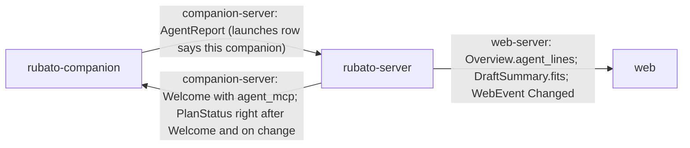

# Agent MCP on the server: take reports, keep and show them, push plan status

Issues: #226 #227 #228 #229 · Design: [226-agent-mcp-server/design.md](226-agent-mcp-server/design.md)
· Built under the design of #197 ([plan](197.md), [design](197-agent-mcp/design.md), ADR
[0071](../decisions/0071-agent-mcp-in-the-companion.md), accepted), after plan [#220](220.md) ·
Map: `companion-server`, `web-server`.

Track: **full**. This plan adds a new consumer of `AgentReport` and a new producer of
`PlanStatus` on `companion-server`. It adds new fields on `web-server`'s `Overview` and on
`DraftSummary`, which change `schema/protocol/`. It also adds two new slices and a table.

Plan #220 gives the wire `AgentReport` and `PlanStatus` and teaches the companion to use them
with a server that announces `agent_mcp`. This plan builds that server:
- it takes each launched agent's report, only for a launch the `launches` table says went to
  that companion;
- it keeps the newest report per launch, and shows it with its age in the lane and the issue
  detail;
- it pushes each launched session its plan status, right after the Welcome and on change;
- it announces `agent_mcp` in the last server PR.

## What the change does

- **The server takes an agent's report** (#226, design §1). It refuses one unless the server's
  own `launches` row sent that launch to this companion and the launch is in the companion's
  newest snapshot. It drops parts the launch's workspace map lacks. It bounds the text again,
  stamps it with its own clock, and counts every drop.
- **It keeps the newest line per launch** (#227, design §2). The new slice `agent_reports` owns a
  table. Only the owning companion changes a row. A row is deleted once its launch is out of
  every snapshot.
- **The team sees what each launched agent says** (#227, #229, design §3). `Overview.agent_lines`
  carries the lines. The web shows each one under its session, joined on `(companion_id,
  launch_id)`, in the lane and in the issue detail, with its age, never as a state.
- **Each launched session gets its plan status** (#228, design §4). The new slice `plan_status`
  derives it from the issue's summary in the launch's workspace: the draft with its own fit, the
  review, the counted approval with its version, and the plan on the branch. It is pushed right
  after the Welcome (from the last tick's cache), and whenever it changes. It goes only to the
  companion that launches the launch.
- **The draft carries its own fit** (#228, design §4). `DraftSummary.fits` is computed with
  `plan_fit` on the draft's plan.
- **The server announces `agent_mcp`** (#228, design §5) once all of the above is in, and counts
  it in `rubato.companions.by_capability`.

## How we'll know it works

- [ ] **Take** (#226). Failing first: `companion_link` tests on a seeded database (a pairing `P`
  with a `launches` row for `L`).
  - The `companion_agent_report.json` fixture rewritten to `L`, with `L` in `P`'s snapshot,
    calls `record` and `notify`.
  - A report for `L` from pairing `Q`, with `L` in `Q`'s snapshot, is dropped as
    `not_this_companion`, counts `agent_report`, and leaves `P`'s row as it was.
  - A report for `L` from `P` with `L` not in `P`'s snapshot is dropped as `not_live`.
  - A part `not-on-the-map` is dropped and counts `agent_report_part`; the others are kept.
  - A 300-character `doing` with a newline is stored cut to 200 with the newline as a space.
  - A report with `at` a day in the future is stored with the server's time.
- [ ] **Never *working*** (#226). After an accepted report:
  - `app.latest_sessions()` and the stored `session_snapshots` row are unchanged;
  - `derive_progress` for the issue gives the same state;
  - the test asserts that `record` was reached.
- [ ] **Span fields** (#226): a `capture` test sees `rubato.launch_id`, `rubato.issue` and
  `rubato.outcome` on `rubato.inbound_event` for kind `agent_report`.
- [ ] **No text in the event log** (#226): `companion_events.payload` for the report is `{}`.
  This is #220's test, kept.
- [ ] **Approval guard** (#226, design §6). Failing first: the new fixtures
  `companion_launch_started.json` and `companion_handoff_report.json` do not exist.
  - Then every `CompanionMessage` fixture is replayed through `on_envelope` on the seeded
    database. No approval row appears and no approval-granting column changes.
  - It prints `replayed N fixtures, M reached a handler`, with M including both `approve` paths.
  - The must-fail dispatch wrapper that inserts an approval on `Draft` fails it.
- [ ] **Keep** (#227). Failing first: `agent_reports` tests.
  - `record` from another companion for an existing launch changes nothing.
  - `prune(c, [a])` deletes `c`'s row for `b` and leaves other companions' rows.
  - `prune_absent` deletes a row whose launch is in no snapshot.
  - `all()` leaves out a row whose launch is not live.
  - The migration applies on a database at today's head (`kernel::db` migration test).
- [ ] **Prune on snapshot** (#227): a `Sessions` envelope without launch `b` deletes `b`'s row.
- [ ] **Overview** (#227): `Overview.agent_lines` carries the live row with its `companion_id`.
  The golden `overview.json` is re-recorded with `UPDATE_GOLDEN=1`. `overview_build.json`, the
  progress golden, is unchanged byte for byte.
- [ ] **Draft fit** (#228). Failing first: a `build` test.
  - A draft whose plan fits the map gives `DraftSummary.fits = Some(true)` with one workspace and
    with two.
  - A draft whose plan names an unknown id gives `Some(false)`.
  - A draft that does not parse gives `None`.
- [ ] **Derive** (#228). Failing first: `plan_status::derive` unit tests on `IssueSummary`
  fixtures.
  - A counted `Approved:` comment with the cutover unset gives `approval.record.source = comment`
    and `version = current`.
  - A Rubato approval gives `source = rubato`.
  - A plan that does not fit gives `version = does_not_fit`.
  - A fitting draft gives `draft.fits = true`.
  - A draft on another branch gives `draft: None`.
  - A plan with the approval record gives `carries_approval: true`.
- [ ] **Push** (#228).
  - `on_tick` sends one `PlanStatus` per live launch on a connected companion with `agent_mcp`,
    none to a disconnected one (no `offline` count), and none to one without `agent_mcp`.
  - A second tick with no change sends nothing.
  - A new socket for the same companion gets `welcome`.
  - An issue held by two workspaces is derived from the launch's workspace only.
  - A launch whose issue is in no build counts `no_summary`.
  - One failing workspace still lets the others push, and `warn!` names it.
- [ ] **Right after a Welcome** (#228): `app.companion_welcomed(c)` makes `on_welcome` send the
  cached statuses of `c`'s live launches, without building an overview.
- [ ] **Capability** (#228): the Welcome carries `agent_mcp`, and `server_welcome.json` is
  regenerated. `rubato.companions.by_capability` has an `agent_mcp` series.
- [ ] **Web** (#229). Failing first:
  - `lanes.test.tsx`: a session with a line shows `"designing the auth seam" · 3 min ago`, and no
    chip or class from it;
  - a line with the same `launch_id` but another `companion_id` is not shown;
  - `issue-panel.test.tsx`: the same line under the issue's session;
  - an old line is shown muted with its age;
  - a session with no line looks as today.
- [ ] **E2E** (#229): with the dev server, a stand-in companion posts an `AgentReport` for its
  launch, and the lane shows the line (`web/e2e`).
- [ ] **Dashboard** (#228): `observability/check.ts` requires "Plan status pushes" querying
  `rubato_plan_status_sent_total`. A fixture dashboard without it fails `check.test.ts`.

## What it must not break

- **Progress is derived** (AGENTS.md): `derive_progress` takes no report. Guards: its signature,
  the unchanged `overview_build.json` golden, and the never-*working* test.
- **A session with no recent signal renders *unknown***: the report changes no `SessionState`.
  Guard: the never-*working* test. `SessionWorkingNoHooks` reads no new series, and the alert
  tests pass unchanged.
- **What leaves the machine is not kept elsewhere** (ADR 0052, 0071): only `agent_reports` holds
  the text, and `companion_events` is empty for it. Guard: #220's test, kept.
- **#162's identity rules**: a report for a launch not sent to this companion is dropped. Guard:
  the take tests. The snapshot and cap-hit checks are unchanged.
- **Approval stays a person's act** (ADR 0054): `plan_status` reads summaries and writes nothing.
  Guard: the approval guard of design §6.
- **Older companions**: a companion without `agent_mcp` gets no `PlanStatus` (the push test).
- **The slice graph is acyclic**: the server slice test passes.
  - `plan_status` names `overview` and `launch`.
  - Only the composition root names `plan_status`.
  - `companion_link` names `agent_reports` (a leaf) and signals the Welcome through the kernel.
  - `approve` names neither new slice.
- **Overview size**: one line per live launched session at most (`all()` filters on live
  sessions), and the snapshot cap bounds those.
- **`DraftSummary` readers**: `fits` is additive and optional. Web tests and goldens that hold a
  `DraftSummary` keep passing, with goldens re-recorded.

## How we'll debug it at 3 am

See the O-rows. New signals:
- `rubato.events.dropped{rubato.reason="agent_report"|"agent_report_part"}`;
- counter `rubato.plan_status.sent{rubato.reason, rubato.outcome}`, on the new panel "Plan
  status pushes";
- `rubato.inbound_event` with `rubato.launch_id`, `rubato.issue` and `rubato.outcome` for kind
  `agent_report`;
- `rubato.companions.by_capability{rubato.capability="agent_mcp"}`.

New log lines:
- `warn!(rubato.companion_id, rubato.launch_id, reason, "agent report refused")`;
- `warn!(rubato.workspace, error, "overview not built")`;
- `info!(rubato.companion_id, launches, "plan status pushed after welcome")`;
- `record` and `prune` failures through `observe`, with the companion and the sequence number.

## Affected parts

| Node | Status | What changes | Seams |
| --- | --- | --- | --- |
| rubato-server | affected | `companion_link`: the `AgentReport` arm against `launches`, prune on `Sessions`, the span fields, the Welcome signal, the capability. New slices `agent_reports` (table) and `plan_status`. `overview`: fills `agent_lines`, computes `DraftSummary.fits`, and `refresh_gauges` returns the built issues per workspace. `tasks.rs`: the tick hand-off and the welcome task. Kernel: the `companion_welcomed` broadcast | companion-server, web-server |
| rubato-protocol | affected | `AgentLine`; `Overview.agent_lines`; `DraftSummary.fits`; fixtures `companion_launch_started.json` and `companion_handoff_report.json`; `server_welcome.json` with `agent_mcp` | web-server, companion-server |
| web | affected | the agent's line under a session in the lane and the issue detail | web-server |
| rubato-companion | quiet | already takes `PlanStatus` and sends `AgentReport` (plan #220) | |

## Data models

| Model | Kind | Part | Change | Crosses | Note |
| --- | --- | --- | --- | --- | --- |
| `agent_reports` | table | rubato-server | new | | slice `agent_reports`; one row per launch; migration `0027_agent_reports.sql` or the next free number; rollback is a later drop migration |
| `AgentLine` | type | rubato-protocol | new | web-server | `{ companion_id, launch_id, doing, parts, reported_at }` |
| `Overview.agent_lines` | type | rubato-protocol | changed | web-server | `Vec<AgentLine>`, serde default |
| `DraftSummary.fits` | type | rubato-protocol | changed | web-server | `Option<bool>`, the draft's own fit |
| `overview`, `draft_view` schemas | schema | rubato-protocol | changed | web-server | additive |
| `companion_launch_started.json`, `companion_handoff_report.json`, `server_welcome.json` | file | rubato-protocol | changed | companion-server | two new fixtures; the Welcome gains `agent_mcp` |
| `PlanStatus` pushes | event | rubato-server | new | companion-server | counter `rubato.plan_status.sent` by reason and outcome |
| last derived and last sent `PlanStatus` | type | rubato-server | new | | in memory in `plan_status`, keyed by launch and by `(companion_id, conn)` |
| `companion_welcomed` broadcast | type | rubato-server | new | | kernel `AppState`, sent by `companion_link` after a Welcome |

## Data flow

## Tasks

One PR per issue, in this order. Each fails first as listed. Each runs `cargo fmt --check`,
`clippy -D warnings`, `cargo test -p rubato-server` and `-p rubato-protocol`, and `pnpm test`, and
`pnpm e2e` where the web changes. Before each merge: `git fetch`, merge origin/main, and re-run
the affected checks. All of them come after plan #220's #220 PR, which has the types.

1. **#227 agent_reports** (`issue/227-agent-reports`).
   - Failing first: the `record`, `prune`, `prune_absent`, `all` and migration tests.
   - Then the slice, the migration, `AgentLine`, `Overview.agent_lines` and the overview fill,
     `prune_absent` in housekeeping, the schemas, `protocol.ts` and the golden.
   - The AGENTS.md server and protocol blocks name them.
2. **#226 companion_link** (`issue/226-take-agent-reports`).
   - Failing first: the take, never-*working*, span-field and prune-on-snapshot tests, and the
     approval guard with its two new fixtures and its must-fail wrapper.
   - Then the arm against `launch_target`, the bounds, the part check, the server clock, `prune`
     in the `Sessions` arm, the declared span fields, and `notify`.
   - No capability announced yet.
3. **#228 plan_status** (`issue/228-plan-status`).
   - Failing first: the draft-fit, derive, push and welcome tests.
   - Then `DraftSummary.fits`, the slice, `refresh_gauges` returning per-workspace results,
     `tasks.rs` (the tick and the welcome task), and the kernel broadcast with `companion_link`
     sending it.
   - Then `agent_mcp` in the Welcome, `server_welcome.json`, and the capability count.
   - The panel and its `check.ts` requirement, and the AGENTS.md server block.
4. **#229 web** (`issue/229-agent-line`).
   - Failing first: the lane and issue-panel tests.
   - Then the two views, then e2e.
   - The AGENTS.md web block names the line under `companions`.

## Assumed, not yet approved

| # | Decision | Chosen | Alternatives | Scope |
| --- | --- | --- | --- | --- |
| A1 | Which map a part is checked against | the launch's workspace map (`launches.workspace_id`) | every map that names the repo | node (rubato-server) |
| A2 | A stale line on the web | shown muted with its age when it is more than `session_stale_secs` older than the session's `last_seen` | hidden | node (web) |
| A3 | Time stored for a line | the server's clock on arrival | the report's `at` | node (rubato-server) |

## Decisions

| # | Decision | Chosen | Why | Decided by |
| --- | --- | --- | --- | --- |
| 1 | Where `PlanStatus` is derived | a new slice `plan_status` that names `overview` and `launch` and reads `IssueSummary`, named only by the composition root, instead of `approve` as #197's design note said | `approve` cannot name `overview`, which names it; `companion_link` cannot name `plan_status`, since `overview` names `companion_link` (a cycle) | agent (delegated by Mattias, 2026-11-15) |
| 2 | How the tick and the Welcome reach it | `refresh_gauges` returns per-workspace built issues to the composition root; a kernel `companion_welcomed` broadcast drives `on_welcome` from the last tick's cache; last-sent is keyed by socket | no second overview build, no slice edge, and a reconnect always gets a fresh push | agent (delegated by Mattias, 2026-11-15) |
| 3 | How the web gets the lines | `Overview.agent_lines: Vec<AgentLine>` with `companion_id`, joined on `(companion_id, launch_id)`, not a field on `SessionState` | `SessionState` is the companion's report on `companion-server`; joining on the launch id alone would show another pairing's claim | agent (delegated by Mattias, 2026-11-15) |
| 4 | Identity of a report | `launch_target(L).companion_id == P` and `L` in `P`'s newest snapshot; the upsert also requires the same companion | ADR 0071's "a launch this pairing started"; a snapshot's `launch_id` is a claim, the `launches` row is the server's record | agent (delegated by Mattias, 2026-11-15) |
| 5 | The draft's fit | additive `DraftSummary.fits`, computed with `plan_fit` on the draft's plan | `fits_in` is about the branch plan, and only with two workspaces or more | agent (delegated by Mattias, 2026-11-15) |
| 6 | When the server announces `agent_mcp` | in #228, the last server PR | a companion sends reports only to a server that keeps, shows and answers them | agent (delegated by Mattias, 2026-11-15) |
| 7 | PR order | #227, #226, #228, #229 | the table first, so the arm has somewhere to write | agent (delegated by Mattias, 2026-11-15) |

## O-rows

| Seam | Breaks like | Signal | Panel | Owner |
| --- | --- | --- | --- | --- |
| companion-server | reports dropped (another companion's launch, a launch not live, unknown parts, schema drift), or plan statuses not derived, not pushed or pushed to an offline socket, so `plan_status` goes stale on the agent's side | `rubato.events.dropped{rubato.reason="agent_report"\|"agent_report_part"\|"schema"}`; `rubato.plan_status.sent{rubato.reason="welcome"\|"change", rubato.outcome="sent"\|"offline"\|"no_summary"}`; `rubato.companions.by_capability{rubato.capability="agent_mcp"}`; span `rubato.inbound_event` for kind `agent_report` with `rubato.launch_id`, `rubato.issue` and `rubato.outcome`; `warn!(…, "agent report refused")` and `warn!(rubato.workspace, …, "overview not built")` | Events dropped; Plan status pushes (new, Trust check row); Companions by capability | rubato-server |
| web-server | the line is shown without its age, as a state, under another pairing's session, or never refreshed | span `rubato.ws.fanout` after each stored report; `Overview.agent_lines[].reported_at`; the lane tests | Web clients | rubato-server |

## Flows

| From | To | Seam | Kind | Carries |
| --- | --- | --- | --- | --- |
| rubato-companion | rubato-server | companion-server | data | AgentReport for a launch the launches row sent to this companion |
| rubato-server | rubato-companion | companion-server | data | PlanStatus per live launch, right after Welcome and on change |
| rubato-server | rubato-companion | companion-server | control | Welcome capabilities gain agent_mcp |
| rubato-server | web | web-server | data | Overview.agent_lines (companion, launch, line, parts, time) and DraftSummary.fits |

## ADRs proposed

None.

## Review map

1. Design §1: the identity check against the `launches` row and the snapshot, and the upsert
   that only the owning companion can change.
2. Design §4: `plan_status` named only by the composition root (the cycle it avoids), the
   socket-keyed push, and the Welcome push from cache through the kernel broadcast.
3. Design §4 and §6: `DraftSummary.fits` computed with `plan_fit`, and the approval guard that
   reaches both `approve` paths.
