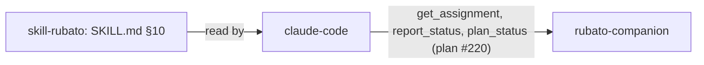

# Skill: tell launched agents when to call get_assignment, report_status and plan_status

Issue: #230 · Built under the design of #197 ([plan](197.md), [design](197-agent-mcp/design.md),
ADR [0071](../decisions/0071-agent-mcp-in-the-companion.md), accepted), after plans
[#220](220.md) and [#226](226.md) · Map: `skill-rubato`.

Track: **small**. This is one part, the skill's text and a test. It touches no seam, schema or
dependency. The tools it describes are built and their seams changed by plans #220 and #226.

A session Rubato launches gets the companion's MCP server, `rubato-companion`, with three tools
(ADR 0071). Nothing tells the agent they exist or when to use them. This change adds a short
section to `skills/rubato/SKILL.md`: what each tool is for, when to call it, and what it is not.
- `report_status` is not progress.
- `plan_status` is not an approval, and an old one is unknown.
- There is no tool that approves.

A manual session, which has no such server, reads the section and skips it.

## What the change does

- **SKILL.md gains §10, "Rubato's MCP server (a session Rubato launched)"**:
  - `get_assignment` comes first in a launched session: the issue, branch, pinned map parts and
    caps. Ids still come from `map.ts`.
  - `report_status`, one line and the map ids, goes out when the work moves to another phase or
    part, and when it waits on a person: designing, reviewing, building, blocked on a question.
    It is never a substitute for the plan, a `Review:` reply or a question in the plan's room.
  - `plan_status` gives the draft's revision and fit, the review, and the approval with its
    version, so the agent need not guess.
    - An approval counts only when its `version` is `current`.
    - `unknown`, or `link_up: false`, means "not known", not "not approved". `as_of` is when
      Rubato last saw a change, so an old `as_of` on a live link is still current; its age is
      information, not a verdict.
    - The approval reaches the session as §6 says for its mode. In Rubato mode it is a prompt
      with a `plan.ts handoff` command (§9). In git mode, which every launch is while the
      cutover is unset, it comes through push and Import.
    - `plan_status` never starts the tasks, never replaces `plan.ts handoff` or Import, and is
      not a reason to run either.
  - No tool approves, reviews, decides or pins, and none should be looked for.
  - Without a `rubato-companion` server, skip §10. That covers a session started by hand, and a
    room's forked turn (ADR 0057).
- **The "Don't" list** gains one line: don't treat `report_status` as progress or as the place
  for a question, and don't start the tasks on a `plan_status`.
- **The skill's version becomes 0.4.0** (`skills/rubato/package.json`). The companion announces
  `skill:0.4.0` in its Hello (`runtime.rs:213,427`), so a launched session with no
  `get_assignment` calls can be told apart: an older installed skill, or an agent that ignored
  §10.

## How we'll know it works

- [ ] **Failing first**: a new `skill.test.ts` case, "SKILL.md describes the agent MCP tools and
  no approval tool", fails on today's SKILL.md (no §10). It runs
  `mcpSectionProblems(text) -> string[]` on the text between `## 10.` and `## Don't` only.
  - A tool name is any `mcp__rubato-companion__\w+`, or a backticked snake_case identifier that
    starts a list item in §10.
  - The set of tool names must be exactly `get_assignment`, `report_status` and `plan_status`.
  - §10 must say an approval counts only at version `current`.
  - It must cite §6 for how the approval arrives.
  - It must contain the sentence that `plan_status` never starts the tasks.

  It prints `checked <n> tool names in §10`, where `<n>` is the number of tool names it found.
- [ ] **Must fail on purpose**: the same function returns a problem for two altered copies of
  §10. One adds a line naming `mcp__rubato-companion__approve_plan`; the other adds a list item
  starting `` `approve_plan` ``. The test asserts both.
- [ ] **Version**: `skills/rubato/package.json` says 0.4.0, and the installed copy's version
  matches (`approval.test.ts`).
- [ ] **Install**: `approval.test.ts` "copies every shipped file byte for byte" passes with the
  new SKILL.md.
- [ ] **Handoff text unchanged**: `handoff.test.ts` "SKILL.md's Rubato mode pins ADRs …" passes,
  with its §9 cut ending at `## 10.` instead of `## Don't`, so §10's text cannot satisfy it. §9 is
  not edited.

## What it must not break

- **Approval stays in Rubato** (ADR 0054): §6 and §9 are unchanged. The `handoff.test.ts`
  assertions on "never write the approval record" and `plan.ts handoff` pass as they are.
- **Manual sessions and room forks plan as today**: §10 tells an agent without the server to
  skip it. No script changes.
- **Git-mode launched sessions**: §10 sends them to §6 (push and Import), never to a handoff
  prompt. Guard: the §6 citation and the never-starts-the-tasks sentence in `mcpSectionProblems`.
- **Installed copies**: `install.ts` copies SKILL.md byte for byte (`approval.test.ts`).
- **Hooks**: `hooks.ts` and `hooks.json` are unchanged.

## How we'll debug it at 3 am

There is nothing new at run time: SKILL.md is text. The tool calls it asks for show on plan
#220's signals: `rubato.mcp.calls{rubato.mcp.tool}` on the panel "MCP calls by tool and outcome".
A launched session with no `get_assignment` calls is told apart by the installed skill version.
The companion announces `skill:<version>` in its Hello, and `skill:0.4.0` or later has §10.
`rubato.mcp.not_initialized` stays flat either way, because Claude Code initializes the server.

## Affected parts

| Node | Status | What changes | Seams |
| --- | --- | --- | --- |
| skill-rubato | affected | SKILL.md §10 and a "Don't" line; version 0.4.0; a Vitest case; the §9 cut in `handoff.test.ts` | |
| claude-code | quiet | reads §10; the tools are plan #220's | |

## Data models

None.

## Data flow

## Tasks

1. **Failing first**: add `mcpSectionProblems` and the case to `skills/rubato/test/skill.test.ts`,
   with its two must-fail inputs, and end `handoff.test.ts`'s §9 cut at `## 10.`. Run
   `pnpm --filter @rubato/skill test`: it fails on "no §10".
2. Write §10 and the "Don't" line in `skills/rubato/SKILL.md`, and bump
   `skills/rubato/package.json` to 0.4.0. Run the skill tests, `pnpm test`, `pnpm typecheck`
   and the plan check.
3. One PR, `issue/230-skill-agent-mcp`, merged after the PRs that close #225 and #228. A skill
   that names tools no companion serves yet would send agents looking for them.

## Assumed, not yet approved

| # | Decision | Chosen | Alternatives | Scope |
| --- | --- | --- | --- | --- |
| A1 | What makes a `plan_status` answer "not known" | `unknown` or `link_up: false`; the age of `as_of` is information only, since the server pushes on change, not on a clock | (b) plan #226 re-pushes every N minutes so age means freshness (a seam change there); (c) five minutes after `as_of` | node (skill-rubato) |
| A2 | Where the text goes | a new §10 in SKILL.md; `prompt-rubato.md` unchanged | a line in the launch prompt too | node (skill-rubato) |

## Decisions

| # | Decision | Chosen | Why | Decided by |
| --- | --- | --- | --- | --- |
| 1 | Track | small | one part, text and a test, no seam; the seams are plans #220 and #226 | agent (delegated by Mattias, 2026-11-15) |
| 2 | Merge order | after the PRs that close #225 and #228 | a skill naming tools nobody serves would send agents looking for them | agent (delegated by Mattias, 2026-11-15) |
| 3 | Skill version | 0.4.0 | earlier behaviour changes bumped it (0.2.0 handoff, 0.3.0 retirement); `skill:<version>` in Hello tells an old skill from an ignored §10 | agent (delegated by Mattias, 2026-11-15) |

## O-rows

None: this change touches no seam. Plan #220's `companion-mcp` O-row covers the calls it asks
for.

## Flows

None.

## ADRs proposed

None.

## Review map

1. `skills/rubato/SKILL.md` §10: the line between a signal (`report_status`) and progress, and
   "an old `plan_status` is unknown, not 'not approved'".
2. `skills/rubato/test/skill.test.ts`: the problems function and its must-fail input.
