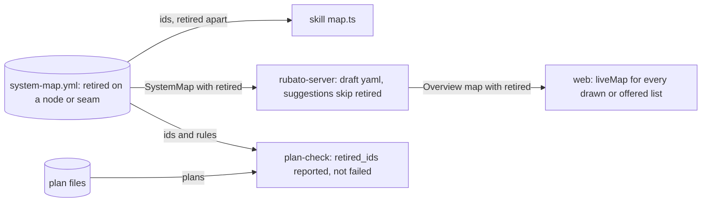

# A map id is retired, not removed: drawn and offered nowhere, history still checks

Issue: #247 · Design: [247-retire-map-ids/design.md](247-retire-map-ids/design.md) · ADR:
[0077](../decisions/0077-a-map-id-is-retired-not-removed.md) (proposed) · Follows #147
(ADR 0070).

Track: **full**. `schema/system-map.schema.json` and the protocol schemas change, and the change
touches four seams.

**Builds on #250.** #147's map PR (#250, merged) keeps `tmux-ide` and `companion-tmux-ide` as ids
described as retired, because ten merged plans name them and the plan check runs them all
against today's map. Those ids are still drawn on the shared map, offered to every session, and
suggested for new issues. This plan adds `retired: "<ADR>"` to a node or seam. A retired id stays
declared (ADR 0007), so history keeps checking, and every reader that draws, offers or suggests
ids skips it (design §1, §2).

**Against the issue.** #247's boxes assume the ids leave the map: "the plan check passes with both
ids removed, and prints how many plans it checked against an older map". Option 1 keeps them
declared, so it replaces those boxes with the five bullets below. Q1, Decision 1, is the question
for the approver: if Mattias prefers option 2 or 3 in design §2, this plan is rewritten for it.

## What the change does

- **A retired part is drawn nowhere:** not on the shared map, the Plans tab minimap or the
  issue-detail system strip. `tmux-ide` and `companion-tmux-ide` are the first.
- **A retired id is offered and suggested nowhere:**
  - not in "Pin to…", "New issue here…" (or its default), the map draft's seam ends, or a repo's
    list of what it provides;
  - never in an issue's pin suggestion (ADR 0026);
  - `map.ts` lists it under "Retired (do not use)", with its ADR.
- **History still checks.** A plan that names a retired id passes the plan check, which reports
  the ids (`rubato.plan.retired_ids`) and counts those plans in its summary line.
- **Nothing that named it breaks.**
  - A pin on a retired id stays, and the issue detail marks it "(retired)".
  - An issue pinned only there stays in the Issues list.
  - A plan naming one still fits (ADR 0029).
  - A map draft edit keeps the field, and a proposal round-trips it.
- **The map stays consistent.** Map validation, in Rust and in the plan check's TS mirror alike,
  refuses:
  - a retired seam with flows;
  - a live seam on a retired node;
  - a retired node with a `service`.

## How we'll know it works

- [ ] **Protocol** (`map.rs`, `plan.rs` unit tests):
  - a map with `retired` round-trips, and a value that is not four digits is refused;
  - each of the three rules refuses its fixture;
  - a plan naming a retired id fits.
  - To fail on purpose: with a rule removed, its fixture passes and the test fails.
- [ ] **Validator parity** (both sides): Rust `validate` and TS `structuralProblems` give the same
  verdict on every `schema/fixtures/maps/retired-*.yml`, and each test prints how many fixtures
  it checked.
- [ ] **Plan check** (`plan-check.test.ts`):
  - a fixture plan naming `companion-tmux-ide` passes with `retired_ids: ["companion-tmux-ide"]`;
  - the dogfood run counts 10 plans naming retired ids.
  - To fail on purpose: a map fixture without `retired` gives `retired_ids: []`, and the count
    test fails.
  - `otel-names.test.ts` passes with `PLAN_RETIRED_IDS` in `otel.rs`.
- [ ] **Skill** (`skill.test.ts`): `map.ts` on the real map:
  - has no retired id under Nodes or Seams;
  - has both under "Retired (do not use)" with `0070`;
  - its header says `12 nodes, 13 seams, 2 retired`.
- [ ] **Server:**
  - `yaml.rs` round-trips `retired`, and `round_trip_keeps_the_committed_maps` passes on the real
    map;
  - `suggest.rs` with an issue body naming `tmux-ide` suggests no retired id;
  - the workspaces golden is re-recorded after it fails first.
- [ ] **Web** (Vitest):
  - `graph.test.ts`: the real map's graph has neither retired id, and its node count drops by
    one.
  - `MiniMap`, `WhereItFits`, `PinMenu`, `NewIssueForm` (including its default) and `provides`
    show no retired id.
  - `DraftPanel`: an edit of a retired node posts an `UpdateNode` that keeps `retired`.
  - The issue detail shows a pin on `tmux-ide` with "(retired)".
  - To fail on purpose: without `liveMap` in `buildGraph`, the graph test fails on the count.
- [ ] **Web e2e** (`map.spec.ts`):
  - `@map.every-part` and `@map.by-repo` run over live parts, and assert `node-tmux-ide` and the
    `companion-tmux-ide` edge have count 0;
  - the map draft proposal test opens its PR as today.
- [ ] **CI plan check** over every plan: the count is unchanged, 0 failed, and 10 plans name
  retired ids.

## What it must not break

- **ADR 0007, ids join everything**: `mapIds` and `plan_fit` are unchanged; the new `plan_fit`
  case and the plan-check dogfood test use a map with `retired`.
- **Maps without the field**, in connected repos: they parse and draw as today (the protocol
  round-trip without `retired`; `e2e/run.ts`'s map has none, 10/10).
- **Map draft proposals** (ADR 0018): `yaml.rs` keeps every key, and the e2e proposal test passes.
- **Pins and their suggestions** (ADR 0026): an existing pin on a retired id stays (the issue
  detail test); the suggestions test.
- **Observed traffic** (ADR 0059): matching is unchanged for live parts (`traffic.rs` tests).
- **The scenario player**: `start-a-session` plays as today (web e2e).

## How we'll debug it at 3 am

See the O-rows. New signals:
- the `rubato.plan.check` line's `rubato.plan.retired_ids` and the summary count;
- `map.ts`'s header counts;
- the three new map errors, each with the id, on the existing map load failure path
  (`rubato.map.load_failures`) and in the plan check's map error.

## Affected parts

| Node | Status | What changes | Seams |
| --- | --- | --- | --- |
| rubato-protocol | affected | `MapNode.retired`, `Seam.retired`, `is_retired`, `live_ids`, three map rules; `PLAN_RETIRED_IDS`; schemas; `protocol.ts` | server-system-map, web-server |
| system-map | affected | the schema gains the optional field; `rubato-map.yml` marks two ids `retired: "0070"`; shared fixtures under `schema/fixtures/maps/` | skill-system-map, server-system-map |
| plan-check | affected | `retiredIds`, the log field, the summary count, the three rules in `structuralProblems`, the parity test; the seam exemption is by `retired` | plan-check-plan-file |
| skill-rubato | affected | `map.ts` lists retired ids apart, with counts | skill-system-map |
| rubato-server | affected | `map_draft/yaml.rs` knows `retired`; `suggest.rs` skips retired ids; the workspaces golden | server-system-map |
| web | affected | `liveMap` in `shared/`, used by the map, minimap, system strip, pin, new-issue, draft and repo readers; the draft form keeps `retired`; a retired pin is marked | web-server |

## Data models

| Model | Kind | Part | Change | Crosses | Note |
| --- | --- | --- | --- | --- | --- |
| `MapNode.retired`, `Seam.retired` | type | rubato-protocol | changed | web-server | optional ADR number, four digits; serde default, skipped when absent |
| `system_map`, `map_response`, `overview`, `draft_op_request` schemas | schema | rubato-protocol | changed | web-server | additive |
| `schema/system-map.schema.json` | schema | system-map | changed | skill-system-map | the optional `retired` on node and seam |
| `docs/design/rubato-map.yml` | file | system-map | changed | server-system-map | `retired: "0070"` on two ids |
| `rubato.plan.retired_ids` | event | plan-check | new | plan-check-plan-file | a field of the `rubato.plan.check` line; `PLAN_RETIRED_IDS` in `otel.rs` |

## Data flow

## Tasks

- [ ] **PR 1** `issue/247-retire-map-ids`: this plan, the design note and ADR 0077 (proposed); the
  design review; the approval. Then, on the same branch:
  - **Protocol, failing first:** the round-trip and pattern tests, the three rule fixtures, and
    the `plan_fit` case. Then the field, the helpers, the rules, `PLAN_RETIRED_IDS`,
    `UPDATE_SCHEMAS=1` and `gen:types`.
  - **Plan check, failing first:** the parity test, the retired-ids fixture and the count. Then
    the rules in `structuralProblems`, `retiredIds`, the log field and the summary.
  - **Skill:** the `map.ts` test, then the Retired section and the counts.
  - **Server, failing first:** the `yaml.rs` round trip and the `suggest.rs` test. Then the keys
    and the skip.
  - **Web, failing first:** the tests listed above. Then `liveMap` in `web/src/shared/map.ts`,
    each reader through it, the draft form keeping `retired`, and the "(retired)" mark.
  - **Web e2e:** `@map.every-part` and `@map.by-repo` over live parts.
  - **Map:** `retired: "0070"` on the two ids; the plan-check seam test exempts any retired seam;
    the workspaces golden is re-recorded after it fails first.
  - **Docs:** AGENTS.md (the `shared/` list in the web block; "Map versus territory" on how to
    retire an id) and the skill's §1.
- [ ] After merge: a follow-up only if someone asks that a new plan naming a retired id fail.

## Assumed, not yet approved

| # | Decision | Chosen | Alternatives | Scope |
| --- | --- | --- | --- | --- |
| A1 | Value of `retired` | the ADR number, four digits, as a string | `true`; an object with ADR and date | node (rubato-protocol) |
| A2 | A pin on a retired id | still shown in the issue detail, marked "(retired)", and the issue stays in the Issues list; not offered for new pins | hidden; refused by the server | node (web) |
| A3 | One PR | the plan with the whole change | plan PR, then a build PR per part | node (rubato-protocol) |

## Decisions

| # | Decision | Chosen | Why | Decided by |
| --- | --- | --- | --- | --- |
| 1 | Q1: how to retire an id for good, and the issue's boxes | (1) `retired: "<ADR>"` on the node or seam: declared, so history checks; drawn, offered and suggested nowhere; reported by the plan check, not failed. It replaces the issue's "ids leave the map" boxes with this plan's five bullets | needs no map history, so it works the same in every repo; no merged plan is edited (design §2) | agent (delegated by Mattias, 2026-11-15) |
| 2 | Q2: a new plan that names a retired id | reported (`rubato.plan.retired_ids`), not failed | offline, the plan check cannot tell a new plan from history; the skill not offering the id is the first guard | agent (delegated by Mattias, 2026-11-15) |
| 3 | Q3: map rules for a retired part | no flows on a retired seam, no live seam on a retired node, no `service` on a retired node; in both validators, one fixture set | an edge to an undrawn node blanks the map tab (ELK); a retired part carries nothing and matches no traffic | agent (delegated by Mattias, 2026-11-15) |
| 4 | Where the "live" rule lives | one helper per language: `SystemMap::live_ids()` and `is_retired` in the protocol, `liveMap` in `web/src/shared/map.ts` | one rule, not one per reader (review: nine web readers) | agent (delegated by Mattias, 2026-11-15) |

## O-rows

| Seam | Breaks like | Signal | Panel | Owner |
| --- | --- | --- | --- | --- |
| skill-system-map | a session is still offered a retired id, or no longer sees a live one | `map.ts` header counts (`12 nodes, 13 seams, 2 retired` on this map); span `rubato.skill.command` with `rubato.skill.subcommand=map` and `rubato.exit_code` | Skills emitting | system-map |
| server-system-map | a map with `retired` fails to load, a rule refuses the team's map, or a draft proposal is refused for an unknown key | `rubato.map.load_failures` with the rule's error naming the id; `rubato.map.loaded` per workspace; `rubato.map.proposals{rubato.outcome="failed"}` with `unknown_keys` in the proposal log line | Map; Map proposals | system-map |
| web-server | the overview's map drops the field, so retired parts are drawn again, or live parts vanish | the overview schema snapshot test; `graph.test.ts` on the real map; the map tab's ELK error in the browser console | Map | rubato-server |
| plan-check-plan-file | a plan naming a retired id fails CI, or a retired id goes unreported | the `rubato.plan.check` line's `rubato.plan.retired_ids` and `ok` in the CI job log; the summary count | Plan check log lines (when the plan check exports) | plan-check |

## Flows

| From | To | Seam | Kind | Carries |
| --- | --- | --- | --- | --- |
| system-map | skill-rubato | skill-system-map | data | node and seam ids, retired ones apart, with counts |
| system-map | rubato-server | server-system-map | data | SystemMap with `retired` on a node or seam |
| rubato-server | web | web-server | data | the overview's map with `retired`, which web neither draws nor offers |

## ADRs proposed

| ADR | File | Blob |
| --- | --- | --- |
| 0077 | docs/decisions/0077-a-map-id-is-retired-not-removed.md | 8d51294a37c38fdfce1a27e00a1970244249b4ab |

## Review map

1. Design §2 and Decision 1: `retired` in the map against the map's history per plan, and the
   issue's boxes it replaces.
2. Design §1: every reader of the map's ids, and `liveMap` / `live_ids` as the one rule.
3. The map draft path (`yaml.rs`, `DraftPanel`): a retired field survives an edit and a proposal.
