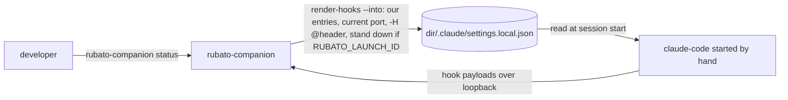

# Sessions started by hand report through a per-repo opt-in the companion prints

Issue: #248 · ADR: [0078](../decisions/0078-manual-sessions-report-through-a-per-repo-opt-in.md)
(proposed) · Follows #147 (ADR 0070, Q3).

Track: **small**. One deployable plus the skill's text; no schema, wire or protocol change. The
map is not edited: the opt-in already crosses `companion-claude-code` through `hooks.ts`
(ADR 0013). The decision on that seam (which hooks exist) is ADR 0078.

## The question (Q1)

How does a session the developer starts by hand report its state, now that tmux-ide's user-level
hooks are gone?

1. **Keep the opt-in per repo or worktree, and make it safe, easy to find and easy to keep
   (recommended).**
   - `rubato-companion status` lists each workspace repo and its worktrees, says which are opted
     in, and prints the one command for the rest.
   - `render-hooks --into <file>` adds our hooks to a `settings.local.json` and keeps everything
     else in it.
   - The hooks it writes stand down inside a launched session, so a worktree a launch reuses
     never fires twice.
   - Nothing runs outside the directories the developer chose.
2. **User-level hooks from the skill** (`hooks.ts --user` into `~/.claude/settings.json`).
   - Every session on the machine reports.
   - A launched session's hooks arrive twice (its `--settings` plus the user-level ones;
     ADR 0013 verified that hooks merge across levels), so each needs a stand-down rule.
   - The hook command must read the port at run time, to survive a `hook port changed` restart.
   - Every Claude Code session posts to the companion, in any directory.
   - Size: medium (companion, skill and hook template).
3. **The companion writes `.claude/settings.local.json` into each workspace repo itself:** it
   edits the developer's files unasked.
4. **Hide sessions started by hand:** no state to fake, but the map no longer shows them.

The plan builds option 1. Choosing 2 makes this a full plan, with a design note and its own ADR.

**Against the issue's criteria.** With option 1 the issue's first box ("turns *working* … with no
per-repo opt-in") becomes "turns *working* once its repo or worktree is opted in with the command
`status` prints". The second box ("a launched session's hooks are forwarded once") stays as it is
and has its own check below.

## What the change does

- **`status` shows where hooks are opted in.** For each repo in `local.yml`, and each of its
  worktrees from `git worktree list`, it prints one line:
  - `opted in`, when the directory's `.claude/settings.local.json` has our hooks on the
    companion's port;
  - `opted in, stale port 
`, when ours point at another port;
  - otherwise the command `rubato-companion render-hooks --into <dir>/.claude/settings.local.json`.

  It ends with a count: `checked <n> directories: <k> opted in, <s> stale`.
- **`status` says whether the companion listens.** A short connect to `127.0.0.1:<port>`.
  Nothing listening prints `hook endpoint: port 
 (not listening)`, and the repo lines say they
  are judged against a stopped companion.
- **`status` no longer prints the token.** Today it prints the endpoint file's JSON, token
  included (`main.rs:128-130`). It now prints the port and the header file's path, as ADR 0063
  wants.
- **The opt-in keeps the developer's settings.** `render-hooks --into <file>`:
  - replaces only our own entries, by event (commands posting to `127.0.0.1:<any port>/hook` with
    `-H @…hook-auth.header`);
  - keeps the developer's own hooks and every other key;
  - stays idempotent when run twice;
  - writes a temp file and renames it, keeping the file's mode; a file it creates is 0600, in a
    `.claude/` it creates if needed;
  - refuses a file that is not JSON, and leaves it as it was.

  Without `--into` it prints to stdout, as today.
- **The hooks it writes stand down in a launched session.** Each command starts with
  `[ -n "${RUBATO_LAUNCH_ID:-}" ] ||`. `launch.sh` exports that variable, so a launched session's
  events come only from its `--settings` hooks, even in a worktree someone opted in by hand.
- **The docs say the same:** SKILL.md "Don't" and QUICKSTART §8. The skill's `hooks.ts` renders
  the same stand-down variant for a machine without the companion binary on `PATH`.

## How we'll know it works

- [ ] **Status, three states** (`pairing.feature`, new scenario "status says which directories are
  opted in"). The scenario writes a `local.yml` with three repos and runs the binary
  (`CARGO_BIN_EXE_rubato-companion status --workspace … --state-dir …`) while the daemon runs:
  - a repo opted in through `render-hooks --into` prints `opted in`;
  - a repo with no file prints its command;
  - a repo whose file has our hooks on port 1 prints `opted in, stale port 1`;
  - the output ends `checked 3 directories: 1 opted in, 1 stale`, and contains no token.
  - To fail on purpose: with the port comparison removed, the third prints `opted in`.
- [ ] **Status with the companion stopped** (same feature): after shutdown, `status` prints
  `(not listening)`.
- [ ] **Merge** (unit tests on the merge function, in `hooks/`):
  - a file with `permissions`, the developer's own `Stop` hook and our old entries keeps
    `permissions` and their `Stop` hook, and has our entries on the new port, once per event;
  - a second run changes nothing;
  - a missing file is created 0600, with `.claude/`;
  - a file that is not JSON is refused and left byte for byte.
- [ ] **One delivery in a launched session** (issue box 2, `worktree.feature`, new scenario):
  - a worktree opted in with `render-hooks --into`, then launched;
  - the step runs both the merged file's command and the launch's `--settings` command for one
    event, under the launch's environment;
  - the server receives that event once.
  - To fail on purpose: without the stand-down prefix it receives it twice.
- [ ] **An opted-in manual session reports** (`discovery.feature`). The scenario "A hook from the
  pane's session makes it trusted" gains a run where a new step reads the command out of the
  worktree's merged `settings.local.json` and runs it under `sh -c`, with the payload on stdin.
  The entry turns `working` from source `hook`.
- [ ] **Docs**: `grep -n "render-hooks --into" docs/QUICKSTART.md skills/rubato/SKILL.md` finds
  both.

## What it must not break

- **Launched sessions** (ADR 0013): their hooks come from `--settings`. With a hand opt-in in
  their worktree they still deliver once (the new `worktree.feature` scenario). `hooks.feature`
  and `worktree.feature` otherwise pass unchanged.
- **The token is never on a command line or a terminal** (ADR 0063): our merged hooks use
  `-H @<header file>` (`hooks/template` tests). `status` prints the header file's path, never the
  token (the status scenario checks it).
- **The developer's own settings and hooks** in `settings.local.json` (the merge tests).
- **`render-hooks` with no flag**: the same output, apart from the stand-down prefix (a unit test
  against `render_hooks`).

## How we'll debug it at 3 am

See the O-row. New output: the per-directory lines and the count line of `rubato-companion
status`, and `(not listening)`.

An opted-in manual session that stops reporting after a companion restart shows as
`opted in, stale port 
`. Beside it, the companion logs `hook port changed` at start, and the
server logs `rubato.session.stale` for a session that went quiet after a working hook.

## Affected parts

| Node | Status | What changes | Seams |
| --- | --- | --- | --- |
| rubato-companion | affected | `status`: directories, listening check, count line, no token; `render-hooks --into` merges our entries, stand-down prefix | companion-claude-code |
| skill-rubato | affected | `hooks.ts` renders the stand-down variant; SKILL.md "Don't" names `render-hooks --into` | |
| claude-code | quiet | reads `.claude/settings.local.json` as it does today | |

## Data models

| Model | Kind | Part | Change | Crosses | Note |
| --- | --- | --- | --- | --- | --- |
| `<dir>/.claude/settings.local.json` `hooks` | file | rubato-companion | changed | companion-claude-code | our entries merged per event, the stand-down prefix, the developer's own entries kept |

## Data flow

## Tasks

- [ ] **PR 1** `issue/248-manual-session-hooks`: this plan and ADR 0078 (proposed); the design
  review; the approval. Then, on the same branch:
  - **Failing first:** the merge tests, the one-delivery scenario and the status scenario (no
    directory lines; the token is printed).
  - Then the merge function and the stand-down variant in `hooks/` beside `render_hooks`, and
    `render-hooks --into` in `main.rs`.
  - Then `status`: workspace repos and their worktrees, the listening check, the count line, and
    no endpoint JSON.
  - Then `hooks.ts`'s variant and its test.
  - Then the `discovery.feature` run through the merged file.
  - Then SKILL.md, QUICKSTART §8, and AGENTS.md's companion block if `hooks/` gains a file.

## Assumed, not yet approved

| # | Decision | Chosen | Alternatives | Scope |
| --- | --- | --- | --- | --- |
| A1 | Which entries are ours | a command posting to `127.0.0.1:<any port>/hook` with `-H @…hook-auth.header` | an entry marker key; matching the whole command | node (rubato-companion) |
| A2 | `status` with no or a broken `local.yml` | prints `no workspace at <path>: directories not checked` or the parse error, and no directory lines | an error exit | node (rubato-companion) |
| A3 | Which directories `status` lists | each workspace repo's clone and its `git worktree list` | the clone only; every directory under the repo | node (rubato-companion) |

## Decisions

| # | Decision | Chosen | Why | Decided by |
| --- | --- | --- | --- | --- |
| 1 | Q1: how sessions started by hand report | (1) opt-in per repo or worktree, listed by `status`, merged by `render-hooks --into`, standing down in a launched session; nothing at user level | one delivery per event, nothing runs outside the chosen directories; user-level hooks wait for a need (ADR 0078) | agent (delegated by Mattias, 2026-11-15) |
| 2 | MCP for sessions started by hand | none (ADR 0071, "What it is not") | a manual session has no launch id to be its identity | agent (delegated by Mattias, 2026-11-15) |
| 3 | `status` and the token | print the port and the header file's path, never the endpoint JSON | the JSON holds the token, which ADR 0063 keeps off command lines and terminals | agent (delegated by Mattias, 2026-11-15) |

## O-rows

| Seam | Breaks like | Signal | Panel | Owner |
| --- | --- | --- | --- | --- |
| companion-claude-code | an opted-in manual session stops reporting after a restart on a new port, a merge drops hooks, or a launched session in an opted-in worktree forwards twice | `rubato-companion status` lines (`opted in, stale port 
`, `(not listening)`) and its count; warn line `hook port changed` with `old_port` and `new_port`; `rubato.session.stale` on the server; `rubato.hook.forwarded` by `rubato.companion_id` doubling against working sessions | Hooks/min vs working sessions | rubato-companion |

## Flows

| From | To | Seam | Kind | Carries |
| --- | --- | --- | --- | --- |
| rubato-companion | claude-code | companion-claude-code | control | our hooks in a directory's `.claude/settings.local.json`, written by `render-hooks --into`, standing down in a launched session |

## ADRs proposed

| ADR | File | Blob |
| --- | --- | --- |
| 0078 | docs/decisions/0078-manual-sessions-report-through-a-per-repo-opt-in.md | 5f439d7e2a840d080dc1dae33f99efe69e8f42bd |

## Review map

1. Q1 and ADR 0078: the per-directory opt-in against user-level hooks.
2. The stand-down prefix and the merge: one delivery in a launched session, and the developer's
   own hooks kept.
3. `status`: what it lists, how it judges "opted in", and that it no longer prints the token.
