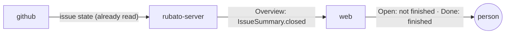

# Open on GitHub by default: done views, a plans board, a wider panel

Issue: #265 · Design: [265-open-only-plans-board/design.md](265-open-only-plans-board/design.md)
· Map: `web-server`.

Track: **full**. `IssueSummary` gains a field, so `schema/protocol/*.json` changes, and `web/`
gets a new dependency (ADR 0079, proposed).

Rubato lists many old issues and plans while GitHub has none open. The server stores whether an
issue is closed (`issue_meta.github_state`) and never uses it, and the lists it builds the
overview from only grow. This change makes GitHub the source: by default Rubato shows what is
open there, and finished issues and plans move to a Done view that is off by default. Nothing is
deleted. The Plans tab becomes a board, the right panel can be widened, and plan text renders as
Markdown.

## What the change does

- **An issue closed on GitHub is finished in Rubato**, whether or not a pull request merged. The
  overview says so per issue (`closed`), and progress stays as it is: Done still means merged
  (design §1).
- **Finished means merged, or closed with no agent at work.** A closed issue whose session is
  working or blocked right now (fresh, by the trust check) stays in the open views, marked
  *closed*. An idle, ended or stale session does not hold it there. A merged issue is finished
  whatever its sessions, as today (design §1).
- **The Issues tab lists open issues only.** An Open / Done switch shows the finished ones, newest
  first, without Start, Pin or Queue. The tab count and the top-bar track count open issues only
  (design §3).
- **The Plans tab is a board**: Proposed and Open columns, side by side when the panel is wide.
  Finished plans are not shown by default; an Open / Done switch lists them. A plan that exists
  only as a draft in Rubato is a row in Proposed (A6, design §5).
- **A plan opens inside the Plans tab**: where it fits, its draft and revisions, with a link to
  the issue. The map still paints it. A finished plan's detail is read-only: no Accept, Import,
  Approve or Resume, here or in the issue detail (design §5).
- **The right panel has three sizes**: normal (400 px), wide (up to 60% of the window, the map
  beside it) and full (the map hidden). One button cycles them, and the browser remembers
  (design §4).
- **Plan text reads as Markdown**: headings, tables, lists and code, with Raw one click away. No
  raw HTML, no images, no diagrams (ADR 0079, design §6).
- **Finished issues stop making noise.** No plan findings, no seam collisions, no room seam
  notices, and no open-plan, not-fitting or per-repo plan counts for them (design §2).
- **Operators see open and finished apart**: `rubato.issues.by_state` gains
  `rubato.issue.finished`, every pair recorded, zeros included, on the panel "Issues by state".

## How we'll know it works

- [ ] **Protocol** (PR 1). Failing first: a `progress::tests` round-trip of an `IssueSummary`
  with `closed: true` (no such field). Then an `IssueSummary` without the field parses as open
  and serialises without it; `UPDATE_SCHEMAS=1 cargo test -p rubato-protocol` shows an additive
  diff; `pnpm -C web gen:types` leaves `protocol.ts` matching.
- [ ] **Closed reaches the overview** (PR 1). Failing first, in `overview/build.rs`
  `closed_mismatch_tests`:
  - meta `closed` → the summary has `closed: true`; meta `open`, or no meta → `false`;
  - a closed issue with an unknown id, a plan that does not parse and a stale approval yields
    none of `UnknownIds`, `FlowOffSeam`, `PlanParseError`, `ApprovalStale`,
    `ApprovedWithoutFit`, `CommentApprovalIgnored`;
  - two plans on one seam, one issue closed → no `SeamCollision`, and `counts()` gives that seam
    one open plan;
  - the same closed issue with a fresh working session → not finished, its findings are back;
  - closed with an idle session, and closed with a working session older than
    `session_stale_secs` → finished;
  - merged with an idle or a working session → finished;
  - a finished issue with a plan is not in `connected_repos().plans`, and not in the
    `plans_not_fitting` and `plans_fit_none` gauges.
- [ ] **Poll** (PR 1). Failing first, `tests/integration.rs`:
  `a_closed_unmerged_issue_is_closed_in_the_overview_until_it_reopens` (closed on FakeGitHub →
  `closed: true`, state unchanged; reopened → `false`).
- [ ] **Room notices** (PR 1). Failing first: a `rooms` test with two plans on one seam, one
  issue closed, posts no notice.
- [ ] **Goldens** (PR 1): `overview_build.json` and `overview.json` re-recorded; the diff is
  `closed: true` on the closed fixtures and their findings gone, nothing else.
- [ ] **Gauge** (PR 1). Failing first: a `build` test of the counts: every (state, finished)
  pair is present, and after an issue moves from open to finished its open pair reads 0, not its
  last value. `observability/check.ts` still passes on the panel.
- [ ] **Issues tab** (PR 2). Failing first, `issue-panel.test.tsx`: with one open, one merged and
  one closed issue the list shows one row; Done shows two, the closed one with a *closed* badge
  and no Start button; a closed issue with a working session is in Open, with an idle one in
  Done; a done issue's detail has no Start, Accept, Import, Approve or Resume. `App.test.tsx`:
  the tab count is 1.
- [ ] **Plans grouping** (PR 2). Failing first, `plans.test.tsx`: `groupPlans` returns `done`
  with the merged and the closed plan, and neither is in `proposed` or `open`; an open issue
  with a draft and no plan on a branch is in `proposed`.
- [ ] **Every reader agrees** (PR 2): `shared/finished.test.ts` covers the rule's cases (the
  same table as the server's), and a source test finds no comparison with `"done"` or
  `merged_at` outside `shared/finished.ts` and an allowlist it prints (the state orderings and
  the rail), and prints how many files it read. Must fail: the same test with a fixture file that
  has one. The readers moved: `plans/group.ts`, `map/graph.ts`, `map/explain.ts`,
  `map/PartCard.tsx`, `repos/RepoWork.tsx`, `companions/Lanes.tsx` (queue rows),
  `issues/IssuePanel.tsx`, `issues/visuals.tsx`, `App.tsx`.
- [ ] **Scenarios** (PR 2): `@issues.open-only`, `@issues.done-view`, `@plans.done-view`, each
  cited by a Playwright test against a seed with one closed and one merged issue.
  `pnpm scenarios check` prints its counts with none uncovered among the new ids.
- [ ] **Panel** (PR 3). Failing first, `App.test.tsx`: the button cycles `data-panel` normal →
  wide → full → normal, its accessible name names the next size, and the size is read back from
  localStorage; with localStorage throwing, the page renders at normal. `look.spec.ts`
  (`@look.panel-expands`) at 1440 px: no horizontal overflow at each size, the panel is wider
  than 400 px in wide and at least 90% of the window in full, and the map is back after full. At
  600 px with "full" already stored: the button is absent, the map is visible, and
  `@look.fits-every-width` still passes.
- [ ] **Board** (PR 4). Failing first, `plans-board.test.tsx`: Proposed and Open columns render
  their rows, a draft-only plan among Proposed; Done is absent until the switch; a done row has
  no *Accept plan*; clicking a row shows the plan detail with *Open issue*, and Back returns; a
  done plan's detail has no Accept, Import, Approve or Resume. `plans.spec.ts` (`@plans.board`)
  does the same in the browser and `@plans.found-by-branch` still passes.
- [ ] **Markdown** (PR 4). Failing first, `markdown.test.tsx`: a plan's table renders as a
  `<table>`; `<script>`, ``, a `javascript:` link and an image produce no such
  element; it prints `checked 4 hostile inputs`. Must fail: the same assertions against a
  renderer with raw HTML on. `@plans.reads-as-markdown` in the browser, Raw toggle included.
- [ ] **Slices** (PR 4): `features/features.test.ts` passes with `plans` importing nothing from
  `issues`, and AGENTS.md's web block matches.
- [ ] **By hand** (recorded in the last PR): against the deployed server with GitHub at no open
  issues, Issues and Plans are empty by default and the old ones are under Done.

## What it must not break

- **Progress derivation.** `derive_progress` is not touched; `@progress.review-and-done` and the
  `progress.rs` tests guard it.
- **The settled lane (ADR 0023).** The poll is not touched; a closed issue is still read once
  and then left. `a_closed_issue_is_settled_until_it_reopens` guards it.
- **The "never silent" list.** Handoff findings (an approval that has not reached its branch, a
  missing link comment, a differing record) stay for finished issues. Unknown nodes and seam
  collisions concern open plans and stop counting finished ones. The alert tests under
  `observability/alerts/tests` guard the rules.
- **Old clients and fixtures.** `closed` is optional and absent when false; `all_fixtures_round_trip`
  and the schema snapshot guard it.
- **Plans of open issues**: fit, approval, *Accept plan*, Import, the room. `plans.spec.ts`,
  `approve` and `room` Playwright projects.
- **The map's lens**: a selected plan still paints the map from the Plans tab (`@plans.paints-the-map`).
- **Narrow layouts**: `@look.fits-every-width` at 900 and 600 px.
- **History**: no row is deleted; a reopened issue returns with its pins, plan and draft.
- **Spend**: a finished issue keeps its spend and history in the Done view.

## How we'll debug it at 3 am

See the O-rows. New: the attribute `rubato.issue.finished` on `rubato.issues.by_state`. If the
web shows nothing, the panel says whether the server counted the issues as finished (a GitHub
state problem, follow "GitHub calls by endpoint") or as open (a web problem). No new finding and
no new alert: nothing here can fail silently that the existing rules do not already cover.

## Affected parts

| Node | Status | What changes | Seams |
| --- | --- | --- | --- |
| rubato-protocol | affected | `IssueSummary.closed`; attribute `rubato.issue.finished` | web-server |
| rubato-server | affected | overview sets `closed`; finished issues leave plan findings, collisions, counts and room notices | web-server |
| web | affected | open-only lists with Done views, plans board with plan detail, panel sizes, Markdown plan text | web-server |

## Data models

| Model | Kind | Part | Change | Crosses | Note |
| --- | --- | --- | --- | --- | --- |
| IssueSummary | type | rubato-protocol | changed | web-server | optional `closed: bool`, absent when false |
| schema/protocol/overview.schema.json | schema | rubato-protocol | changed | web-server | additive |
| rubato.panel | file | web | new | | localStorage key, the panel size per browser |

## Data flow

## Tasks

Stacked branches, one PR each; the next is built while the previous waits.

1. **PR 1, `issue/265-closed-in-overview`** (protocol + server). Failing tests first, in the
   order of "How we'll know": protocol round-trip; `closed_mismatch_tests`; integration; rooms;
   counts. Then the field, `build.rs`, `rooms/notices.rs`, `gauges.rs`, `otel.rs`;
   regenerate schemas and `protocol.ts`; re-record goldens and read the diff.
2. **PR 2, `issue/265-open-only`** (web). `shared/finished.ts` and its test first; then
   `groupPlans`, `IssuePanel` switch, tab count, `TeamTrack`, the map and repo readers, the
   queue rows, `readOnly` on `WhereItFits` and `DraftSection`;
   `features/issues.feature`, `@plans.done-view`; Playwright seed and tests.
3. **PR 3, `issue/265-panel-sizes`** (web shell). `App.test.tsx` first; then the state, the
   button, the CSS; `@look.panel-expands` and `look.spec.ts`.
4. **PR 4, `issue/265-plans-board`** (web). `plans-board.test.tsx` and `markdown.test.tsx`
   first; then `PlansBoard`, the plan detail, `Markdown.tsx` with the ADR 0079 dependencies,
   `DraftSection`; scenarios, `plans.spec.ts`, the `plans-tab` shot; AGENTS.md web block.

## Assumed, not yet approved

| # | Decision | Chosen | Alternatives | Scope |
| --- | --- | --- | --- | --- |
| A1 | A closed issue with a session working or blocked right now | stays in the open views, marked *closed*, and keeps its findings; idle, ended and stale sessions do not hold it | hide it at once; the session then spends unseen | node |
| A2 | Order of the Done lists | newest first by pull request merge or last update, then number | by number | node |
| A3 | A plan with no Rubato draft, in the plan detail | a link to its file on GitHub; its parsed parts as today | fetch the file body through the server (a new route) | node |
| A4 | The Open / Done switch | per tab, not remembered across reloads; always opens on Open | remembered in localStorage | node |
| A5 | Panel size under 900 px | the button is hidden and a stored size is ignored; the stacked layout is unchanged | a full-height sheet | node |
| A6 | A plan that exists only as a draft in Rubato (ADR 0053) | a row in Proposed: key, title, *draft* with its revision and owner, fits or not; no mini map (the overview carries no parsed draft plan) | leave drafts out of the board, as the Plans tab does today | node |
| A7 | Room seam notices | skip closed and merged issues, without A1's exception: a notice is a message posted once, not a view | the same rule as the overview | node |
| A8 | An issue deleted or transferred on GitHub | not handled here: the poll reads "not found" as open (`github_poll/poll.rs:91`), so it stays in the open views until unpinned | record it as gone and treat it as finished (a follow-up issue) | node |

## Decisions

| # | Decision | Chosen | Why | Decided by |
| --- | --- | --- | --- | --- |
| 1 | What happens to old issues and plans | hidden by default, kept, shown in Done views | GitHub is the source; nothing is deleted | Mattias Jonsson, 2026-11-16 |
| 2 | Form of the plans board | the Plans tab becomes the board | a fifth tab crowds the bar | Mattias Jonsson, 2026-11-16 |
| 3 | Where the Done views live | an Open / Done switch inside the Issues tab and the Plans tab; finished plans not shown by default | same | Mattias Jonsson, 2026-11-16 |
| 4 | How the panel expands | one toggle: normal, wide, full; remembered per browser | simple, keyboard reachable | Mattias Jonsson, 2026-11-16 |
| 5 | Plan text | rendered Markdown now (ADR 0079) | tables are unreadable raw | Mattias Jonsson, 2026-11-16 |
| 6 | How "closed" is carried | a field on `IssueSummary`, not a progress state | Done stays "merged"; no ripple into the rail, gauges or `blocked_from` | agent, inside the seam's existing Overview flow |

## O-rows

| Seam | Breaks like | Signal | Panel | Owner |
| --- | --- | --- | --- | --- |
| web-server | open issues missing from the web, or finished ones back in the default lists | `rubato.issues.by_state{rubato.issue.finished, rubato.issue.state, rubato.workspace}` | Issues by state | rubato-server |

## Flows

| From | To | Seam | Kind | Carries |
| --- | --- | --- | --- | --- |
| rubato-server | web | web-server | data | Overview: whether each issue is closed on GitHub |

## ADRs proposed

| ADR | File | Blob |
| --- | --- | --- |
| 0079 | docs/decisions/0079-plan-text-renders-as-markdown-in-the-web.md | 78db7908471f9cf80936a0d3ce8113fb686d58b6 |

## Review map

1. `crates/rubato-server/src/overview/build.rs`: the one `finished` rule and every place gated on it.
2. `web/src/shared/finished.ts` and its callers: the web's same rule, used by every list.
3. `web/src/features/plans/Markdown.tsx`: what a hostile plan can and cannot put on the page.
